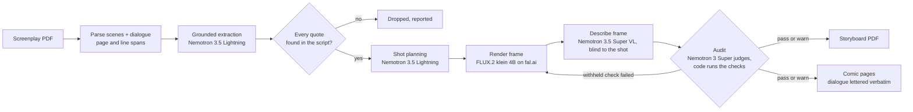
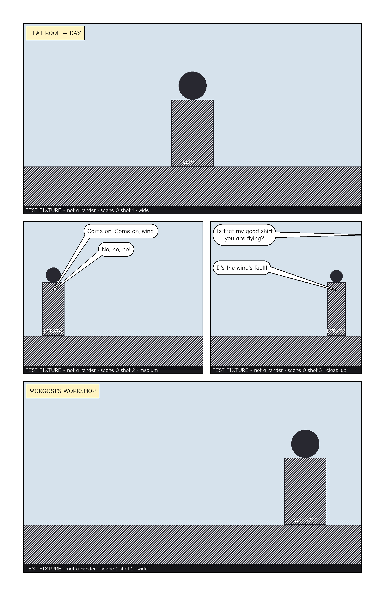

# Panelwise

**Script → storyboard → comic, grounded in the screenplay at every step.**

## Problem

A storyboard is how a director shows everyone what the film will look like before a single day
is shot, and on a small production it is often the first thing cut, because it takes an artist,
time and money. Image models could draw it, but they invent: ask for "a kitchen at night" and you
get a third person or a window that isn't in the scene, and a storyboard that shows the crew
something the writer never wrote is worse than none. So the cost Panelwise measures is that
invention: every panel must trace to a verbatim span of the script
([PLAN.md](PLAN.md) Non-negotiable I), and faithfulness, recall and the audit's results are
reported as numbers ([§ Measured results](#measured-results)). The persona and scope:
[SCOPE.md](SCOPE.md).

## Solution

Panelwise turns a screenplay into a shot-by-shot storyboard and then into a comic book. Every panel
traces back to a verbatim span of the script. NVIDIA Nemotron on Nebius Token Factory extracts the
characters, props and locations and plans the shots. Code then checks every quote the model gives
against the script, and anything it can't find is dropped. Each frame is drawn by FLUX.2 [klein] 4B
on fal.ai, a vision model describes it, and Nemotron audits that description against the shot. A
frame that fails a check that withholds is re-rendered, and after the last try it is withheld,
never shown. Which checks withhold is a setting; on the hosted demo it is three of the seven hard
checks, and a frame that fails one of the other four is shown with a warning naming it
([§ How it works](#architecture)).

Built for the [Nebius x NVIDIA Global AI Hackathon](https://nebiusglobalaihackathon.devpost.com/)
(Best Apps and Agents track). Panelwise builds on FrameFlow, an earlier private project by the same
team: [CHANGES-FROM-FRAMEFLOW.md](CHANGES-FROM-FRAMEFLOW.md) says what was ported and what is new.

## Demo

The 3-minute video is linked here once it is recorded (T034). The live demo:

| Piece | Where |
| --- | --- |
| Web app | https://panelwise.vercel.app (Vercel, functions in `fra1`) |
| API | https://panelwise-api.onrender.com (Render, plan `1c-2g`, Frankfurt, from the [`render.yaml`](render.yaml) Blueprint) |
| Data | Supabase: Postgres via the session pooler, a private Storage bucket, Auth |

- **Sign-up is off.** Judges get a shared login in Devpost's testing instructions, never in the
  repo. The account and a ready-made copy of the sample project are made by
  `python -m app.demo.seed` (T069). On the hosted stack (T030, 2026-10-20) the-red-kite was drawn
  end to end, storyboard and a 6-page comic, and copied to the judge account with `seed --from`.
- **Limits** ([docs/design/limits.md](docs/design/limits.md), deploy.md §6): 3 uploads a day per
  account, 15 pages a script, 2,800,000 Token Factory tokens a month (`LLM_MONTHLY_TOKEN_CAP`) and
  800 drawings a month (`IMAGE_MONTHLY_GENERATION_CAP`). At a cap, new work is refused with a
  message; a job already running finishes.
- **Migrations** run in the API image's start command before uvicorn, on Render and in compose
  alike; an API that can't reach its database exits instead of serving.
- **Keep-alive:** [`.github/workflows/keepalive.yml`](.github/workflows/keepalive.yml) pings the
  API's health check every 10 minutes; a failed run is our uptime alert.

Setup, step by step: [docs/deploy.md](docs/deploy.md); the design:
[docs/design/deploy.md](docs/design/deploy.md).

## What's real and what's mocked


As of 2026-10-27, on `main`:

| Stage | State | Try it |
| --- | --- | --- |
| Parse a screenplay PDF into scenes, action and dialogue, each with its page and line span | built | [§ Run it](#how-to-run-it) |
| Grounded extraction on Nemotron: characters, props, locations, every quote located in the script | built, measured | `app.grounding.run` |
| Shot planning on Nemotron: every action paragraph and speech in exactly one shot | built, measured | `app.shots.run` |
| Frame prompts from the shot's own script words, names redacted | built | `app.storyboard.prompts` |
| Rendering: FLUX.2 [klein] 4B on fal.ai, at most one megapixel a drawing (T026) | built, run live on the samples | upload a script with `FAL_KEY` set |
| Frame audit: Nemotron 3.5 Super VL describes, Nemotron Super judges, one-question vision agents check a character's sex and presence, a frame drawn in panels or one person drawn twice, and each head's place for the bubbles; code runs the checks (T020, T094, T095, T099, T102, T104, T097, T105–T107, T109, T124) | built, run live on every run in [eval/runs/](eval/runs/README.md), scored on 109 hand-labelled frames | `app.verify.run`, `app.verify.report` |
| The re-render loop: up to 3 drawings a frame, withheld after the last; every attempt and its audit kept (T021) | built, run live | the storyboard's frame sheet |
| The storyboard PDF, each line of dialogue under its speaker's name, the file named after the screenplay (T027, T103, T126) | built | *Export PDF* on the storyboard |
| The comic: panels drawn and audited at their own size, laid out by shot, dialogue lettered verbatim, a reader and a PDF (T022, T023, T064, T024); a speech tail aims at the speaker's mouth and never crosses another tail, a bubble or a face; balloons take the script's voice (thought, whisper, shout, distress, radio) and one speaker's lines link (T098, T112, T114–T121) | built, run live on real renders | *Make the comic* on a project's comic tab |
| Web app: sign-in, the projects list with upload and each job's live state, the script page (every entity with its quotes and spans, faithfulness and recall), the storyboard (the script with a line over each shot's span beside a board of frame cards), the frame sheet with the audit log of every attempt and "Try another render", the comic reader; a page's image links signed in one request, and a slow session refresh doesn't sign the reader out | built, run live on Supabase (T040–T042, T045, T061, T024, T122, T123, T125) | `docker compose up --build --wait`, then `localhost:3000` ([§ Run it](#how-to-run-it)) |
| The hosted demo: web on Vercel, API on Render, Supabase for Postgres, Storage and Auth | up since 2026-10-16, health checks green; the-red-kite drawn on it end to end and seeded to the judge account on 2026-10-20 (T030, T037) | [§ The hosted demo](#demo) |
| Not built: reference portraits for consistent characters (T025, cut; a character's look comes from the script's words, T079); ComfyUI on a Nebius GPU (T003, cut: fal.ai draws every frame); a check for bodies drawn wrong (T111: measured on Super VL, not adopted, findings § U9); the comic read aloud by ElevenLabs (T113, designed in [docs/design/narration.md](docs/design/narration.md), a stretch not started) | — | — |

[STATUS.md](STATUS.md) is the live board. The order of what's left is in its *Next action* section.

**Mocked:** nothing on the demo's path. Every stage above calls the real service: Token Factory,
fal.ai, Supabase. Stand-ins exist only in tests (a fake renderer, an in-memory store, scripted model
answers, so the gate needs no network) and in one developer check, `python -m app.comic.check`,
which lays out a comic with a sketch renderer instead of fal.ai.

## Architecture




The rule behind every box, Non-negotiable I in [PLAN.md](PLAN.md): **a panel may never show a
character, prop, line of dialogue or event that isn't in the screenplay, and every panel traces to
a verbatim source span.** It is enforced in code after each model call, not asked for in a prompt:

- **Extraction.** Every entity the model proposes comes with quotes. Each quote must be found,
  word for word, inside one scene heading or element, and it keeps that page and line span. A quote
  that can't be found is dropped. An entity left with no found quote, or whose name the script never
  writes, is dropped too. Speaking characters the model misses are added from the script's own
  dialogue cues ([docs/design/grounding.md](docs/design/grounding.md)).
- **Shots.** Each shot covers a run of the scene's elements and cites their exact text and span.
  Character and prop names that weren't extracted for that scene are removed
  ([docs/design/shots.md](docs/design/shots.md)).
- **Frame prompts.** A prompt carries only the shot's own action lines, setting and time. Dialogue
  is left out, and character names are redacted. A character's sex reaches the prompt only when the
  script's own words give it (a pronoun, a title such as MR or MAMA, a noun such as "a boy")
  ([docs/design/storyboard.md](docs/design/storyboard.md) §3.1).
- **Frame audit.** The vision model describes the frame without seeing the shot. Nemotron matches
  that description to the shot, and code runs thirteen checks
  ([docs/design/verify.md](docs/design/verify.md) §3). Seven are hard: a person the script doesn't
  have, an animal or weapon it doesn't have, the wrong interior or exterior, none of the shot's
  characters drawn, a character drawn as the other sex, a frame drawn as several panels, and one
  person drawn twice. Several use the same vision model for one narrow question each: the sex
  agent asks about one matched person, the presence agent asks which drawn person, if any, is a
  character the judge left unmatched, and the layout agent asks whether the frame is split or
  repeats a person. Six are soft and only
  warn: a missing character, the wrong light or framing, lettering or a signature in the frame, an
  everyday object the script didn't mention. An audit that errors never passes.
- **Which checks withhold.** A failed hard check withholds the frame only when it is on the rule
  ladder, `AUDIT_WITHHOLD_CHECKS` (T094). The code default is every hard check; the hosted demo
  withholds on `drawn_sex,no_character,split_panels`. A frame that fails another hard check is shown, marked as
  warned, with the failed check named on its card and in its audit log, never presented as passing.
  So today Non-negotiable I's "never shown" holds for the checks on the ladder, and the rest are
  shown and named. Why: with every hard check withholding, the held-out script market-day showed 0
  of 15 shots though about 12 of the 15 final drawings were right (klein fills a market with
  shoppers, and each one failed as an unscripted person); with none withholding it showed 16 of 17
  ([eval/runs/](eval/runs/README.md), [docs/learning-log.md](docs/learning-log.md) L020). Each rule
  comes back on the ladder after it is measured: `split_panels` did (on the labelled set, all 22 of its flags are wrong frames), and
  `drawn_twice` was tried and taken off again, because 6 of the 7 right frames it withheld were the
  judge failing to recognise a drawn character ([§ Measured results](#measured-results)).
- **Comic.** Every bubble is a line of dialogue from the shot, verbatim, carrying its span. Each
  panel is drawn and audited at its own size. A withheld frame is drawn as a card naming the failed
  checks, never as its pixels ([docs/design/comic.md](docs/design/comic.md)).

<p align="center">
  
  <br><sub>A comic reference page from the sample <code>the-red-kite</code>. The layout, captions and bubbles are produced by the real code; the
  frames are test fixtures, labelled as such, so the gate can compare the page pixel for pixel. In the app the frames are klein's drawings.</sub>
</p>

## Sponsor Technologies Deployed


Every model call goes to **Nebius Token Factory**'s OpenAI-compatible API, through one client
(`services/api/app/llm`). Before writing any code we measured what the service actually does, with
real calls, in [docs/nebius-findings.md](docs/nebius-findings.md). Several answers differed from
the catalog, and the design follows the answers.

| Tier | Model | Used for | Why this model |
| --- | --- | --- | --- |
| fast | `nvidia/Nemotron-3_5-Lightning` | extraction, shot planning | Token Factory **enforces** a strict `json_schema` on it (U1), which schema-bound extraction needs. It allows 600 requests and 400K tokens a minute (U4) at $0.06 / $0.24 per million tokens. Thinking is switched off: that took a one-number answer from 271 output tokens to 4 (U2) |
| reasoning | `nvidia/nemotron-3-super-120b-a12b` | the frame-audit verdict | A judgement call over the shot's grounded spec and the frame's description, with thinking on |
| vision | `nvidia/Nemotron-3.5-Super-VL`, thinking off | describing a rendered frame, blind to the shot; the agents' one-question checks (sex, presence, layout, heads) | NVIDIA's vision model, on Token Factory since 12 Oct (U8). Measured on the same stored drawings before the switch on 17 Oct: it tied the previous describer (`deepseek-ai/DeepSeek-V4.1-Flash`) on the disputed checks, with no errors and 0.95× the tokens (T105). It only describes and answers narrow questions; Nemotron Super judges, and code decides |

Images are drawn by FLUX.2 [klein] 4B on **fal.ai**, because Token Factory serves no
image-generation model (U5, re-checked 2026-10-08). ComfyUI on a Nebius AI Cloud GPU was the first
plan; a GPU kept up until judging ends would cost about $2,500, so it stays an optional backend we
don't use (T003, [docs/design/storyboard.md](docs/design/storyboard.md) §3.5). Every drawing is at
most one megapixel, $0.003 each.

Details that came out of measuring rather than reading the docs:

- Strict `json_schema` is enforced. `json_object` returns valid JSON in the wrong shape, and
  `guided_json` is ignored (U1). The client sends `json_schema` and keeps one repair retry as a
  backstop (`structured_chat`, [docs/design/llm.md](docs/design/llm.md)).
- Only two of the four switches we tried actually turn thinking off (U2).
- Rate limits are per model and come back on every response. The client honours `Retry-After`
  on 429 instead of backing off blindly (U4).
- The first vision model we chose silently stopped receiving images between two dates and began
  answering from text alone. A re-check caught it, and the describer moved to DeepSeek
  (findings § U7 re-check), then on 17 Oct to Nemotron 3.5 Super VL (U8).
- The audit, not the extraction, is where the tokens go: two calls a drawing (the describer, then
  the judge), plus the agents' questions when they run, and up to 3 drawings a shot; a 30-shot
  script at 3 attempts can use about 500,000 tokens (docs/learning-log.md L007). One storyboard and
  comic of the-red-kite took 339,000 tokens and 44 drawings (2026-10-16, [STATUS.md](STATUS.md)).

## Measured results


### Extraction and shot planning

On the three self-written sample screenplays of [T031](samples/README.md), 5 live runs each on
Nemotron 3.5 Lightning (2026-10-01):

| | Result |
| --- | --- |
| Ungrounded quotes or shot citations kept, re-checked in code | **0** in all 15 runs |
| Every action paragraph and speech in exactly one shot | all 15 runs |
| Faithfulness: the model's proposals fully found in the script (the rest loses its unfound quotes, or is dropped whole if its name or every quote is missing) | 0.898 (246 of 274 entities) |
| Recall: speaking characters the model found itself (cues supply the rest) | 0.944 (85 of 90) |
| Tokens per run | about 9,700 in and 3,800 out (≈ $0.0015 at catalog prices) |

Per-sample numbers, the method and the raw results are in [eval/README.md](eval/README.md). Rerun
them with `uv run python -m tools.evaluate --runs 5` from `services/api`.

### The frame audit on real renders

Every live run is a report written by code from what the run stored
([eval/runs/](eval/runs/README.md)), and every shown frame was then looked at by hand; what each run
taught us is in [docs/learning-log.md](docs/learning-log.md). All on klein, 3 drawings a frame at
most:

| Date | Script | What withheld | Result |
| --- | --- | --- | --- |
| 2026-10-11 | the-red-kite | every hard check | 16 of 21 shots shown, 38 drawings |
| 2026-10-13 | market-day (held out) | every hard check | 0 of 15 shown, 44 drawings; about 12 of the 15 final drawings were right (L020) |
| 2026-10-13 | market-day, second run | none | 16 of 17 shown, 17 drawings: 9 right, 5 weak, 2 split panels, none of the wrong sex or age |
| 2026-10-14 | the-lighthouse-inspector (held out) | `drawn_sex,no_character` | 26 of 26 shown, 26 drawings: 14 right, 11 weak, 1 wrong (a man drawn as a woman: L022) |
| 2026-10-14 | the-borrowed-bicycle (held out) | `drawn_sex,no_character` | 18 of 18 shown, 19 drawings; the girl NALEDI drawn as a boy in about 11 frames, because her sex is only in a "Her" the code didn't read then (L023; T100 reads it now); one frame shows an unscripted adult, warned |
| 2026-10-17 | rooftop-tomatoes (held out), Super VL describing | `drawn_sex,no_character` | 21 of 21 shown, 21 drawings: 11 right, 6 weak, 4 wrong (a character drawn twice, or an unscripted old man) |
| 2026-10-17 | gogos-recipe (held out), with the layout agent | `drawn_sex,no_character,split_panels` | 17 of 17 shown, 18 drawings: 8 right, 4 weak, 5 wrong (each one person drawn twice or an extra child); none of the wrong sex |

The two agents, measured on stored drawings with Token Factory before they were switched on
([docs/design/verify.md](docs/design/verify.md) §3):

- **Sex agent** (2026-10-13): 175 matched people asked, 12 flagged, every one a real error, 0
  false alarms.
- **Presence agent** (2026-10-14): of 30 stored frames `no_character` would have withheld, 23 had
  the character plainly drawn. The agent found the character in 17 of those 23, and wrongly found
  one in 3 of the other 7.

**The audit against our own eyes.** 109 drawn frames from the runs above, labelled by hand as right,
weak or wrong and picked for their faults, were re-audited on 2026-10-20 with Super VL and the
hosted ladder ([eval/measurements/t124/](eval/measurements/t124/README.md)):

| Label | Frames | Withheld | Shown |
| --- | --- | --- | --- |
| wrong | 57 | **38 (67%)** | 19, each with its failed checks named |
| right | 40 | **1** | 39 |
| weak | 12 | 0 | 12 |

Its biggest gap is the judge not recognising a drawn character, which is also why `drawn_twice`
only warns. `python -m app.verify.recheck` re-runs today's checks on stored audits, free.

## How to run it


You need Python 3.14 with [uv](https://docs.astral.sh/uv/), and a Nebius Token Factory API key.
Docker is needed for the local stack and the full gate (its database tests start their own
Postgres and it builds the API image), Node 24 with pnpm only for the web app, a fal.ai key
(`FAL_KEY`) only for drawing frames, and a Supabase project only for the web app.

```bash
git clone https://github.com/Katlego-tech/Panelwise.git && cd Panelwise
bash install-hooks.sh            # contributors: the pre-push gate
cp .env.example .env             # set NEBIUS_API_KEY
cd services/api && uv sync
```

Every command below runs from `services/api` on a self-written sample. Only use public-domain or
self-written scripts.

```bash
uv run python -m app.llm.smoke                                      # the key works; fast tier answers with 0 reasoning tokens
uv run python -m app.grounding.run ../../samples/the-red-kite.pdf   # entities with page/line spans, faithfulness, recall
uv run python -m app.shots.run ../../samples/the-red-kite.pdf       # shots with the verbatim text each one cites
uv run python -m app.projects.run ../../samples/the-red-kite.pdf    # the pipeline core, stage by stage
uv run python -m app.storyboard.prompts ../../samples/the-red-kite.pdf --style ink   # frame prompts, each part citing its line
uv run python -m app.verify.run ../../samples/the-red-kite.pdf 1.2 frame.png  # audit a PNG against shot 2 of scene 1
uv run python -m tools.evaluate --runs 5                            # the extraction results above
```

Offline, no key needed:

```bash
uv run python -m tools.build_samples           # rebuild the sample PDFs and print what the parser reads
uv run python -m tools.build_comic_reference   # re-render the comic reference pages in docs/design/comic/
bash ../../scripts/gate.sh                     # every check the pre-push hook runs
```

The local stack (Postgres, the API and the web app on pinned versions) runs with
`docker compose up --build --wait` from the repo root. Without a Supabase project in `.env` it
serves the health checks, `GET :8000/api/v1/health` and `GET :3000/api/health`. With one
(`SUPABASE_URL`, `SUPABASE_SECRET_KEY`, a private Storage bucket named in `SUPABASE_STORAGE_BUCKET`,
and the `NEXT_PUBLIC_SUPABASE_*` pair), open `localhost:3000`, sign in and upload a sample PDF. The
job reads, extracts and plans; with `FAL_KEY` set it then draws and audits every frame
(`RENDER_MAX_ATTEMPTS`, 3 by default, drawings a frame at most). Open the script page, the
storyboard (click a card for its frame sheet and audit log, *Export PDF* once every frame is
settled) and the comic tab (*Make the comic*). Without `FAL_KEY` the job ends at planning, and
"Try another render" and "Make the comic" answer 503: no renderer. The app has a sign-in
page only: sign-up is off, so users are created in the Supabase dashboard (Authentication > Users).

A run's report, free (no model call), in the API container:

```bash
docker compose exec api .venv/bin/python -m app.verify.report <project-id>
```

The samples: thirteen self-written screenplays in [`samples/`](samples/README.md), Fountain source
and PDF. `the-red-kite` is the demo script; the ten of the second set (T090) are ordinary spec
scripts, used as held-out scripts for the audit.

## Baseline and dependencies

**Baseline:** the repository was created inside the event from the Cultivation-kit scaffold,
template only: commit `7d5277d` (2026-09-27), recorded in [event.toml](event.toml) `[provenance]`.
Everything after it was built during the event. Code ported from FrameFlow, the team's earlier
private project, is disclosed file by file in [CHANGES-FROM-FRAMEFLOW.md](CHANGES-FROM-FRAMEFLOW.md).

**Dependencies** (pinned; the full list in [PLAN.md](PLAN.md) § Technical Context):

| Piece | Version / service |
| --- | --- |
| API | Python 3.14 (`python:3.14.7-slim-trixie`), FastAPI, SQLAlchemy 2 async, Alembic, Pillow; uv 0.11.32 |
| Web | Node 24.21.0 LTS, Next.js 16.4.1, shadcn/ui; pnpm 11.10.0 |
| Database | Postgres 17.11 (Supabase in production, `postgres:17.11-trixie` locally and in the gate) |
| Models | NVIDIA Nemotron 3.5 Lightning, Nemotron 3 Super and Nemotron 3.5 Super VL on Nebius Token Factory ([§ Sponsor Technologies Deployed](#sponsor-technologies-deployed)) |
| Images | FLUX.2 [klein] 4B on fal.ai |
| Hosting | Vercel (web), Render (API), Supabase (Postgres, Storage, Auth) |

## Feedback on Nebius Token Factory and NVIDIA Nemotron


### 1. What worked exceptionally well

- **Undocumented structured decoding saved our pipeline (U1):** The Token Factory catalog listed no
  `json_mode` or `structured_outputs` for Nemotron, but strict `json_schema` decoding worked cleanly
  out of the box. Even with a bare user prompt containing no mention of schemas or evidence fields,
  Nemotron steered generation into the exact JSON schema requested. For a system whose core premise
  is deterministic grounding back to screenplay lines, schema-level enforcement was far more
  reliable than prompt-based formatting or `json_object` (which produced malformed shapes or
  invented narrative details).
- **Transparent rate limits and clean backoff headers (U4):** Getting per-model rate limits
  (`x-ratelimit-limit-*`, `x-ratelimit-remaining-*`, `x-ratelimit-reset-*`) echoed directly on every
  HTTP response, combined with an API that honours `Retry-After`, made implementing resilient client
  retries straightforward. Bursting 20 concurrent extraction calls on Lightning returned 20 × 200
  without a hitch.
- **Radical cost-efficiency for multi-stage pipelines:** Running a complete script end-to-end
  (parsing, grounded extraction, shot planning, 44 rendered frames, and multi-agent audit loops)
  consumed ~340k tokens and cost roughly $0.20 total (with ~$0.05 on Token Factory and ~$0.15 for
  image generation). Token Factory solved the infrastructure wall where free-tier or local small
  models timed out or hit arbitrary daily request caps.
- **Nemotron 3.5 Super VL landing mid-hackathon (U8):** When we started, Token Factory served no
  NVIDIA vision model, forcing us into a split architecture (DeepSeek describing, Nemotron judging).
  The arrival of `nvidia/Nemotron-3.5-Super-VL` on 12–15 October allowed us to migrate every vision
  call to an NVIDIA model without running a separate self-hosted GPU VM. With thinking disabled, it
  matched the previous describer's accuracy, dropped total token usage by 5%, and processed 44
  verification runs with zero schema errors.

### 2. What surprised us & friction points (constructive feedback)

- **Catalog metadata does not reflect model reality:**
  - Strict `json_schema` works, but the catalog didn't advertise it. Builders relying solely on
    `supported_features` would assume Nemotron cannot do structured outputs and look elsewhere.
  - Conversely, `json_object` silently degraded into invalid structures or echoed JSON schema
    definitions as data wrappers.
- **Reasoning token overhead and confusing toggle switches (U2):**
  - On fast-tier Nemotron Lightning, thinking is enabled by default. For a single-number arithmetic
    probe, reasoning expanded token usage from 4 tokens to 271 (a ~68× cost multiplier). Left
    unmanaged on bulk extraction tasks, this would chew through budgets rapidly.
  - Standard ways of turning off reasoning (`reasoning_effort: "low"` or system directives like
    `/no_think`) were ignored and still emitted reasoning tokens. Only explicit
    `chat_template_kwargs: {"enable_thinking": false}` or `reasoning_effort: "none"` reliably
    silenced it. Clearer documentation on how to control thinking behavior would save teams
    significant trial-and-error.
- **Silent degradation on multimodal endpoints (U7):**
  - When `zai-org/GLM-5.3-Flash` stopped receiving images between 28 and 30 September, it returned
    HTTP 200 with text-only token counts (~31 prompt tokens) and fabricated plausible descriptions
    of nonexistent scenes rather than throwing a 400 or 500 error. For an automated critic
    pipeline, a model failing silently and hallucinating audit descriptions is much more dangerous
    than a hard error.
- **Lack of image generation on Token Factory (U5):**
  - Token Factory is strictly text->text and text+image->text. Because there is no image
    generation model (e.g. FLUX or SDXL) available on the serverless API, we had to route frame
    generation to fal.ai. Having serverless image generation on Token Factory would have allowed
    the entire pipeline to run within a single provider boundary.

## Team

| Member | Role |
| --- | --- |
| Katlego Thapelo Tlhapiso ([@Katlego-tech](https://github.com/Katlego-tech)) | project leader |
| Tumo Olorato Mogame ([@TUMO-MOGAME](https://github.com/TUMO-MOGAME)) | co-builder |

Both work with AI coding assistants (Claude; Gemini too for Katlego), coordinated through
[STATUS.md](STATUS.md) and [AGENTS.md](AGENTS.md) ([§ How we work](#how-we-work)).

## Repository layout


| Path | What |
| --- | --- |
| `services/api/app/` | the FastAPI service: `llm`, `script`, `grounding`, `shots`, `storyboard`, `verify`, `comic`, `characters`, `projects`, `jobs`, `frames`, `storage`, `limits`, `demo`, `core`, `api` (with Alembic migrations) |
| `services/api/tools/` | `build_samples`, `build_comic_reference`, `evaluate` |
| `services/api/styles/` | public storyboard styles (`clean`, `ink`, `pencil`); `styles/` at the root links to it |
| `apps/web/` | the Next.js app: sign-in, the projects page with upload, the script page, the storyboard and its frame sheet, the comic reader |
| `samples/` | thirteen self-written screenplays (Fountain source and PDF) |
| `eval/` | measured results, the live run reports and how they were produced |
| `docs/design/` | a design doc per module: diagrams, contracts, decisions |
| `render.yaml`, `apps/web/vercel.json` | the hosted demo's API and web config |

Full tree: [docs/project-structure.md](docs/project-structure.md).

## How we work


This repo uses the Cultivation kit. [AGENTS.md](AGENTS.md) holds the rules,
[STATUS.md](STATUS.md) the live board and [TASKS.md](TASKS.md) the backlog. Every push runs
`scripts/gate.sh`: ruff, pyright, pytest (database tests on a throwaway Postgres 17.11), eslint and
tsc, vitest, next build, the API image build, and placeholder, secret, vulnerability and duplication
scans.

## License


[Apache 2.0](LICENSE). The sample screenplays are original and under the same licence.
