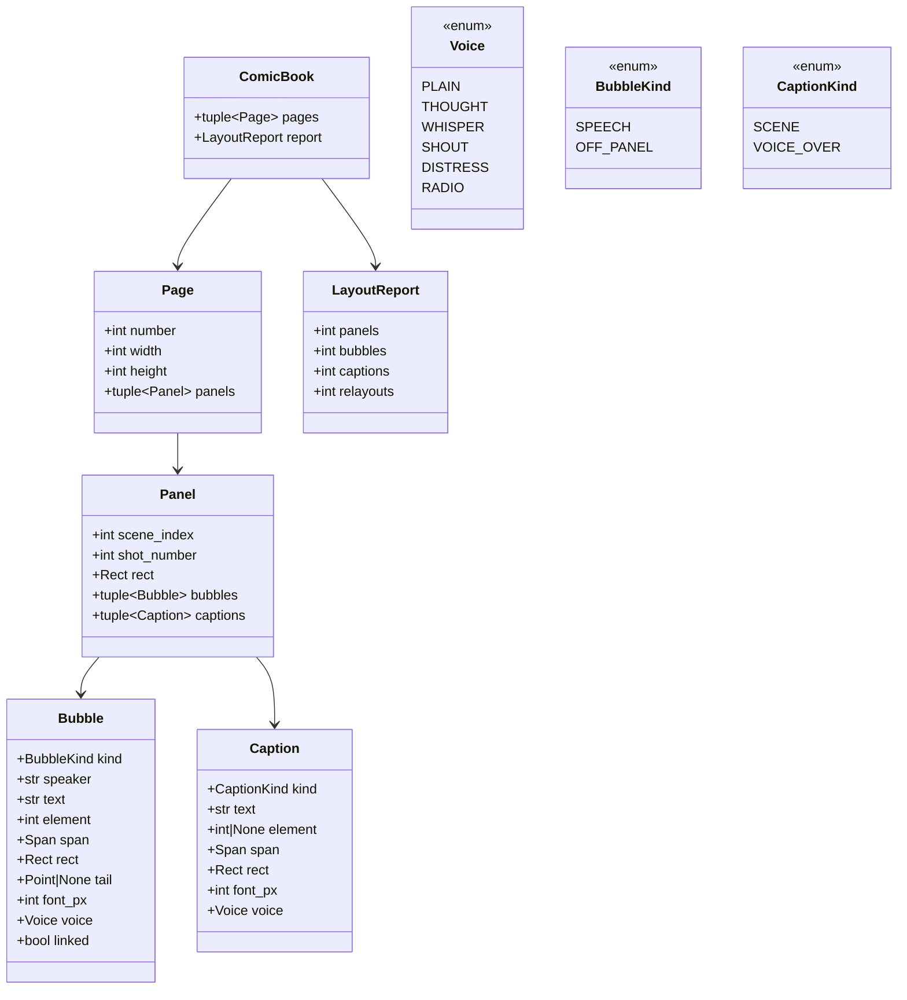

# Design — `comic` (page layout, panels, speech bubbles, export)

**Status:** agreed; §4a, the comic job, proposed (T064) · **Owner:** Katlego (Claude); §4a Tumo (Claude) · **Tasks:** T022 (layout), T023 (bubbles, lettering,
export), T064 (the comic job, storage, the API), T098 (bubbles placed by the speaker's head; Katlego), T112 (tails never cross; Katlego), T114 (the tail aims at the mouth; Katlego), T115 (a lone unnamed head is the speaker's; Katlego), T116 (tails clear of bubbles and faces; Katlego), T117 (balloon voices: thought, whisper, shout, distress, radio; Katlego), T118 (one speaker's lines linked; Katlego), T119–T121 (the linked tail nearest the head, merged balloons, pauses unlinked; Katlego), T024 consumes it (reader) · **Spec:** [SPEC.md](../../SPEC.md) US3 (script →
comic)

---

## 1. What this covers

Turning a `ShotPlan` (docs/design/shots.md) into comic pages: which shots share a page and a row, how
big each panel is, the frame rendered for each panel, where each speech bubble sits, how it's
lettered, and the exported pages (PNG and PDF, plus a layout JSON for the web reader).

**Non-negotiable I applies to every letter on the page.** Bubbles and captions carry **verbatim
script text only**, each with its source `Span`; nothing is paraphrased, summarised, truncated,
dropped or invented. The single exception is typographic: the ` — ` that joins a scene caption's
location and time (§3). Action lines are never lettered (the art shows them), and there are no
invented sound effects.

**Not covered:** the renderer (T026, storyboard.md) and the audit (verify.md), which this calls; the web reader's UI
(T024, web.md §4.5).

## 2. Reference material

| Kind | Where |
| --- | --- |
| Visual reference | [`docs/design/comic/the-red-kite-page-*.png`](comic/): the self-written sample `samples/the-red-kite.pdf` rendered by T023's `render_pages`, built by `services/api/tools/build_comic_reference.py` from the real parser, a hand-planned shot list (every element in one shot) and **fixture frames** drawn with Pillow, each marked `TEST FIXTURE - not a render` (the real frames wait on T026). Six pages, 20 panels; one panel (scene 3, shot 3) is withheld, to show the card. The gate re-renders it and compares pixels (`tests/comic/test_reference.py`). T022's geometry test pins the rects |
| Inputs | `ShotPlan`, `Shot` (shots.md §6); `Screenplay`, `Scene`, `Dialogue`, `Span` (script.md §6); the frame renderer and audit (verify.md §6: `Renderer`, `render_until_accepted`, `Audit.positions`, and from T097 `Audit.heads`: each described person's head box on a comic panel's accepted frame). **Depends on verify.md's `Renderer.render` and `render_until_accepted` taking `width`/`height`** (added in PR #17, T010), so this doc lands after it |
| Prior art in FrameFlow | none: FrameFlow made storyboard PDFs, never comics (its `storyboard_document.py` hand-wrote a PDF with base-14 fonts, two 16:9 panels per A4 page) |
| Font | **Comic Neue Regular** (`ComicNeue-Regular.ttf`, SIL Open Font License 1.1), committed with its licence under `services/api/assets/fonts/` by T022, because step 5's budget measures text with the same file the renderer letters with |
| Lettering practice | [docs/research/speech-bubble-placement.pdf](../research/speech-bubble-placement.pdf), its findings against this doc in [docs/research/README.md](../research/README.md) § Speech bubble placement: the tail aims at the mouth (T114), tails never cross (T112), faces stay clear (T098); the rest is §10 |
| Page size | US comic trim, 6.625 × 10.25 in, rendered at 300 dpi = **1988 × 3075 px**; margins **120 px** (0.4 in); gutters **36 px** |

## 3. Domain model



- `Rect` is `(x, y, w, h)` and `Point` is `(x, y)`, both in page pixels.
- **One panel per shot**, in plan order. `(scene_index, shot_number)` names the shot. **The panel's
  frame is rendered at exactly `rect`'s width × height** (§4), so nothing is ever cropped.
- **One bubble or caption per `Dialogue` element** the shot covers, in element order. `text` is
  `Dialogue.text` byte for byte; `element` is its index in `scene.elements`; `span` is its span;
  `speaker` is `Dialogue.cue` verbatim. Parentheticals are direction for the art and are not
  lettered.
- **Extension → kind**, exhaustive over any `Dialogue.extension` (free text in script.md): take
  `extension.upper()` (or `""`); if it contains `V.O.` → a `VOICE_OVER` caption (a box, no tail),
  so `V.O./CONT'D` is a voice-over too; else if it contains `O.S.`, `O.C.` or `OFF` → an
  `OFF_PANEL` bubble (tail to the panel edge nearest the speaker's side, or the right edge if
  unknown); else → a `SPEECH` bubble. `CONT'D`, `FILTERED`, `PRE-LAP`, `ON P.A.` and anything else
  are speech. **Two exceptions (T117):** a cue that is exactly `NARRATOR` is a `VOICE_OVER` caption
  whatever its extension (a narration box: no one in the panel says it); and a `V.O.` line whose
  voice is `THOUGHT` (below) is a `SPEECH` bubble, since a thought belongs to someone in the panel and
  its trail points at them.
- **Voice (T117): the balloon's shape, from the script's own words, never from the drawing or the
  line's punctuation.** `voice_of(dialogue)` reads the element's parenthetical, extension and cue as
  whole words, case-insensitive, and takes the first that applies:
  1. `RADIO`, a voice through a device: the extension names one (`FILTERED`, `ON PHONE`, `ON THE
     PHONE`, `ON RADIO`, `ON TV`, `ON P.A.`, `ON SPEAKER`); or the line is `V.O.` or off-panel and
     its cue or parenthetical names one (`radio`, `phone`, `telephone`, `cellphone`, `intercom`,
     `speakerphone`, `tv`, `television`, `loudspeaker`, `announcer`, `presenter`, `newsreader`,
     `voicemail`, `walkie-talkie`, `broadcast`). A speaker in the panel talking *into* a phone is
     plain: their own voice is in the room.
  2. `THOUGHT`: `think`, `thinks`, `thinking`, `thought`, `thoughts`, `in his/her/their/my head`.
  3. `SHOUT`: `shout(s/ing/ed)`, `yell(s/ing/ed)`, `scream(s/ing/ed)`, `bellow(s/ing/ed)`,
     `roar(s/ing/ed)`, `at the top of his/her/their lungs`.
  4. `WHISPER`: `whisper(s/ing/ed)`, `quietly`, `softly`, `murmur(s/ing/ed)`, `mutter(s/ing/ed)`,
     `under his/her/their breath`, `barely audible`, `hushed`, `sotto voce`.
  5. `DISTRESS`: `crying`, `sobbing`, `sobs`, `weakly`, `trembling`, `shaking`, `shivering`,
     `gasping`, `wheezing`, `slurring`, `slurred`, `drunk`, `drunkenly`, `through tears`, `hoarse`,
     `hoarsely`, `choking`.
  6. else `PLAIN`.

  The words are the script's: a shout is drawn only where the script says someone shouts, so the
  shape traces to the same element as the words (Non-negotiable I). A `SCENE` caption is `PLAIN`; a
  `VOICE_OVER` caption is `PLAIN` (the pale yellow narration box) or `RADIO` (a broadcast box);
  any other voice on a `VOICE_OVER` caption is lettered `PLAIN`, as captions carry no delivery.
  Known gap: a device named only in the action ("The radio bursts into life. COASTGUARD (V.O.)")
  stays a narration box; the voice reads the line's own element.
- **Linked lines (T118):** a bubble is `linked` to the bubble before it in the panel's lettering
  order when both have the same speaker (the cue, byte for byte), the same `kind` and the same
  voice, and that voice is `PLAIN`, `SHOUT` or `DISTRESS` (a whisper's dashes, a thought's trail
  and a radio's zigzag have their own ways to reach the speaker). A chain's first bubble has the
  tail; each linked bubble has none (`tail` is `null`) and is joined to the one before by a
  *connector*, so the reader sees one balloon splitting in two. Only consecutive lines link: a line
  by someone else in between breaks the chain. **A pause the script states unlinks (T121):** an
  action element between the two dialogue elements in the scene (the script's own beat: "A gust
  tears the kite out of her hands."), or a second line whose parenthetical says `beat`, `pause`,
  `pauses`, `pausing`, `a moment` or `silence` (whole words). Those two lines stay separate, a tail
  each, as letterers mark a deliberate pause. A speech split only by a page break (`CONT'D`,
  nothing between) stays linked: it is one breath. **The tail (T119)** is on the chain's box nearest
  the speaker: the one whose centre is closest to the tip it would have (ties to the earlier). That
  is the box a letterer hangs the tail from, so the rest of the chain is reached through it.
- **`SCENE` caption** on a scene's first panel: `scene.location`, then — only when
  `absolute_time(scene.time_of_day)` is not `None` — ` — ` and that time. Words from the heading
  only; a borrowed clock (`CONTINUOUS`) is never lettered. `element` is `None`; `span` is the
  heading line.

## 4. Flow

```mermaid
sequenceDiagram
    participant C as Comic job
    participant G as layout_geometry()
    participant V as render_until_accepted (verify.md)
    participant B as place_lettering()
    participant R as render_pages()
    C->>G: ShotPlan, Screenplay
    G->>G: weights → tiers → pages → rects; lettering area budget (≤ 3 passes)
    G-->>C: geometry (rects), or ComicError
    loop each panel
        C->>V: shot, width × height = the panel rect
        V-->>C: accepted frame + positions + head boxes (T097), or WITHHELD
    end
    C->>B: panels + frames + positions + head boxes
    B-->>C: bubbles and captions placed
    C->>R: ComicBook + frames
    R-->>C: page PNGs, one PDF, layout JSON
```

Geometry and the lettering budget are settled **before** any frame exists, from text alone; frames
are then rendered to fit their panels. No step loops back to re-render.

**1. Weights (panel size by story beat).** Base by framing: `wide` 2.0; `medium`, `over_shoulder`,
`pov` 1.0; `close_up` 0.8; `extreme_close_up`, `insert` 0.6. +0.5 for a scene's first shot (the
establishing beat). Lettering: `c` = total characters of the texts the panel will letter (bubbles
and captions); add **0.25 × ⌈c / 60⌉** (integer ceiling; 0 when `c` = 0).

**2. Tiers.** Shots are taken in plan order. A shot of weight ≥ 2.0 gets a tier of its own (a
*solo* tier). Otherwise it joins the open tier; the tier closes when it holds 3 panels or its
weights reach ≥ 2.0 after adding. A scene's first shot always opens a new tier (closing any open
one).

**3. Pages.** Tiers fill pages in order, 3 per page. Usable height `H = 3075 − 2·120 − 36·(t−1)` for
`t` tiers on the page; with `s` solo tiers and `t − s` normal ones, unit `u = H / ((t − s) + 1.25·s)`;
a normal tier is `u` tall, a solo tier `1.25·u`, each rounded down to whole pixels with the
remainder added to the last tier. So every page's tiers fill it exactly. The last page
may have 1 or 2 tiers; the formula stretches them.

**4. Panels.** Usable width `W = 1988 − 2·120 − 36·(p−1)` for `p` panels in the tier; widths are
proportional to weights, rounded down to whole pixels, with the rounding remainder added to the
last panel. `rect` follows from the running x and y.

**5. Lettering budget (fit, never shrink or cut).** Each text is wrapped with the font at **32 px**
(nominal) to at most 40% of the panel width; its box is the wrapped block plus 16 px padding each
side (the bubble is drawn filling it: step 7, Drawing). If the boxes' total area exceeds **35% of the panel's area**,
that panel's weight is raised by 0.5 and steps 2–4 rerun (a *relayout*), at most 3 passes. A panel
still over budget gets a solo tier; if even that is over, the layout fails with `ComicError` naming
the shot. Wrapping is greedy on whitespace; a word wider than the limit keeps a line to itself
(never split), so its box is simply wider. A block is its widest line wide and `lines × (ascent +
descent)` tall. Wrapping splits on whitespace and rejoins with one space, so a run of whitespace
letters as one space (typography, not wording). **A line-break hyphen** (`south-` / `westerly`, samples/README.md finding 5) is joined by the
parser in the element text (`south-westerly`; script.md §3, T048), and lettered as the element
text has it: the bubble's `text` is `Dialogue.text` byte for byte. Joining it here instead would
make the lettered words differ from `text` and its span's contract (T023). *Passes* are the up-to-3 raising relayouts; a panel over budget after them (one a
late reshuffle squeezed) is given a solo tier in one more relayout, and a panel over budget that
already has a solo tier (weight ≥ 2.0, or given one) at that point fails the layout.
`LayoutReport.relayouts` counts every rerun of steps 2–4. Text is never below **28 px** (the renderer may drop from 32 to 28 to fit a box, never
lower) and never truncated or reworded.

**6. Frames.** Each panel's shot is rendered at `rect.w × rect.h` through verify.md's
`render_until_accepted` (the same audit, the same withhold rule). A `WITHHELD` frame's panel shows
the comic's **withheld card** instead, and its lettering is still placed:

- The card is `rect.w × rect.h`, white, with a 4 px mid-grey (`#808080`) border. **The withheld
  frame's pixels are never decoded or drawn**: `PanelFrame.withheld` is the switch, whatever
  `png` holds.
- It carries two lines, centred, in the comic font at 32 px, black (each wraps greedily on
  whitespace to the card's width less 2 × 16 px when it is wider, never cut): `Frame withheld: failed audit
  (<checks>)`, where `<checks>` is the names of the failed **hard** checks of the *last* attempt,
  in `Check` enum order, lower case with `_` as spaces, joined by `, ` (an `ERROR` audit reads
  `audit error`); and `Script p.<page> l.<line_start>–<line_end>` from the shot's span.
- It does not repeat the shot's `source`: the bubbles on it already letter the dialogue, and action
  text is never lettered. (The storyboard's card, which verify.md §4 describes, does show the
  source; the storyboard has no bubbles.)
- Placement on a card: `detail` is 0 everywhere, so boxes go to the earliest admissible cells;
  `positions` is empty (a failed attempt's positions describe a frame no one sees), so
  `OFF_PANEL` tails point at the right edge, and a `SPEECH` bubble has **no tail** (`tail` is
  `null`): no one is in the panel to point at, and a tail to the bottom centre crosses the card's
  own two lines (T023 found this on the reference page; the rule was "the bottom centre" before).
- `panel_frame(outcome, shot)` turns verify's `FrameOutcome` into a `PanelFrame`: `PASSED` or
  `WARNED` → the accepted frame's PNG and its (last) audit's `positions`; `WITHHELD` → no PNG, no
  positions, and a `WithheldCard` (`withheld_checks(last audit)`, the shot's span); any other state
  (a `FAILED` renderer, or not settled) → `ComicError`, since the frame job has failed. A
  `WITHHELD` outcome whose last audit is neither `ERROR` nor has a failed hard check → `ComicError`
  (a card never reads "failed audit ()").
- **A panel whose renderer failed** (T067, 2026-10-10) shows the same card box with `Frame not
  drawn: the renderer failed` as its first line (the second line, the span, as above), and its
  lettering is placed as on a withheld card. `failed_panel(shot)` builds that `PanelFrame`
  (`WithheldCard(checks="", span, failed=True)`); `panel_frame` itself never sees a `FAILED`
  outcome, since verify's loop raises instead of returning one. The storyboard's failed card says
  the same (storyboard.md §3.4).
- An accepted frame must decode to exactly `rect.w × rect.h`; any other size → `ComicError` naming
  the shot (never scaled or cropped). It is pasted at `rect` and gets a 4 px black border drawn
  inside the rect; the card keeps its own grey border instead.

**7. Placing lettering.** Candidate positions are the 12 × 8 grid of cell corners inside the panel
(columns × rows), each tried as a box's top-left. The grid is laid over the panel **inset by 16 px**
(the padding) on every side, the *inner rect*: corner `(row, col)` is at `inner.x + ⌊col · inner.w /
12⌋`, `inner.y + ⌊row · inner.h / 8⌋`, for `col` 0–11, `row` 0–7. A box is its text wrapped at the
font size (to 40% of the panel width) plus 16 px padding, as in step 5. **Hard constraints** (a
candidate that breaks one is never chosen): the box lies inside the inner rect; it overlaps no earlier box; **reading order**: its
grid cell `(row, col)` is after the previous box's in row-major order (`row > prev_row`, or `row ==
prev_row` and `col > prev_col`); **tails never cross** (T112): the box's tail (step 8, computed
from this box and its tip) shares no point with the tail of any box already placed, unless the two
tails end at the same tip (two lines of one speaker meeting at their head reads as one speaker, not
a crossing); **tails stay clear** (T116): the box's tail shares no point with any other box already
placed (bubble or caption), no tail already placed shares a point with this box, and the box's tail
shares no point with any head rect but the one its tip ends in (no tail across another face); and,
a *linked* box (T118) has no tail but a **connector** to the box before it, which counts as a
tail for every rule above (it may not cross a tail, run under a third box, or cross a face; a tail or
connector of either box it joins is never "another"), and its gap is at most `LINK_GAP` = 120 px
(the shortest distance between the two boxes: a bridge, not a wander); a chain's one tail (T119) is
judged when its last box is placed, since only then is the box nearest the speaker known, and it may
not run under any box of its own chain but the one it leaves; and,
while any tail rule holds, a bubble never covers its own tip (it would draw no tail, so no rule could
see it, and it would sit on the speaker's mouth to escape a rule). A
tail is judged by its *hull* (`tail_hull`), the convex hull of what step 8 draws for its voice: for a
plain tail that is the triangle itself, so a crossing is judged on exactly what is drawn. **Cost** among the admissible: `detail + 2.0 × covers_head + 2.0 ×
covers_speaker`, where `detail` is the mean of Pillow `FIND_EDGES` over the box on the grayscale
frame, divided by 255 (0–1); `covers_head` (T098) is 1 when the box overlaps any **head rect** of
the panel, the speaker's or anyone else's; and `covers_speaker` is 1 when the box overlaps the
speaker's third of the panel (from the audit's `positions`, looked up by `match_speaker(speaker,
list(positions))`; 0 when unknown), **counted only for a speaker with no head rect**: a known head
replaces the third. A *head rect* is a `HeadSeen` box of the frame (`PanelFrame.heads`, verify.md
§6, T097) in panel pixels, `(⌊x0·w⌋, ⌊y0·h⌋, ⌈x1·w⌉, ⌈y1·h⌉)`, grown by `HEAD_MARGIN` = 12 px on
every side and clipped to the panel; the *speaker's* head rect is the one whose `character` is
`match_speaker(speaker, [characters with a head])`. **A lone unnamed head (T115):** when the frame
has exactly one head and it has no `character` (the head agent boxed a person the judge left
unmatched), and the panel's `SPEECH` lines (any voice) have exactly one speaker, that head is the
speaker's, unless the audit's `positions` place the speaker in a third the head's centre is not in
(`(x0 + x1) / 2` against `1/3` and `2/3`). With two or more heads, an unnamed one is never guessed:
it may be a person the script doesn't have. A frame with no heads (a storyboard-era
audit, the agent failing, the fixture frames) costs exactly as before T098. Lowest
cost wins; ties go to the earlier cell in row-major order. The `SCENE` caption, when present, is
placed first, at the panel's top-left (cell `(0, 0)`, subject to the same hard constraints). The
thirds split the panel's width at `⌊w/3⌋` and `⌊2w/3⌋`; a `VOICE_OVER` caption uses its cue as the
speaker, like a bubble. **Font size:** each box is tried at 32 px; only when no candidate is
admissible is it tried again at 28 px (the one smaller size, never lower).

**The boxes are placed as a set** (PR #92). A box's *preference order* is its admissible candidates
at 32 px by cost (ties to the earlier cell), then its candidates at 28 px the same way. The panel's
boxes are placed in reading order by a depth-first search: each box takes its first candidate that
is admissible after the boxes already placed; when a later box has none, the search goes back to the
box before it and tries its next candidate. The first complete placement is the panel's. So a panel
the one-box-at-a-time rule could letter is lettered exactly as before (the first path the search
tries *is* that rule), and only a panel where the cheapest spot for one box leaves none for the next
changes: on a detailed frame whose quietest area is low in the panel, the first bubble used to take a
late cell and corner the second. The search tries at most **10,000** candidate placements per panel
(`SEARCH_LIMIT`). If it runs out of candidates, or reaches the limit, `ComicError` names the shot and
the text that found no room. (The budget in step 5 makes this rare, not impossible.)
**Tail rules as the last resort (T112, T116):** when the search finds no placement that keeps every
tail clear (no candidates left, or the limit reached), it runs again keeping only T112's rule (tails
don't cross) and the link gap, and logs "a tail runs under a bubble or across a face on scene s, shot n: no placement
keeps it clear"; when that finds none either, it runs once more **without** any tail rule, exactly
as before T112 (no links: every bubble has its own tail), and logs ("tails cross on scene s, shot
n: no placement keeps them apart"). Each
search has its own 10,000 tries, and a later one runs only if a candidate was refused for a tail. A panel is never failed for its tails:
a crossing is worse to read than a clean page but far better than a lost comic. So a panel whose
first placement has no crossing letters exactly as before T112, and only a panel whose tails crossed
changes.

**Drawing by voice (T117).** Every shape is drawn inside its box, so placement, the budget (step 5)
and the 16 px text padding are the same for every voice; only the outline changes. `PLAIN` is the
rounded rectangle below. `WHISPER`: the same rectangle with a **dashed** 3 px outline (12 px dash,
8 px gap), its tail's sides dashed outside the box. `SHOUT`: a **burst**, the box's edge walked with
points alternating on the edge and 9 px inside it, about 18 px apart, a peak at every corner.
`DISTRESS`: a **wavy** outline, the rounded rectangle's edge pushed inward by up to 5 px along a
24 px wave. `RADIO`: an **angular** box, the rectangle with each corner cut 14 px; as a `VOICE_OVER`
caption it is white, not the narration box's yellow. `THOUGHT`: a **cloud**, a rounded rectangle
8 px inside the box with circles of 11 px radius every 24 px along the line 11 px inside the box's
edge. The fill is white for every bubble; outlines are drawn first, fills second, dashes third and
words last, so a dash never crosses a word.

**Drawing.** A bubble is a white rounded rectangle filling its box (corner radius `min(48, h/2,
w/2)`) with a 3 px black outline: an ellipse inscribed in a box with 16 px padding would cut the
text block's corners, and a radius ≤ 54 px never does. A caption is a pale yellow (`#FFF4C2`)
rectangle filling its box with a 3 px black outline, no tail. Lines are centred in the box, black,
in the comic font at `font_px`. Outlines of every box on a panel are drawn first, then every fill,
then every text, so a tail passing under another bubble never covers its words.

**8. Tails.** `SPEECH`: from the bubble's nearest edge to the speaker's point. **With a speaker's head
rect** (T098), **aimed at the mouth** (T114): the *mouth* is the centre of the lower third of the
speaker's head box, un-grown: with the box in panel pixels `(L, T, R, B) = (⌊x0·w⌋, ⌊y0·h⌋, ⌈x1·w⌉,
⌈y1·h⌉)`, the mouth is `((L + R) / 2, T + 5 (B − T) / 6)` (the box runs from the top of the hair to
the chin, verify.md §3, so its lower third holds the mouth and chin). The tip is where the straight
line from the bubble box's centre to the mouth enters the speaker's head rect (step 7, grown by
12 px, so the tip still stops short of the face), rounded to the nearest pixel and kept inside that
rect, in page pixels. A bubble whose centre is inside the head rect has its tip at its own centre,
so it draws no tail (as before T114). (T098's tip was the rect's point nearest the bubble's centre:
from a bubble beside the head that is level with the bubble, often the hair; from one above, the
crown.) Without one: the horizontal centre of their
third (`left`/`centre`/`right`) at 45% of the panel height; when the position is unknown, the
panel's bottom centre (on a withheld card: no tail, step 6). `OFF_PANEL`: to the panel edge on the speaker's side, else the right edge.
Captions: no tail. `Bubble.tail` is the tip, in page pixels, always inside the panel: a third's
centre is `x + ⌊w/6⌋`, `x + ⌊w/2⌋` or `x + ⌊5w/6⌋`, at `y + ⌊0.45 h⌋`; the bottom centre is
`(x + ⌊w/2⌋, y + h − 1)`; an `OFF_PANEL` tip is on the left (`x`) or right (`x + w − 1`) edge at
the bubble's vertical centre (a speaker in the `centre` third has no side: right edge). The tail is
a triangle, 28 px wide at its base, from the point of the box shrunk by the corner radius nearest
the tip to the tip; a tip inside the box draws no tail. **One triangle (T112):** `tail_triangle` in
bubbles.py computes it; placement tests crossings with it and render.py draws it, so the two never
disagree. **Connectors (T118):** a band 22 px wide (`LINK_WIDTH`) from one box's centre to the
other's, drawn in the outline pass grown by the 3 px outline and in the fill pass in white, so the
two boxes' fills hide its ends and it opens into both: one balloon, stretched. Its hull is that band
grown by the outline. **Merged (T120):** when two linked boxes are less than `MERGE_GAP` = 16 px
apart and overlap along the other axis by at least `LINK_WIDTH` once each end is inset by the
larger corner radius, the connector is instead the *seam*: a rectangle across that inset overlap,
from 8 px inside one box to 8 px inside the other. Drawn the same way, the two boxes read as one
outline pinched at the waist (the letterers' abutted balloons: speech with no breath). Otherwise,
the bridge. **Tails by voice (T117):** `PLAIN`, `SHOUT` and `DISTRESS` draw the triangle; `WHISPER`
draws it with dashed sides. `THOUGHT` draws a **trail** of three circles (radii 12, 8 and 5 px) at
25%, 55% and 85% of the way from where the line from the triangle's base to the tip leaves the box,
to the tip; its tip aims at the head box's **centre** (a thought comes from the head, not the mouth;
the same rule as the mouth's, with `T + (B − T) / 2`). `RADIO` draws a **lightning** zigzag: a 6 px
white stroke with a 3 px black edge from the base through points at 35%, 55% and 75% of the way to
the tip, pushed sideways +16, −16 and +10 px, to the tip. The *hull* (step 7's rules) is the convex
hull of what is drawn: the triangle; the trail's circles; the zigzag's points widened by the
stroke.

**Failure paths:** layout over budget after the passes → `ComicError` (shot named); no admissible
spot for a box → `ComicError` (shot named); the renderer failing → the frame job fails (verify.md);
the font file missing → `ComicError` at start-up, never a fallback font; a character the font has no glyph for (it would letter as an empty box) → `ComicError` naming the shot (T023). A missing line is worse than
a failed job.

### 4a. The comic job (T064)

The steps above, run for one project as a job, stored, and served to the web reader (web.md §4.5).
Until T026 sets `app.state.renderer_factory`, the app answers `POST …/comic` with 503
`renderer_unavailable`; the comic is made locally by the architecture check's sketch renderer
(below), the same way T062 proved the frame loop.

```mermaid
sequenceDiagram
    participant W as Web (Make the comic)
    participant A as POST /projects/{id}/comic
    participant J as run_comic_job (background task)
    participant V as render_until_accepted (verify.md)
    participant S as Storage
    participant D as Postgres
    W->>A: (no body)
    A->>D: start_comic: lock the owner's project; the checks in order (below)
    A->>D: jobs row (kind comic, RUNNING, stage rendering, progress 0)
    A-->>W: 202 {job}
    A->>J: asyncio task (tracked in app.state.tasks)
    J->>J: layout_geometry(plan, screenplay)
    loop each panel, started in plan order, `concurrency` at once (T073)
        J->>D: the shot's comic audits: an accepted one at this size is reused (no render)
        J->>V: otherwise shot, width × height = rect, first_attempt after the last logged
        V->>D: frame_audits row per attempt (target comic)
        V-->>J: FrameOutcome
        J->>D: progress = round(90 × panels settled / panels)
    end
    J->>J: panel_frame → place_lettering → render_pages → to_pdf → to_json
    J->>S: comics/<sha256>.png per page, comics/<sha256>.pdf
    J->>D: one transaction: upsert comics row, job DONE 100
```

- **Checks, in order** (each answers before anything is written), all in `start_comic`, inside one
  transaction that selects the project `FOR UPDATE` **filtered by owner**, so two clicks make one
  job: no such project, or not the caller's → `not_found`; no plan, or the latest `storyboard` job
  not `DONE` → `not_ready`; a `comic` job `queued` or `running` for the project → `comic_running`;
  the month's token budget spent → `llm_budget_spent` (T069, limits.md §6); the month's drawings
  spent → `image_budget_spent` (T030); `renderer` false (the route passes `app.state.renderer_factory is not None and app.state.model is
  not None`) → `renderer_unavailable`; `store` false → `storage_unavailable`. It raises
  `ComicRefused(code)` (app/comic, no API import); the route maps the codes to 404, 409, 409, 429,
  429, 503, 503 (`_COMIC_STATUS`) and `ApiError`.
- **Per panel**, in plan order, for the panel's shot `key` and its rect `w × h`:
  1. **Reuse.** The project's `frame_audits` rows with `target = 'comic'` for `key` are read. If the
     one with the greatest `attempt` among those with verdict `pass` or `warn` exists, its
     `frame_asset` is read from the store; if it decodes to exactly `w × h` the panel is **accepted
     from it**: no render, no audit, `positions` from that row. Otherwise (none, or another size)
     the panel is rendered.
  2. **Render.** `render_until_accepted(model, renderer, shot, screenplay, extraction, width=w,
     height=h, first_attempt=1 + the greatest comic attempt logged for key (0 if none),
     max_renders=<the job's max_renders: Settings.render_max_attempts, verify.md §4, T071>, log=log, on_state=on_state)`. Continuing the attempt numbers keeps every row
     (the unique key `(project_id, target, scene_index, shot_number, attempt)` never collides) and
     gives a re-run new seeds (`seed_for(shot, attempt)`). The hooks are comic's own, never
     `frame_hooks` (whose `on_state` writes a `frames` row): `log(audit)` →
     `writer.log(audit, renderer.record(key, audit.attempt).asset)` on a `FrameWriter(target=COMIC)`;
     `on_state(state, attempt)` only records the last state, so a `FAILED` state tells the job the
     **renderer** raised (the loop enters FAILED only then, verify.md §6), whatever else the
     exception could have been.
  3. **Size.** An accepted outcome's PNG must decode to exactly `w × h`, checked here, before the
     next panel: otherwise the renderer ignored the size → the job fails `COMIC_RENDER_FAILED` at
     once, not after every other panel (the same check `place_lettering` makes, made early).
  4. **Map.** `panel_frame(outcome, shot)` → `frames[key]` (PASSED/WARNED → the PNG and the last
     audit's positions; WITHHELD → the card). A reused panel's `PanelFrame` is built from its row
     the same way. `paths[key] = renderer.record(key, outcome.frame.attempt).asset` (or the reused
     row's `frame_asset`) for an accepted panel only; a withheld panel has no entry, so `to_json`
     marks it `withheld` (§6).
  5. **Progress** `round(90 × k / n)` once k of the n panels have settled, in its own short
     transaction, written under one lock so it only rises.
- **Concurrency (T073).** Panels start in plan order, at most `concurrency` at once: the
  renderer's own limit, which the route passes (`FAL_CONCURRENCY` for fal.ai, storyboard.md
  §3.5; whichever renderer wins brings its own), default 1 (one at a time, as before T073). Steps
  1–4 are per panel and unchanged; `frames` and `paths` are keyed by shot, so the order panels
  settle in changes nothing on the page. The renderer-looks-down count below is shared. The
  first panel that fails the job (any message below) **cancels the panels still in flight**,
  waits for them, and the job fails with that panel's message; the attempts a cancelled panel
  already logged stay, as after a restart. Why: on 2026-10-10 the-red-kite's comic took 24 min
  for 15 panels one at a time, its storyboard 3 min 39 s for 22 frames two at a time.
- Then `place_lettering(book, screenplay, plan, frames)`, `render_pages`, `to_pdf`,
  `to_json(lettered, paths)`. These and `layout_geometry` are CPU-bound Pillow work: each runs in
  `asyncio.to_thread`, so the API keeps answering polls while a comic is made.
- **No `frames` row is written**: those are the storyboard's 1280 × 720 frames, and a comic panel's
  state lives in the job and, once done, the layout. The storyboard's audit log reads only
  `target = 'storyboard'`, so the two never mix.
- **Stored by content**: each page PNG at `comics/<sha256 of its bytes>.png`, the PDF at
  `comics/<sha256>.pdf` (idempotent `put`, as storyboard.md §3.3). `to_json` gets each accepted
  panel's **Storage path**, not a URL: the layout is stored, and signed URLs expire, so `GET …/comic`
  signs at read time.
- **One comic per project.** The `comics` row is upserted only when everything is stored, in the same
  transaction that marks the job `DONE` with progress 100, so a reader never sees half a comic and a
  failed remake leaves the previous comic readable.
- **Progress order**: 0 when the job is created; after each panel, as above; held at 90 through
  lettering, pages, PDF and storage; 100 with the row. The stage stays `rendering` (jobs' stage CHECK
  allows it; the web words it "Making the comic").
- **Failure** → job `FAILED`, `error` one of (verbatim; the web shows it as written):
  - `COMIC_RENDERER_DOWN` "No panel could be drawn, so the comic stopped. Try again in a few
    minutes." (T067): the renderer looks down, which is **no panel drawn in this job yet** (none has
    reached `AUDITING`; a reused panel doesn't count, since it proves nothing about the renderer)
    **and `min(3, panels to render)` panels whose renderer raised**. Any other panel whose renderer
    raised (its last recorded state `FAILED`) is **not** a job failure: it gets the failed card
    (§4 step 6), no layout path, and the comic goes on; progress counts it as done. (Before T067
    one such panel stopped the comic; in the first live storyboard runs a single passing renderer
    error stopped the whole job three times.)
  - `COMIC_RENDER_FAILED` "A panel couldn't be drawn, so the comic stopped.": an accepted PNG of the
    wrong size (step 3): the renderer ignored the size, a fault in it, not a passing error;
  - `COMIC_LAYOUT_FAILED` "Shot {shot_id}'s lettering didn't fit its panel, so the comic stopped."
    for a `ComicError` with `shot` set (`shot_id` as web.md's), else `COMIC_LAYOUT_FAILED_ANY` "The
    lettering didn't fit the panels, so the comic stopped.". `ComicError` can come from
    `layout_geometry`, `panel_frame`, `place_lettering` and `render_pages`; every raise in them that
    names a shot sets `shot`. Its message goes to the log. This is SPEC US3's "the comic job fails
    naming the shot";
  - `COMIC_UNEXPECTED` "Something went wrong on our side while making the comic. Make it again.":
    anything else (an audit or database error, storage), logged.
  The restart sweep's `RESTARTED` ("…Upload the script again.") is read back by `GET …/comic` as
  `COMIC_RESTARTED` "The server restarted while the comic was being made. Make it again.", since a
  comic is remade, not re-uploaded.
- **Cost**: two audit calls per attempt (verify.md), one to three attempts per panel, plus the
  renderer's. the-red-kite has 21 shots: 42–126 audit calls for the first comic. A re-run reuses
  every panel already accepted (step 1), so a job that fails late (lettering, storage) costs only the
  panels that were never accepted when it is made again; a withheld panel is tried three more times.

**The local check** (`python -m app.comic.check <project-id>`): runs `run_comic_job` on a project
with `SketchRenderer` (verify.md §6, T062) as the renderer and the real audit. It refuses
(`CheckRefused`, nothing written) unless the store's bucket is `panelwise-dev`, the project's title
ends with " (architecture check)" (a T062 copy, never a real project), and it has a plan; it creates
the `comic` job itself (`RUNNING`), so the web reader shows the result like any comic, and prints the
pages, the withheld panels and each panel's verdicts. It spends the audit calls above: **run it only
with the owner's go-ahead**. A sketch comic shows the path a comic takes, not a grounded one.

## 5. State

Layout geometry is pure. Producing a comic is a `Job` of kind `comic` (docs/design/deploy.md §5:
`QUEUED → RUNNING → DONE | FAILED`; T064 creates it `RUNNING`, as a "Try another render" job is);
progress follows §4a's order (0, then per panel to 90, held through lettering and pages, 100 with
the stored comic). A project has at most one comic, replaced only by a job that finishes.

## 6. Contracts

```python
# app/comic/model.py
type Rect = tuple[int, int, int, int]      # x, y, w, h (page px)
type Point = tuple[int, int]               # x, y (page px)
class BubbleKind(StrEnum): SPEECH = "speech"; OFF_PANEL = "off_panel"
class CaptionKind(StrEnum): SCENE = "scene"; VOICE_OVER = "voice_over"
class Voice(StrEnum): PLAIN = "plain"; THOUGHT = "thought"; WHISPER = "whisper"; SHOUT = "shout"; DISTRESS = "distress"; RADIO = "radio"   # T117
@dataclass(frozen=True) class Bubble: kind: BubbleKind; speaker: str; text: str; element: int; span: Span; rect: Rect; tail: Point | None; font_px: int; voice: Voice = Voice.PLAIN; linked: bool = False   # T118: joined to the bubble before it in `Panel.bubbles` by a connector; tail None
@dataclass(frozen=True) class Caption: kind: CaptionKind; text: str; element: int | None; span: Span; rect: Rect; font_px: int; voice: Voice = Voice.PLAIN
@dataclass(frozen=True) class Panel: scene_index: int; shot_number: int; rect: Rect; bubbles: tuple[Bubble, ...]; captions: tuple[Caption, ...]
@dataclass(frozen=True) class Page: number: int; width: int; height: int; panels: tuple[Panel, ...]
@dataclass(frozen=True) class LayoutReport: panels: int; bubbles: int; captions: int; relayouts: int
@dataclass(frozen=True) class ComicBook: pages: tuple[Page, ...]; report: LayoutReport
@dataclass(frozen=True) class WithheldCard: checks: str; span: Span; failed: bool = False   # the card's variable parts (§4 step 6); lands with T023; failed: the renderer's card (T067)
def failed_panel(shot: Shot) -> PanelFrame: ...   # app/comic/render.py (T067): no PNG, no positions, WithheldCard("", shot.span, failed=True)
@dataclass(frozen=True) class PanelFrame: png: bytes; positions: Mapping[str, Position]; withheld: bool; card: WithheldCard | None = None; heads: tuple[HeadSeen, ...] = ()   # Position, HeadSeen from verify.md; lands with T023, its first consumer. card is set exactly when withheld (else ComicError); a withheld png is never drawn. heads (T098): the accepted audit's (panel_frame), a reused panel's row's (None → ()), () on a card
class ComicError(RuntimeError):   # T064: `shot`, set by every raise in layout.py, bubbles.py and render.py that names a shot
    def __init__(self, message: str, *, shot: tuple[int, int] | None = None) -> None: ...
    shot: tuple[int, int] | None    # (scene_index, shot_number)

# app/comic/layout.py (T022) — pure, no images
def panel_weight(shot: Shot, scene: Scene, first_in_scene: bool, lettered_chars: int) -> float: ...   # step 1; ComicError if the shot isn't in that scene
def layout_geometry(plan: ShotPlan, screenplay: Screenplay) -> ComicBook: ...   # rects set; bubbles/captions not yet placed (empty; report counts 0 of each)
def scene_caption(scene: Scene) -> str: ...   # the SCENE caption text (§3); weighed here, lettered by T023

# app/comic/bubbles.py (T023)
def place_lettering(book: ComicBook, screenplay: Screenplay, plan: ShotPlan,
                    frames: Mapping[tuple[int, int], PanelFrame]) -> ComicBook: ...
# T112: moved here from render.py (`_tail_polygon`, `_radius`, `TAIL_BASE` = 28), unchanged in shape
def tail_triangle(box: Rect, tip: Point) -> tuple[tuple[float, float], ...] | None: ...   # step 8's triangle; None when the tip is inside the box
def tails_cross(a: Sequence[tuple[float, float]], b: Sequence[tuple[float, float]]) -> bool: ...   # pure: the two convex shapes share a point (touching counts); the caller exempts two tails with one tip
# T117
def voice_of(dialogue: Dialogue) -> Voice: ...   # §3: the script's words only
def thought_trail(box: Rect, tip: Point) -> tuple[tuple[float, float, float], ...]: ...   # (x, y, r) of the three circles; () when the tip is inside the box
def radio_zigzag(box: Rect, tip: Point) -> tuple[tuple[float, float], ...]: ...   # the stroke's points, base to tip; () when the tip is inside the box
def tail_hull(voice: Voice, box: Rect, tip: Point) -> tuple[tuple[float, float], ...] | None: ...   # step 7's rules judge this; None when no tail is drawn
def connector(a: Rect, b: Rect) -> tuple[tuple[float, float], ...]: ...   # T118: the band between two boxes' centres, LINK_WIDTH wide; T120: the seam when they nearly touch (the drawn shape)

# app/comic/render.py (T023)
def withheld_checks(audit: Audit) -> str: ...   # the card's <checks>: "audit error", or the failed hard checks in Check order, "_" as spaces, ", "-joined
def panel_frame(outcome: FrameOutcome, shot: Shot) -> PanelFrame: ...   # §4 step 6; ComicError unless PASSED, WARNED or WITHHELD
def render_pages(book: ComicBook, frames: Mapping[tuple[int, int], PanelFrame]) -> list[bytes]: ...   # PNG per page
def to_pdf(pages: Sequence[bytes]) -> bytes: ...
def to_json(book: ComicBook, frame_urls: Mapping[tuple[int, int], str]) -> dict[str, object]: ...
```

**Layout JSON** (T024's input, verbatim shape):

```json
{
  "pages": [{
    "number": 1, "width": 1988, "height": 3075,
    "panels": [{
      "shot": [0, 1],
      "rect": [120, 120, 1748, 1062],
      "frame_url": "https://…/frames/…png",
      "withheld": false,
      "bubbles": [{
        "kind": "speech", "speaker": "NANDI", "text": "You came back.",
        "element": 2, "span": {"page": 1, "line_start": 14, "line_end": 14},
        "rect": [300, 180, 420, 160], "tail": [620, 574], "font_px": 32, "voice": "plain",
        "linked": false
      }],
      "captions": [{
        "kind": "scene", "text": "LIGHTHOUSE KITCHEN — NIGHT",
        "element": null, "span": {"page": 1, "line_start": 5, "line_end": 5},
        "rect": [136, 136, 640, 80], "font_px": 32, "voice": "plain"
      }]
    }]
  }]
}
```

Every piece of text carries its span, so the reader can show "from page 1, line 14" on any bubble.
`frame_url` is the Supabase Storage URL of the accepted frame (absent and `withheld: true` for a
withheld one). `to_json` reads `withheld` as "the shot has no entry in `frame_urls`": the comic
job passes a URL for every accepted frame and none for a withheld one. A bubble's `tail` is
`[x, y]` or `null`; a caption has no `tail` key. `voice` (T117) is added to both, so a reader that
doesn't know it reads the comic as before; `kind`'s values are unchanged. A bubble's `linked`
(T118) is `true` when it joins the bubble before it in `bubbles`. A chain has exactly one
non-`null` `tail`, on its box nearest the speaker (T119), which may be any of its boxes.

**The comic job** (T064; §4a). Migration `0005_comics`, upgrade: the `jobs_kind` CHECK is dropped and
re-made with `'comic'` (`JobKind.COMIC = "comic"`); `frame_audits` gains `target` (text, not null,
default `'storyboard'`, CHECK `frame_audits_target`: `target IN ('storyboard', 'comic')`), and its
unique constraint `frame_audits_frame` is dropped and re-made under the same name over
`(project_id, target, scene_index, shot_number, attempt)` (`FrameAuditRow.__table_args__` the same);
then this table (`lock_down` like every table, deploy.md §6). **Downgrade** deletes the `comic` jobs
(cascading to `comics` and their `frame_audits`) and every `target = 'comic'` row first, then restores
the old constraints and drops `target` and the table, so it succeeds with comics present:

| Column | Type | Notes |
|---|---|---|
| `project_id` | uuid, primary key, FK `projects` on delete cascade | one comic per project |
| `job_id` | uuid, FK `jobs` on delete cascade | the job that made it |
| `layout` | jsonb | `to_json(book, paths)`: the Layout JSON above, `frame_url` holding a Storage **path** |
| `pages` | text[] | page PNG paths in page order, `comics/<sha256>.png` |
| `pdf` | text | `comics/<sha256>.pdf` |
| `made_at` | timestamptz, `clock_timestamp()` | set on every upsert |

```python
# app/comic/rows.py
class ComicRow(Base): ...   # the table above

# app/comic/job.py
COMIC_RENDERER_DOWN: str; COMIC_RENDER_FAILED: str; COMIC_LAYOUT_FAILED: str; COMIC_LAYOUT_FAILED_ANY: str; COMIC_UNEXPECTED: str; COMIC_RESTARTED: str   # §4a, verbatim; COMIC_LAYOUT_FAILED takes .format(shot_id=...)
async def run_comic_job(job_id: uuid.UUID, *, sessions: async_sessionmaker[AsyncSession], store: AssetStore,
                        model: NebiusChatModel, factory: RendererFactory, max_renders: int = MAX_RENDERS,
                        concurrency: int = 1) -> None: ...
#   max_renders (T071): each rendered panel's attempts; the route passes Settings.render_max_attempts
#   concurrency (T073): panels in flight at once, ≥ 1 (ValueError otherwise); the route passes the
#   renderer's limit
#   §4a end to end for the job's project, per panel exactly as §4a's steps 1–5; never raises: every
#   failure is the job FAILED with one of §4a's messages (the cause logged). RendererFactory is
#   app/frames/attempt.py's; the factory is called once per job. Hooks: comic's own (§4a step 2),
#   never frame_hooks.
class ComicRefused(RuntimeError):
    code: Literal["not_found", "not_ready", "comic_running", "renderer_unavailable", "storage_unavailable"]
async def start_comic(session: AsyncSession, project_id: uuid.UUID, owner: uuid.UUID, *,
                      renderer: bool, store: bool) -> JobRow: ...
#   §4a's checks in order, in the caller's transaction (the route's `session.begin()`): selects the
#   project FOR UPDATE where id and owner match, then adds the RUNNING comic job (progress 0) and
#   flushes; raises ComicRefused(code) before writing anything. The route maps the code to its status
#   and ApiError, commits, then starts run_comic_job as a tracked task (as the upload does).

# app/comic/views.py
def comic_view(project: ProjectRow, job: JobRow | None, row: ComicRow | None,
               page_urls: Sequence[str], pdf_url: str | None, *, can_make: bool) -> ComicView: ...
#   web.md §6 ComicView; pure (URLs signed by the route). Lettering per panel: the SCENE caption,
#   then bubbles and voice-over captions in element order (reading order, T023); `cue` is the
#   Dialogue's cue, then " (" extension ")" when it has one, read from the screenplay; a job error
#   equal to RESTARTED reads COMIC_RESTARTED.

# app/comic/check.py
async def run_comic_check(sessions, store: AssetStore, model: NebiusChatModel, project_id: uuid.UUID,
                          *, bucket: str) -> uuid.UUID: ...   # §4a The local check; → the comic job's id
```

## 7. Structure

| Path | New? | Responsibility | Task |
| --- | --- | --- | --- |
| `services/api/app/comic/{__init__,model,layout}.py` | new | weights, tiers, pages, rects, lettering budget | T022 |
| `services/api/app/comic/{bubbles,render}.py` | new | placement, tails, lettering, the withheld card, page PNGs, PDF, JSON | T023 |
| `services/api/assets/fonts/ComicNeue-Regular.ttf`, `OFL.txt` | new | the lettering font and its licence (the budget measures with it; the Dockerfile copies `assets/`) | T022 |
| `services/api/tests/comic/` | new | §9 | T022, T023 |
| `services/api/tools/build_comic_reference.py`, `docs/design/comic/the-red-kite-page-*.png` | new | the rendered reference (§2): hand-planned shots and fixture frames, rebuilt with `uv run python -m tools.build_comic_reference` | T023 |
| `services/api/app/comic/{rows,job,views,check}.py`, migration `0005_comics` | new | the comics table, the comic job, `ComicView`, `python -m app.comic.check` (§4a) | T064 |
| `services/api/app/api/v1/{projects,schemas}.py` | edited | `POST`/`GET /projects/{id}/comic`, `ComicView` (web.md §6) | T064 |

Dependency: **Pillow** (text measurement, edge detection, compositing, PNG, multi-page PDF via
`save_all`). No second PDF library.

## 8. Decisions & alternatives

| Decision | Chosen | Rejected, and why |
|---|---|---|
| Panels at once (T073) | the renderer's own limit, the route passing it (default 1) | one at a time (before T073): 24 min for 15 panels on 2026-10-10; more than the renderer's limit: fal.ai answers 429 past 2 requests (the first live run died on it); asyncio.gather: one failure wouldn't stop the rest |
| Lettered text | `Dialogue.text` verbatim, with its span | a model rewriting speech for comic rhythm: invention, and the span would no longer point at what's shown |
| Action lines | not lettered | narration captions from action: the art already shows it |
| Sound effects | none | lettering "SLAM!" from "DOORS SLAM.": a styling decision the script didn't make (open question) |
| Frame shape | rendered at the panel's size | cover-cropping the storyboard's 16:9 frames: two-panel tiers are near-square, so a ≤ 20% crop limit forced almost every tier to one panel, and deeper crops can cut a character out. **Cost:** a comic renders its own frames (and audits them), on top of the storyboard's |
| Order of work | geometry and lettering budget from text first, frames second | placing bubbles on images and growing panels afterwards: every growth would mean a re-render |
| Too much text | the panel grows; the job fails before text is cut | shrinking below 28 px (illegible) or truncating (drops script) |
| Reading order | a hard constraint | a cost term: the cheapest spot could still break reading order |
| A panel's boxes | placed as a set: depth-first in each box's preference order, at most 10,000 tries | one box at a time, cheapest first, never revisited: on a detailed frame the first bubble could take a late cell and leave the next none, and the comic stopped (PR #92, real FLUX frames). The lowest total cost over all boxes: a different layout for panels that letter fine today, for no gain the reader sees |
| Bubble position | image detail + every head (T098) + the speaker's third when their head is unknown | a vision model placing bubbles: another call per panel, not deterministic. (T098 keeps this: placement stays code over stored boxes; the one vision question is the audit's, asked once when the panel is accepted) |
| A pause between one speaker's lines (T121) | unlinked when the script puts an action or a `(beat)` between them | linking every pair (the research: an unlinked pair is how a letterer marks a pause); a timer or word count (the script already says where it breathes) |
| Which linked box has the tail (T119) | the one nearest the speaker | the first (T118's: the tail may cross the whole chain to reach the speaker) |
| One speaker's lines (T118) | consecutive same-speaker bubbles joined by a connector, the first with the tail; the gap capped at 120 px; links dropped only in the last-resort search | a tail on every bubble (two tails to one head read as two people unless they meet); one balloon holding both lines (merges two script elements, so two spans in one box); a link across another speaker's line (the reading order would jump) |
| Balloon shapes (T117) | a `voice` from the parenthetical, extension and cue's own words, beside `kind` | from punctuation or capitals ("!" is not a shout the script states); from the drawing (the audit already shows drawings can be wrong); new `kind` values (the reader's `kind` list is closed, web.md; `voice` is additive) |
| Thought vs. narration (T117) | `V.O.` is the narration box unless the script says the line is a thought | thought balloons for every `V.O.` (the research: captions replaced thought balloons for monologue) |
| Tails over bubbles and faces (T116) | hard rules beside T112's, dropped first when nothing fits, then T112's | a cost (a tail hidden under a bubble would still win where it is cheaper); drawing tails over bubbles (a tail would cross words) |
| An unnamed head (T115) | the speaker's only when it is the frame's one head and the panel has one speaker, and the positions don't disagree | any unnamed head (5.4 on gogos-recipe: the unnamed person was an extra the script doesn't have); leaving it to the judge (3.1's tail kept pointing away) |
| Where a tail points (T114) | at the mouth: the centre of the head box's lower third, the tip where the line to it enters the grown head rect (Katlego, 2026-10-18; lettering practice, docs/research) | the rect's point nearest the bubble (T098: level with the bubble, so often the hair or the crown); the mouth itself as the tip (the tip lands on the face, which T098's margin keeps clear); asking the vision model for the mouth (another question, for a point a third of the box already gives) |
| Tails that cross (T112) | a hard rule in the set search, on the drawn triangles; tails ending at one tip exempt; if no placement keeps them apart, the search runs again without the rule and logs | a cost term (a crossing would still win whenever the uncrossed spot is busier, which is the case that matters); redrawing a tail as a curve around the other (a new shape to draw and test, and a curved tail still crosses); failing the panel (a lost comic for a readability fault) |
| Speaker position | the speaker's head box from the audit (T097, T098), else the audit's `positions` third | face detection: another model and dependency for a box the vision model already gives (measured: verify.md §3, the head agent). Before T098 the third alone, with the tail at a fixed 45% of the height: it missed a head high or low in the frame, and the third's whole height was kept clear for one head |
| Page flow | a scene starts a new tier, not a new page | a page per scene: short scenes waste pages |
| PDF | Pillow `save_all` | reportlab / img2pdf: a second library for what Pillow does |

Deviations from [docs/architecture-defaults.md](../architecture-defaults.md): none.

## 9. How this is verified

- **Traceability:** every `Dialogue` of every shot is in exactly one bubble or caption, `text` equal
  to `Dialogue.text` and `span` to its span; no other text is lettered except `SCENE` captions built
  from heading words and the ` — ` joiner.
- **Extension mapping:** `None`, `CONT'D`, `FILTERED`, `PRE-LAP` → speech; `O.S.`, `O.C.`,
  `OFF SCREEN` → off-panel; `V.O.`, `V.O./CONT'D` → voice-over caption.
- **Geometry** (pure, no images): one panel per shot in plan order; deterministic; ≤ 3 tiers per
  page, ≤ 3 panels per tier; solo tiers for weight ≥ 2.0; a scene's first shot opens a tier; tiers
  fill the page height exactly; panels inside the margins, gutters respected, no overlap; the
  lettering-weight rounding (`⌈c/60⌉`); the budget raising weights and, past 3 passes, a solo tier,
  then `ComicError`.
- **Placement:** boxes inside their panel, never overlapping, strictly in reading order; font ≥ 28
  px; `O.S.` tails on the edge; `V.O.` as captions; no admissible spot → `ComicError`. A frame
  that is busy everywhere but its bottom-right corner (PR #92's repro) letters a two-bubble panel:
  the search moves the first bubble so the second fits. A panel that fits one box at a time letters
  exactly as before.
- **T098** (`tests/comic/test_t098.py`, tests first): a head rect is `(⌊x0·w⌋, ⌊y0·h⌋, ⌈x1·w⌉,
  ⌈y1·h⌉)` grown by 12 px and clipped to the panel; on a blank frame with one head, a one-bubble
  panel's bubble overlaps no head rect when a free spot exists, and a box over a non-speaker's head
  costs 2.0 more than the same box elsewhere; a speaker with a head rect pays no third cost; a
  `SPEECH` tail's tip is the point of the speaker's head rect nearest the bubble's centre, inside
  the panel (replaced by T114's mouth below); a speaker matched to no head (no `character`, or another name) keeps the third and
  the 45% tip; an `OFF_PANEL` tail and a withheld card are unchanged; a frame with no heads letters
  exactly as before (the reference pages compare unchanged); `panel_frame` carries the accepted
  audit's heads, the comic job's reused panel its row's (`None` → `()`), a card `()`.
- **T115** (`tests/comic/test_t115.py`, tests first): one unnamed head and one speaker → the
  tail aims at that head and the head replaces the third's cost; two heads, or two speakers, or a
  named head, or positions placing the speaker in another third → unchanged (T098's fallbacks).
- **T116** (`tests/comic/test_t116.py`, tests first): a tail never shares a point with another box
  or another head rect when a placement exists that keeps it clear; a box isn't placed over a tail
  already placed; a panel where nothing keeps tails clear but tails can stay apart letters through
  the second search with its warning; the third search as T112's; the reference pages unchanged, or
  each changed panel looked at and named in the PR.
- **T119–T121** (`tests/comic/test_t119.py`, tests first): the chain's tail is on the box whose
  centre is nearest its tip, the others `null`, judged by the tail rules; two linked boxes under
  16 px apart with enough overlap get the seam, others the bridge, and the seam lies inside the two
  boxes grown by 8 px; an action between, or a `(beat)`/`(pause)` on the second line, unlinks; a
  `CONT'D` split by a page break stays linked; the sample's p1 0.2 unlinks (the gust) and p5 4.2
  stays linked and merged.
- **T118** (`tests/comic/test_t118.py`, tests first): two and three consecutive lines of one
  speaker link (the first has the tail, the rest `linked` with no tail); another speaker between,
  a different kind or voice, a whisper, thought or radio voice, or a caption between → no link;
  the gap ≤ 120 px; a connector crosses no other tail, box or face when a placement allows; the
  last-resort search unlinks; the JSON carries `linked`; `connector` is the band render.py draws.
- **T117** (`tests/comic/test_t117.py`, tests first): `voice_of` on every word list, the precedence
  (a crying voice on the phone is `RADIO`), a speaker in the panel talking into a phone `PLAIN`,
  `NARRATOR` a caption, a `V.O.` thought a `SPEECH` bubble, a `V.O.` radio voice a `RADIO` caption, a
  caption never anything but `PLAIN` or `RADIO`; the layout JSON carries `voice`; the thought trail's
  circles and the zigzag stay as specified and lie on the line to the tip; a thought tip aims at the
  head's centre; `tail_hull` contains every drawn point; each shape drawn inside its box (no pixel
  outside the box grown by the outline, except the tail); the words are byte for byte as before.
- **T114** (`tests/comic/test_t114.py`, tests first): the mouth is the centre of the un-grown head
  box's lower third; a `SPEECH` tail's tip lies on the line from the bubble's centre to the mouth,
  on the grown head rect's edge (within a pixel of rounding), inside the rect and the panel; a
  bubble beside the head ends at the rect's side, a bubble above it at its top edge, both on the
  line to the mouth; a bubble whose centre is inside the head rect draws no tail; a speaker with
  no head, an `OFF_PANEL` tail and a withheld card are unchanged; a frame with no heads letters
  exactly as before (the reference pages compare unchanged); T112's tests still pass on the new
  tips.
- **T112** (`tests/comic/test_t112.py`, tests first): `tails_cross` on triangles that cross, touch
  at a point, and stay apart; two speakers whose cheapest placement crosses (the left bubble's
  speaker on the right, the right bubble's on the left, both with head rects) are placed so no two
  tails cross, every box still in reading order and inside the panel; two lines of one speaker
  ending at the same tip may meet; a panel where every placement crosses still letters, through the
  second search, with the warning logged; a panel whose first placement has no crossing letters
  exactly as before (the reference pages compare unchanged, or any page that changes is looked at
  and its crossing named in the PR); render.py draws `tail_triangle`'s points (the drawn tail and
  the tested tail are one); an `OFF_PANEL` tail counts like any other.
- **Frames:** each panel's render request is exactly its `rect` size; a withheld frame yields the
  card (its two lines, the failed hard checks in enum order, `audit error` for an ERROR audit, no
  source text) plus its lettering, placed in grid order, `OFF_PANEL` tails to the right edge and no `SPEECH` tail.
- **Export:** one PDF page per `Page` at 1988 × 3075; the JSON matches §6's shape and round-trips
  every span.
- **Visual:** T022/T023 render the self-written sample's comic and commit the page PNGs as the
  reference later changes are compared against.
- **The comic job** (T064; a real Postgres, a fake recording renderer, a scripted audit, an
  in-memory store): every panel is requested at exactly its rect's size, in plan order; every attempt
  is a `frame_audits` row with `target` `comic` and no `frames` row is written, and the storyboard's
  audits read is unchanged by them; pages and PDF land at their content hashes and the `comics` row
  holds those paths and a layout whose `frame_url`s are paths (none for a withheld panel); progress
  only rises and ends at 100 with the job `DONE`; a renderer error on one panel after another was
  drawn → that panel's failed card and the job `DONE` (T067); `min(3, panels)` renderer errors with
  none drawn → `COMIC_RENDERER_DOWN` and no further panel tried; a
  `ComicError` → `COMIC_LAYOUT_FAILED` naming its shot (or `COMIC_LAYOUT_FAILED_ANY` without one), every shot-naming `ComicError` raise carrying `shot`, anything else → `COMIC_UNEXPECTED`, each leaving a previous
  comic untouched; **two jobs in a row** both settle cleanly: the second reuses every panel the first
  accepted at its size (no render, no audit call for it) and numbers a re-rendered panel's attempts
  after the first job's (new seeds, no unique-key error); an accepted PNG of the wrong size fails the
  job at that panel with `COMIC_RENDER_FAILED`; the renderer raising is told from an audit error by
  the recorded `FAILED` state; no `frames` row is written; **T073:** with `concurrency` 2, two
  panels are in the renderer at once and never three, the comic's pages and layout equal the
  one-at-a-time job's, progress only rises and ends at 100; a panel drawn at the wrong size while
  another is in flight fails the job `COMIC_RENDER_FAILED` and cancels the other (no panel
  starts after it); `concurrency` 0 is refused; the migration's downgrade succeeds with
  comic jobs and comic audit rows present, and `tests/db`'s table and CHECK assertions include
  `comics`, `'comic'` and `target`; `POST` answers each §4a check in order with nothing written, and two concurrent
  POSTs make one job; `GET` signs every page and the PDF, orders lettering as §6 says, builds `cue`
  with its extension, maps `RESTARTED`; `list_summaries` ignores `comic` jobs; the local check's
  three refusals. Then, with the owner's go-ahead, `python -m app.comic.check` on a T062 copy of
  the-red-kite.

## 10. Open questions

- [ ] Sound effects from all-caps action ("DOORS SLAM.") would suit comics, but lettering them is a
  styling choice; decide with a sample page in hand. T023 letters none (§8); the reference page is
  now the sample page to decide with.
- [x] A line-break hyphen in element text (`south- westerly`) was lettered with its space; the
  parser joins it at source since T048 (samples/README.md finding 5; §4 step 5).
- [ ] Dual dialogue isn't parsed (script.md §10), so two simultaneous speeches read as sequential
  bubbles.
- [ ] Right-to-left reading order: not planned.
- [x] **A tail hidden under another bubble**: T116 (Katlego, 2026-10-18). Was (T112 left it): the 2026-10-17 live comic's "All of
  it. But listen to me." has its tail entirely under "Can I have all of it?" (step 7 draws every
  outline, then every fill, so a tail never covers words, but it can vanish). A second rule, "a
  tail crosses no other box", would fix it. Katlego's call whether it joins T112 or waits.
- [x] **One tip, two speakers**: T116's "a tail crosses no other box" covers the off-panel case (Katlego, 2026-10-18). Was (found building T112): the exemption is by tip, so two speakers'
  tails that end at one point are never refused. It happens to two `OFF_PANEL` boxes of equal
  height side by side (one edge, one middle: the left tail runs under the right box) and to two
  speakers the audit placed nowhere (both to the bottom centre). Exempting by speaker instead would
  log a crossing on every panel of the second kind, where no placement can help. Waits with the
  hidden tail above, which the "crosses no other box" rule would also fix.
- [x] **A speaker whose head has no name**: T115, the lone-head rule (Katlego, 2026-10-18). Was (Tumo, 2026-10-17, gogos-recipe on `feat/bubbles-t098`,
  `eval/runs/2026-10-17-gogos-recipe.md` on #200): 3.1 "Ma. There's writing at the back." and 5.4
  "Next time, sing in tune." point away from their speaker. The head agent boxed the head, but the
  judge left that person unmatched, so the box has no `character` and the tail falls back to the
  third or the bottom centre. Pointing at an unnamed head is a guess (5.4's unnamed person is an
  extra the script doesn't have), so it isn't T114's. Options: point at the one unnamed head only
  when the panel has exactly one head and one speaker; or leave it to the judge's matching.
  Katlego's call.
- [ ] **From the lettering research** (docs/research § Speech bubble placement), not adopted:
  - ~~no tail across another character's face~~: T116;
  - a shorter tail, ending 50–60% of the way to the head;
  - the tail leaving from near the balloon's middle, not the point nearest the tip;
  - a long speech (over about 25 words) split at sentence ends into linked balloons. Every word is
    kept, in order, so Non-negotiable I holds, but the layout JSON gains a link;
  - lines stacked as an oval (short, long, short) instead of a greedy wrap;
  - hands that are doing something kept clear, if T111 ever gives hand boxes.
