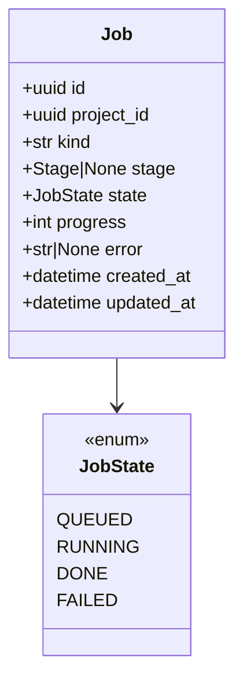
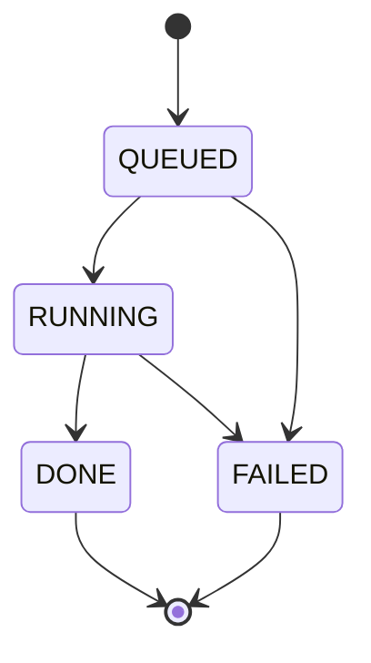

# Design — `infra` deploy (Vercel + Render + Supabase)

**Status:** agreed · **Owner:** Katlego (Claude) · **Tasks:** T037 (stack), T063 (API on Render), T009 (database), T053 (Storage, first for uploads; T026 adds frames), T053/T040/T030 (Auth)
· **Spec:** cross-cutting (hosting for every story in [SPEC.md](../../SPEC.md))
· **Decided:** 2026-09-29 by Katlego, adopting the Hackathon kit's REACT + FASTAPI stack;
**API host changed 2026-10-08 by Katlego: Railway → Render** (§8, §11). Nothing had been deployed to
Railway (T037's deploy check was still blocked on accounts), so the change is configuration and
docs only: no data, domain or running service moves. **Render plan changed 2026-10-11 by Katlego:
Free → `0.5c-512mb`** (paid, called Starter before Render's 26 Aug 2026 rename; §8, §11). **Plan
changed 2026-10-16 by Katlego: `0.5c-512mb` → `1c-2g`** (the memory check, §9: 506 MiB at its peak);
the API is created on Render as soon as both money caps have figures (§6); Render bills at the end
of the month for the seconds a service ran (~$13 for the rest of October)

---

## 1. What this covers

Where Panelwise runs once it leaves a laptop, and what each hosted service is for. It replaces
PLAN.md's earlier target ("API + web on Nebius; Postgres + Redis self-hosted"). **Not covered:**
the image renderer: FLUX.2 [klein] 4B on fal.ai (storyboard.md §3.5; fal.ai decided 2026-10-09, klein 2026-10-11), with
ComfyUI on a Nebius GPU kept as an optional backend (T003).

| Piece | Runs on | Why |
|---|---|---|
| Web app (`apps/web`, Next.js 16) | **Vercel** | Next.js's native host; preview deploy per PR |
| API (`services/api`, FastAPI) | **Render** (a Docker web service, plan `1c-2g`, Frankfurt), from `services/api/Dockerfile` | extraction runs for minutes; it needs a real container, not a serverless function |
| Database | **Supabase Postgres** | hosted Postgres; the SQLAlchemy + asyncpg code is unchanged |
| Images (frames, portraits, comic pages) | **Supabase Storage** | PLAN's "content-addressed file store", hosted |
| Sign-in, seeded judge account | **Supabase Auth** | T030 needs a judge login in the testing instructions |
| Job status and progress | **a Postgres table** | replaces Redis: one fewer service to host and pay for |
| Models | Nebius Token Factory | unchanged; this call is what satisfies "runs on Nebius" |
| Rendering | FLUX.2 [klein] 4B on **fal.ai** (storyboard.md §3.5; ComfyUI on a Nebius GPU optional, T003) | changed 2026-10-09: Token Factory has no image model, a GPU kept up to 15 Dec costs ≈ $2,500, Cloudflare's FLUX takes no seed or size |

**Hackathon rules still hold:** "runs on Nebius" means a runtime Token Factory call *or* Nebius
compute. Every Nemotron call is a Token Factory call; rendering on fal.ai doesn't change that. Hosting the app elsewhere is allowed
(frameflow-nebius-hackathon/PLAN.md, rules). The demo must stay up, free, until 15 Dec.

## 2. Reference material

| Kind | Where |
| --- | --- |
| Source of the stack | `~/Documents/projects/personal/Hackathon/stacks/react-fastapi` and `stacks/_parts/{web-react,api-fastapi}` (`vercel.json`, `railway.json`, `db.py`, `supabase.ts`, the PREP steps); the kit's API host was Railway, replaced by Render (§11) |
| Render (checked 2026-10-08) | render.com/docs: `blueprint-spec` (the `render.yaml` fields), `deploys` (pre-deploy command: paid instances only, a separate instance, a failure stops the deploy), `health-checks` (5 s timeout; a deploy not healthy in 15 min is cancelled; a running instance failing 60 s is restarted), `web-services` (`PORT` defaults to 10000, bind `0.0.0.0`), `free` (spins down after 15 min idle, ~1 min to wake, 750 instance hours a month per workspace, no pre-deploy command, "Render might restart a Free web service at any time"), `monorepo-support` (`dockerfilePath`/`dockerContext` relative to `rootDir`; build filters relative to the repo root), `cli` (`render blueprints validate`); the schema at render.com/schema/render.yaml.json; re-checked 2026-10-11: `compute-plans` (Render renamed its plans on 26 Aug 2026: `0.5c-512mb` was `starter`, 0.5 CPU and 512 MB; `1c-2g` was `standard`, 1 CPU and 2 GB; "Legacy plan names remain valid across all Render tooling", Blueprints included; no price change); third-party reviews put `0.5c-512mb` at ~$7/month and `1c-2g` at ~$25/month (Render's pricing page didn't load: confirm in the dashboard) |
| Vercel regions | vercel.com/docs/functions/configuring-functions/region (checked 2026-10-11): functions run in `iad1` (Washington, D.C.) by default for new projects; `"regions"` in `vercel.json` changes it; Hobby allows a single region |
| Supabase connections | supabase.com/docs/guides/database/connecting-to-postgres (checked 2026-09-29): for a long-running server on IPv4, the **shared pooler, session mode**, port 5432 — IPv4 on every plan; transaction mode (6543) doesn't support prepared statements, which asyncpg uses |
| Current code | `services/api/app/main.py` (health checks Postgres **and Redis** today), `docker-compose.yml`, `.env.example` |

## 3. Domain model

One new entity, built with its first consumer (T009): a job row, so progress survives an API
restart and needs no Redis. `project_id` and `stage` (and the `Project` it belongs to) are defined in
[web.md](web.md) §3.



## 4. Flow

```mermaid
sequenceDiagram
    participant B as Browser
    participant W as Next.js on Vercel
    participant A as FastAPI on Render
    participant S as Supabase (Postgres, Storage, Auth)
    participant N as Token Factory / ComfyUI
    B->>W: page, sign-in (Supabase Auth cookies via @supabase/ssr)
    W->>A: server-side fetch, API_URL, with the user's access token
    A->>S: SQL over the session pooler; Storage with the secret key
    A->>N: Nemotron calls; render calls
    A-->>W: JSON
    W-->>B: HTML / JSON
```

- **The browser never calls the API directly.** Next.js route handlers and server components call
  it server-side (`API_URL`, as `app/api/health` already does). So the API needs no CORS setup, and
  only the Supabase *publishable* key ever reaches a browser.
- **Secrets by place:** `SUPABASE_SECRET_KEY`, `DATABASE_URL`, `NEBIUS_API_KEY` live only on
  Render. `NEXT_PUBLIC_SUPABASE_URL` and `NEXT_PUBLIC_SUPABASE_PUBLISHABLE_KEY` live on Vercel.
  `API_URL` (server-only, Vercel) points at the Render domain (`https://<name>.onrender.com`).
- **`FAL_KEY`** (the renderer's, storyboard.md §3.5) is a secret of the API host only, like
  `NEBIUS_API_KEY`; it never reaches Vercel or a browser.

**Failure paths:** the API down → the web health route answers 502 (already built); Supabase
Postgres down → the API health answers 503 `degraded`; a Render deploy whose instance isn't
healthy on `/api/v1/health` within 15 minutes → Render cancels it and keeps the previous deploy
running; a failed migration exits the container before uvicorn starts, so it is never healthy and
the deploy is cancelled the same way (§6 *Who runs migrations*). The paid plan never spins down
(Free's 15-minute idle sleep and its restarts "at any time" were why it was dropped, §8). **Out of
memory:** `1c-2g` has 2 GB; a job that needs more gets the process killed and restarted, and
the restart sweep (web.md §4.1) fails the jobs that were running. T063's check (§9) measured the API
at 413–422 MiB between jobs once it has made a comic and 506 MiB at its peak, so `0.5c-512mb` had no
room for a storyboard and a comic at once; 2 GB has room for both. **New with Render:** it keeps checking a running instance,
stops routing to it after 15 s of failed checks and restarts it after 60 s. Because our health
check includes Postgres, a Supabase outage over a minute restarts the API, and the restart sweep
(web.md §4.1) fails the jobs that were running. Accepted (§8): those jobs can't write their
progress without the database anyway, so they would fail either way.

## 5. State



No transition out of `DONE` or `FAILED`: a retry is a new job.

## 6. Contracts

**Environment** (`.env.example` is the source; names are exact):

| Variable | Where | What |
|---|---|---|
| `DATABASE_URL` | API (Render, local) | `postgresql+asyncpg://…` — locally the compose Postgres; deployed, the Supabase **session pooler** URL (port 5432) |
| `SUPABASE_URL`, `SUPABASE_SECRET_KEY` | API only | Storage (T053 for uploads, T026 for frames), verifying users (T053) |
| `NEXT_PUBLIC_SUPABASE_URL`, `NEXT_PUBLIC_SUPABASE_PUBLISHABLE_KEY` | web (Vercel) | Auth in the browser (T040) |
| `API_URL` | web, server-side only | the Render domain, no trailing slash |
| `NEBIUS_*`, `LLM_*` | API only | unchanged (docs/design/llm.md) |
| `FAL_KEY` | API only, secret | fal.ai's key; unset, no renderer (storyboard.md §3.5, T026) |
| `FAL_MODEL`, `FAL_TIMEOUT_S`, `FAL_CONCURRENCY` | API | default `fal-ai/flux-2/klein/4b` (2026-10-11), 60 s, 2 (storyboard.md §3.5) |
| `LLM_MONTHLY_TOKEN_CAP`, `UPLOADS_PER_DAY`, `UPLOAD_MAX_PAGES` | API only | the hosted demo's limits (limits.md, T069); unset or blank: off |
| `IMAGE_MONTHLY_GENERATION_CAP` | API only | drawings a month (limits.md §4, T030); unset or blank: off |
| `AUDIT_WITHHOLD_CHECKS` | API | which failed hard checks withhold a frame (verify.md §3, T094): `all` (the code default), empty, or a comma list; **hosted: `drawn_sex,no_character`** (Tumo, 2026-10-15; T030) |
| `RENDER_MAX_ATTEMPTS`, `UPLOAD_MAX_BYTES` | API | drawings per frame, 1–3 (default 3); the upload size in bytes (default 4,000,000) |
| `JUDGE_EMAIL`, `JUDGE_PASSWORD` | local only | the judge seed (`python -m app.demo.seed`, limits.md §4); never the hosted API's environment |
| `COMFYUI_MAX_WORDS` | API | the frame prompt's word budget, default 55 (storyboard.md §3.1, T008) |
| `PANELWISE_PRIVATE_STYLES` | API, optional | a directory of private style TOMLs outside the repo; **never set on the hosted demo** (storyboard.md §3.2, T008) |
| `REDIS_URL` | — | **removed** |

**Deploy configs:** `apps/web/vercel.json` (framework `nextjs`, pnpm, root directory `apps/web`),
with `"regions": ["fra1"]` (T063): the web's server code calls the API on every page, so it runs
beside it in Frankfurt instead of Vercel's default `iad1`, which would put two Atlantic crossings in
each request. Static files still come from Vercel's CDN nearest the visitor.
The API is a Render **Blueprint**, `render.yaml` at the repository root (T063), exactly:

```yaml
# The API on Render (docs/design/deploy.md §6). Secrets are entered once, in Render's
# dashboard, when the Blueprint is first applied; never here.
services:
  - type: web
    name: panelwise-api
    runtime: docker
    plan: 1c-2g
    region: frankfurt
    rootDir: services/api
    dockerfilePath: ./Dockerfile
    dockerContext: .
    healthCheckPath: /api/v1/health
    autoDeployTrigger: checksPass
    numInstances: 1
    buildFilter:
      paths:
        - services/api/**
      ignoredPaths:
        - services/api/tests/**
    envVars:
      - key: DATABASE_URL
        sync: false
      - key: NEBIUS_API_KEY
        sync: false
      - key: SUPABASE_URL
        sync: false
      - key: SUPABASE_SECRET_KEY
        sync: false
      - key: FAL_KEY
        sync: false
      # The hosted demo's settings (T030): decided, so written here.
      - key: AUDIT_WITHHOLD_CHECKS
        value: drawn_sex,no_character,split_panels
      - key: UPLOADS_PER_DAY
        value: "3"
      - key: UPLOAD_MAX_PAGES
        value: "15"
      # The two money caps (limits.md §10): figures entered in the dashboard, recorded below.
      - key: LLM_MONTHLY_TOKEN_CAP
        sync: false
      - key: IMAGE_MONTHLY_GENERATION_CAP
        sync: false
```

Validated against render.com/schema/render.yaml.json on 2026-10-08 (`1c-2g` is in its `serverPlan` enum, checked 2026-10-16). What each line holds us to:
- `region: frankfurt` — the nearest Render region to the Supabase project (eu-west-1, Ireland), so
  the API keeps the 2 s health timeout.
- `rootDir` + `dockerContext: .` — the build context is `services/api`, as the Dockerfile's `COPY`
  lines expect (paths relative to `rootDir`).
- `autoDeployTrigger: checksPass` — a push to `main` deploys only after its GitHub checks (the gate,
  `ci.yml`) pass; `buildFilter` paths are relative to the repository root, so a web-only or docs-only
  change doesn't redeploy the API.
- `plan: 1c-2g` — paid, always on, 1 CPU and 2 GB (§8, the memory check in §9); the new ID rather
  than the legacy `standard`, so the file reads like the dashboard. The image's own start command runs the migration before uvicorn
  (*Who runs migrations*); no `dockerCommand`, so Render, compose and a plain `docker run` start the
  API the same way.
- `numInstances: 1` — jobs run in the API process (web.md §3), so one instance owns them, and no
  second instance can race the migration.
- `PORT`: Render sets 10000; the Dockerfile's `CMD` already listens on `${PORT:-8000}`. Render
  ignores the Dockerfile's `HEALTHCHECK` (compose still uses it).
- Every other setting has a default in `app/core/config.py` (`NEBIUS_MODEL_*`, `LLM_*`,
  `SUPABASE_STORAGE_BUCKET=panelwise`, `UPLOAD_MAX_BYTES`, `FAL_MODEL`, `RENDER_MAX_ATTEMPTS`), so
  only the five secrets and T030's settings are listed. **T030:** `AUDIT_WITHHOLD_CHECKS`,
  `UPLOADS_PER_DAY` and `UPLOAD_MAX_PAGES` carry their decided values; the two money caps are
  `sync: false`, entered when the Blueprint is applied, and their figures go here once decided
  (limits.md §10): `LLM_MONTHLY_TOKEN_CAP` = **2,800,000** (Katlego, 2026-10-16: 30% of the $18 left
  on Token Factory, $5.40, over the three months the cap counts, Oct to Dec, is $1.80 a month; a
  storyboard and its comic measured 339,000 tokens, at most $0.19 at DeepSeek-V4.1-Flash's
  $0.30/$1.20 per million, the dearest model the API calls; less one job's room; with T104's layout
  question about 370,000–387,000, so about 7 a month instead of 8, verify.md §3),
  `IMAGE_MONTHLY_GENERATION_CAP` = **800** (Katlego, 2026-10-16, from Tumo's fal balance: $5.35
  left, $10 loaded at the end of October for November and $5 at the end of November for December;
  about $8 of a month's money for the demo, 1,000 drawings at $0.004, less one job with re-renders,
  ~150, rounded down. The token cap binds first in an ordinary run: ~8 storyboards and comics,
  ~350 drawings at 44 each. Each top-up lands before its month starts: at $0 on fal, drawing stops
  whatever the cap says). **Never deploy
  with either blank:** blank is off, an uncapped bill.

**Keep-alive** (`.github/workflows/keepalive.yml`, T063), exactly:

```yaml
# Our uptime alert, and keeps a free Supabase project from pausing for inactivity
# (docs/design/deploy.md §6). Pings nothing until the API_HEALTH_URL variable is set.
name: keep-alive
on:
  schedule:
    - cron: "*/10 * * * *"
  workflow_dispatch:
permissions: {}
jobs:
  ping:
    runs-on: ubuntu-latest
    timeout-minutes: 3
    steps:
      - name: Ping the API's health check
        env:
          API_HEALTH_URL: ${{ vars.API_HEALTH_URL }}
        run: |
          if [ -z "$API_HEALTH_URL" ]; then
            echo "::notice::API_HEALTH_URL is not set; nothing to ping until T037 deploys the API"
            exit 0
          fi
          curl --fail --silent --show-error --max-time 90 --retry 2 "$API_HEALTH_URL"
```

- **Why it stays on a paid plan** (§8): the paid instance never sleeps, so this no longer keeps it
  awake. It is the only thing that tells us the demo is down (a 503 or no answer fails the run, and
  GitHub emails the failure), and while Supabase is on its free plan the health check's Postgres
  query is the activity that stops the project being paused. Every 10 minutes; GitHub may delay a
  scheduled run, which only delays an alert.
- `API_HEALTH_URL` is a repository *variable* (not a secret: the URL is public), set to
  `https://<render-domain>/api/v1/health` after T037's deploy.
- GitHub turns off scheduled workflows in a public repository after 60 days with no activity.
  The last planned commit is around 30 Oct, which is 60 days before 29 Dec, after the demo ends on
  15 Dec.
- `PANELWISE_PRIVATE_STYLES` is absent on purpose (storyboard.md §3.2: never on the hosted demo).

**`DATABASE_URL`** may be `postgresql://`, `postgres://` or `postgresql+asyncpg://`; the API adds the
`+asyncpg` driver and rewrites libpq's `sslmode=` to asyncpg's `ssl=` (same values). asyncpg rejects
`sslmode` at connect time.

**API health** (`GET /api/v1/health`, T002 contract) keeps its shape; its checks become
`{"postgres": …}` only.

**Schema and migrations (T009).** SQLAlchemy 2 async models; **Alembic** migrations in
`services/api/migrations/` (`alembic.ini` beside `pyproject.toml`; an async `env.py` that reads
`Settings().database_url`). Tables live in Supabase's `public` schema. Enumerations are `text` with a
`CHECK` constraint, not Postgres enums, so a later state (T021's) is one migration that swaps a
constraint. Migration `0001` creates:

| Table | Columns | Constraints and indexes |
|---|---|---|
| `projects` | `id uuid pk`, `owner uuid not null`, `title text not null`, `pdf_path text not null`, `screenplay jsonb`, `extraction jsonb`, `plan jsonb`, `created_at timestamptz not null default clock_timestamp()` | index `(owner, created_at desc)` |
| `jobs` | `id uuid pk`, `project_id uuid not null references projects(id) on delete cascade`, `kind text not null`, `state text not null`, `stage text`, `progress int not null default 0`, `error text`, `created_at`, `updated_at timestamptz not null default clock_timestamp()` | `kind in ('storyboard','frame_attempt')`; `state in ('queued','running','done','failed')`; `stage in ('parsing','extracting','planning','rendering')` or null; `progress between 0 and 100`; index `(project_id, created_at desc)` |

Timestamps default to `clock_timestamp()`, not `now()`: `now()` is the transaction's start, so rows inserted in one transaction would tie and "newest first" would be arbitrary. `owner` is not a foreign key to `auth.users`: that schema exists only on Supabase, and the compose
Postgres and the test Postgres must run the same migration. **Who runs migrations:** never the app
while two replicas could race. The API runs exactly one instance (`numInstances: 1`), so the
Dockerfile's `CMD` runs it (a pre-deploy command, possible on the paid plan, is rejected in §8):
`sh -c ".venv/bin/alembic upgrade head && exec .venv/bin/uvicorn app.main:app --host 0.0.0.0 --port ${PORT:-8000}"`
from `WORKDIR /srv/api` (`alembic` is a main dependency, so `uv sync --no-dev` installs it).
Compose's `api` drops its own `command` and uses this `CMD`, so the local stack starts the API
exactly as Render does. A failed migration exits the container before it serves, so the
new deploy never becomes healthy and Render keeps the old one (§4). During a deploy the old
instance serves while the new one migrates, the same timing a pre-deploy command would give.
If the API ever runs more than one instance, the migration moves back to a pre-deploy command; compose's `api` runs it before uvicorn; the DB tests run it once per test session, which
also tests the migration.

**Row-level security (T009; closes §10).** Every table in `public` — the API's and Alembic's own
`alembic_version` — gets `ENABLE ROW LEVEL SECURITY` and **no policies**, and its privileges are
revoked from Supabase's `anon` and `authenticated` roles when those roles exist (a `DO` block; they
don't exist in the compose or test Postgres). Supabase's default privileges grant those roles every
new table, so this is not automatic: each migration that creates a table calls the shared helper
`lock_down(table)` (`migrations/helpers.py`), and a test (`db`) fails if any table in `public` has
RLS off or grants anything to `anon`/`authenticated` (on the test Postgres it checks RLS; the grant
check is live, against the Supabase project, in T009's Verify). So the publishable key reads nothing through Supabase's Data API. The API connects
as the tables' owner, which RLS does not restrict unless forced, and enforces ownership itself
(web.md §6: another user's project is a 404). Storage: the bucket is private and has no policies;
only the secret key reads or writes it, and the browser sees images only through signed URLs
(storyboard.md §8).

**Test Postgres (T009; option A, decided by Katlego 2026-10-01, Postgres 17.11 on 2026-10-02).**
`scripts/gate.sh` provides it, so the hook and CI run the same thing (CI's `ubuntu-latest` runner
has Docker; `ci.yml` needs no service of its own):
- `TEST_DATABASE_URL` set → use it.
- else Docker available → `docker run -d --rm -p 127.0.0.1::5432 postgres:17.11-trixie` with a
  throwaway password, wait for `pg_isready` (60 s at most), export `TEST_DATABASE_URL`, and stop the
  container on exit (a `trap`).
- else → the gate **fails** ("no Postgres for the database tests: start Docker or set
  TEST_DATABASE_URL"). Never a silent skip.
- The gate exports `PANELWISE_REQUIRE_DB=1`. Tests marked `db` use `TEST_DATABASE_URL`; without it
  they **skip** when run by hand and **fail** under the gate. The `db` fixture upgrades a fresh
  database to `head` once per session and truncates every table except `alembic_version` before each test.
- **Safety:** the fixture refuses (fails) any `TEST_DATABASE_URL` whose database name doesn't end
  in `_test`, so pointing it at Supabase or the dev database can never wipe it. The gate's container
  creates `panelwise_test`.
- **In parallel** (pytest-xdist, `-n auto`): each worker uses its own database on the same server,
  `<name>_<worker>_test` (`panelwise_gw0_test`, …), created when missing and migrated once, so a
  caller-supplied `TEST_DATABASE_URL`'s role needs `CREATEDB` (the gate's container uses the
  superuser). Debugging one test by hand (`--pdb`, `-s`): add `-n0`.
- **Where in the gate:** started once, before the per-project checks (so every `pyrun` subshell
  inherits the export), and only when a Python project has tests to run: never for `--list` or
  `--install-deps`. The host port is Docker's choice (`-p 127.0.0.1::5432`), read back with
  `docker port`. One `trap … EXIT` stops the container on every exit path, including the early
  `exit 1`s.

**Public styles in the image (T063).** The renderer loads the public styles at start-up
(storyboard.md §3.2, §3.5), but they live in the repo-root `styles/`, outside the API image's build
context (`services/api`), so today only compose has them, through a `./styles:/styles` mount; on
Render the hosted API would start with no styles and render nothing. They move into the build
context:
- `styles/*` moves to `services/api/styles/` (`git mv`, history kept), and the repo-root `styles`
  becomes a symlink to `services/api/styles`, so every `styles/…` path in the docs still resolves.
- `PUBLIC_STYLES = Path(__file__).resolve().parents[2] / "styles"` in
  `app/storyboard/styles.py` (`services/api/styles`, wherever the API is started from).
- The Dockerfile gains `COPY styles ./styles`; compose's `api` drops the `./styles:/styles:ro` mount.
- The gate's image probe (below) adds `load_styles(PUBLIC_STYLES, None)`, so an image without them
  fails the gate.

**The image (T068, 2026-10-10).** The API is deployed from its Dockerfile, built by the host from
`main` (Render). A Dockerfile that no longer builds, or an image missing a module
or a file the app needs, would otherwise be found only there, after the merge. So the gate builds it
too:
- For each **Python** project directory with a `Dockerfile` (today `services/api`; the web's
  Dockerfile serves compose only, and Vercel builds the web itself), `docker build` with that
  directory as the context, as compose builds it, tagged `panelwise-gate/<dir name>:check`; then
  one `docker run --rm --entrypoint .venv/bin/python` of the image (the entrypoint set, so a future
  `ENTRYPOINT` such as a migrate-then-serve script never runs here) with a probe that imports
  `app.main` and asserts the files the app reads at run time are in the image: the comic font
  (`app.comic.layout.FONT_PATH`), `alembic.ini` and `migrations/env.py`. Both count as one check; the
  image is removed afterwards.
- **The public styles** (`PUBLIC_STYLES`, storyboard.md §3.2) join the probe with T063, which ships
  them in the image (*Public styles in the image*): `load_styles(PUBLIC_STYLES, None)` must load.
- Docker is required: without it the check **fails** ("Docker is needed to build the API's image"),
  never a skip, as for the test Postgres.
- It runs after the per-project checks, once per Dockerfile, on **every** run of the gate, including
  CI's `--changed-files` runs and docs-only pushes (the change list feeds only the sweeps), and not
  for `--list` or `--install-deps`. Docker's layer cache keeps a re-run to seconds; a cold build (CI)
  is a minute or two.

## 7. Structure

| Path | New? | Responsibility | Task |
|---|---|---|---|
| `apps/web/vercel.json` | new (T037), changed (T063) | Vercel build settings; `regions: ["fra1"]` | T037, T063 |
| `services/api/app/main.py`, `app/core/config.py`, `docker-compose.yml`, `.env.example`, `pyproject.toml` | changed | Redis out; Supabase settings in | T037 |
| `services/api/Dockerfile` `CMD`, `docker-compose.yml` `api` | changed | the migration in the image's start command; compose uses it | T063 |
| `docs/deploy.md` | new (T037), changed (T063) | the account steps (Supabase, Render, Vercel), in order, with checks | T037, T063 |
| `render.yaml` (repository root) | new | the API's Render Blueprint, §6 verbatim | T063 |
| `.github/workflows/keepalive.yml` | new | the keep-alive ping, §6 verbatim | T063 |
| `services/api/styles/` (from `styles/`), the root `styles` symlink, `app/storyboard/styles.py`, the Dockerfile, compose's `api`, `scripts/gate.sh` (`IMAGE_PROBE`) | moved / changed | the public styles inside the API image, probed by the gate (§6 *Public styles in the image*) | T063 |
| `services/api/app/storage/` | new | Supabase Storage: uploaded PDFs (T053), frame images (T026) | T053, T026 |
| `services/api/app/jobs/` + migration | new | the `Job` table (with web.md §3's `project_id`, `stage`) | T009 |
| `apps/web` auth (`@supabase/ssr`) + API token check | new | sign-in (T040), the token check (T053), judge account (T030) | T040 / T053 / T030 |

## 8. Decisions & alternatives

| Decision | Chosen | Rejected, and why |
|---|---|---|
| API host | **Render**, Docker web service (Katlego, 2026-10-08) | Railway (chosen 2026-09-29, never deployed): its config-as-code is deprecated and dies 2026-12-01, inside the demo's life, so its settings would live only in a dashboard, and its price is usage-based; Nebius VM: more setup, not covered by credit; the GPU box: couples API uptime to the GPU (Katlego, 2026-09-29) |
| Render plan | **`1c-2g`**, paid, ~$25/month (Katlego, 2026-10-16, after the memory check, §9; paid plans since 2026-10-11: the team will pay for hosting) | `0.5c-512mb` (~$7/month, chosen 2026-10-11): the check put the API at 506 MiB of 512 at its peak and ~415 MiB between jobs, so a storyboard (~150 MiB) beside a comic would be killed, failing every running job. Free (chosen 2026-10-08 under a $0 budget): spins down after 15 idle minutes (~1 minute to wake, a judge's first sight a 502), "might restart a Free web service at any time", 0.1 CPU for Pillow's page work, and 744 of a workspace's 750 free hours |
| Migrations on Render | in the Dockerfile's `CMD`, before uvicorn (compose uses the same `CMD`) | a pre-deploy command (possible on the paid plan): with one instance it buys nothing (a failed migration already leaves the new deploy unhealthy and Render keeps the old one, §4), and it would take the local stack's start out of step with Render's; by hand from a laptop: easy to forget, and a deploy could start against an old schema |
| Keep-alive ping | kept on the paid plan, every 10 minutes | dropped with Free: it is our only uptime alert, and the activity that keeps a free Supabase project from pausing; an external uptime service: another account, outside the repo |
| Vercel function region | `fra1`, beside the API (Hobby allows one) | `iad1`, the default: every server-side call to the API crosses the Atlantic and back; `dub1` (beside Supabase): the web's server talks to the API far more than to Supabase Auth |
| Public styles in the image | moved into `services/api/styles`, a root symlink for the old paths | a repo-root build context: every other `COPY` and Render's `rootDir` change with it; a mount on Render: needs a disk, which the API otherwise doesn't |
| API config | `render.yaml` Blueprint in the repo | Render dashboard settings: config the gate and review can't see; Railway's dashboard was only chosen because its file was deprecated, and Render's Blueprint is not |
| Health check path | `/api/v1/health`, Postgres included | a liveness path without the database: avoids restarts during a Supabase outage, but a new endpoint for a case where the running jobs fail anyway (§4) |
| Postgres client | SQLAlchemy + asyncpg over the session pooler | the `supabase` REST client for data (the kit's `db.py`): we already have SQL code, and REST can't do transactions |
| Pooler mode | session (5432) | transaction (6543): no prepared statements, which asyncpg relies on; direct connection: IPv6-only without the paid add-on |
| Redis | removed; job state in Postgres | keep Redis: a second hosted service for one table's worth of state |
| Browser → API | always through Next.js server-side | direct browser calls: CORS, and the API URL and tokens in the browser |
| Local development | compose Postgres, no Supabase needed for tests | the Supabase CLI locally: heavier, and tests never touch the network |
| Storage and Auth timing | built with their first consumer (Storage: T053's upload; Auth: T053/T040/T030) | now: a module with no caller is a placeholder (AGENTS.md §2a) |

Deviations from [docs/architecture-defaults.md](../architecture-defaults.md): "Docker for every
service" still holds (both services have Dockerfiles; Vercel builds the web app itself). No
message broker, as before.

## 9. How this is verified

- T037: the gate green with Redis gone (health tests updated test-first); `docker compose up` still
  healthy locally; `vercel.json` validated against its schema.
- T063: `render.yaml` validates (`uvx check-jsonschema --schemafile
  https://render.com/schema/render.yaml.json render.yaml`, and `render blueprints validate` once the
  CLI is logged in); `grep -rni railway` finds only the history (this doc's §8 and §11, STATUS.md's
  log, docs/HANDOFF.md) and the sample screenplay's railway station. The gate's image probe loads the
  public styles. **Memory, before paying for a plan:** `docker compose` with the API limited to
  `--memory=512m --cpus=0.5`, the-red-kite uploaded and run to its storyboard and its comic, the
  container never OOM-killed (`docker inspect … .State.OOMKilled` false) and its peak in
  `docker stats` recorded here; over 512 MB → `1c-2g`. (Evidence so far, 2026-10-15: the local
  stack has run every live storyboard since 2026-10-13 with the API at `mem_limit: 512m`, 11
  scripts, none OOM-killed; the comic at 512 MB and the 0.5 CPU limit are still unchecked.)
  **Run 2026-10-16** (Katlego, Claude; compose on `3b9fc99` with the API at `mem_limit: 512m`, no
  swap, `cpus: 0.5`, `AUDIT_WITHHOLD_CHECKS=drawn_sex,no_character`; the-red-kite, klein, 3 attempts;
  memory from the cgroup's `memory.peak` and the process's `VmRSS`/`VmHWM`): the storyboard 22 of 22
  accepted in 4½ min, peak 153 MiB; the comic (22 panels drawn) 7 min, peak 403 MiB; four comic
  re-runs (no drawings, no tokens) 95–177 s each, the process at **413–422 MiB between jobs and
  506 MiB at its peak**, the container at its 512 MiB limit 61 times during the second, never
  OOM-killed. CPU sat at the 0.5 cap; jobs still finished in minutes. Spend: 44 drawings, 339,000
  tokens (229,761 prompt, 100,506 completion in the audits). **Verdict: `1c-2g`** (Katlego): 512 MB
  held one job at a time, but a storyboard beside a comic would not fit.
- T037 done means deployed: the Render URL answers `/api/v1/health` `ok` against Supabase, the
  service log shows `alembic upgrade head` before uvicorn starts, the Vercel URL's `/api/health`
  answers 200 through it, and with `API_HEALTH_URL` set a manual run of `keep-alive` passes. That needs Katlego's Render and Vercel accounts, so the task is **blocked on accounts** until
  they exist, and says so.
- **T030:** `render.yaml` still validates with the new `envVars`; before the first hosted upload,
  Render's dashboard shows both money caps set to the figures recorded in §6 (nothing checks this in
  code: a blank cap is off, so it is a step in the deploy, read back by eye);
  the judge seed run once against the hosted Supabase (Tumo's go-ahead), the judge signed in on
  the Vercel URL, the copied storyboard open; one upload as the judge runs to its storyboard on the
  hosted stack with `drawn_sex,no_character`; `event.toml`'s `demo` set to the Vercel URL.

## 10. Open questions

- [x] Storage in local development: a dev bucket in the same Supabase project, or a local
  filesystem adapter behind the same interface? **Decided (storyboard.md §8):** a dev bucket through
  the same `SupabaseStore`; tests use an in-memory fake.
- [x] Row-level security policies for Storage and the `Job` table: **decided in T009's design
  (2026-10-02):** RLS on, no policies, privileges revoked from `anon`/`authenticated`; private bucket,
  secret key only (§6 *Row-level security*).
- [ ] **A deploy overlaps the old and new instance** (both on Railway and Render): the new
  instance's restart sweep runs while the old one may still be finishing a job, and fails it.
  Pre-existing, not caused by T063; acceptable while deploys are rare during the demo. A fix
  (sweeping only jobs older than the process, or draining before exit) would be its own design.

## 11. The change from Railway to Render (2026-10-08)

| What | Railway (2026-09-29) | Render (T063) |
|---|---|---|
| Config | dashboard settings, written down in `docs/deploy.md` | `render.yaml` in the repo, §6 |
| Migrations | pre-deploy command, dashboard | the image's `CMD`, before uvicorn (one instance; §8) |
| Health check | `/api/v1/health` at deploy | `/api/v1/health` at deploy **and** while running (§4) |
| Region | EU (to be picked) | `frankfurt` |
| Deploy trigger | every push to `main` | a push to `main` that touches `services/api/**`, after its checks pass |
| `PORT` | set by Railway | 10000, set by Render; the Dockerfile reads it either way |
| Price | trial credit, then usage-based | `1c-2g`, ~$25/month (Free until 2026-10-11, `0.5c-512mb` until 2026-10-16) |

Unchanged: the Dockerfile's build, every environment variable's name and meaning, Vercel, Supabase,
the web app's `API_URL` contract (only its value's domain changes). Nothing ran on Railway, so there
is nothing to move, switch over or shut down. T063 carries the change into the files; T037's deploy
check and T030 then run against Render.
