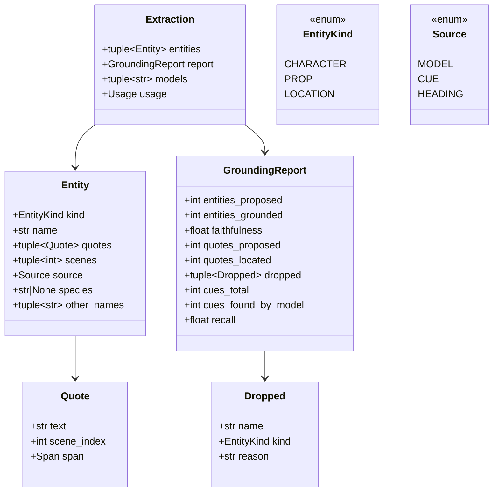

# Design — `grounding` (entity extraction + grounding filter; lane `script+grounding`)

**Status:** agreed · **Owner:** Katlego (Claude) · **Tasks:** T006, T039, T082, T088, T091 · **Spec:** PLAN.md Non-negotiable I;
[SPEC.md](../../SPEC.md) US1

---

## 1. What this covers

Turning a parsed `Screenplay` (docs/design/script.md) into the cast, props and locations every
later stage draws from — **where every entity and every description is a verbatim quote located
back to a page and line span**, and anything the model says that can't be located is dropped.
Plus the two numbers that say how well it worked: **faithfulness** (precision) and **recall**.

**Not covered:** storage, shots (T007), frame prompts (T008). Portraits use these entities later
(T025).

## 2. Reference material

| Kind | Where |
| --- | --- |
| Code ported from | FrameFlow `services/api/app/services/grounding.py` (`normalize_for_grounding`, 26 Aug), `extraction_service.py` (scene chunking, merge, the filter), `governance_service.py` (faithfulness, recall) |
| Why recall matters | FrameFlow: faithfulness 1.0 on 15 entities of a script with 77 speaking characters — "a recall failure wearing a green badge" |
| API behaviour | docs/nebius-findings.md: `json_schema` enforced (U1); thinking off on the fast tier (U2); TPM is the binding limit (U4); `json_object` invented a detail (U1) |
| LLM seam | docs/design/llm.md (`structured_chat`, `Tier.FAST`) |

## 3. Domain model



- **What the model decides vs what the parser already knows.** Locations come from scene headings
  (`Source.HEADING`, the heading line is the quote). Speaking characters are known from dialogue
  cues. The model is asked only for what the parser can't know: characters and props **as the
  script describes them**, each with verbatim quotes.
- **Descriptions are quotes, never attributes.** No age, gender or role fields: FrameFlow asked for
  them, and inferring them is inventing (findings U1: "likely a lighthouse keeper"). A later stage
  that needs to draw a character reads its quotes.
- **`Quote.text`** is the model's quote; **`Quote.span`** is the element (action paragraph, speech
  or heading) it was found inside. A quote is *located* only when its normalised text is a
  substring of one element's normalised text — so its span is exact, never "somewhere in the
  script". The one exception to "the model's quote": a dialogue quote the model led with its
  speech's own header (§4, *Cue headers*) is kept **without** that header, so `Quote.text` is
  always text inside `Quote.span`.
- **Animals, other names and sex (T051, T082).** Three things the parser can't know and redaction
  and the prompt need (storyboard.md §3.1). All three are copied words, grounded in code, never
  inferred attributes:
  - **`species`**: for a `CHARACTER` that is an animal, the word the script uses for what it is
    ("A ginger cat, MARMALADE, sleeps…" → `cat`). A leading `a` / `an` / `the` is stripped first.
    It is kept only when the rest is 1–3 words with a letter; none of its words is in
    `PERSON_WORDS` (`NAME_STOP_WORDS` plus `PERSON`, `PEOPLE`, `MEN`, `WOMEN`, `CHILD`,
    `CHILDREN`, `KID`, `KIDS`, `BABY`, `TEENAGER`, `FIGURE`, `CROWD`) or is a name token of a
    *different* character (a speaking animal cued `CAT` keeps `cat`; NANDI can't be `species:
    "thabo"`); and it appears as whole words (`normalize_for_grounding`) inside one of that
    entity's located quotes **whose span is an `Action` element** (a description, not someone's
    speech). Otherwise `None`, and the character is treated as a person. Always `None` for props,
    locations and `Source.CUE` backfills. Across chunks, the first species that passes, in
    proposal order, wins. **Residual risk:** the test proves the word is in a description the
    model tied to this entity, not that it describes *this* entity ("NANDI strokes the cat" with
    species `cat` on NANDI would pass): a person read as an animal is drawn as one. Rare (it needs
    the model to call a person an animal), and recorded in §8.
  - **`other_names`**: other names the script gives the same character or prop: a nickname
    (SIPHOKAZI's "Kazi"), a pet's or a toy's name (the GIRAFFE called "Gerald"). Each is kept when
    the script mentions it as a whole word (the same test as an entity name), it differs from the
    entity's name under `normalise`, and it has at least one name token (characters' redact.py:
    stop words alone, like "Mr.", are not a name). A kept other name is always redacted; whether
    it gets its entity's label is decided by storyboard.md §3.1 (*paired*). Union across chunks,
    first appearance first. `()` for locations and `CUE` backfills.
  - **`sex_word` (T082):** for a person `CHARACTER`, the one word of the script that shows their
    sex, copied: a pronoun about them ("Siphokazi nods. **She** cannot stop the smile.") or a
    noun for them ("a salt-and-pepper-bearded **fisherman** … This is SIPHO (50s)."). The model
    only copies the word; it never states a sex, so `sex_word` is a copied word like `species`,
    not an inferred attribute. Code keeps it, as `Entity.sex` (a `Sex`: `female`, `male`) and
    `Entity.sex_quote` (the quote), only when:
    1. the word, lower case and with a trailing `.` stripped, is in `SEX_WORDS` (one pure module,
       `app/characters/sex.py`, below);
    2. one of the entity's located quotes **whose span is an `Action` element** (a description,
       not someone's speech) passes all of: (a) the word is a whole word of it, any case;
       (b) it **names this character**: a name token (`name_tokens` of the entity's name) or a
       kept other name as whole words under `normalise`, so a title alone ("Mr.") names no one;
       (c) it **names no other character**: no name token of another `CHARACTER` entity
       (`Source.CUE` ones and animals included), except when the two are aliases, one's token
       set containing the other's (THABO ⊂ THABO MOLEFE). Any other shared token counts as naming
       the other: "DUBE nods. She…" with THABO DUBE and LERATO DUBE names both, so neither gets a
       sex; (d) a pronoun (`she`, `he`, `herself`, `himself`) comes **after** the first mention of
       this character, the earliest whole-word occurrence of any of its name tokens or kept other
       names in the quote ("She nods. SIPHO…" gives Sipho nothing); a noun may come before it
       ("a … fisherman … This is SIPHO");
       (e) **every** sex-bearing word in it keys to the same sex: the `SEX_WORDS` and, though
       they never give a sex, the object and possessive pronouns `her`, `hers`, `him`, `his`
       (`CONFLICT_WORDS`): "She hands him the cup" gives nothing, a safe miss rather than a
       guess. The first such quote, in proposal order, is `sex_quote`.
    3. Across chunks, every kept proposal agrees; two that disagree keep `None`. The species test
       runs first: a character with a species gets `sex` `None`. Always `None` for props,
       locations and `Source.CUE` backfills.
    - **`SEX_WORDS`** keeps only words that, in one character's own description, are about that
      character: the subject and reflexive pronouns `she`, `herself` (female), `he`, `himself`
      (male); and the nouns `woman`, `girl`, `lady`, `fisherwoman`, `policewoman`,
      `businesswoman`, `waitress`, `actress` (female), `man`, `boy`, `gentleman`, `fisherman`,
      `policeman`, `businessman`, `waiter`, `actor` (male). **Left out on purpose** (the T082
      review): object and possessive pronouns (`her`, `him`, `his`: "SIPHO hands her the box" is
      about someone else); relational nouns (`mother`, `wife`, `uncle`…: "Thabo hugs his mother");
      plurals (`women`, `boys`: a group); titles (`miss` is also a verb), which `title_sex` reads
      from the name instead (storyboard.md §6). One dict, so a language or a word is added in one
      place; a word outside it fails closed (no sex), never guesses.
    - **Safe by returning `None`:** a character introduced only in dialogue (no `Action` quote); a
      "they" character (no word in the vocabulary); a woman described as "the fisherman" whose
      introduction says "her" (storyboard.md's `character_sex`: the sources disagree, so `None`).
    - **Residual risk:** a one-character quote whose pronoun or noun is about an unnamed other
      person ("KOOS (70s) pushes a broom. She waves."; "SIPHO waves to a woman") keeps the wrong
      sex if the model copies that word. The model reads the whole script and is asked for the
      word *about this character*; `character_sex` drops a sex the introduction contradicts;
      storyboard.md §9's labelled table measures what is left.
    - Faithfulness and recall don't change: a `sex_word` that fails is simply not kept.
  - **A claimed sex, checked by the script's own pronouns (T088):** `sex_word` must sit in a quote
    that names the character, so a sex the script gives only in a later sentence is missed: on
    2026-10-12 T082 found 3 of the 9 sexed characters of lost-property (L010) and missed THEO and
    DANIEL on the-bread-van. Looking at what the model proposes showed why: its `sex_word` was right
    for **every** person of three samples, but the quote it put it in rarely holds it (an
    introduction with no pronoun, a speech, a sentence where the pronoun is someone else's). Two
    designs were stopped first: code rules alone (storyboard.md §8, T085: no rule tells whose "his"
    it is) and the model citing a pronoun sentence itself (a `sex_pronoun_quote` field: its picks
    were wrong as often as not). So the `sex_word` is now also a **claim**, and code looks in the
    script for its own evidence. When a person's `sex_word` keys (`SEX_WORDS`) to one sex across all
    its chunks and T082's rules don't keep it, code keeps it only when **at least one** Action
    sentence supports it and **none** contradicts it, the first supporting sentence becoming
    `sex_quote` (the script's own sentence, verbatim, at its element's span: an introduction is
    left out only when its words are read). A sentence is evidence for this character (`_pronoun_evidence`,
    in script order; an introduction's own description, `NAME (…), a phrase,`, is dropped first, so
    "DANIEL (40s), a tall driver, climbs out." reads "DANIEL climbs out."; sentences split after
    `.`, `!` or `?` and whitespace, never after `Mr.`, `Mrs.`, `Ms.`, `Dr.` or `St.`; words
    `[A-Za-z']+`) when either:
    - **its subject owns the pronoun**: the sentence opens with this character's name (`normalise`d
      name words, an optional "The" first), and the first third-person pronoun after the name is
      `his`, `himself`, `herself`, or `her` followed by a word not in `NOT_POSSESSED` (a
      possessive: "Amahle tugs at **her** mother's scrubs", not "hands her the box"); `he`, `she`,
      `him`, `hers` and an object `her` give nothing here; and nothing between the name and it could
      own it (`_clear`): no other name (another character's token, a name the script itself writes
      as a cue or a `NAME (` introduction, or any Title-case word that is no name stop word), no
      possessive, no `'s`, no determiner (`a`, `an`, `the`, `this`, `that`, `these`, `those`,
      `another`, `some`), no sex noun. "Koos taps his broom." → male; "Sipho does not take his eyes
      off the water." → male; "Ben stumbles out with a bag held against his chest." → nothing (a
      determiner between); "Nomsa pulls Theo onto her lap." → nothing for either (Theo isn't the
      subject, and he stands between Nomsa and "her");
    - **or it opens with `He` or `She`** right after a sentence of the same element, or the last
      sentence of the Action element just before, that opens with the name and holds nothing
      `_clear` refuses: "Siphokazi nods. **She** cannot stop the smile." → female. A speech between
      breaks the chain: a pronoun right after someone speaks is often the listener's ("…Me,
      probably." from ZANELE, then "He peers at the ledger" is Mr. Dube), so a cue is never an
      antecedent.
    Every piece must agree with the claim: "Zola takes his hand." beside "Zola nods. She smiles."
    leaves ZOLA with no sex. Then T082's rule 3 as before (every kept piece, from the `sex_word`'s
    quotes and from this evidence, one sex), and storyboard.md's `character_sex` as before. Never for
    an animal, a prop, a location or a `Source.CUE` backfill; no claim, no sex (until T091, below).
    - **Why it holds:** a wrong sex needs the model to claim it **and** the script's own pronouns to
      back it plainly with nothing against it: two signals that are wrong in different ways. The
      prototype on 2026-10-12 found no piece of evidence that wasn't right once the cue and the
      object were out. **Not checkable by code:** an unnamed person with no noun and no sentence of
      their own ("Sipho knocks. She opens the door.") when the model also claims "she" for Sipho;
      and a dative "her" read as a possessive ("Mike hands her coffee"): with a true claim ("he") it
      only contradicts, so Mike gets no sex, but a model making the same misreading would agree with
      it. Both need the model and the script to mislead the same way; the held-out script measures.
      No wrong sex on the samples is no proof for other scripts: the held-out script measures it.
    - **The judge** sees the evidence sentence (`character_sex`), which may not name the character:
      the spec line is already under that character's name. Faithfulness and recall don't change.
    - **The claim is asked for whenever the screenplay shows the sex** (§6: the prompt's sentence and
      the field's description now allow `her` and `his` and ask for the word "best" from a quote, null
      only when the screenplay never shows it): told to copy it only from its own quote, the model
      left it null for KOOS, AMAHLE and TEBOGO although the script says "Koos taps his broom". A
      `her`/`his` claim keys by `CONFLICT_WORDS`; T082's own rules still never keep such a word.
    - **Measured** 2026-10-12, Token Factory, three extractions of each sample (about 42,000 tokens),
      against eval/sex-labels.json: **WRONG 0, INVENTED 0** in all twelve; the-red-kite 3 of 3 each
      run; sipho-and-siphokazi every extracted person right (SIPHO and SIPHOKAZI, missed by T082
      alone; GOGO not always extracted); lost-property (found on) 7 of 12 a run, from 6 (AMAHLE, KOOS
      when the model claims); the-bread-van (found on) 3 of 4, from 2 (DANIEL). Still missed: PRIYA
      (her "She" sentences follow her speeches), TEBOGO and KOOS when the model gives no claim (2026-10-12; T091 now finds KOOS), MOLOI
      (only a parenthetical), the sleeping commuter, THEO (a determiner in each of his sentences).
  - **No claim: the script's own possessive (T091).** On 2026-10-13 the extraction claimed no sex for
    any of load-shedding's six learners (held out, L018), though `_pronoun_evidence` found the right
    one for every one of them ("AYANDA (17), braids, chews her pencil.", "Pieter pulls his hood down",
    "Lucky looks at his paper"), and two accepted frames drew girls as boys. So when **no** chunk
    claims a sex, code keeps a sex
    from the evidence alone, but more strictly than with a claim: **every** piece of the evidence
    gives one sex, **and at least one piece is a sentence whose subject owns the pronoun** (the first
    kind above: the sentence opens with the name, a `his`/`her`/`himself`/`herself` follows with
    nothing `_clear` refuses between). A `He`/`She` opening the next sentence still counts against
    a sex (it contradicts) but never alone keeps one: "Sipho knocks. She opens the door." (an
    unnamed woman opening it) would otherwise make Sipho female, and with no claim there is no
    second signal. The quote is the first owning sentence. A claim that keys to one sex works as
    T088 says; two chunks claiming different sexes still keep nothing (a claim is no "no claim").
    Never for an animal, a prop, a location or a `Source.CUE` backfill, as T088.
    - **"No claim", exactly:** `_claimed_sex`'s own `claims = {CONFLICT_WORDS.get(w.strip().rstrip(".").lower())
      for w in proposed} - {None}` is empty. So a `her`, `hers`, `him`, `his` or `she` claim (all in
      `CONFLICT_WORDS`) is a claim, and T088's path holds it to the evidence; a word that keys to
      nothing ("teen", "captain") or null in every chunk is no claim. The order in `_claimed_sex`:
      the species and `Source.MODEL` guard first (`[]`); then `len(claims) > 1` → `[]`; `len(claims)
      == 1` → T088 as before; `len(claims) == 0` → T091.
    - **Which pieces own:** `_pronoun_evidence` is split. A private `_pronoun_pieces` returns `(Sex,
      Quote, owns)` for each piece, `owns` true for the first kind above (the sentence opens with
      the name) and false for a next-sentence He/She; `_pronoun_evidence` stays as it is, a thin
      wrapper dropping `owns`, so T088's signature and tests don't change and the script is parsed
      once. T091 keeps `(sex, the first piece whose owns is true)`; `_with_sex`'s rule 3 is
      unchanged.
    - **Measured free** (2026-10-13, the stored extractions of six scripts, `_pronoun_evidence` on
      each, against eval/sex-labels.json; today's sex wins where it has one): **0 wrong, 0 invented
      in 37 labels** (eval/sex-labels.json, the held-out scripts' labels in #157), right 20 → 31. Held
      out (Katlego's T090 samples, nothing tuned on them):
      load-shedding 1 → 7 of 7, final-whistle 4 → 5 of 5 (the REFEREE, "blows his whistle"). Found
      on: lost-property 6 → 9 of 12 (KOOS, AMAHLE, the sleeping commuter), sipho-and-siphokazi 3 → 4
      of 5 (SIPHO; SIPHOKAZI's sex rests on "She cannot stop the smile", a next-sentence `She`, which
      alone keeps nothing without a claim: the evidence-of-any-kind variant had 32, at the risk
      above), the-red-kite and the-bread-van unchanged. Still missed: THEO, PRIYA, TEBOGO, OFFICER
      MOLOI, the TAXI DRIVER, SIPHOKAZI (when the model claims nothing).
    - **Why it holds:** a possessive owned by the sentence's own subject, with no other name, no
      determiner, no `'s` and no sex noun between, is the plainest way a script sexes a person, and
      every other sentence about them must agree. **Not checkable by code:** a dative `her` read as a
      possessive ("Mike hands her coffee" for Mike) when no other sentence about Mike says otherwise:
      Mike would be female. It needs a script whose only sentences about a person are datives; the
      next held-out runs measure it.
  - The filter now imports `name_tokens` / `NAME_STOP_WORDS` from `app/characters/redact.py`
    (a pure module that imports only `app.script`); `app/characters/__init__.py` must never import
    `labels.py`, which imports `app.grounding` (storyboard.md §6).
  - None of these (T051, T082) affects faithfulness or recall (they are about the entity, not whether it exists), and
    a species or other name that fails its test is simply not kept.
- **`Entity.scenes`**: 0-based scene indexes, derived from where its quotes and (for characters)
  its matched cues sit. Never taken from the model's say-so.
- **Speaking characters the model missed** are added with `Source.CUE`, quoting their first
  speech, so the cast is complete. They don't count toward the model's recall — that measures
  the model.
- **A bare name folds into its titled spelling (T101).** Found on 2026-10-14 (L022): the model named
  `FORTUIN` and `NAIDOO`, the script cues them only as `MR. FORTUIN` and `MS. NAIDOO`, and
  `match_speaker` binds a cue only to a name holding all its words, so each cue was backfilled as a
  second, sexless `Source.CUE` character. `FORTUIN` was cast in 2 shots as "a person in their 70s",
  and 7.5 drew him as a woman. So, right after the merge across chunks (before the name test and
  before any quote is located), a `CHARACTER` group is **folded** when all of these hold. A *title
  word* is one of `TITLE_WORDS` (characters' redact.py: MR, MRS, MS, MISS, DR, SIR, LADY, OFFICER,
  NURSE, DOCTOR), forms of address only: never `SEX_TITLES`' kinship words (MAMA, GOGO, AUNTIE,
  UNCLE, SISTER …), because "Mama Thembi" can be Thembi's mother, while a form of address adds no
  person.
  - its name's words (`normalise`) are non-empty and hold no title word (the *bare name*);
  - no Dialogue cue normalises to the bare name itself: a script that cues both `DUBE` and
    `MR. DUBE` writes two speakers, and `match_speaker` already tells them apart;
  - among the *titled spellings*, **exactly one** has words that, less its title words, equal the
    bare name's words (`FORTUIN` ↔ `MR. FORTUIN`; `VAN DER MERWE` ↔ `MR. VAN DER MERWE`). A titled
    spelling is a name with at least one title word and at least one other word, taken from every
    Dialogue cue, and from every other `CHARACTER` group's name that the script mentions (the name
    test, `_mentions`: a model name the script never writes would be dropped, and the bare group's
    quotes with it), deduplicated by `normalise`, groups before cues, first spelling kept;
  - no other name holds the bare name's words with more words than titles: no `CHARACTER` group's
    name and no Dialogue cue, titled or not, other than the one titled spelling, whose words are a
    strict superset of the bare name's (`THABO DUBE` beside `MR. DUBE` for a bare `DUBE`: the
    surname is shared, so the bare one could be either). This test reads every group's name, the
    script's mention or not: an unmentioned superset only blocks a fold, the safe direction.

  A fold makes the bare group part of the titled one:
  - **Merge**, when a `CHARACTER` group of that spelling exists: it keeps its place and name; the
    bare group's quotes not already among its own (`normalize_for_grounding`, as the merge loop
    compares them) are appended after its own; then the bare group's species, then sex words, after
    its own; its other names become its own, then the bare name, then the bare group's; the bare
    group is removed.
  - **Rename**, when none exists: the bare group keeps its place, its name becomes the titled
    spelling (a cue's, so `match_speaker` finds every one of its speeches exactly), its other names
    the bare name first, then its own; quotes, species and sex words unchanged.
  - Either way the result is keyed `(kind, normalise(titled spelling))`, and `ground` rebinds its
    groups to it before anything else reads them (the not-species names, the sex words keyed by
    name, `entities_proposed`).
  - The folded character's own sentences: a sentence opening with the bare name ("Fortuin taps his
    pipe.") is the folded character's, as it was the bare group's before the fold, so
    `_pronoun_pieces` takes each folded bare name as a second opener beside the name (§6). Only a
    folded bare name, never any other name: an other name ("Kazi") stays out of the evidence, as
    T088 measured it.

  Two titled spellings (`MR. DUBE` and `MRS. DUBE` for a bare `DUBE`), none, a bare cue, or a
  superset name: no fold, as before. Only the bare-against-form-of-address case folds: a first name
  against a full name (`THABO`, `THABO MOLEFE`) is the alias row of §8, unchanged.
  - Everything after works on the folded groups:
    - **The name test**: the titled spelling, which the script writes.
    - **Faithfulness**: proposed and grounded count folded groups, so a model proposing both
      `FORTUIN` and `MR. FORTUIN` counts 1, and one unlocated quote of either fails that one
      group. Faithfulness before and after T101 isn't comparable on scripts with a fold.
    - **The cue backfill**: the titled cue now has a model owner, so recall counts it. That is
      right: the model found that character.
    - **The sex rules**: a renamed group is `Source.MODEL`, so T082/T088/T091 read its sex words
      and pronouns. Sex words from both groups that disagree are two claims, so `_claimed_sex`
      keeps nothing, as for two chunks. A form of address that is also a sex title (MR, MRS, MS,
      MISS, SIR, LADY) gives the prompt its sex (storyboard.md §6 `title_sex`).
    - **Redaction**: the bare name, now an other name, is redacted with the name.
  - Measured free (2026-10-15) by replaying `ground` on the model entities of all 30 stored
    extractions, with and without a prototype fold: **1 changed**, the-lighthouse-inspector:
    `FORTUIN` → `MR. FORTUIN` and `NAIDOO` → `MS. NAIDOO`, each now `Source.MODEL` with its three
    quotes, recall 2/4 → 4/4, `MS. NAIDOO` female (from her pronouns, which a CUE backfill never
    gets); the other 29 identical. No ambiguous pair was seen.

## 4. Flow

```mermaid
sequenceDiagram
    participant C as Caller
    participant X as extract()
    participant M as structured_chat (FAST)
    participant G as grounding filter
    C->>X: Screenplay, NebiusChatModel
    X->>X: chunk_scenes: whole scenes, ≤ chunk_chars each; refuse > max_chunks
    par each chunk (≤ concurrency at once)
        X->>M: system prompt + render_chunk(scenes) → ChunkEntities
        M-->>X: proposed entities + ChatResult
    end
    X->>G: all proposals + Screenplay
    G->>G: merge by (kind, normalise(name)); T101: fold a bare CHARACTER name into its one titled spelling (§3)
    G->>G: per quote: locate in one element, else strip its speech's own header → Quote(text, span) or unlocated
    G->>G: per entity: name found in script AND ≥1 quote located → keep (bad quotes dropped); else Dropped
    G->>G: add HEADING locations; add CUE characters the model missed
    G-->>X: entities + GroundingReport
    X-->>C: Extraction
```

**Faithfulness** = entities fully grounded (name found **and every** quote located) ÷ entities
proposed, after merging. **Filtering** is per quote: an entity with one bad quote keeps its good
ones, because FrameFlow lost its lead character to exactly this (one quote broken by a line-break
hyphen). The two differ on purpose: the score measures the model; the filter decides what the
product may show, and it only ever shows located quotes.

**Cue headers (T039).** `render_chunk` shows a speech as `CUE (EXT)`, `(parenthetical)`, text,
and Nemotron 3.5 Lightning copies the header into the quote (`"LERATO\nI promise."`). The cue
line is not inside the speech's span, so the whole quote failed: on `samples/the-red-kite.pdf`
faithfulness fell to 0.14–0.63 and recall to 0/3. Two changes, in this order of trust:

1. The prompt asks for dialogue quotes without the speaker's name or the parenthetical.
2. `locate_quote`: a quote not located as given is tried once more, and kept only if **all** hold:
   its first line, or first two lines, normalised, equal one of *one speech's own* headers — the
   cue, the cue with its extension, either followed by that speech's parenthetical, or the
   parenthetical alone; the rest of the quote is non-empty; and the rest is inside **that same
   speech** (a speech of the same cue, never another speaker's). The kept `Quote.text` is the
   rest. No other prefix is stripped, a cue anywhere but the leading line is never stripped, and
   a quote that fails is still dropped — so every kept quote is still verbatim script text
   located to one span (Non-negotiable I). A stripped quote counts as located for faithfulness:
   the model copied what it was shown, word for word. The same text at the same span, given with
   and without its header, is kept once.

**Line-break hyphen (T039, T048).** Only a dash run touching the word before it is joined across a
line break (`sea-` / `green` → `SEA-GREEN`). A spaced dash at a line's end (`LOST PROPERTY -` /
`PLATFORM 9`, and since T048 a spaced `--`) keeps its space; joining it made the sign's own words
unfindable. The parser joins element text by the same rule (script.md §3).

**Recall** = distinct speaking cues matched (`match_speaker`) by a model-proposed, grounded
character ÷ distinct speaking cues. 1.0 when the script has no dialogue.

**Failure paths:** more chunks than `max_chunks` → `ExtractionError` before any call is made (each
chunk is billed). A chunk whose call fails (an `LLMError`, or a `ValidationError` after the repair
retry) fails the whole extraction with `ExtractionError` naming the chunk's scene range — a silent
gap in the cast is worse than a loud failure. No partial results are returned.

**What the model is asked for (T051).** Besides name, kind and quotes, each proposal carries
`species` (for an animal character, the script's word for what it is, copied from one of its
quotes; else null) and `other_names` (any other name the script gives the same character or prop,
copied exactly; else empty). The system prompt says so in those words; the filter (§3) decides what
is kept.

## 5. State

None. `extract` is a pure async function of its inputs plus the model calls.

## 6. Contracts

```python
# app/grounding/model.py
class EntityKind(StrEnum): CHARACTER = "character"; PROP = "prop"; LOCATION = "location"
class Source(StrEnum): MODEL = "model"; CUE = "cue"; HEADING = "heading"
@dataclass(frozen=True) class Quote: text: str; scene_index: int; span: Span
@dataclass(frozen=True) class Entity: kind: EntityKind; name: str; quotes: tuple[Quote, ...]; scenes: tuple[int, ...]; source: Source; species: str | None = None; other_names: tuple[str, ...] = (); sex: Sex | None = None; sex_quote: Quote | None = None   # §3, T051; sex, sex_quote: T082
# T082: app/projects/codec.py's _load uses a field's default when a stored record lacks it (today it raises
# "missing"), so an extraction stored before T082 (or T051) loads with sex None
@dataclass(frozen=True) class Dropped: name: str; kind: EntityKind; reason: str
@dataclass(frozen=True) class GroundingReport: entities_proposed: int; entities_grounded: int; faithfulness: float; quotes_proposed: int; quotes_located: int; dropped: tuple[Dropped, ...]; cues_total: int; cues_found_by_model: int; recall: float
@dataclass(frozen=True) class Extraction: entities: tuple[Entity, ...]; report: GroundingReport; models: tuple[str, ...]; usage: Usage
class ExtractionError(RuntimeError):
    def __init__(self, message: str, *, scene: str | None = None) -> None: ...
    scene: str | None   # the `number` of the first scene in the failed chunk; None only for the max_chunks budget (web.md §4.1)

# app/grounding/text.py
def normalize_for_grounding(text: str) -> str: ...        # FrameFlow's (join line-break hyphens that touch a word, collapse whitespace, upper-case) + fold curly quotes/dashes/ellipsis to ASCII and collapse dash runs, on both sides
type Index = list[tuple[int, Span, str]]                  # (scene_index, heading/element span, normalised source lines)
def build_index(screenplay: Screenplay) -> Index: ...     # built once per screenplay; the filter reuses it
def locate_in(index: Index, quote: str) -> tuple[int, Span] | None: ...
type CueIndex = list[tuple[int, Span, frozenset[str], str]]  # (scene_index, speech span, its normalised headers, normalised source lines)
def headers(speech: Dialogue) -> frozenset[str]: ...      # CUE, CUE (EXT), either + " (paren)", "(paren)" — normalised
def build_cue_index(screenplay: Screenplay) -> CueIndex: ...
def locate_after_cue(cues: CueIndex, quote: str) -> tuple[str, int, Span] | None: ...   # (text kept = quote minus its 1–2 header lines, scene_index, speech span)
def locate_quote(index: Index, cues: CueIndex, quote: str) -> tuple[str, int, Span] | None: ...  # as given (locate_in), else locate_after_cue
def locate(quote: str, screenplay: Screenplay) -> tuple[int, Span] | None: ...   # (scene_index, element or heading span)

# app/grounding/schema.py — what the model is asked for (strict json_schema via structured_chat).
# Its own module because both extract and filter use it.
class ProposedEntity(BaseModel): name: str; kind: Literal["character", "prop"]; quotes: list[str]; species: str | None; other_names: list[str]; sex_word: str | None   # T051: both required in the schema (null / [] when none); T082: sex_word required, null when none
# The system prompt gains (T082): "For a character who is a person, give in sex_word the one word of the
# screenplay that shows whether this character is female or male -- she, he, or a noun such as woman, girl,
# man, boy or fisherman -- copied exactly from one of its quotes from an action paragraph that names this
# character and no one else; otherwise sex_word is null. Never guess: copy only a word the screenplay writes
# about them." The schema docstring ("No age, gender or role fields") says sex_word is a copied word, as
# species is; its Field description says the same.
# T088: the system prompt's sex_word sentence becomes: "For a character who is a person, give in sex_word one
# word the screenplay writes about this character that shows whether they are female or male -- she, he, her,
# his, or a noun such as woman, girl, man, boy or fisherman -- copied exactly, best from one of its quotes from
# an action paragraph that names this character and no one else; null only when the screenplay never shows it.
# Never guess: copy only a word the screenplay writes about them." The Field description says the same.
# filter.py, pure:
# def _pronoun_evidence(entity: Entity, cast: Sequence[Entity], screenplay: Screenplay,
#                       names: frozenset[str]) -> list[tuple[Sex, Quote]]   # §3's evidence, script order
# def _claimed_sex(entity: Entity, proposed: Sequence[str], cast: Sequence[Entity], screenplay: Screenplay,
#                  names: frozenset[str]) -> list[tuple[Sex, Quote]]   # [(claim, first support)] or []
#   T091: claims = {CONFLICT_WORDS.get(w.strip().rstrip(".").lower()) for w in proposed} - {None};
#   species / not Source.MODEL -> []; len(claims) > 1 -> []; == 1 -> T088; == 0 -> [(the one sex, the
#   first owning piece's quote)] when every piece gives that sex and at least one piece owns, else []
# def _pronoun_pieces(entity: Entity, cast: Sequence[Entity], screenplay: Screenplay,
#                     names: frozenset[str]) -> list[tuple[Sex, Quote, bool]]   # T091: the evidence, script
#   order, each with owns: True when its sentence opens with the name (the first kind), False for a
#   next-sentence He/She. _pronoun_evidence returns [(sex, quote) for sex, quote, _ in _pronoun_pieces(...)]
# def _script_names(screenplay: Screenplay) -> frozenset[str]   # cue and `NAME (` words, less NAME_STOP_WORDS
# ground passes _claimed_sex's result to _with_sex, which adds it after the sex_word's pieces (rule 3)
# T101, filter.py, pure:
# def _fold_titled(groups: dict[tuple[str, str], _Group], screenplay: Screenplay,
#                  script: str) -> tuple[dict[tuple[str, str], _Group], dict[str, tuple[str, ...]]]
#   §3's fold, called by ground right after the merge loop (script: normalize_for_grounding(screenplay.text),
#   for _mentions); returns the new groups (a new dict re-keyed, a renamed group in its place, a merged one
#   gone; props untouched; title words = TITLE_WORDS) and, per folded character's normalised name, the bare
#   names folded into it, in fold order
# _pronoun_pieces(entity, cast, screenplay, names, openers: Sequence[str] = ()) and _pronoun_evidence and
#   _claimed_sex gain the same keyword: each opener's normalised words are tried after the name's in
#   _opens_with, for both kinds of piece; ground passes the folded bare names of that character
# app/characters/sex.py (T082), pure, imports nothing from app.grounding or app.storyboard:
class Sex(StrEnum): FEMALE = "female"; MALE = "male"
SEX_WORDS: dict[str, Sex]     # §3: the pronouns and nouns, lower case
CONFLICT_WORDS: dict[str, Sex]  # §3 rule (e): SEX_WORDS plus her, hers, him, his
SEX_TITLES: dict[str, Sex]    # storyboard.md §6 title_sex's words, upper case
class ChunkEntities(BaseModel): entities: list[ProposedEntity]

# app/grounding/extract.py
def chunk_scenes(screenplay: Screenplay, chunk_chars: int) -> list[tuple[Scene, ...]]: ...
def render_chunk(scenes: Sequence[Scene]) -> str: ...
async def extract(model: NebiusChatModel, screenplay: Screenplay, *, chunk_chars: int = 12_000,
                  max_chunks: int = 40, concurrency: int = 4, temperature: float = 0.0) -> Extraction: ...

# app/grounding/filter.py
def ground(proposals: Sequence[ProposedEntity], screenplay: Screenplay) -> tuple[tuple[Entity, ...], GroundingReport]: ...
```

`render_chunk` writes each scene as its heading, then its elements in order — action paragraphs as
text, speeches as `CUE`, `(parenthetical)`, text on separate lines — every piece verbatim from
the parser, so a faithful quote is always locatable.

## 7. Structure

| Path | New? | Responsibility |
| --- | --- | --- |
| `services/api/app/grounding/{__init__,model,text,schema,filter,extract}.py` | new | §6 |
| `services/api/app/grounding/run.py` | new | `python -m app.grounding.run <script.pdf>`: parse, extract on the real account, print entities, faithfulness, recall, model, tokens — the Phase 1 checkpoint |
| `services/api/tests/grounding/` | new | `locate`, `ground` (pure), `extract` with `httpx2.MockTransport` |

## 8. Decisions & alternatives

| Decision | Chosen | Rejected, and why |
| --- | --- | --- |
| Locations | from headings | model-extracted: the parser already knows them exactly |
| Character attributes | quotes only | age/gender/role fields: inference is invention |
| Quote location | inside one element | anywhere in the full text (FrameFlow): gives no span a panel can cite |
| A dialogue quote led by its cue (T039) | prompt says leave it out; the filter strips a leading line that is that same speech's own header, keeps the rest | reject the whole quote: dropped every character quoted through dialogue on Lightning (recall 0/3); strip any leading all-caps line: would let one speaker's name front another's line; match the quote anywhere after a cue: no longer one span |
| Filter granularity | per quote | per entity (FrameFlow): one wrap-broken quote dropped the lead |
| Recall | model-only, cues via `match_speaker` | FrameFlow's name-set intersection: exact-name only, missed "THABO" vs "THABO MOLEFE" |
| Chunk failure | fail the extraction | skip the chunk: a silent gap in the cast |
| Concurrency | 4 chunks at once | sequential (FrameFlow): Lightning allows 600 RPM / 400K TPM (U4) |
| Quote ↔ name pairing | not checked: a kept quote is verbatim and located, but nothing proves it is *about* the entity it's paired with | a semantic check: needs another model call and can't be exact. Nothing unscripted can be shown either way; a mis-paired quote is still a real line |
| Aliases ("THABO" vs "THABO MOLEFE" proposed separately) | kept as two entries | fuzzy merge: risks fusing two people. `match_speaker` binds a cue to the name holding all its words, so scenes and recall are unaffected for these; not for a bare name against its titled cue, which T101 folds |
| A bare name and its titled cue (T101; L022, 2026-10-15) | fold the bare name into the one titled spelling whose words are it plus forms of address (`TITLE_WORDS`); none, two, a bare cue or a superset name: no fold | kinship words as titles (`SEX_TITLES`: MAMA, UNCLE): "Mama Thembi" can be Thembi's mother, a second person; change `match_speaker` so a cue finds a name holding its non-title words: it is used by bubbles, the prompt, the planner and the audit, and "MRS. DUBE" would bind to a bare "DUBE" who is Mr. Dube; fold any name whose words are a subset (`FORTUIN` into `JOHN FORTUIN`): a first or last name alone can be a relative's, while a title adds no person; keep both and pass the titled one's sex to the presence agent (L022's other candidate): the duplicate would still be cast and drawn |
| Animals (T051) | a `species` word, grounded in the entity's own located quote | an `ANIMAL` entity kind: every consumer of `CHARACTER` (planner, cues, audit) would need a second branch, and an animal that speaks or acts is cast like a character; a model `is_animal` flag: an inferred attribute, ungroundable |
| Other names (T051) | `other_names`, kept when the script mentions them; the label is decided downstream by pairing (storyboard.md §3.1) | merging them as entities: "Gerald" isn't a separate thing; dropping one not inside the entity's own quote: a dropped other name is a name left in a prompt, so it is kept and redacted to the neutral `it` instead. **Cost:** a common capitalised word given as another name ("Mum", "Captain") is redacted wherever the script capitalises it |
| No claim, the script's own possessive (T091; Tumo, 2026-10-13) | with no claim, the evidence alone, all of it one sex and at least one sentence whose subject owns the pronoun | the evidence of any kind (32 of 37 right, 0 wrong measured, but "Sipho knocks. She opens the door." would make Sipho female with nothing to check it); asking the model harder for a claim (T088's prompt already asks; on load-shedding it still claimed none for six of seven) |
| A sex from a later pronoun (T088; Tumo, 2026-10-12) | the model's `sex_word` as a claim, kept when the script's own subject pronouns support it (a sentence opening with the name whose own his/her follows, or a He/She opening the next sentence) and none contradicts it | code rules alone (T085, stopped: "Siphokazi takes his hand"); the model citing a pronoun sentence (`sex_pronoun_quote`, built and measured 2026-10-12: it cited an introduction with no pronoun, a speech, or "Theo sits … with Biscuit on his lap" for Daniel); a cue as an antecedent (a pronoun after a speech is often the listener's: Zanele, then "He peers at the ledger"); any name before a possessive ("Nomsa pulls Theo onto her lap") |
| A character's sex (T082; Tumo, 2026-10-11) | a copied `sex_word`, keyed by a fixed vocabulary, grounded in a located Action quote that names only this character; with storyboard.md's code rules (the introduction's pronouns, a title) | a model `sex` field: an inferred attribute, ungroundable; code rules alone: sipho-and-siphokazi's three characters have no pronoun of their own in their introduction (L002), and "Siphokazi nods. She…" needs coreference a rule can't do safely; any quote: dialogue ("my uncle") is about someone else |
| Species test (T051) | in an Action quote of the entity, not a person word, not a name token | any located quote: a person's speech mentioning "the cat" would pass; no word list: `species: "man"` would turn a person into an object for the audit. **Residual risk:** a person the model calls an animal, with that animal word in their own description line |
| Chunk size | 12,000 chars | FrameFlow's 20,000: smaller chunks help recall, and Lightning is cheap |

## 9. How this is verified

- `normalize_for_grounding` / `locate`: line-break hyphen, case, whitespace; a quote spanning two
  elements is not located; a heading is locatable; a spaced dash at a line end is not joined.
- `locate_quote` (T039): each header form is stripped and the rest kept at its own speech; the
  cases that must still fail — another speaker's cue, a wrong extension or parenthetical, nothing
  after the header, a cue not on its own line, a quote stitched across speeches, a heading or an
  action line as the "header", a name that is no cue.
- `ground` (T088), one scene per case, each claim's quote without the word (so T082 can't keep it): kept, with
  the evidence as `sex_quote`, for DANIEL "he" ("DANIEL (40s), a tall driver, climbs out. He stretches until his
  back cracks."), SIPHO "he" ("Sipho does not take his eyes off the water."), KAZI "she" ("KAZI (17) nods. She
  cannot stop the smile."), AMAHLE "she" ("Amahle tugs at her mother's scrubs."), MR. DUBE "he" ("Mr. Dube takes
  off his cap.", one sentence), JOHN "fisherman" ("John rubs his eyes."). Nothing for: ZOLA "she" with "Zola takes
  his hand." (contradicted); PRIYA "she" with "She spots the sign" right after her speech; THEO "he" and NOMSA
  "she" with "Nomsa pulls Theo onto her lap."; LINDA "she" with "behind him"; PETER "he" with "hands her the
  box"; BEN "he" with "with a bag … his chest" (a determiner); OMAR "she" with "OMAR (40s) pays the cashier. She
  smiles."; THABO "she" with "THABO (30s) hugs LERATO (10). She smiles." (a name the script writes); no claim
  with only a next-sentence He/She (T091: "NALEDI (30s) sits down. She opens the letter." with no claim → nothing);
  two chunks claiming he and she; a claim the evidence contradicts; an animal (REX, a dog) claiming "he"; MIKE
  "he" with "Mike hands her coffee." (a dative her: contradicted, so nothing). Kept: ZARA "she" from "ZARA (8)
  tugs at her sleeve." with that verbatim text as `sex_quote`; NALEDI "she" from "She opens the letter." in the
  Action right after "NALEDI (30s) sits down.". T082's
  "ZOLA laughs. She hands him the cup." now has ZOLA female from "She hands him the cup." (rule (e) still
  refuses that quote for the `sex_word`). Live, Token Factory (Tumo approved 2026-10-12): three extractions of
  each of the four samples (the-red-kite, sipho-and-siphokazi, lost-property, the-bread-van; the last two found
  on) against eval/sex-labels.json: WRONG 0 and INVENTED 0, the misses per character; then Tumo's unread script,
  held out.
- `ground` (T091), no chunk claiming a sex (`sex_word` null in every chunk): kept, with the owning sentence as
  `sex_quote`, for AYANDA female ("AYANDA (17), braids, chews her pencil."), PIETER male ("Pieter pulls his
  hood down and stares at his candle."), the REFEREE male ("The REFEREE (50s), striped shirt, blows his
  whistle."), NOMSA female from both "NOMSA (16), praying with her eyes closed." and "Nomsa drags her desk to
  the window." (the first is the quote). Nothing for: NALEDI with only "NALEDI (30s) sits down. She opens the
  letter." (a next-sentence She alone); ZOLA with "Zola takes his hand." and "Zola nods. She smiles."
  (contradicted); MIKE with "Mike hands her coffee." and "Mike nods. He leaves." (contradicted); BEN with "Ben
  stumbles out with a bag held against his chest." (a determiner, no evidence); an animal (REX, "Rex wags his
  tail."); a `Source.CUE` backfill with an owning sentence; chunks claiming he and she (a claim, not "no claim").
  A claim keeps working as T088 (DANIEL "he" with "He stretches" still kept). Also: no claim, "Koos taps his
  broom." and "Koos sits. He smiles." → male (agreeing next-sentence pieces don't block); a "her" claim with
  "Koos taps his broom." → nothing (a claim, contradicted); a "teen" `sex_word` (keys to nothing) with "Koos
  taps his broom." → male (no claim); two chunks, one null and one "she", with "Koos taps his broom." →
  nothing (a claim, contradicted). `_pronoun_pieces`: "AYANDA (17), braids, chews her pencil." for AYANDA →
  (female, that sentence, True); "NALEDI (30s) sits down. She opens the letter." for NALEDI → (female, "She
  opens the letter.", False); "The REFEREE (50s), striped shirt, blows his whistle." for REFEREE → (male, …,
  True); `_pronoun_evidence` equals it without the flag on every T088 case. Free: every labelled stored
  extraction, 0 wrong and 0 invented, the counts in §3 (the labels land in #157, which merges first).
- `ground` (T082): `sex_word` "She" in "Siphokazi nods. She cannot stop the smile." (one Action quote, one
  character) → `female` with that quote; "fisherman" in "a salt-and-pepper-bearded fisherman … This is SIPHO
  (50s)." → `male`; "her" in "MAMA THEMBI (60s), the shop's owner, watches her" (two characters) → None;
  "uncle" in dialogue → None; a word not in `SEX_WORDS` ("teacher", "her", "mother", "miss") → None; "SIPHO
  hands her the box" → None; "She hands him the cup" → None (two sexes); "She nods. SIPHO…" → None (the
  pronoun comes first); "a … fisherman … This is SIPHO" → male (a noun may come first); THABO and
  THABO MOLEFE in one quote → kept (aliases); "DUBE nods. She…" with THABO DUBE and LERATO DUBE → None
  for both (a shared token, not aliases); "Mr." alone names no one;
  two chunks proposing "she" and "he" → None; a prop, an animal, a `CUE` backfill → None. The codec: an
  extraction stored without `sex`, `sex_quote`, `species` or `other_names` loads with their defaults; a
  female entity round-trips. KOOS (`KOOS (70s), the night cleaner, pushes a broom. She waves.`):
  `introduced_sex` stays None (T079); the grounded sex is female only if the model copies "She", the
  recorded residual risk.
- `ground` (T051): a species found in the entity's own located Action quote kept (a leading
  article stripped: "a cat" → `cat`), one only in a dialogue quote, in another entity's quote, a
  person word (`man`, `girl`, `figure`) or a character's name token dropped to `None`, a species on
  a prop ignored; an other name the script
  mentions kept, one it doesn't (or equal to the name, or only stop words) dropped; both merge across
  chunks; CUE backfills have neither.
- `ground`: bad quote dropped but entity kept; entity whose name isn't in the script dropped with a
  reason; merge across chunks; HEADING locations; CUE backfill; faithfulness and recall arithmetic.
- `ground` (T101), tests/grounding/test_t101.py, each case its own script: a model `FORTUIN` with the script
  cueing only `MR. FORTUIN` → one character `MR. FORTUIN`, `Source.MODEL`, its quotes, `other_names`
  `("FORTUIN",)`, the cue's scenes, no CUE backfill, recall 1/1, proposed and grounded 1; the model also
  proposing `MR. FORTUIN` (after `FORTUIN`) → one character in `MR. FORTUIN`'s place, its quotes then the bare
  one's, its other names then `FORTUIN`, proposed 1; the model proposing `MR. FORTUIN` with an unlocated quote →
  the merged group not fully grounded (faithfulness 0/1) but kept on the bare quote; a model `MR. FORTUIN` the
  script never writes (only "Mr Fortuin" without a cue) → not a titled spelling, `FORTUIN` kept as it is;
  `NAIDOO` with "Ms. Naidoo checks her logbook." → female after the fold; `FORTUIN` with "Fortuin taps his
  pipe." and a `he` claim → male (a folded bare opener), and the same sentence for an other name that wasn't
  folded ("Kazi") → nothing; sex words `he` and `she` across the two groups → no sex; a bare `VAN DER MERWE` with
  a `MR. VAN DER MERWE` cue → folded. No fold for: `THEMBI` with a `MAMA THEMBI` cue (a kinship word); a bare
  `DUBE` with cues `MR. DUBE` and `MRS. DUBE` (two spellings; both cues backfilled as before); `DUBE` with cues
  `DUBE` and `MR. DUBE` (a bare cue); `DUBE` with a `MR. DUBE` cue and a character `THABO DUBE` (a superset
  name); `THABO` with a `THABO MOLEFE` cue (not a title); a bare name with no titled spelling; a cue of title
  words alone (`NURSE`); a prop `KITE` beside a `MR. KITE` cue. Free: the 30 stored extractions replayed
  through the real `ground`, only the-lighthouse-inspector changes (§3).
- `extract`: chunks never split a scene; `max_chunks` refusal makes no call; a failing chunk fails
  the extraction; request uses `Tier.FAST`, thinking off, strict `json_schema`.
- Checkpoint: `python -m app.grounding.run` on the self-written sample PDF, on the real account.

## 10. Open questions

- [ ] U6 (sampling): `temperature` defaults to 0.0. Compare 0.0 vs 1.0/0.95 on a full-length sample
  once one exists (T031).
- [ ] The sample is tiny; recall on a feature-length public-domain script needs T031's samples.
- [ ] Usage undercounts a repaired chunk: `StructuredResult.chat` is the final call only. Fine
  while repairs are rare (U1); revisit if the trace shows them.
