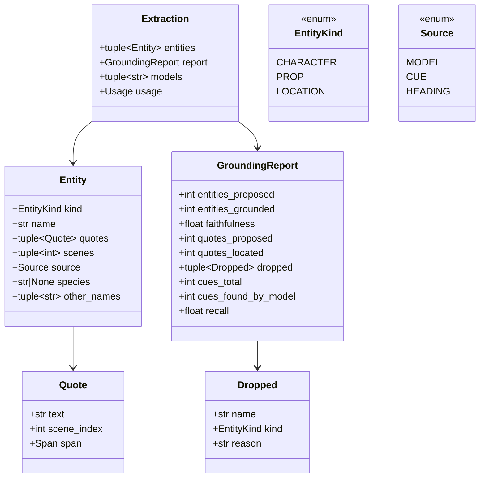

# Design — `grounding` (entity extraction + grounding filter; lane `script+grounding`)

**Status:** agreed · **Owner:** Katlego (Claude) · **Tasks:** T006, T039, T082, T088 · **Spec:** PLAN.md Non-negotiable I;
[SPEC.md](../../SPEC.md) US1

---

## 1. What this covers

Turning a parsed `Screenplay` (docs/design/script.md) into the cast, props and locations every
later stage draws from — **where every entity and every description is a verbatim quote located
back to a page and line span**, and anything the model says that can't be located is dropped.
Plus the two numbers that say how well it worked: **faithfulness** (precision) and **recall**.

**Not covered:** storage, shots (T007), frame prompts (T008). Portraits use these entities later
(T025).

## 2. Reference material

| Kind | Where |
| --- | --- |
| Code ported from | FrameFlow `services/api/app/services/grounding.py` (`normalize_for_grounding`, 26 Aug), `extraction_service.py` (scene chunking, merge, the filter), `governance_service.py` (faithfulness, recall) |
| Why recall matters | FrameFlow: faithfulness 1.0 on 15 entities of a script with 77 speaking characters — "a recall failure wearing a green badge" |
| API behaviour | docs/nebius-findings.md: `json_schema` enforced (U1); thinking off on the fast tier (U2); TPM is the binding limit (U4); `json_object` invented a detail (U1) |
| LLM seam | docs/design/llm.md (`structured_chat`, `Tier.FAST`) |

## 3. Domain model



- **What the model decides vs what the parser already knows.** Locations come from scene headings
  (`Source.HEADING`, the heading line is the quote). Speaking characters are known from dialogue
  cues. The model is asked only for what the parser can't know: characters and props **as the
  script describes them**, each with verbatim quotes.
- **Descriptions are quotes, never attributes.** No age, gender or role fields: FrameFlow asked for
  them, and inferring them is inventing (findings U1: "likely a lighthouse keeper"). A later stage
  that needs to draw a character reads its quotes.
- **`Quote.text`** is the model's quote; **`Quote.span`** is the element (action paragraph, speech
  or heading) it was found inside. A quote is *located* only when its normalised text is a
  substring of one element's normalised text — so its span is exact, never "somewhere in the
  script". The one exception to "the model's quote": a dialogue quote the model led with its
  speech's own header (§4, *Cue headers*) is kept **without** that header, so `Quote.text` is
  always text inside `Quote.span`.
- **Animals, other names and sex (T051, T082).** Three things the parser can't know and redaction
  and the prompt need (storyboard.md §3.1). All three are copied words, grounded in code, never
  inferred attributes:
  - **`species`**: for a `CHARACTER` that is an animal, the word the script uses for what it is
    ("A ginger cat, MARMALADE, sleeps…" → `cat`). A leading `a` / `an` / `the` is stripped first.
    It is kept only when the rest is 1–3 words with a letter; none of its words is in
    `PERSON_WORDS` (`NAME_STOP_WORDS` plus `PERSON`, `PEOPLE`, `MEN`, `WOMEN`, `CHILD`,
    `CHILDREN`, `KID`, `KIDS`, `BABY`, `TEENAGER`, `FIGURE`, `CROWD`) or is a name token of a
    *different* character (a speaking animal cued `CAT` keeps `cat`; NANDI can't be `species:
    "thabo"`); and it appears as whole words (`normalize_for_grounding`) inside one of that
    entity's located quotes **whose span is an `Action` element** (a description, not someone's
    speech). Otherwise `None`, and the character is treated as a person. Always `None` for props,
    locations and `Source.CUE` backfills. Across chunks, the first species that passes, in
    proposal order, wins. **Residual risk:** the test proves the word is in a description the
    model tied to this entity, not that it describes *this* entity ("NANDI strokes the cat" with
    species `cat` on NANDI would pass): a person read as an animal is drawn as one. Rare (it needs
    the model to call a person an animal), and recorded in §8.
  - **`other_names`**: other names the script gives the same character or prop: a nickname
    (SIPHOKAZI's "Kazi"), a pet's or a toy's name (the GIRAFFE called "Gerald"). Each is kept when
    the script mentions it as a whole word (the same test as an entity name), it differs from the
    entity's name under `normalise`, and it has at least one name token (characters' redact.py:
    stop words alone, like "Mr.", are not a name). A kept other name is always redacted; whether
    it gets its entity's label is decided by storyboard.md §3.1 (*paired*). Union across chunks,
    first appearance first. `()` for locations and `CUE` backfills.
  - **`sex_word` (T082):** for a person `CHARACTER`, the one word of the script that shows their
    sex, copied: a pronoun about them ("Siphokazi nods. **She** cannot stop the smile.") or a
    noun for them ("a salt-and-pepper-bearded **fisherman** … This is SIPHO (50s)."). The model
    only copies the word; it never states a sex, so `sex_word` is a copied word like `species`,
    not an inferred attribute. Code keeps it, as `Entity.sex` (a `Sex`: `female`, `male`) and
    `Entity.sex_quote` (the quote), only when:
    1. the word, lower case and with a trailing `.` stripped, is in `SEX_WORDS` (one pure module,
       `app/characters/sex.py`, below);
    2. one of the entity's located quotes **whose span is an `Action` element** (a description,
       not someone's speech) passes all of: (a) the word is a whole word of it, any case;
       (b) it **names this character**: a name token (`name_tokens` of the entity's name) or a
       kept other name as whole words under `normalise`, so a title alone ("Mr.") names no one;
       (c) it **names no other character**: no name token of another `CHARACTER` entity
       (`Source.CUE` ones and animals included), except when the two are aliases, one's token
       set containing the other's (THABO ⊂ THABO MOLEFE). Any other shared token counts as naming
       the other: "DUBE nods. She…" with THABO DUBE and LERATO DUBE names both, so neither gets a
       sex; (d) a pronoun (`she`, `he`, `herself`, `himself`) comes **after** the first mention of
       this character, the earliest whole-word occurrence of any of its name tokens or kept other
       names in the quote ("She nods. SIPHO…" gives Sipho nothing); a noun may come before it
       ("a … fisherman … This is SIPHO");
       (e) **every** sex-bearing word in it keys to the same sex: the `SEX_WORDS` and, though
       they never give a sex, the object and possessive pronouns `her`, `hers`, `him`, `his`
       (`CONFLICT_WORDS`): "She hands him the cup" gives nothing, a safe miss rather than a
       guess. The first such quote, in proposal order, is `sex_quote`.
    3. Across chunks, every kept proposal agrees; two that disagree keep `None`. The species test
       runs first: a character with a species gets `sex` `None`. Always `None` for props,
       locations and `Source.CUE` backfills.
    - **`SEX_WORDS`** keeps only words that, in one character's own description, are about that
      character: the subject and reflexive pronouns `she`, `herself` (female), `he`, `himself`
      (male); and the nouns `woman`, `girl`, `lady`, `fisherwoman`, `policewoman`,
      `businesswoman`, `waitress`, `actress` (female), `man`, `boy`, `gentleman`, `fisherman`,
      `policeman`, `businessman`, `waiter`, `actor` (male). **Left out on purpose** (the T082
      review): object and possessive pronouns (`her`, `him`, `his`: "SIPHO hands her the box" is
      about someone else); relational nouns (`mother`, `wife`, `uncle`…: "Thabo hugs his mother");
      plurals (`women`, `boys`: a group); titles (`miss` is also a verb), which `title_sex` reads
      from the name instead (storyboard.md §6). One dict, so a language or a word is added in one
      place; a word outside it fails closed (no sex), never guesses.
    - **Safe by returning `None`:** a character introduced only in dialogue (no `Action` quote); a
      "they" character (no word in the vocabulary); a woman described as "the fisherman" whose
      introduction says "her" (storyboard.md's `character_sex`: the sources disagree, so `None`).
    - **Residual risk:** a one-character quote whose pronoun or noun is about an unnamed other
      person ("KOOS (70s) pushes a broom. She waves."; "SIPHO waves to a woman") keeps the wrong
      sex if the model copies that word. The model reads the whole script and is asked for the
      word *about this character*; `character_sex` drops a sex the introduction contradicts;
      storyboard.md §9's labelled table measures what is left.
    - Faithfulness and recall don't change: a `sex_word` that fails is simply not kept.
  - **`sex_pronoun_quote` (T088):** `sex_word` must sit in a quote that names the character, so a
    sex the script gives only in a later sentence is missed: on 2026-10-12 T082 found 3 of the 9
    sexed characters of lost-property (L010) and missed THEO ("A small brown dog, BISCUIT, sleeps
    across his feet.") and DANIEL on the-bread-van. Code rules for these pronouns were stopped on
    review (storyboard.md §8): no rule on words tells whose "his" it is ("Siphokazi takes his
    hand"). So the **model** picks the sentence and says whom its pronoun means, and **code**
    checks the sentence and that the claim is the plain reading. For a person `CHARACTER`, the
    model may copy into `sex_pronoun_quote` one sentence of an action paragraph, exactly, in which
    a pronoun (`he`, `him`, `his`, `himself`, `she`, `her`, `hers`, `herself`) refers to this
    character. Code keeps it, as `Entity.sex` and `Entity.sex_quote`, only when all hold:
    1. it is located (`locate_quote`) in an `Action` element (never a speech or a parenthetical);
    2. its third-person singular pronouns (those eight words, whole words of `normalise`d text)
       are at least one and **all one sex**: "She hands him the cup" gives nothing;
    3. **the antecedent is the plain reading**: its first such pronoun, in the first place the quote
       occurs in that element (sentences split after `.`, `!` or `?` and whitespace, never after
       `Mr.`, `Mrs.`, `Ms.`, `Dr.` or `St.`; words `[A-Za-z']+`, compared in lower case), is
       scanned back through **two stretches only**: the words before it in its own sentence, then
       the sentence before (for an element's first sentence: the previous element's last sentence,
       or a `Dialogue`'s cue, never what is said). Going back word by word, the first of these
       decides:
       - a **capitalised** word (raw text: "with grace" is not GRACE) that is a name token of a
         person `CHARACTER` (`_tokens`): kept only if that token belongs to **this character and
         no other** (MR. DUBE and MRS. DUBE share DUBE: "Dube enters. She sits." gives neither);
       - a capitalised name token of an **animal** (a `CHARACTER` with a `species`): nothing, the
         pronoun may be the animal's own ("A small brown dog, BISCUIT, licks her paws.");
       - a **possessive** (`his`, `her`, `hers`, `their`, `theirs`, `my`, `your`, `our`) or a pronoun
         of the **other sex**: nothing ("Peter hugs his mother. She smiles.");
       - a **sex noun** (`SEX_WORDS` less `PRONOUNS`): nothing ("waves to a woman. She smiles.");
       - a **Title-case** word not first in its sentence and not a name stop word (`NAME_STOP_WORDS`,
         so "Mr." is no name): nothing, a name the extraction doesn't have ("hugs Lerato. She…");
         a prop in capitals (RED KITE) is not Title-case and doesn't stop the scan;
       - and a stretch whose sentence opens with a determiner (`a`, `an`, `the`, `this`, `that`,
         `these`, `those`, `another`, `some`) ends the scan with nothing: someone unnamed may be the
         subject ("The cashier smiles. She bags…").
       No name in the two stretches: nothing. So "DANIEL (40s), a tall driver, climbs out. He
       stretches until his back cracks." gives DANIEL male; "THEO (9) stumbles out with a bag held
       against his chest." gives THEO male; "She spots the sign and runs." right after PRIYA's
       speech gives PRIYA female (her cue is the sentence before); "Siphokazi takes his hand."
       claimed for SIPHO gives nothing (the name is SIPHOKAZI's); "Daniel laughs and takes the bag
       from him." claimed for THEO gives nothing; "A small brown dog, BISCUIT, sleeps across his
       feet." gives THEO nothing (it may be the dog's feet). A name spoken in dialogue ("Theo. Up.")
       is never an antecedent.
    4. Every kept piece of evidence, `sex_word` and `sex_pronoun_quote` from every chunk, gives one
       sex, else `None` (T082's rule 3); with both kept, `sex_quote` is the `sex_word`'s. The species
       test still runs first; never for props, locations or `Source.CUE` backfills.
    - **What the model decides, what code checks:** the model resolves the pronoun; code refuses a
      claim that isn't the plain reading (a named person nearby, no other possible referent between).
      **Not checkable by code:** a person with no name, no sex noun and no sentence of their own
      between ("Sipho knocks. She opens the door."), if the model claims that "She" for Sipho. Code
      can't tell it from "Siphokazi nods. She smiles."; the model is asked for a sentence where the
      reading is plain, `character_sex` drops a sex another source contradicts, and the labelled table
      and the held-out script measure it. No wrong sex on the samples is no proof for other scripts.
    - **The judge** sees the sentence as the evidence (`character_sex`), which may not name the
      character: the spec line is already under that character's name, so nothing is added.
    - The prompt's sentence and the schema field: §6. Faithfulness and recall don't change.
  - The filter now imports `name_tokens` / `NAME_STOP_WORDS` from `app/characters/redact.py`
    (a pure module that imports only `app.script`); `app/characters/__init__.py` must never import
    `labels.py`, which imports `app.grounding` (storyboard.md §6).
  - None of these affects faithfulness or recall (they are about the entity, not whether it exists), and
    a species or other name that fails its test is simply not kept.
- **`Entity.scenes`**: 0-based scene indexes, derived from where its quotes and (for characters)
  its matched cues sit. Never taken from the model's say-so.
- **Speaking characters the model missed** are added with `Source.CUE`, quoting their first
  speech, so the cast is complete. They don't count toward the model's recall — that measures
  the model.

## 4. Flow

```mermaid
sequenceDiagram
    participant C as Caller
    participant X as extract()
    participant M as structured_chat (FAST)
    participant G as grounding filter
    C->>X: Screenplay, NebiusChatModel
    X->>X: chunk_scenes: whole scenes, ≤ chunk_chars each; refuse > max_chunks
    par each chunk (≤ concurrency at once)
        X->>M: system prompt + render_chunk(scenes) → ChunkEntities
        M-->>X: proposed entities + ChatResult
    end
    X->>G: all proposals + Screenplay
    G->>G: per quote: locate in one element, else strip its speech's own header → Quote(text, span) or unlocated
    G->>G: per entity: name found in script AND ≥1 quote located → keep (bad quotes dropped); else Dropped
    G->>G: merge by (kind, normalise(name)); add HEADING locations; add CUE characters the model missed
    G-->>X: entities + GroundingReport
    X-->>C: Extraction
```

**Faithfulness** = entities fully grounded (name found **and every** quote located) ÷ entities
proposed, after merging. **Filtering** is per quote: an entity with one bad quote keeps its good
ones, because FrameFlow lost its lead character to exactly this (one quote broken by a line-break
hyphen). The two differ on purpose: the score measures the model; the filter decides what the
product may show, and it only ever shows located quotes.

**Cue headers (T039).** `render_chunk` shows a speech as `CUE (EXT)`, `(parenthetical)`, text,
and Nemotron 3.5 Lightning copies the header into the quote (`"LERATO\nI promise."`). The cue
line is not inside the speech's span, so the whole quote failed: on `samples/the-red-kite.pdf`
faithfulness fell to 0.14–0.63 and recall to 0/3. Two changes, in this order of trust:

1. The prompt asks for dialogue quotes without the speaker's name or the parenthetical.
2. `locate_quote`: a quote not located as given is tried once more, and kept only if **all** hold:
   its first line, or first two lines, normalised, equal one of *one speech's own* headers — the
   cue, the cue with its extension, either followed by that speech's parenthetical, or the
   parenthetical alone; the rest of the quote is non-empty; and the rest is inside **that same
   speech** (a speech of the same cue, never another speaker's). The kept `Quote.text` is the
   rest. No other prefix is stripped, a cue anywhere but the leading line is never stripped, and
   a quote that fails is still dropped — so every kept quote is still verbatim script text
   located to one span (Non-negotiable I). A stripped quote counts as located for faithfulness:
   the model copied what it was shown, word for word. The same text at the same span, given with
   and without its header, is kept once.

**Line-break hyphen (T039, T048).** Only a dash run touching the word before it is joined across a
line break (`sea-` / `green` → `SEA-GREEN`). A spaced dash at a line's end (`LOST PROPERTY -` /
`PLATFORM 9`, and since T048 a spaced `--`) keeps its space; joining it made the sign's own words
unfindable. The parser joins element text by the same rule (script.md §3).

**Recall** = distinct speaking cues matched (`match_speaker`) by a model-proposed, grounded
character ÷ distinct speaking cues. 1.0 when the script has no dialogue.

**Failure paths:** more chunks than `max_chunks` → `ExtractionError` before any call is made (each
chunk is billed). A chunk whose call fails (an `LLMError`, or a `ValidationError` after the repair
retry) fails the whole extraction with `ExtractionError` naming the chunk's scene range — a silent
gap in the cast is worse than a loud failure. No partial results are returned.

**What the model is asked for (T051).** Besides name, kind and quotes, each proposal carries
`species` (for an animal character, the script's word for what it is, copied from one of its
quotes; else null) and `other_names` (any other name the script gives the same character or prop,
copied exactly; else empty). The system prompt says so in those words; the filter (§3) decides what
is kept.

## 5. State

None. `extract` is a pure async function of its inputs plus the model calls.

## 6. Contracts

```python
# app/grounding/model.py
class EntityKind(StrEnum): CHARACTER = "character"; PROP = "prop"; LOCATION = "location"
class Source(StrEnum): MODEL = "model"; CUE = "cue"; HEADING = "heading"
@dataclass(frozen=True) class Quote: text: str; scene_index: int; span: Span
@dataclass(frozen=True) class Entity: kind: EntityKind; name: str; quotes: tuple[Quote, ...]; scenes: tuple[int, ...]; source: Source; species: str | None = None; other_names: tuple[str, ...] = (); sex: Sex | None = None; sex_quote: Quote | None = None   # §3, T051; sex, sex_quote: T082
# T082: app/projects/codec.py's _load uses a field's default when a stored record lacks it (today it raises
# "missing"), so an extraction stored before T082 (or T051) loads with sex None
@dataclass(frozen=True) class Dropped: name: str; kind: EntityKind; reason: str
@dataclass(frozen=True) class GroundingReport: entities_proposed: int; entities_grounded: int; faithfulness: float; quotes_proposed: int; quotes_located: int; dropped: tuple[Dropped, ...]; cues_total: int; cues_found_by_model: int; recall: float
@dataclass(frozen=True) class Extraction: entities: tuple[Entity, ...]; report: GroundingReport; models: tuple[str, ...]; usage: Usage
class ExtractionError(RuntimeError):
    def __init__(self, message: str, *, scene: str | None = None) -> None: ...
    scene: str | None   # the `number` of the first scene in the failed chunk; None only for the max_chunks budget (web.md §4.1)

# app/grounding/text.py
def normalize_for_grounding(text: str) -> str: ...        # FrameFlow's (join line-break hyphens that touch a word, collapse whitespace, upper-case) + fold curly quotes/dashes/ellipsis to ASCII and collapse dash runs, on both sides
type Index = list[tuple[int, Span, str]]                  # (scene_index, heading/element span, normalised source lines)
def build_index(screenplay: Screenplay) -> Index: ...     # built once per screenplay; the filter reuses it
def locate_in(index: Index, quote: str) -> tuple[int, Span] | None: ...
type CueIndex = list[tuple[int, Span, frozenset[str], str]]  # (scene_index, speech span, its normalised headers, normalised source lines)
def headers(speech: Dialogue) -> frozenset[str]: ...      # CUE, CUE (EXT), either + " (paren)", "(paren)" — normalised
def build_cue_index(screenplay: Screenplay) -> CueIndex: ...
def locate_after_cue(cues: CueIndex, quote: str) -> tuple[str, int, Span] | None: ...   # (text kept = quote minus its 1–2 header lines, scene_index, speech span)
def locate_quote(index: Index, cues: CueIndex, quote: str) -> tuple[str, int, Span] | None: ...  # as given (locate_in), else locate_after_cue
def locate(quote: str, screenplay: Screenplay) -> tuple[int, Span] | None: ...   # (scene_index, element or heading span)

# app/grounding/schema.py — what the model is asked for (strict json_schema via structured_chat).
# Its own module because both extract and filter use it.
class ProposedEntity(BaseModel): name: str; kind: Literal["character", "prop"]; quotes: list[str]; species: str | None; other_names: list[str]; sex_word: str | None   # T051: both required in the schema (null / [] when none); T082: sex_word required, null when none
# The system prompt gains (T082): "For a character who is a person, give in sex_word the one word of the
# screenplay that shows whether this character is female or male -- she, he, or a noun such as woman, girl,
# man, boy or fisherman -- copied exactly from one of its quotes from an action paragraph that names this
# character and no one else; otherwise sex_word is null. Never guess: copy only a word the screenplay writes
# about them." The schema docstring ("No age, gender or role fields") says sex_word is a copied word, as
# species is; its Field description says the same.
# T088: ProposedEntity gains `sex_pronoun_quote: str | None` (required in the schema, null when none),
# described as "Only for a character who is a person: one sentence of an action paragraph, copied exactly, in
# which he, him, his, himself, she, her, hers or herself refers to this character. Null when there is none, and
# for every prop"; the system prompt gains: "For a character who is a person, also give in sex_pronoun_quote one
# sentence of an action paragraph, copied exactly, in which a pronoun such as he, him, his, she or her refers
# to this character, choosing a sentence where that is plain; otherwise null."
# def _pronoun_sex(text: str, entity: Entity, cast: Sequence[Entity], screenplay: Screenplay, index: Index,
#                  cues: CueIndex) -> tuple[Sex, Quote] | None   # filter.py, pure: §3's rules 1 to 3; the Quote
#   is the located sentence (not one of entity.quotes); ground passes each kept one to _with_sex, which adds
#   them after the sex_word's pieces and applies rule 4
# app/characters/sex.py (T082), pure, imports nothing from app.grounding or app.storyboard:
class Sex(StrEnum): FEMALE = "female"; MALE = "male"
SEX_WORDS: dict[str, Sex]     # §3: the pronouns and nouns, lower case
CONFLICT_WORDS: dict[str, Sex]  # §3 rule (e): SEX_WORDS plus her, hers, him, his
SEX_TITLES: dict[str, Sex]    # storyboard.md §6 title_sex's words, upper case
class ChunkEntities(BaseModel): entities: list[ProposedEntity]

# app/grounding/extract.py
def chunk_scenes(screenplay: Screenplay, chunk_chars: int) -> list[tuple[Scene, ...]]: ...
def render_chunk(scenes: Sequence[Scene]) -> str: ...
async def extract(model: NebiusChatModel, screenplay: Screenplay, *, chunk_chars: int = 12_000,
                  max_chunks: int = 40, concurrency: int = 4, temperature: float = 0.0) -> Extraction: ...

# app/grounding/filter.py
def ground(proposals: Sequence[ProposedEntity], screenplay: Screenplay) -> tuple[tuple[Entity, ...], GroundingReport]: ...
```

`render_chunk` writes each scene as its heading, then its elements in order — action paragraphs as
text, speeches as `CUE`, `(parenthetical)`, text on separate lines — every piece verbatim from
the parser, so a faithful quote is always locatable.

## 7. Structure

| Path | New? | Responsibility |
| --- | --- | --- |
| `services/api/app/grounding/{__init__,model,text,schema,filter,extract}.py` | new | §6 |
| `services/api/app/grounding/run.py` | new | `python -m app.grounding.run <script.pdf>`: parse, extract on the real account, print entities, faithfulness, recall, model, tokens — the Phase 1 checkpoint |
| `services/api/tests/grounding/` | new | `locate`, `ground` (pure), `extract` with `httpx2.MockTransport` |

## 8. Decisions & alternatives

| Decision | Chosen | Rejected, and why |
| --- | --- | --- |
| Locations | from headings | model-extracted: the parser already knows them exactly |
| Character attributes | quotes only | age/gender/role fields: inference is invention |
| Quote location | inside one element | anywhere in the full text (FrameFlow): gives no span a panel can cite |
| A dialogue quote led by its cue (T039) | prompt says leave it out; the filter strips a leading line that is that same speech's own header, keeps the rest | reject the whole quote: dropped every character quoted through dialogue on Lightning (recall 0/3); strip any leading all-caps line: would let one speaker's name front another's line; match the quote anywhere after a cue: no longer one span |
| Filter granularity | per quote | per entity (FrameFlow): one wrap-broken quote dropped the lead |
| Recall | model-only, cues via `match_speaker` | FrameFlow's name-set intersection: exact-name only, missed "THABO" vs "THABO MOLEFE" |
| Chunk failure | fail the extraction | skip the chunk: a silent gap in the cast |
| Concurrency | 4 chunks at once | sequential (FrameFlow): Lightning allows 600 RPM / 400K TPM (U4) |
| Quote ↔ name pairing | not checked: a kept quote is verbatim and located, but nothing proves it is *about* the entity it's paired with | a semantic check: needs another model call and can't be exact. Nothing unscripted can be shown either way; a mis-paired quote is still a real line |
| Aliases ("THABO" vs "THABO MOLEFE" proposed separately) | kept as two entries | fuzzy merge: risks fusing two people. `match_speaker` still binds cues correctly, so scenes and recall are unaffected |
| Animals (T051) | a `species` word, grounded in the entity's own located quote | an `ANIMAL` entity kind: every consumer of `CHARACTER` (planner, cues, audit) would need a second branch, and an animal that speaks or acts is cast like a character; a model `is_animal` flag: an inferred attribute, ungroundable |
| Other names (T051) | `other_names`, kept when the script mentions them; the label is decided downstream by pairing (storyboard.md §3.1) | merging them as entities: "Gerald" isn't a separate thing; dropping one not inside the entity's own quote: a dropped other name is a name left in a prompt, so it is kept and redacted to the neutral `it` instead. **Cost:** a common capitalised word given as another name ("Mum", "Captain") is redacted wherever the script capitalises it |
| A sex from a later pronoun (T088; Tumo, 2026-10-12) | the model picks the sentence and means the pronoun, code checks it's located in an action line, of one sex, and the plain reading (the nearest named person, no unnamed woman or man between) | code rules alone (storyboard.md §8, T085 stopped: "Siphokazi takes his hand", "Sipho turns to her"); the model's word alone, as `sex_word` with any quote (it can claim "his" for Siphokazi); `sex_word` widened to his/her in a quote that names the character (still misses THEO and PRIYA, whose sentences don't name them) |
| A character's sex (T082; Tumo, 2026-10-11) | a copied `sex_word`, keyed by a fixed vocabulary, grounded in a located Action quote that names only this character; with storyboard.md's code rules (the introduction's pronouns, a title) | a model `sex` field: an inferred attribute, ungroundable; code rules alone: sipho-and-siphokazi's three characters have no pronoun of their own in their introduction (L002), and "Siphokazi nods. She…" needs coreference a rule can't do safely; any quote: dialogue ("my uncle") is about someone else |
| Species test (T051) | in an Action quote of the entity, not a person word, not a name token | any located quote: a person's speech mentioning "the cat" would pass; no word list: `species: "man"` would turn a person into an object for the audit. **Residual risk:** a person the model calls an animal, with that animal word in their own description line |
| Chunk size | 12,000 chars | FrameFlow's 20,000: smaller chunks help recall, and Lightning is cheap |

## 9. How this is verified

- `normalize_for_grounding` / `locate`: line-break hyphen, case, whitespace; a quote spanning two
  elements is not located; a heading is locatable; a spaced dash at a line end is not joined.
- `locate_quote` (T039): each header form is stripped and the rest kept at its own speech; the
  cases that must still fail — another speaker's cue, a wrong extension or parenthetical, nothing
  after the header, a cue not on its own line, a quote stitched across speeches, a heading or an
  action line as the "header", a name that is no cue.
- `ground` (T088), one scene per trap: "He stretches until his back cracks." after "DANIEL (40s), a tall
  driver, climbs out." → DANIEL male, `sex_quote` that sentence; "THEO (9) stumbles out with a bag held against
  his chest." → THEO male; "She spots the sign and runs." after PRIYA's speech → PRIYA female; "Mr. Dube takes
  off his cap." → MR. DUBE male (one sentence). Nothing for: "Siphokazi takes his hand." for SIPHO; "DANIEL
  laughs and takes the bag from him." for THEO; "She hands him the cup." (two sexes); "SIPHO (50s) waves to a
  woman. She smiles." (a sex noun); "THABO (30s) pays. The cashier smiles. She bags the items." (a determiner
  subject); "PETER (30s) hugs his mother. She smiles." (a possessive); "A small brown dog, BISCUIT, licks her
  paws." for THEO (an animal); "THABO (30s) dances with grace. He nods." for GRACE (a lower-case word is no
  name); "MR. DUBE (60s) and MRS. DUBE (60s) wait. Dube enters. She sits." (a shared token); "THABO (30s) hugs
  Lerato. She smiles." (a name not extracted); "He hasn't moved." after NOMSA's "Theo. Up." for THEO (spoken
  names are no antecedent); a sentence not found, or found only in dialogue. "LINDA (40s) lifts a RED KITE. She
  grins." → LINDA female (a prop in capitals doesn't stop it). A `sex_word` "He" in the whole paragraph and the
  pronoun sentence → male with the `sex_word`'s quote. The schema lists `sex_pronoun_quote` as required. Live,
  Token Factory (Tumo approved 2026-10-12): three extractions of each of the four samples (the-red-kite,
  sipho-and-siphokazi, lost-property, the-bread-van; the last two found on) against eval/sex-labels.json:
  WRONG 0 and INVENTED 0, the misses per character; then Tumo's unread script, held out.
- `ground` (T082): `sex_word` "She" in "Siphokazi nods. She cannot stop the smile." (one Action quote, one
  character) → `female` with that quote; "fisherman" in "a salt-and-pepper-bearded fisherman … This is SIPHO
  (50s)." → `male`; "her" in "MAMA THEMBI (60s), the shop's owner, watches her" (two characters) → None;
  "uncle" in dialogue → None; a word not in `SEX_WORDS` ("teacher", "her", "mother", "miss") → None; "SIPHO
  hands her the box" → None; "She hands him the cup" → None (two sexes); "She nods. SIPHO…" → None (the
  pronoun comes first); "a … fisherman … This is SIPHO" → male (a noun may come first); THABO and
  THABO MOLEFE in one quote → kept (aliases); "DUBE nods. She…" with THABO DUBE and LERATO DUBE → None
  for both (a shared token, not aliases); "Mr." alone names no one;
  two chunks proposing "she" and "he" → None; a prop, an animal, a `CUE` backfill → None. The codec: an
  extraction stored without `sex`, `sex_quote`, `species` or `other_names` loads with their defaults; a
  female entity round-trips. KOOS (`KOOS (70s), the night cleaner, pushes a broom. She waves.`):
  `introduced_sex` stays None (T079); the grounded sex is female only if the model copies "She", the
  recorded residual risk.
- `ground` (T051): a species found in the entity's own located Action quote kept (a leading
  article stripped: "a cat" → `cat`), one only in a dialogue quote, in another entity's quote, a
  person word (`man`, `girl`, `figure`) or a character's name token dropped to `None`, a species on
  a prop ignored; an other name the script
  mentions kept, one it doesn't (or equal to the name, or only stop words) dropped; both merge across
  chunks; CUE backfills have neither.
- `ground`: bad quote dropped but entity kept; entity whose name isn't in the script dropped with a
  reason; merge across chunks; HEADING locations; CUE backfill; faithfulness and recall arithmetic.
- `extract`: chunks never split a scene; `max_chunks` refusal makes no call; a failing chunk fails
  the extraction; request uses `Tier.FAST`, thinking off, strict `json_schema`.
- Checkpoint: `python -m app.grounding.run` on the self-written sample PDF, on the real account.

## 10. Open questions

- [ ] U6 (sampling): `temperature` defaults to 0.0. Compare 0.0 vs 1.0/0.95 on a full-length sample
  once one exists (T031).
- [ ] The sample is tiny; recall on a feature-length public-domain script needs T031's samples.
- [ ] Usage undercounts a repaired chunk: `StructuredResult.chat` is the final call only. Fine
  while repairs are rare (U1); revisit if the trace shows them.
