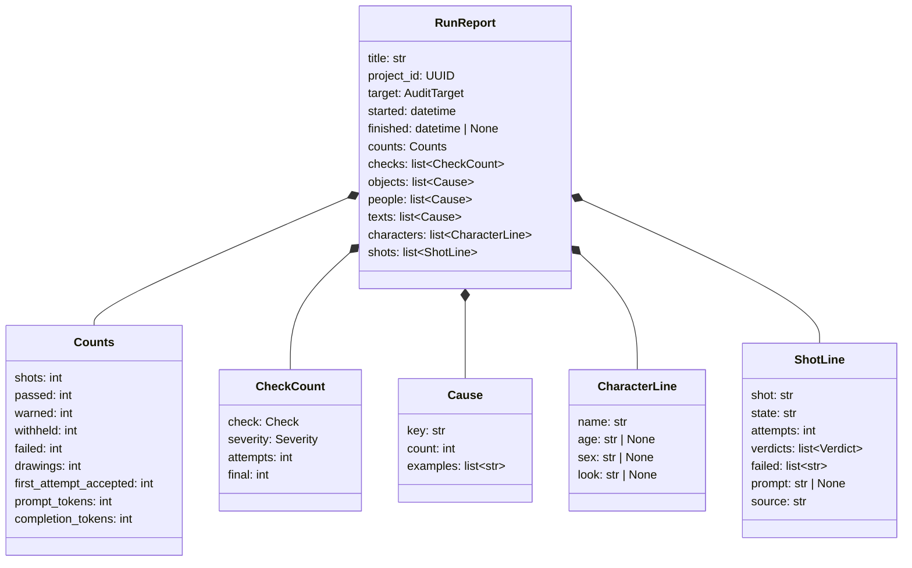
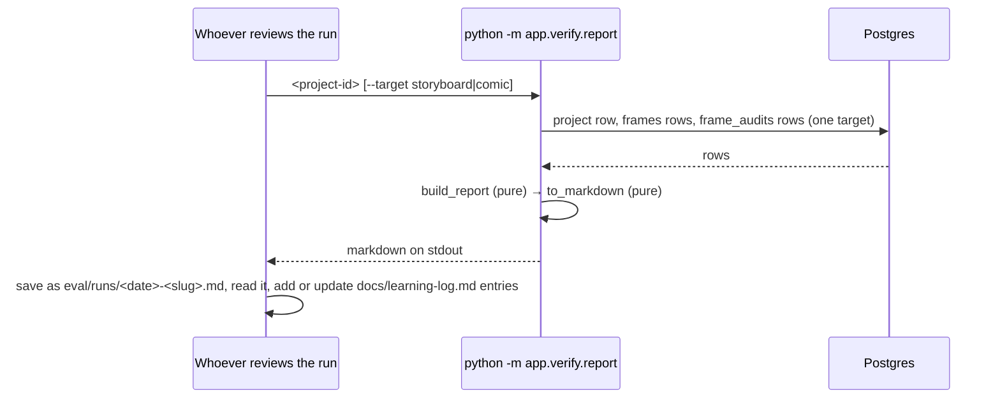

# Design — `learning` (run reports and the learning log)

**Status:** proposed · **Owner:** Tumo (Claude) · **Tasks:** T081 · **Spec:** [SPEC.md](../../SPEC.md)
US2 (frame audit)

---

## 1. What this covers

Every live run teaches us something the tests can't, and how well a run goes depends on the script.
On 2026-10-11 the-red-kite accepted 16 of 21 frames. sipho-and-siphokazi accepted 7 of 30, and one
accepted frame was wrong: 8.3 drew an old woman and a boy for Sipho and Siphokazi. Without a
written record, the same lesson gets learned again. This doc adds two things:

- **A run report**, written by code from what a run already stored: the project, its frames and
  their `frame_audits` rows. It makes no model call, writes nothing to the database and draws
  nothing, so it costs nothing. One report per live run is committed under `eval/runs/`.
- **The learning log**, [docs/learning-log.md](../learning-log.md). One entry per lesson, written
  by whoever reviewed the run: what we saw (with the report's numbers), why (code references), what
  we did (the task and PR), and what it measured before and after, on the same stored drawings.

**Not covered:** changing the audit or the prompt (each fix is its own task, measured with this
report); dollar costs (`eval.md` §1: prices change, so drawings and tokens are reported instead);
any copyrighted script (eval.md §1).

## 2. Reference material

- `services/api/app/verify/reaudit.py`: reads the same rows (`ProjectRow`, `FrameAuditRow`) the
  same way, outside the app.
- `services/api/app/verify/audit.py` `run_checks`: writes each check's `detail` in fixed shapes
  (`object 2 (boat masts, vehicle): never set dressing`, `person 0 (left, an old man …): no shot
  character, no support`, `text 'MILK' isn't the script's`). The report reads those shapes, so §9
  tests them against `run_checks`' real output, not copies.
- `services/api/app/storyboard/prompt.py`: `build_frame_prompt`, `introduced_age`,
  `introduced_sex`, `introduced_look`.

## 3. Domain model



- `CheckCount.attempts`: how many logged attempts failed (hard) or warned (soft) on that check.
  `final`: how many shots' **last** attempt did. The first counts the model's habits, the second
  what the reader sees.
- `Cause`, for objects: key `<category> · <reason>` (`vehicle · never set dressing`), examples the
  object names, most frequent first, at most 5. For people: key the description's first noun
  phrase (`an old man`, `a teenage boy`). For text: key the string read (`MILK`). Sorted by count,
  then key.
- `CharacterLine`: for each extracted character, what the prompt gives (`introduced_age`,
  `introduced_sex`, `introduced_look`), or `None`. A `None` sex for a character the script does
  sex is how tonight's lesson would have shown at a glance.
- `ShotLine.prompt`: `build_frame_prompt`'s text, **rebuilt with today's code** in the registry's
  default style and the `comfyui_max_words` budget, as `fal_factory` draws (`storyboard/fal.py`).
  The report says it was rebuilt. `None` with the error's message when the build fails.

## 4. Flow



**Failure paths:** an unknown or malformed id exits 2 with `no such project`; a project with no
plan yet exits 2 with `no shot plan yet`; a database error exits 1 with its type. Nothing is ever
written, so a failed report leaves nothing behind.

## 5. State

None. The report is computed from rows each time; the learning log is a file edited by hand.

## 6. Contracts

```python
# services/api/app/verify/report.py
def build_report(project: ProjectRow, frames: Sequence[FrameRow], audits: Sequence[FrameAuditRow],
                 *, target: AuditTarget, styles: StyleRegistry, max_words: int) -> RunReport: ...   # pure
def to_markdown(report: RunReport) -> str: ...   # pure; layout below
def object_causes(audits: Sequence[FrameAuditRow]) -> list[Cause]: ...   # pure; from run_checks' detail shapes
def person_causes(audits: Sequence[FrameAuditRow]) -> list[Cause]: ...
def text_causes(audits: Sequence[FrameAuditRow]) -> list[Cause]: ...
# python -m app.verify.report <project-id> [--target storyboard|comic]   (default storyboard)
```

`frames` are used for `target=storyboard` only (a comic's panels live in its `comics` row, so its
states come from each shot's last audit).

**Markdown layout** (`to_markdown`), in this order:

1. `# Run report: <title>` and one line: project id, target, started and finished (UTC), and
   "prompts rebuilt with the code at <git describe, if given by `PANELWISE_GIT_DESCRIBE`, else
   'this checkout'>".
2. `## Result`: one table of `Counts`, and accepted = passed + warned out of shots.
3. `## Checks`: `CheckCount` rows, hard first, then soft, in `Check` order.
4. `## Causes`: three tables (objects, people, text), each `count | key | examples`, top 15.
5. `## Characters`: `CharacterLine` rows; an empty cell reads "none from the script".
6. `## Shots`: one row per shot in plan order: `shot | state | attempts | verdicts | final failed
   checks | prompt`, then each shot's `source` below the table, as the PDF shows it.

**`docs/learning-log.md` entry**, newest first:

```markdown
### L<nnn> · <short name> · <open | fixed | won't fix>

- **Seen:** <date>, <script>, [run report](../eval/runs/<file>.md): <the numbers>
- **Cause:** <what, with file:line or function names>
- **Action:** <task id, PR numbers, or why none>
- **Measured:** <before → after, and on which stored drawings, or "not yet">
```

## 7. Structure

| Path | New/changed | What |
| --- | --- | --- |
| `services/api/app/verify/report.py` | new | §6 |
| `services/api/tests/verify/test_report.py` | new | §9 |
| `eval/runs/README.md` | new | what a run report is, the command, one line per report |
| `eval/runs/2026-10-11-the-red-kite.md`, `eval/runs/2026-10-11-sipho-and-siphokazi.md` | new | today's two runs |
| `docs/learning-log.md` | new | §6's format, seeded with today's lessons |

## 8. Decisions & alternatives

| Decision | Chosen | Rejected, and why |
| --- | --- | --- |
| Where reports come from | code, from stored rows | written by hand: slow, and numbers drift from the data |
| Where reports live | committed under `eval/runs/` (Tumo, 2026-10-11) | local only: Katlego and later AIs couldn't learn from them |
| The prompt in the report | rebuilt with today's code, labelled so | stored per attempt: needs a migration and a new column; rebuilding is exact while the prompt code hasn't changed since the run, and the label says when it might have |
| Causes from check details | parse `run_checks`' fixed shapes, tested against its real output | re-run the checks: needs the screenplay, extraction and the same code as the run; the details are what the run actually decided |
| A database table for lessons | a markdown file | a table: lessons are prose for people, reviewed in PRs |

Deviations from [docs/architecture-defaults.md](../architecture-defaults.md): none.

## 9. How this is verified

- `object_causes`, `person_causes`, `text_causes` on details produced by `run_checks` itself (a
  frame with an unscripted vehicle, a stranger, painted text): keys and counts as expected; a
  detail in an unknown shape is counted under `other` and never dropped.
- `build_report` on hand-built rows: counts (a shot with three failed attempts then withheld, one
  passed at attempt 2, one warned at attempt 1), `final` vs `attempts`, a comic target ignoring
  `frames`, a prompt that fails to build shows its error.
- `to_markdown`: the sections in order, the "rebuilt" line, a character with no sex reads
  "none from the script".
- Live, free: `python -m app.verify.report` on the 2026-10-11 runs gives the-red-kite 16 of 21
  accepted and 38 drawings, and sipho-and-siphokazi 7 of 30 and 82 drawings, as the database says.

## 10. Open questions

- [ ] Should the gate check that every `eval/runs/*.md` is listed in `eval/runs/README.md`? Not
  now: a missing line is a review comment, not a broken build.
