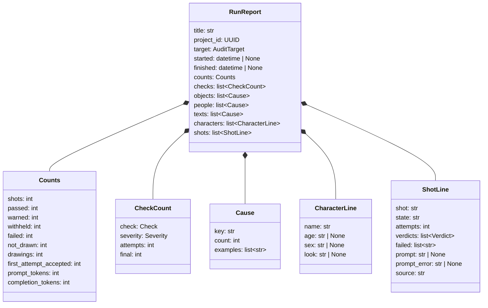
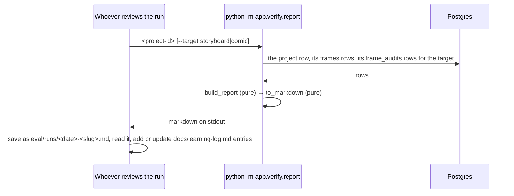

# Design — `learning` (run reports and the learning log)

**Status:** proposed · **Owner:** Tumo (Claude) · **Tasks:** T081 · **Spec:** [SPEC.md](../../SPEC.md)
US2 (frame audit)

---

## 1. What this covers

Every live run teaches us something the tests can't, and how well a run goes depends on the script.
On 2026-10-11 the-red-kite accepted 16 of 21 frames. sipho-and-siphokazi accepted 7 of 30, and one
accepted frame was wrong: 8.3 drew an old woman and a boy for Sipho and Siphokazi. Without a
written record, the same lesson gets learned again. This doc adds two things:

- **A run report**, written by code from what a run already stored: the project, its frames and
  their `frame_audits` rows. It makes no model call, writes nothing to the database and draws
  nothing, so it costs nothing. One report per live run is committed under `eval/runs/`.
- **The learning log**, [docs/learning-log.md](../learning-log.md). One entry per lesson, written
  by whoever reviewed the run: what we saw (with the report's numbers), why (code references), what
  we did (the task and PR), and what it measured before and after, on the same stored drawings.

**Not covered:** changing the audit or the prompt (each fix is its own task, measured with this
report); dollar costs (`eval.md` §1: prices change, so drawings and tokens are reported instead);
any copyrighted script (eval.md §1).

## 2. Reference material

- `services/api/app/verify/reaudit.py`: reads the same rows (`ProjectRow`, `FrameAuditRow`) the
  same way, outside the app, and loads the plan, screenplay and extraction with
  `app.projects.codec`'s `load_plan`, `load_screenplay`, `load_extraction`.
- `services/api/app/frames/writer.py`: stores each audit's `checks` as a list of
  `{"check", "severity", "ok", "detail"}`.
- `services/api/app/verify/audit.py` `run_checks`: writes each failed check's `detail` as its
  failures joined by `"; "`, each in a fixed shape (§3, Causes). The report reads those shapes, so
  §9 tests them against `run_checks`' real output, not copies.
- `services/api/app/storyboard/prompt.py`: `build_frame_prompt`, `introduced_age`,
  `introduced_sex`, `introduced_look`; `services/api/app/storyboard/fal.py` `fal_factory`: the
  style (`registry.get(None)`) and word budget (`Settings().comfyui_max_words`) a storyboard draws
  with.
- `services/api/app/comic/job.py`: a comic panel has no `frames` row; its audits are
  `target = comic`.

## 3. Domain model



Everything is for **one project, by its id, and one target** (`storyboard` by default). Titles
are never used to find a project: two uploads of one script share a title (sipho-and-siphokazi has
a 2026-10-10 and a 2026-10-11 project). "The audits" below means that project's `frame_audits`
rows for that target.

**Shots.** Every shot in `load_plan(project.plan).shots` gets one `ShotLine`, in plan order
(`scene_index`, then `number`). `shot` is `f"{scene.number}.{shot.number}"`
for its scene in `load_screenplay(project.screenplay)` (`Scene.number` is a string), as `reaudit` prints it. `source`
is `shot.source`. A shot's audits are those with its `scene_index` and `shot_number`; its **last
audit** is the one with the highest `attempt`.

- `state`, storyboard: the shot's `FrameRow.state`, as stored (so `rendering` and `auditing` show as
  such); `not drawn` when it has no `frames` row.
- `state`, comic: from its last audit, `pass` → `passed`, `warn` → `warned`, `fail` or `error` →
  `withheld`; `not drawn` when it has no audit. (A panel reused from an earlier comic job keeps
  that job's audits, which are still this project's comic audits.)
- `attempts`: the number of its audits; `verdicts`: their verdicts in attempt order; `failed`: the
  `check` names its last audit has `ok == false` with severity `hard`. A shot with no audits has
  `0`, `[]`, `[]`.

**Counts.** `shots`: plan shots. `passed`, `warned`, `withheld`, `failed`, `not_drawn`: shots by
`state` (storyboard `rendering` or `auditing` count as `not_drawn`; the report is meant for a
finished run and says so when any shot is still in them). Always: shots = passed + warned + withheld
+ failed + not_drawn. `drawings`: the number of audits (one
row per drawing, each audited once: 38 for the-red-kite and 82 for sipho-and-siphokazi on
2026-10-11). `first_attempt_accepted`: shots whose attempt-1 audit is `pass` or `warn`.
`prompt_tokens`, `completion_tokens`: sums over the audits. An audit with verdict `error` has no
checks: it counts as a drawing and in the tokens, in no check.

**Times.** `started` and `finished`: the earliest and latest `created_at` of the audits; both
`None` with no audits. (The project's own `created_at` is the upload, not the run.)

**CheckCount**, one per `Check` that any audit has: `attempts` is the number of audits where that
check has `ok == false`; `final` the number of shots whose last audit has it `ok == false`;
`severity` as stored. The first counts the model's habits, the second what the reader sees.

**Causes**, read only from checks with `ok == false`. A `detail` holds several failures joined by
`"; "`; it is split at `"; "` only where the next piece starts with `object `, `person ` or
`text `, because a model-written name may itself contain `"; "`. Each piece is matched to its
shape; a piece that matches none counts under the key `other`, with the piece as its example, and
is never dropped. Each table is sorted by count, then key; examples are the most frequent first,
at most 5, each once.

- **Objects** (`unscripted_object`, and since T083 the soft `background_object`):
  `^object (\d+) \((.*), ([^,]*)\): (.*)$`. Key `<category> · <reason>` (`vehicle · never set
  dressing`, `nature · not in the script`); examples the object names (group 2).
  The reasons are `run_checks`' six: `unscripted`, `prop without support`, `held, so not set
  dressing`, `the script names it`, `never set dressing`, `not in the heading`.
- **People** (`unscripted_person`): `^person (\d+) \(([^,]*), (.*)\): (.*)$`, the appearance being
  group 3. Key: the appearance in lower case, leading spaces stripped, cut before the earliest of
  `,`, ` in `, ` with `, ` wearing `, ` standing `, ` sitting `, ` holding `, ` seen `,
  ` looking `, ` smiling `, trailing spaces stripped (`an old man with white hair, standing` →
  `an old man`; `a teenage boy` → `a teenage boy`). Examples: the reasons (group 4), which are
  `no shot character, no support`, `its support is about a character`, or `<NAME> is already
  another person`. The cut is at the first occurrence after position 0; a key with no letter left in it
  (`,` from `, in a coat`) becomes `other`.
- **Text** (`text_in_frame`): `^text (.*) isn't the script's$`; the key is group 1 read back with
  `ast.literal_eval` (it was written with `repr`, so either quote may wrap it), or group 1 as is
  when that fails. Examples: the `shot` labels it appeared in (`6.4`), in plan order, each once.

The other checks (`setting`, `missing_character`, `light`, `framing`, `signature`,
`no_character`) have no cause table: `## Checks` counts them, and their details show per shot.

**CharacterLine**, one per extracted character (`EntityKind.CHARACTER`, extraction order):
`introduced_age`'s text, `introduced_sex`, `introduced_look`'s text, each `None` when the script
gives none. A `None` sex for a character the script does sex is how 2026-10-11's lesson would have
shown at a glance.

**ShotLine.prompt**: `build_frame_prompt(shot, screenplay, extraction, styles.get(None),
max_words=max_words)`'s text, with `max_words` from `Settings().comfyui_max_words`, as
`fal_factory` draws. This is the prompt **rebuilt with the code the report runs**, not a stored
copy; the report says so. When the build raises, `prompt` is `None`, `prompt_error` is
`"<type>: <message>"`, and the shot's row shows it instead.

## 4. Flow



**Failure paths:** a malformed id is refused by `argparse` (exit 2, its usage message); a
well-formed id with no project exits 2 with `no such project`; a
project whose `plan`, `screenplay` or `extraction` is still empty exits 2 with `no shot plan yet`;
a database error exits 1 with its type. Nothing is ever written, so a failed report leaves nothing
behind.

## 5. State

None. The report is computed from rows each time; the learning log is a file edited by hand.

## 6. Contracts

```python
# services/api/app/verify/report.py
def build_report(project: ProjectRow, frames: Sequence[FrameRow], audits: Sequence[FrameAuditRow],
                 *, target: AuditTarget, styles: StyleRegistry, max_words: int) -> RunReport: ...   # pure
#   loads the plan, screenplay and extraction from `project` as reaudit does; `frames` read for
#   target=storyboard only; `audits` are this project's, filtered to `target` here as well
def to_markdown(report: RunReport) -> str: ...   # pure; layout below
def object_causes(audits: Sequence[FrameAuditRow]) -> list[Cause]: ...   # pure; §3 Causes
def person_causes(audits: Sequence[FrameAuditRow]) -> list[Cause]: ...    # pure
def text_causes(audits: Sequence[FrameAuditRow], *, label: Callable[[int, int], str]) -> list[Cause]: ...   # pure;
#   label(scene_index, shot_number) is the shot label of §3 (build_report passes its own)
# python -m app.verify.report <project-id> [--target storyboard|comic]   (default storyboard)
#   reads Settings() for the database and comfyui_max_words only (never Storage: unlike reaudit it
#   needs no Supabase keys), load_styles(PUBLIC_STYLES, private) as
#   create_app does; prints the markdown; exit codes as §4
```

**Markdown layout** (`to_markdown`), in this order:

1. `# Run report: <title>`, then one line: the project id, the target, `started` and `finished`
   (UTC, minutes), and "prompts rebuilt with the code that wrote this report". When a shot is
   still `rendering` or `auditing`: a line `The run had not finished: <n> shots still in progress.`
2. `## Result`: a table of `Counts`, and the line `<passed + warned> of <shots> accepted`.
3. `## Checks`: `CheckCount` rows, hard first, then soft, each in `Check` order.
4. `## Causes`: three tables (objects, people, text), each `count | key | examples`, the top 15
   rows each.
5. `## Characters`: `CharacterLine` rows; an empty cell reads "none from the script".
6. `## Shots`: one row per shot in plan order, `shot | state | attempts | verdicts | final failed
   checks | prompt`, then each shot's `source` in a list below the table: the shot's verbatim
   script text.

**`docs/learning-log.md` entry**, newest first:

```markdown
### L<nnn> · <short name> · <open | fixed | won't fix>

- **Seen:** <date>, <script>, [run report](../eval/runs/<file>.md): <the numbers>
- **Cause:** <what, with file:line or function names>
- **Action:** <task id, PR numbers, or why none>
- **Measured:** <before → after, and on which stored drawings, or "not yet">
```

## 7. Structure

| Path | New/changed | What |
| --- | --- | --- |
| `services/api/app/verify/report.py` | new | §6 |
| `services/api/tests/verify/test_report.py` | new | §9 |
| `eval/runs/README.md` | new | what a run report is, the command, one line per report |
| `eval/runs/2026-10-11-the-red-kite.md`, `eval/runs/2026-10-11-sipho-and-siphokazi.md` | new | the two runs of 2026-10-11 |
| `docs/learning-log.md` | new | §6's format, seeded with the 2026-10-11 lessons |

## 8. Decisions & alternatives

| Decision | Chosen | Rejected, and why |
| --- | --- | --- |
| Where reports come from | code, from stored rows | written by hand: slow, and numbers drift from the data |
| Where reports live | committed under `eval/runs/` (Tumo, 2026-10-11) | local only: Katlego and later AIs couldn't learn from them |
| The prompt in the report | rebuilt with the report's code, labelled so | stored per attempt: needs a migration and a new column; rebuilding is exact while the prompt code hasn't changed since the run, and the label says when it might have |
| Causes from check details | parse `run_checks`' fixed shapes, tested against its real output; unknown shapes counted as `other` | re-run the checks: needs the same code as the run; the details are what the run actually decided |
| Finding a project | by id only | by title: two uploads share one |
| A database table for lessons | a markdown file | a table: lessons are prose for people, reviewed in PRs |

Deviations from [docs/architecture-defaults.md](../architecture-defaults.md): none.

## 9. How this is verified

- `object_causes`, `person_causes`, `text_causes` on details produced by `run_checks` itself (a
  frame with an unscripted vehicle, a stranger, painted text): keys and counts as expected; a name
  containing `"; "` stays one object; a text with an apostrophe (`"JO'S CAFE"`) keys as
  `JO'S CAFE`; a detail in an unknown shape counts under `other`; a check with `ok == true` is
  never read.
- `build_report` on hand-built rows: a shot with three failed attempts then withheld, one passed
  at attempt 2, one warned at attempt 1, one failed to render (no audits), one with no `frames` row
  (`not drawn`); `Counts` (drawings = audits, `first_attempt_accepted` = 1, the sum of states equal to `shots`), `final` vs
  `attempts`; an `error` audit counted as a drawing and in no check; the comic target ignoring
  `frames` and deriving state from the last audit; a prompt that fails to build shows its error;
  `started`/`finished` from the audits.
- `to_markdown`: the sections in order, the "rebuilt" line, the unfinished-run line, a character
  with no sex reads "none from the script".
- Live, free: `python -m app.verify.report` on the 2026-10-11 projects gives the-red-kite 16 of 21
  accepted, 38 drawings, 10 accepted at attempt 1; sipho-and-siphokazi 7 of 30 and 82 drawings.

## 10. Open questions

- [ ] Should the gate check that every `eval/runs/*.md` is listed in `eval/runs/README.md`? Not
  now: a missing line is a review comment, not a broken build.
