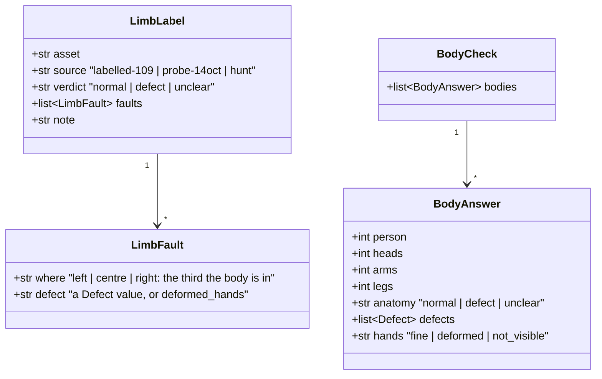

# Design — `verify` the limb agent: a body drawn wrong, measured on Super VL first

**Status:** draft (measure first; the check is designed only as far as the measurement needs) ·
**Owner:** Katlego (Claude) · **Tasks:** T111 (label, measure, decide); the code task is numbered
when §8 adopts it, announced on this doc's PR · **Spec:** [SPEC.md](../../SPEC.md) US2 (frame audit)
· **Raised:** 2026-10-17 by Katlego

---

## 1. What this covers

The image model sometimes draws a body wrong: a third arm, a leg growing from the wrong place, two
bodies fused, a missing limb that should be in view, a hand melted into a claw. No check sees it
today. The describer says what a person looks like, not how many arms they have; the judge never
sees the image. A reader sees it at once, and a three-armed man is not the person the script
describes.

**The agent:** one vision question per audited frame that has a described person. Per person: how
many heads, arms and legs are attached, whether the body is drawn as a real body, which defects,
and the hands. If the answers are good enough (§8), a hard check, `LIMBS`, fails on a named defect,
and the rule ladder decides whether it withholds.

**Why measure first:** the same question was asked on 2026-10-14 on DeepSeek-V4.1-Flash, in one call
with T097's head boxes, and failed. It called a man drawn with three arms (the-red-kite 0.3 a1)
`normal` twice, even when told to count each limb back to its shoulder. It counted 0 legs on
standing people and 1 arm on a person with two, and called one drawing's ordinary hands deformed.
So T097 kept the head boxes and dropped anatomy (verify.md §3 *The head agent*, §8; on #170). The
vision model has since changed to Nemotron 3.5 Super VL (T105). T097's head boxes, which DeepSeek
got right, came out right on Super VL too: 24 of 24 on the 14 Oct drawings. Whether Super VL can
count limbs is unmeasured.

**Not covered:** heads for the bubbles (T097); a frame in panels or one person drawn twice (T104);
the drawn sex (T095, T102); hairstyle words (T108); the judge (unchanged).

## 2. Reference material

| Kind | Where |
|---|---|
| The failed measurement | verify.md §3 *The head agent* ("No anatomy"), on #170 (`docs/heads-t097`); the 14 Oct prototype's prompt and schema are §6's starting point, verbatim |
| The drawings to label | Tumo's 109 labelled frames (`eval/labelled/`, `eval/frame-labels.json`, #194: each frame's Storage path, project data and stored audit; read only, never edited here) and the 18 distinct drawings of the 14 Oct probe (the-red-kite, T097's eye test, 2026-10-17) |
| How a model is measured | [vision-model.md](vision-model.md) §8 (T105: a bar written before the run); [nebius-findings.md](../nebius-findings.md) § U8 |
| The vision model | `nvidia/Nemotron-3.5-Super-VL`, `NEBIUS_VISION_THINKING=false` (T105's default) |
| Background reading | [docs/research/anatomical-fidelity.pdf](../research/anatomical-fidelity.pdf), its findings in [docs/research/README.md](../research/README.md) § Anatomical fidelity: the four kinds of fault, small hands, answers that box the fault |

## 3. Domain model



- **`LimbLabel`** is one drawing judged by eye (Katlego), stored in
  `docs/design/limb-agent/labels.json`. `defect` means a reader would notice at once; `unclear` is a
  drawing too small or too sketchy to say. Labelled **before** any model answer is seen, so the
  labels don't lean toward the model. A fault was meant to name the **third** the broken body is
  in (the hunted drawings have no stored description), but the labels never filled it in (2026-10-18),
  so **faults are matched per drawing**: an answer that names any defect on a drawing labelled
  `defect` is a catch. The bar's measures are per drawing anyway (§8).
- **The hunted pool** (`source: hunt`, Katlego's ask, 2026-10-18): Tumo's 109 frames have no
  anatomy fault at all and the probe has one, so recall on them alone would rest on one or two
  drawings. Claude looks through every drawing in the dev bucket (1,382 on 2026-10-18, every
  attempt of every run, withheld ones too) and adds those where a body may be drawn wrong. Katlego
  still labels them, on the same page, with nothing saying why they were picked. **They are
  scored apart:** a vision model chose them, so they lean toward faults a vision model can see,
  and recall on them is an upper bound; the 127 stay the honest base for false alarms.
- **`BodyAnswer`** and **`BodyCheck`** are the prototype's schema, minus the head box (T097 has
  it). `heads`, `arms` and `legs` count what is attached to the body, visible or partly visible.
- **Only if §8 adopts it:** a `BodySeen` per answered person on `Audit.bodies`, a `LIMBS` check,
  and `frame_audits.bodies` (§6).

## 4. Flow

**The measurement (T111):**

```mermaid
sequenceDiagram
    participant K as Katlego (eye)
    participant M as measure_limbs.py
    participant S as Storage (dev bucket)
    participant V as Super VL
    K->>K: label every drawing (labels.json), no model answers shown
    M->>S: each labelled drawing's PNG
    M->>V: the limb question, the stored description's people (twice per drawing)
    V-->>M: BodyCheck
    M-->>K: per drawing: answer against label; recall, false alarms, agreement
    K->>K: decide against §8, recorded in findings § U9
```

**In the audit, only if adopted:** in `audit_frame`, after the layout agent (T104), on a
well-formed judgement with at least one described person: one question, then `run_checks(...,
bodies=...)`. It is asked on **every** attempt, unlike T097's heads: it is a check, and a check that
can withhold has to see the frame it withholds.

**Failure paths:** a failed question (`LLMError` or `ValidationError`) checks nothing: logged, never
an `ERROR`, as every agent since T095. An answer for a person not described, or a second answer for
one person, is dropped. `unclear` never fails.

## 6. Contracts

The measurement (T111):

```python
# services/api/tools/measure_limbs.py (writes nothing to the database or Storage)
#   python tools/measure_limbs.py LABELS_JSON OUT_JSON [--repeat 2]
#   for each label: the PNG from Storage, the stored description's people (a hunted drawing has none:
#   it is described first, one `describe_frame` call on Super VL), LIMB_AGENT_PROMPT on
#   Tier.VISION (max_tokens=4096) `--repeat` times; prints recall, false alarms, agreement (§8)

LIMB_AGENT_PROMPT = (  # the 14 Oct prototype's anatomy half, as measured on DeepSeek
    "You look at the people in a storyboard drawing, one by one, and say whether each listed "
    "person's body is drawn as a real human body: anatomy 'defect' only for an error a viewer "
    "would notice at once - two heads, a third arm or leg, a limb growing from the wrong place, "
    "two bodies fused together, a body twisted the way no body bends, a missing head or limb that "
    "should be in view. A limb hidden by the frame's edge, an object, another person or a pose is "
    "not missing. Then the hands: 'deformed' for too many or too few fingers, fused or melted "
    "fingers or a claw-like mass; 'not_visible' when no hand is clear enough to judge. Answer for "
    "every person listed, by their number, and only for them. Before judging the anatomy, count "
    "what is attached to each person's body: heads, arms (shoulder to hand) and legs (hip to "
    "foot), tracing each limb back to the shoulder or hip it grows from. Count a hand or arm only "
    "if it joins this person's body; more than one head, two arms or two legs is a defect."
)
type Defect = Literal["two_heads", "extra_arm", "extra_leg", "misplaced_limb", "fused_bodies",
                      "impossible_twist", "missing_head", "missing_limb"]
class BodyAnswer(BaseModel): person: int; heads: int; arms: int; legs: int; anatomy: Literal["normal", "defect", "unclear"]; defects: list[Defect]; hands: Literal["fine", "deformed", "not_visible"]
class BodyCheck(BaseModel): bodies: list[BodyAnswer]
# the people listed as T097 lists them: "0: left third, an old man ..."
```

**Proposed for the code task, fixed only after §8** (a change here after the measurement goes in
this doc first):

```python
# app/verify/model.py
class Check(StrEnum): ...; LIMBS = auto()   # T111: hard; the ladder decides whether it withholds
@dataclass(frozen=True) class BodySeen: person: int; defects: tuple[str, ...]; hands: str
@dataclass(frozen=True) class Audit: ...; bodies: tuple[BodySeen, ...] = ()
# app/verify/audit.py
def bodies_seen(answer: BodyCheck, people: int) -> tuple[BodySeen, ...]: ...   # pure: first answer per described person
# run_checks(..., bodies: Sequence[BodySeen] | None = None): LIMBS fails when a person has a defect
#   detail "person 1 (right, a man in a hoodie): extra_arm"; None or no person: ok
# app/frames: frame_audits.bodies JSONB, nullable; migration 0011 (after T097's 0010)
```

Whether `hands: deformed` fails `LIMBS` too is decided by §8's numbers for hands alone.

## 7. Structure

| Path | Change | Task |
|---|---|---|
| `docs/design/limb-agent/labels.json` | new: the eye labels | T111 |
| `services/api/tools/measure_limbs.py` | new: the measurement, no writes | T111 |
| `docs/nebius-findings.md` § U9 | new section: the measurement and the decision (not § U8, Tumo's) | T111 |
| `services/api/app/verify/{model,schema,audit,recheck}.py`, `app/frames/{model,writer}.py`, migration `0011_audit_bodies`, tests | only if adopted | the code task |

## 8. Decisions & alternatives

**The bar, written before the run** (Katlego to confirm, §10). On the labelled drawings, Super VL
with thinking off, each drawing asked twice:

| Measure | Bar | Why |
|---|---|---|
| Recall: drawings labelled `defect` where the answer names a defect for a labelled person | **≥ 60%** | below that the check misses most of what it exists for |
| False alarms: drawings labelled `normal` where it names a defect | **≤ 2.5%** (1 in 40) | on the ladder each one is a redraw of a right frame; the 14 Oct DeepSeek run's deformed hands were this failure |
| Agreement: the two asks give the same normal/defect call | **≥ 90%** | a check that flips on a re-ask is noise (Tumo's caution on § U8: the judge already isn't deterministic) |
| Errors (schema, after the repair) | **≤ 2%** | T109's problem must not grow |

- **Meets the bar:** the code task, `LIMBS` a hard check **off** the hosted ladder (it warns),
  until a held-out run agrees; then Katlego decides the ladder, as with `split_panels`.
- **Misses it with thinking off:** one more run with thinking on (counting is the kind of question
  thinking helps, and it costs about 1.2× the tokens, § U8). Misses it again: no check, recorded in
  § U9 beside 14 Oct's, as T097 did.
- **Hands** are scored apart: they fail `LIMBS` only if hands alone meet the bar.

| Decision | Chosen | Rejected, and why |
|---|---|---|
| Who sees the body | the vision model, one question a frame | a pose or keypoint model (another host and dependency, not on Token Factory; the sponsor's stack is the point, T105); the describer counting limbs (blind and general; a longer schema on every attempt; T097's reason too); the judge (it never sees the image) |
| When | every attempt with a described person | the accepted one only (T097's choice): a check that can withhold must see the frame it withholds |
| Labels first | by eye, before any answer is seen | scoring against the model's own answers, or labelling after: both lean the labels toward the model |
| The prompt | the 14 Oct prototype's, unchanged for the first run | a new prompt first: we'd learn nothing about Super VL against DeepSeek on the same question |

**Cost, if adopted:** one more vision call per attempt with people, about 1,500 prompt and 300
completion tokens (T097's head question on Super VL: about 1,340 and 100). That's under 10% of an
audit; the monthly token cap's arithmetic (deploy.md §6) is rechecked in the code task.

## 9. How this is verified

**T111 (the measurement):**
1. **Labels:** Katlego marks every drawing on an eye-test page (an Artifact whose labels are kept
   in its own database, read back by Claude into `labels.json`): normal, defect (which, and in
   which third), or unclear, with the described people shown as a reference where a stored
   description exists. No model answer and no reason for a pick is shown. Free.
2. **The run:** `measure_limbs.py` on Super VL, thinking off, `--repeat 2`. About 250 questions,
   roughly $0.10–0.15 of Token Factory, plus one description and two questions per hunted drawing
   (the total restated in the announcement once the hunt's size is known). Announced on the PR before it starts (#194's rule), and
   **one process at a time**: the 404s of 2026-10-17 came with 22 parallel ones.
3. **The look:** every disagreement between an answer and a label is looked at, with the drawing.
   A label is corrected only with a reason written beside it.
4. **The decision:** § U9 records the table and the decision against §8.

**The code task, if adopted:** tests first (`tests/verify/test_t111.py`), the pattern of T104's: the
answer cleaned, `LIMBS` per defect, a failed question checking nothing, the writer and `recheck`;
then the scorer on Tumo's 109 frames, asked of Tumo first (#194's rule).

## 10. Open questions

1. **The bar's numbers** (§8): Katlego's call, before the run.
2. **Who labels:** Katlego by eye. Tumo is asked for a second look on the disputed drawings only.
3. **Order with T106 and T107** (also Katlego's, 18–20 Oct): proposed T098 → T111's labels and run
   → T106/T107 → T111's code if adopted. The code has to land by 22 Oct to be in the 23 Oct judge
   sample.
4. **Recall by framing** (docs/research § Anatomical fidelity: a hand in a wide shot is a few
   latent tokens): the run's table splits recall and false alarms by the shot's framing, so a
   check that only works on close and medium shots is seen as that. Free: the framing is in the
   project data. Proposed for the first run.
5. **A second prompt, only if the first misses the bar or the look finds a kind it can't name**
   (the first run stays on the prototype's prompt, §8):
   - a `limb_fused_to_object` defect: an arm melted into a sleeve, a bag or a table. The research's
     *fusion* kind; the prototype only names fused bodies;
   - a box per defect, as the research's diagnostic model gives: the answer says where, and the
     look checks the box landed.
6. **Repair instead of redraw** (the research's regional inpainting): needs an inpainting endpoint
   and a hand box. Out of T111; recorded so the decision in § U9 can point at it.
