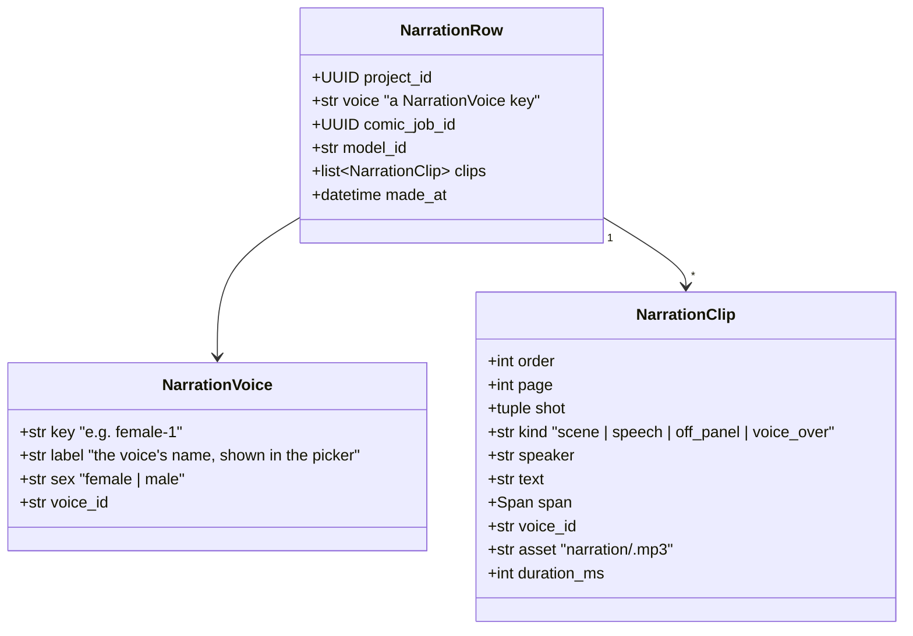
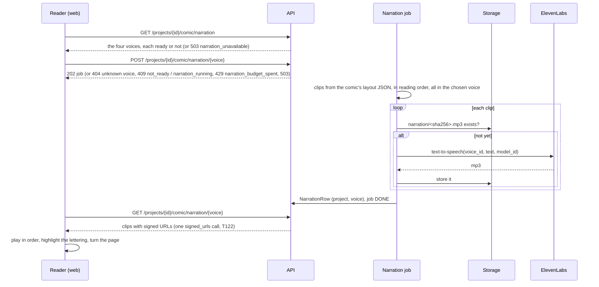

# Design — `narration` (stretch): the comic read aloud, by ElevenLabs

**Status:** draft, **stretch**; not built, so out of the submission (no code by 27 Oct) · **Owner:** Katlego (Claude); the reader's controls with Tumo
(`web`) · **Tasks:** T113 · **Spec:** [SPEC.md](../../SPEC.md) US5 (stretch) · **Raised:**
2026-10-17 by Katlego · **Revised:** 2026-10-20 by Katlego: one voice for the whole comic, chosen
by the reader from four (two female, two male), instead of a voice per character; brought up to
`main` (T117's balloon voices, T118–T121's linked lines, T122's batch signing); the ElevenLabs
subscription and key are Tumo's

> **Stretch means:** built only after the submission path is safe (T030's hosted run, the judge
> sample, T033–T035), never on it. Off unless `ELEVENLABS_API_KEY` is set, so the app, the hosted
> demo and the gate behave exactly as before without it. If it isn't done and tested by 27 Oct it
> stays out of the submission and the video.

---

## 1. What this covers

**Listen to the comic.** In the comic reader, the reader picks one of four voices (two female, two
male) and "Listen" reads every lettered line aloud in that voice, in reading order, highlighting the
line being read and turning the page when the next line is on it. The scene captions are read in
the same voice. One voice reads the whole comic, as one person reading a comic aloud would.

**Every spoken word is a lettered word** (Non-negotiable I): the narration speaks the comic's
lettering byte for byte, `Bubble.text` and `Caption.text` (comic.md §3), and nothing else. No added
words, no speaker names (the cue isn't lettered on the page), no summaries of the action, no audio
tags (`[whispers]`, `[laughs]`). So every clip traces to the same verbatim span its bubble does.

**The voice is the reader's choice, never inferred.** Nothing about a character (sex, age, the
drawing, the name) picks a voice: there is one voice, and the reader chose it. Who is speaking is
shown, not voiced: the highlight sits on the line's lettering, and the rail's **Lettering on this
page** names its speaker (web.md §4.5). A voice per character is §8's later option.

**The lettering since 17 Oct** (comic.md §3, §6):
- **Balloon voices (T117)** — `THOUGHT`, `WHISPER`, `SHOUT`, `DISTRESS`, `RADIO` — are spoken
  plainly in the chosen voice. The voice changes how a balloon is drawn, not its text, and an audio
  tag would be words sent that the lettering doesn't have. Whether a script-stated whisper may
  become a delivery tag is §10.
- **Linked lines (T118–T121)** are separate `Bubble`s, each with its own text: one clip each, played
  one after the other in `Panel.bubbles` order, so a linked chain sounds like one speech. A merged
  pair (T120) is drawn as one balloon but is still two bubbles, so still two clips; a stated pause
  (T121) only unlinks the drawing and changes nothing here.
- **`Voice` is comic.md's name** for a balloon's style. This document's spoken voices are
  `NarrationVoice` (§6), so the two never share a name in code.

**Not covered:** narrating the storyboard (it has no lettering); narration from action lines and
sound effects (SPEC Non-goals, comic.md §8); music; a video or animatic export; voice cloning;
a voice per character (§8); more than four voices, or voices from outside `voices.json`.

## 2. Reference material

| Kind | Where |
|---|---|
| Text to speech | ElevenLabs API: `POST /v1/text-to-speech/{voice_id}` (one voice, one text, audio back); a `with-timestamps` variant returns character-level timing ([docs](https://elevenlabs.io/docs/api-reference/text-to-speech/convert-with-timestamps)) |
| Text to dialogue | `inputs[]` of `{text, voice_id}` turns, Eleven v3 / v4, at most 2,000 characters per request; the docs don't describe per-turn timing ([docs](https://elevenlabs.io/docs/overview/capabilities/text-to-dialogue)). §8 says why it's not the first choice |
| Reading order | comic.md §6: the layout JSON lists pages → panels → the SCENE caption, then bubbles and voice-over captions in element order (`to_json`, T023); `voice` and `linked` on each item (T117, T118) |
| The reader | web.md §4.5 (the comic reader, T024): per lettering a `<button aria-pressed>` stacked in reading order, each naming its speaker |
| Signing many links | storyboard.md §6, T122: `Store.signed_urls`, one batch request per 100 links |
| Spend caps | limits.md §4 (the monthly caps' pattern: counted before the call, refused when spent, never blank on the hosted demo) |

The subscription and the key are **Tumo's**. The key lives with the team's other secrets (Infisical),
in Render's dashboard and in a local `.env`, never in the repo. Its monthly character quota sets the
cap (§6, §10).

## 3. Domain model



- **`NarrationVoice`** comes from a file in the repo, `services/api/app/narration/voices.json`:
  exactly four voices, two `female` and two `male`, in the order the picker shows them, the first
  the default. The voice ids come from Tumo's ElevenLabs library (§10). Loading a file with any
  other number or split stops the API starting, as an unknown `AUDIT_WITHHOLD_CHECKS` name does.
- **`NarrationClip`** is one lettering item: `text` is the lettering's text byte for byte, `span`
  its span, `speaker` the bubble's cue (`None` on a caption) for the reader's highlight, never spoken.
  `asset` is keyed by `sha256(model_id, voice_id, text)`, so a line already spoken in that voice is
  never paid for twice (a re-made comic reuses every unchanged line; going back to a voice already
  made costs nothing).
- **`NarrationRow`** is one comic narrated in one voice: at most one row per project and voice, so
  at most four. It belongs to one comic (`comic_job_id`). A comic made again makes every narration
  stale: the reader offers "Listen" in a voice only when that row's `comic_job_id` is the comic's.

## 4. Flow



**The checks, before anything is called:** the key is set (else 503 `narration_unavailable`); the
voice is one of the four (else 404); the comic is DONE (else 409 `not_ready`); no narration job
running for the project, in any voice (else 409 `narration_running`); the clips' characters not
already cached for that voice, added to the month's count, stay under
`NARRATION_MONTHLY_CHARACTER_CAP` (else 429 `narration_budget_spent`, nothing spent). A voice whose
current narration exists is not made again: its POST answers 202 with no job started, and the
reader plays it.

**Failure paths:** a clip failing after the client's retries fails the job, naming the clip's page
and shot; the clips already stored stay in Storage, so a retry pays only for the rest. No partial
narration is shown. A comic re-made while its narration runs: the job finishes against the comic
it started on, and the row is stale on arrival (§3). The voice is an argument of the in-process job
(web.md §3), not a column of `jobs`: the startup sweep fails a running narration job like any other,
and the reader asks for the voice again.

## 5. State

The job is a `JobRow` of a new kind, `narration`, with the existing states (queued → running →
done | failed); nothing new. One narration job per project at a time, whatever its voice.

## 6. Contracts

```python
# app/core/config.py
elevenlabs_api_key: str | None = None             # secret, Tumo's: Infisical, Render's dashboard and .env only; None turns narration off
elevenlabs_model_id: str | None = None             # required with the key; chosen by listening (§10)
narration_monthly_character_cap: int | None = None  # the subscription's monthly quota less a margin; required when the key is set

# app/narration/voices.py
@dataclass(frozen=True) class NarrationVoice: key: str; label: str; sex: Literal["female", "male"]; voice_id: str
def load_voices(path: Path) -> tuple[NarrationVoice, ...]: ...   # voices.json; exactly four, two female and two male, keys unique, else ValueError

# app/narration/model.py
@dataclass(frozen=True) class NarrationClip: order: int; page: int; shot: tuple[int, int]; kind: str; speaker: str | None; text: str; span: Span; voice_id: str; asset: str; duration_ms: int
@dataclass(frozen=True) class Line: order: int; page: int; shot: tuple[int, int]; kind: str; speaker: str | None; text: str; span: Span   # a lettering item, before it has a voice
def clips_of(book: ComicBook) -> list[Line]: ...   # pure: reading order, every bubble and caption one Line (a linked bubble too); text = the lettering's text, byte for byte, whatever its Voice

# app/narration/client.py
class ElevenLabs:   # httpx2, the key in the `xi-api-key` header, never logged
    async def speak(self, voice_id: str, text: str, model_id: str) -> bytes: ...   # POST /v1/text-to-speech/{voice_id}, mp3

# app/jobs/model.py
class JobKind(StrEnum): ...; NARRATION = "narration"

# app/narration/rows.py, a migration numbered at code time (the next free number after 0010, announced on the PR)
class NarrationRow(Base): project_id (FK projects, cascade); voice; PK (project_id, voice); comic_job_id; model_id; clips: JSONB; made_at

# app/api/v1/projects.py
GET  /api/v1/projects/{id}/comic/narration           -> {"voices": [{"key", "label", "sex", "ready"}]} | 503 narration_unavailable
POST /api/v1/projects/{id}/comic/narration/{voice}   -> 202 {"job": ... | null} | 404 | 409 not_ready | 409 narration_running | 429 narration_budget_spent | 503 narration_unavailable
GET  /api/v1/projects/{id}/comic/narration/{voice}   -> {"voice", "comic_job_id", "clips": [{..., "url": signed}]} | 404
```

`ready` is true when the voice's row exists and its `comic_job_id` is the comic's. The clip URLs are
signed in one `signed_urls` call (T122), not one request per clip.

**The web side** (web.md §4.5, with Tumo): nothing without the key (the GET answers 503). With it, a
picker of the four voices (each its `label` and "female" / "male"), the first chosen; "Listen" when
the chosen voice is `ready`, "Make narration" when it isn't. Playing moves the existing lettering
`aria-pressed` highlight and the page; pause and stop; changing the voice stops playback. The text
stays on the page, so the narration adds a way in and takes nothing away.

## 7. Structure

| Path | Change |
|---|---|
| `services/api/app/narration/{model,voices,client,job,rows}.py`, `voices.json` | new |
| `services/api/app/core/config.py`, `app/jobs/model.py`, `app/api/v1/projects.py`, a migration | changed / new |
| `services/api/tests/narration/` | new, tests first; ElevenLabs only through a MockTransport |
| `apps/web` comic reader | the voice picker and Listen control (web.md first, its own PR, with Tumo) |
| `.env.example`, `render.yaml` (sync: false), deploy.md §6, limits.md | the three settings |

## 8. Decisions & alternatives

| Decision | Chosen | Rejected, and why |
|---|---|---|
| Whose voice | **one voice for the whole comic, the reader's choice of four, two female and two male** (Katlego, 2026-10-20) | a voice per character from the script's stated sex and age (this design's 17 Oct version): more like a table read, but it needs a pool per sex and age band (ten or more voices to vet), and a voice is one more thing that can be wrong about a character; kept as a later "cast" option. A per-character picker in the app: more UI than a stretch earns. Any voice from the library: too many to vet, and not all fit a narrator |
| One call per line, or per page | **text-to-speech per lettering item** | text-to-dialogue per page: more natural turn-taking, but one audio for the page with no per-turn timing in its docs, so no highlight and no page turn on the right line; 2,000-character chunks; a line can't be reused when one other line changes. With one voice it also gains little |
| What is spoken | the lettering, byte for byte | action lines, or a summary (SPEC Non-goals; Non-negotiable I); speaker names (not lettered); audio tags for emotion (a delivery the script doesn't state) |
| Balloon voices (T117) | spoken plainly | a tag per voice (`[whispers]` for `WHISPER`, `[shouts]` for `SHOUT`): §10 |
| Linked lines (T118) | one clip per bubble | one clip per chain: a chain is one speaker's consecutive lines, but each bubble has its own span, and a clip per bubble keeps the highlight on the right box |
| Caching | by `sha256(model_id, voice_id, text)` in Storage | per comic: a re-made comic would pay again for every unchanged line |
| The vendor | ElevenLabs (Tumo's subscription; Katlego, 2026-10-17) | an NVIDIA speech model on the sponsor's stack would fit the pitch better, but none was on Token Factory at the 2026-10-17 catalog check (findings § U8); revisit if one appears |

## 9. How this is verified

- **Tests first** (`tests/narration/`): `clips_of` keeps reading order and every text byte for byte
  (each clip's text equals its lettering's, every lettering has one clip, a linked bubble its own,
  a `WHISPER` or `SHOUT` bubble's text unchanged); `load_voices` accepts four voices split two and
  two and refuses three, five, or three of one sex; every clip of a narration has the chosen voice's
  id; an unknown voice is 404 and calls nothing; a second POST while a narration job runs is 409
  `narration_running`; a voice already `ready` starts no job; the cache skips a stored clip and
  counts only new characters; the cap refuses before any call; the GET signs every clip in one
  `signed_urls` call; a re-made comic makes every voice not `ready`; no key → 503 and nothing else
  changes (the app's behaviour without the key is today's); the key never appears in a log line or
  an error; a failing clip fails the job naming page and shot.
- **Live** (announced on the PR first; Tumo's key): narrate the 2026-10-17 live comic of
  the-red-kite in one voice and listen to all of it: every line present and in order, the captions
  in the same voice; then make it in a second voice, and go back to the first without a new call.

## 10. Open questions

1. **The cap's number:** Tumo's subscription's monthly character quota, less a margin (Tumo).
2. **The four voices:** which voices from Tumo's library fill `voices.json`, two female and two
   male (Tumo, with Katlego); one listen of the same page each.
3. **The model:** chosen by listening to the same page on two or three models (§6's
   `elevenlabs_model_id`).
4. **Balloon voices and parentheticals as delivery tags:** T117's voice comes from the script's own
   parenthetical or extension, so `[whispers]` on a `WHISPER` balloon would be grounded; but a tag is
   text the lettering doesn't have, and only some models read tags. Later, and only for what the
   script states.
5. ~~**The hosted demo:** narration on the hosted demo or only in the video, decided by 27 Oct.~~
   Moot: not built by 27 Oct, so out of the submission and the video (the stretch rule above).
