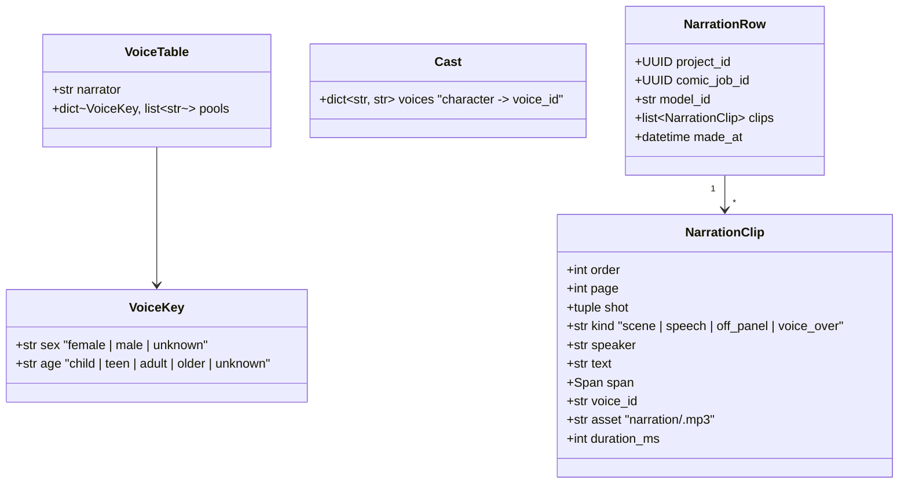

# Design — `narration` (stretch): the comic read aloud, by ElevenLabs

**Status:** draft, **stretch** · **Owner:** Katlego (Claude); the reader's controls with Tumo
(`web`) · **Tasks:** T113 · **Spec:** [SPEC.md](../../SPEC.md) US5 (stretch) · **Raised:**
2026-10-17 by Katlego

> **Stretch means:** built only after the submission path is safe (T030's hosted run, the judge
> sample, T033–T035), never on it. Off unless `ELEVENLABS_API_KEY` is set, so the app, the hosted
> demo and the gate behave exactly as before without it. If it isn't done and tested by 27 Oct it
> stays out of the submission and the video.

---

## 1. What this covers

**Listen to the comic.** In the comic reader, "Listen" reads every lettered line aloud in reading
order, each in its speaker's voice, highlighting the line being read and turning the page when the
next line is on it. The scene captions are read in a narrator's voice.

**Every spoken word is a lettered word** (Non-negotiable I): the narration speaks the comic's
lettering byte for byte, `Bubble.text` and `Caption.text` (comic.md §3), and nothing else. No added
words, no summaries of the action, no audio tags (`[whispers]`, `[laughs]`): those add a delivery
the script doesn't state. So every clip traces to the same verbatim span its bubble does.

**A voice comes from the script, never from the drawing or the name.** A character's voice is
chosen by the sex and age the script states (T082's `character_sex`, T080's `introduced_years`);
a character the script doesn't sex gets a neutral voice. This is the same rule as the image
prompts (SPEC Non-goals: no attributes the script doesn't state).

**Not covered:** narrating the storyboard (it has no lettering); narration from action lines and
sound effects (SPEC Non-goals, comic.md §8); music; a video or animatic export; voice cloning;
editing a voice per character in the app (the cast is code, §3).

## 2. Reference material

| Kind | Where |
|---|---|
| Text to speech | ElevenLabs API: `POST /v1/text-to-speech/{voice_id}` (one voice, one text, audio back); a `with-timestamps` variant returns character-level timing ([docs](https://elevenlabs.io/docs/api-reference/text-to-speech/convert-with-timestamps)) |
| Text to dialogue | `inputs[]` of `{text, voice_id}` turns, Eleven v3 / v4, at most 2,000 characters per request; the docs don't describe per-turn timing ([docs](https://elevenlabs.io/docs/overview/capabilities/text-to-dialogue)). §8 says why it's not the first choice |
| Reading order | comic.md §6: the layout JSON lists pages → panels → the SCENE caption, then bubbles and voice-over captions in element order (`to_json`, T023) |
| The reader | web.md §4.5 (the comic reader, T024): per lettering a `<button aria-pressed>` stacked in reading order |
| Sex and age from the script | storyboard `character_sex` (T082, T091, T096, T100), `introduced_years` (T080) |
| Spend caps | limits.md §4 (the monthly caps' pattern: counted before the call, refused when spent, never blank on the hosted demo) |

The subscription is Katlego's; its monthly character quota sets the cap (§6, §10).

## 3. Domain model



- **`VoiceTable`** is a file in the repo, `services/api/app/narration/voices.json`: a narrator
  voice and, per `VoiceKey`, an ordered list of voice ids from the subscription's library (Katlego
  picks them, §10). Ages are bands of `introduced_years`: child < 13, teen 13–19, adult 20–59,
  older ≥ 60, else unknown.
- **`Cast`** is computed, not stored: characters in order of their first lettered line; each takes
  the next unused voice of its key's pool (so two adult women get two voices while the pool lasts,
  then the pool repeats from the start). Pure and deterministic: the same comic gets the same voices.
- **`NarrationClip`** is one lettering item: `text` is the lettering's text byte for byte, `span`
  its span. `asset` is keyed by `sha256(model_id, voice_id, text)`, so a line already spoken in
  that voice is never paid for twice (a re-made comic reuses every unchanged line).
- **`NarrationRow`** belongs to one comic (`comic_job_id`). A comic made again makes the narration
  stale: the reader offers "Listen" only when the row's `comic_job_id` is the comic's.

## 4. Flow

```mermaid
sequenceDiagram
    participant W as Reader (web)
    participant A as API
    participant J as Narration job
    participant S as Storage
    participant E as ElevenLabs
    W->>A: POST /projects/{id}/comic/narration
    A-->>W: 202 job (or 409 not_ready, 429 narration_budget_spent, 503 narration_unavailable)
    J->>J: clips from the comic's layout JSON, in reading order; the cast
    loop each clip
        J->>S: narration/<sha256>.mp3 exists?
        alt not yet
            J->>E: text-to-speech(voice_id, text, model_id)
            E-->>J: mp3
            J->>S: store it
        end
    end
    J->>A: NarrationRow, job DONE
    W->>A: GET /projects/{id}/comic/narration
    A-->>W: clips with signed URLs
    W->>W: play in order, highlight the lettering, turn the page
```

**The checks, before anything is called:** the comic is DONE; the key is set (else 503
`narration_unavailable`); no narration job running for the project; the clips' characters not
already cached, added to the month's count, stay under `NARRATION_MONTHLY_CHARACTER_CAP` (else 429
`narration_budget_spent`, nothing spent).

**Failure paths:** a clip failing after the client's retries fails the job, naming the clip's page
and shot; the clips already stored stay in Storage, so a retry pays only for the rest. No partial
narration is shown. A comic re-made while its narration runs: the job finishes against the comic
it started on, and the row is stale on arrival (§3).

## 5. State

The job is a `JobRow` of a new kind, `narration`, with the existing states (queued → running →
done | failed); nothing new.

## 6. Contracts

```python
# app/core/config.py
elevenlabs_api_key: str | None = None             # secret: Render's dashboard and .env only; None turns narration off
elevenlabs_model_id: str | None = None             # required with the key; chosen by listening (§10)
narration_monthly_character_cap: int | None = None  # the subscription's monthly quota less a margin; required when the key is set

# app/narration/model.py
@dataclass(frozen=True) class NarrationClip: order: int; page: int; shot: tuple[int, int]; kind: str; speaker: str | None; text: str; span: Span; voice_id: str; asset: str; duration_ms: int
@dataclass(frozen=True) class Line: order: int; page: int; shot: tuple[int, int]; kind: str; speaker: str | None; text: str; span: Span   # a lettering item, before it has a voice
def clips_of(book: ComicBook) -> list[Line]: ...   # pure: reading order; text = the lettering's text, byte for byte
def cast(book: ComicBook, screenplay: Screenplay, extraction: Extraction, table: VoiceTable) -> dict[str, str]: ...   # pure, deterministic (§3)

# app/narration/client.py
class ElevenLabs:   # httpx2, the key in the `xi-api-key` header, never logged
    async def speak(self, voice_id: str, text: str, model_id: str) -> bytes: ...   # POST /v1/text-to-speech/{voice_id}, mp3

# app/jobs/model.py
class JobKind(StrEnum): ...; NARRATION = "narration"

# app/narration/rows.py, a migration numbered at code time (the next free number, announced on the PR)
class NarrationRow(Base): project_id (PK, FK projects, cascade); comic_job_id; model_id; clips: JSONB; made_at

# app/api/v1/projects.py
POST /api/v1/projects/{id}/comic/narration   -> 202 {"job": ...} | 409 not_ready | 429 narration_budget_spent | 503 narration_unavailable
GET  /api/v1/projects/{id}/comic/narration   -> {"comic_job_id", "clips": [{..., "url": signed}]} | 404
```

**The web side** (web.md §4.5, with Tumo): a "Listen" control in the reader, shown when a current
narration exists, "Make narration" when it can be made, nothing without the key. Playing moves the
existing lettering `aria-pressed` highlight and the page; pause and stop; the text stays on the page,
so the narration adds a way in and takes nothing away.

## 7. Structure

| Path | Change |
|---|---|
| `services/api/app/narration/{model,voices,client,job,rows}.py`, `voices.json` | new |
| `services/api/app/core/config.py`, `app/jobs/model.py`, `app/api/v1/projects.py`, a migration | changed / new |
| `services/api/tests/narration/` | new, tests first; ElevenLabs only through a MockTransport |
| `apps/web` comic reader | the Listen control (web.md first, its own PR, with Tumo) |
| `.env.example`, `render.yaml` (sync: false), deploy.md §6, limits.md | the three settings |

## 8. Decisions & alternatives

| Decision | Chosen | Rejected, and why |
|---|---|---|
| One call per line, or per page | **text-to-speech per lettering item** | text-to-dialogue per page: more natural turn-taking, but one audio for the page with no per-turn timing in its docs, so no highlight and no page turn on the right line; 2,000-character chunks; a line can't be reused when one other line changes. A later option for a "performance" mode |
| What is spoken | the lettering, byte for byte | action lines, or a summary (SPEC Non-goals; Non-negotiable I); audio tags for emotion (a delivery the script doesn't state). A parenthetical like "(whispering)" could map to a tag later: §10 |
| Who sounds like whom | the script's stated sex and age, else neutral | the drawing (the audit already shows drawings can be wrong); the name (a guess) |
| The cast | code from a voice table in the repo | a per-character picker in the app: more UI than a stretch earns |
| Caching | by `sha256(model_id, voice_id, text)` in Storage | per comic: a re-made comic would pay again for every unchanged line |
| The vendor | ElevenLabs (Katlego, 2026-10-17: the team has a subscription) | an NVIDIA speech model on the sponsor's stack would fit the pitch better, but none was on Token Factory at the 2026-10-17 catalog check (findings § U8); revisit if one appears |

## 9. How this is verified

- **Tests first** (`tests/narration/`): `clips_of` keeps reading order and every text byte for byte
  (each clip's text equals its lettering's, every lettering has one clip); `cast` is deterministic,
  follows the sex and age bands, gives an unsexed character a neutral voice, and never reads the
  drawing; the cache skips a stored clip and counts only new characters; the cap refuses before any
  call; no key → 503 and nothing else changes (the app's behaviour without the key is today's); the
  key never appears in a log line or an error; a failing clip fails the job naming page and shot.
- **Live** (Katlego's go-ahead, announced on the PR): narrate the 2026-10-17 live comic of
  the-red-kite and listen to all of it: every line present and in order, Lerato's and Mokgosi's
  voices distinct and fitting what the script says of them, the narrator on the scene captions.

## 10. Open questions

1. **The cap's number:** the subscription's monthly character quota, less a margin (Katlego).
2. **Voices:** which voices from the subscription's library fill `voices.json` (Katlego, with
   Tumo); one listen per pool.
3. **The model:** chosen by listening to the same page on two or three models (§6's
   `elevenlabs_model_id`).
4. **Parentheticals** ("(whispering)") as delivery tags: later, and only for parentheticals the
   script has.
5. **The hosted demo:** narration on the hosted demo or only in the video, decided by 27 Oct.
