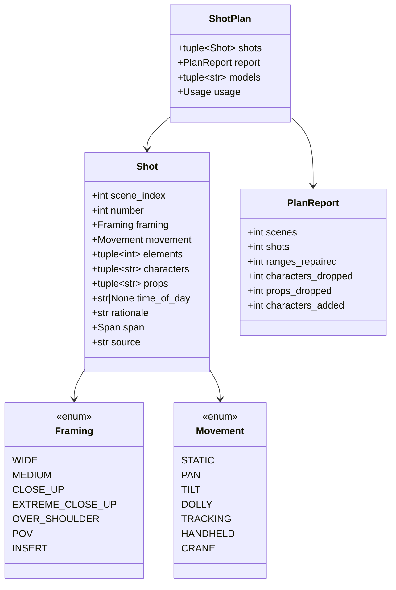

# Design — `shots` (the shot planner)

**Status:** agreed (T092 proposed) · **Owner:** Katlego (Claude; Tumo for T092) · **Tasks:** T007, T092 · **Spec:** [SPEC.md](../../SPEC.md) US1 (script →
grounded storyboard)

---

## 1. What this covers

Turning each parsed scene (docs/design/script.md) plus its grounded entities
(docs/design/grounding.md) into an ordered list of **shots**: one storyboard frame, or one comic
panel, each. A shot says which of the scene's elements it covers, how it is framed, and which
extracted characters and props are in it. **Every shot traces back to a verbatim span**
(Non-negotiable I), and every element of a scene lands in exactly one shot, so no line of dialogue
is left without a panel.

**Not covered:** the image prompt and rendering (T008, T026: storyboard.md), comic page layout and panel sizing (T022),
the frame audit (T020).

## 2. Reference material

| Kind | Where |
| --- | --- |
| Code ported from | FrameFlow `services/api/app/services/shot_service.py` (the shot-list call, the camera vocabularies, the explicit time of day) |
| What FrameFlow learned | a `CONTINUOUS` heading with no clock made the model write "soft overcast light" into a night scene → the resolved time of day goes in explicitly (`resolve_times`) |
| Inputs | `Screenplay`, `Scene`, `Element`, `Span` (script.md §6); `Extraction`, `Entity` (grounding.md §6) |
| LLM seam | `structured_chat`, `Tier.FAST` (llm.md §6) |

## 3. Domain model



- **`elements`**: 0-based indexes into `scene.elements`, contiguous and ascending. Across one
  scene's shots they **partition** the elements: each element in exactly one shot, in order.
- **`span`** runs from the first covered element's `line_start` to the last one's `line_end`;
  `page` is the first element's. A scene with no elements gets one shot with `elements == ()`
  and the heading's span.
- **`source`**: the covered elements' texts, verbatim, one per line; the heading for an empty
  scene. This is the text a panel cites.
- **`characters` / `props`**: entity names from the extraction, **only** entities present in this
  scene (`scene_index in entity.scenes`). The model proposes names; anything not matching an
  allowed entity (`match_speaker`, so "Thabo" finds "THABO MOLEFE") is dropped and counted.
- **A character the shot's own action names is in its cast (T092).** After the model's names are
  filtered, every `CHARACTER` entity (person or animal) that a covered `Action` element names **as
  a figure** is appended after the model's names (the model's order first, then extraction order),
  and counted in `characters_added`, per shot (a name in two shots counts twice); this is the one
  way a name joins a shot without being in `entity.scenes`, because the extraction's `scenes` are
  incomplete (learning-log L019, added by #160: in the stored plans of seven scripts, 45 times in 266 shots a shot left out a
  character its own action names, 38 because the planner was never offered the character).
  "Names as a figure" is `named_as_figure(element.text, tokens)` (storyboard.md §3.1), with the
  character's tokens from `redaction_labels(extraction, screenplay, only=name)`, the same ones
  `visible_characters` uses, so a backfilled person is one the prompt will also count as drawn (an
  animal joins the cast, as the judge's "Animals in this shot", but is never a figure), **less
  every token another `CHARACTER` entity also has**: "Dube winds his watch" with MR. DUBE and MRS.
  DUBE both in the extraction adds neither (the model may still list one). No stored script has a
  shared token today, so this changes none of the 40 below:
  - a **Title-case** run ("Lindi rolls the ball out to Palesa.", "Mr. Van der Merwe climbs down"),
    or an **UPPER-case run directly followed by `(`**, an introduction ("AYANDA (17), braids");
  - **never a possessive** run ("The Lionesses' goalkeeper, LINDI", "He looks across at Jabu's
    paper": a thing of theirs, not them), and **never an UPPER-case run with no `(`** ("The
    scoreboard is a blackboard: LIONESSES 1 - EAGLES 1": lettering, or a name in a sign);
  - **not dialogue**: a speaker missing from the cast stays out (a shot of the listener while
    someone speaks is the planner's choice, and a line spoken names no one on screen).
  Measured free on the same stored plans (prototype): 40 characters added in 28 of 181 shots,
  every one read: 38 are people the line puts there; 2 are groups the extraction made characters
  (EAGLES in "The Eagles build a wall.", LIONESSES in "The Lionesses pile on top of Lindi."), which
  L017 is about, not this: until L017 is fixed, they add a drawn figure to those two shots.
  **Known cost:** a Title-case common word that is also a character's name ("Hope fades.", "Grace
  fills the room.") already redacts as a name; now it also joins the cast.
- **`time_of_day`**: `resolve_times(screenplay.scenes)[scene_index]`, never the model's.
- **`rationale`**: the model's one-line reason for the framing. Metadata for the reader, never
  drawn and never used in an image prompt.
- **No free-text frame description.** FrameFlow asked for composition, lighting and placement in
  prose, and that is where invention lives. The image prompt (T008, storyboard.md §3.1) is built from the grounded
  fields above plus the entities' quotes.

## 4. Flow

```mermaid
sequenceDiagram
    participant C as Caller
    participant P as plan_shots()
    participant M as structured_chat (FAST)
    C->>P: Screenplay, Extraction, NebiusChatModel
    P->>P: resolve_times; per scene, the characters and props present in it
    par each scene with ≥1 element (≤ concurrency at once)
        P->>M: system prompt + render_scene(scene, characters, props, time) → ScenePlan
        M-->>P: proposed shots (first, last, framing, movement, characters, props, rationale)
    end
    P->>P: normalise_ranges → a partition of the elements; filter names to allowed entities
    P->>P: T092: append each character a covered Action line names as a figure (counted)
    P->>P: build Shot (span, source, time_of_day) per range; empty scenes get one wide static shot
    P-->>C: ShotPlan
```

**`normalise_ranges(proposed, n)`**, deterministic, so a sloppy model answer still yields a valid
partition: clamp each `(first, last)` to `[0, n-1]` and swap reversed pairs; sort by `first`; walk
in order with `next = 0`: a range wholly before `next` is dropped; otherwise it starts at `next`
(a gap is absorbed by the shot after it, an overlap trimmed) and ends at `max(start, last)`. After
the walk, any uncovered tail extends the last shot; with no usable range at all, one shot covers
the whole scene. Every change from the proposal counts as one repair.

**Failure paths:** a scene's call fails (an `LLMError`, or a `ValidationError` after the repair
retry) → `ShotError` naming the scene number, and the whole plan fails; a storyboard with a silent
hole is worse than a loud failure. Names the model invents are dropped, never shown, and counted
in the report.

## 5. State

None. `plan_shots` is a pure async function of its inputs plus the model calls.

## 6. Contracts

```python
# app/shots/model.py
class Framing(StrEnum): WIDE = "wide"; MEDIUM = "medium"; CLOSE_UP = "close_up"; EXTREME_CLOSE_UP = "extreme_close_up"; OVER_SHOULDER = "over_shoulder"; POV = "pov"; INSERT = "insert"
class Movement(StrEnum): STATIC = "static"; PAN = "pan"; TILT = "tilt"; DOLLY = "dolly"; TRACKING = "tracking"; HANDHELD = "handheld"; CRANE = "crane"
@dataclass(frozen=True) class Shot: scene_index: int; number: int; framing: Framing; movement: Movement; elements: tuple[int, ...]; characters: tuple[str, ...]; props: tuple[str, ...]; time_of_day: str | None; rationale: str; span: Span; source: str
@dataclass(frozen=True) class PlanReport: scenes: int; shots: int; ranges_repaired: int; characters_dropped: int; props_dropped: int; characters_added: int = 0   # T092; the default lets older stored plans load (codec.py)
@dataclass(frozen=True) class ShotPlan: shots: tuple[Shot, ...]; report: PlanReport; models: tuple[str, ...]; usage: Usage
class ShotError(RuntimeError):
    def __init__(self, message: str, *, scene: str) -> None: ...
    scene: str   # the `number` of the scene that failed to plan (web.md §4.1 names it)

# app/shots/schema.py — what the model is asked for (strict json_schema)
class ProposedShot(BaseModel): first: int; last: int; framing: Framing; movement: Movement; characters: list[str]; props: list[str]; rationale: str
class ScenePlan(BaseModel): shots: list[ProposedShot]

# app/shots/planner.py
def normalise_ranges(proposed: Sequence[tuple[int, int]], n: int) -> tuple[list[tuple[int, int]], int]: ...   # (partition, repairs)
def render_scene(scene: Scene, characters: Sequence[str], props: Sequence[str], time_of_day: str | None) -> str: ...
async def plan_shots(model: NebiusChatModel, screenplay: Screenplay, extraction: Extraction, *,
                     concurrency: int = 4, temperature: float = 0.0) -> ShotPlan: ...
def named_in_action(scene: Scene, elements: Sequence[int], extraction: Extraction,
                    screenplay: Screenplay) -> tuple[str, ...]: ...
#   T092, pure: every CHARACTER entity's name, in extraction order, that some covered Action element
#   names as a figure (`named_as_figure(element.text, tokens)`, tokens = the keys of
#   `redaction_labels(extraction, screenplay, only=name)` less every token another CHARACTER entity
#   has); `elements` are the shot's covered indexes, nothing outside them is read. plan_shots
#   appends the ones not already kept, after `_keep`, and adds their count to characters_added.
```

`python -m app.shots.run` prints `added N characters` with the other report counts.

`render_scene` numbers the elements `[0]`, `[1]`, … (an action as its text; a speech as `CUE
(extension) (parenthetical): text`), states the bounds ("4 elements, [0] to [3]: no shot goes past
[3], and at most 4 shots."; without it the model padded a one-element scene with six shots), then lists "Characters in this scene" and "Props in this
scene" (only the allowed names) and "Time of day" when known. The system prompt asks for 1 to 6
shots per scene, never more than the elements, that together cover every element in order, with the framing and movement
vocabularies above.

## 7. Structure

| Path | New? | Responsibility |
| --- | --- | --- |
| `services/api/app/shots/{__init__,model,schema,planner}.py` | new | §6 |
| `services/api/app/shots/run.py` | new | `python -m app.shots.run <script.pdf>`: parse, extract, plan on the real account; print each shot with its span and source |
| `services/api/tests/shots/` | new | `normalise_ranges` (pure), name filtering, `plan_shots` with `httpx2.MockTransport` |

## 8. Decisions & alternatives

| Decision | Chosen | Rejected, and why |
|---|---|---|
| Frame description | none; grounded fields only | FrameFlow's free-text `storyboard_description`: invented lighting and details, e.g. "soft overcast light" in a night scene |
| Coverage | every element in exactly one shot | shots cherry-picking moments: a comic would drop lines of dialogue |
| Bad ranges from the model | repaired deterministically, counted | rejecting the answer: a retry costs a call and can fail the same way; the repair can't invent anything, it only regroups real elements |
| Names in a shot | only extracted entities present in the scene | trusting the model: the one place a shot could smuggle in someone the script never put there |
| A character the action names but the planner left out (T092; Tumo, 2026-10-13) | appended in code: a covered action line names them as a figure (Title case, or an UPPER-case introduction), never a possessive or a sign | offering the planner every character the scene's text names: still the model's choice (7 of 45 were offered and left out), and its answers would change on every stored script; fixing the extraction's `scenes`: grounding's lane, and `scenes` also feeds the extraction's own checks; adding on-screen speakers too (12 more): a reaction shot of the listener is a real choice; any whole-word mention: the scoreboard's "LIONESSES 1 - EAGLES 1" and "the Lionesses' goalkeeper" would add groups that aren't there |
| Separate size and angle fields | one `framing` field (FrameFlow's merged list, plus `insert`) | size × angle: twice the vocabulary for storyboard frames that don't need it |
| No-model fallback shots | none | FrameFlow's hard-coded shots: a placeholder (AGENTS.md §2a) |
| Cache | none | FrameFlow's Redis cache: Redis is gone (deploy.md); revisit with the `Job` table if repeat runs cost too much |

Deviations from [docs/architecture-defaults.md](../architecture-defaults.md): none.

## 9. How this is verified

- `normalise_ranges`: gaps, overlaps, reversed and out-of-bounds pairs, fully covered duplicates,
  an empty proposal, and a property check that the output is always a partition of `range(n)`.
- Planning with `httpx2.MockTransport`: one call per non-empty scene on `Tier.FAST` with thinking off
  and a strict `json_schema`; empty scenes get a shot without a call; invented names dropped and
  counted; `time_of_day` from `resolve_times`, even when the model says otherwise; spans and `source`
  match the covered elements exactly; a failing scene fails the plan with its number.
- Live: `python -m app.shots.run` on the sample script, on the real account.
- **T092** (`tests/shots/test_t092.py`, tests first): a Title-case name in a covered action line
  joins the cast and is counted ("Lindi rolls the ball out to Palesa." with the model's
  `["LINDI"]` → `("LINDI", "PALESA")`, `characters_added == 1`); a name the model already gave is
  not added twice; an UPPER-case introduction (`AYANDA (17), braids`) joins; a possessive ("the
  Lionesses' goalkeeper", "Jabu's paper") and an UPPER-case run without `(` ("LIONESSES 1 -
  EAGLES 1") don't; a name only in dialogue doesn't, nor an on-screen speaker; a character not in
  `entity.scenes` still joins (the L019 case: "Mr. Van der Merwe climbs down" in a scene whose
  allowed list lacks him); an animal joins ("Marmalade leaves in disgust."); a paired other name
  counts as its character's; an older stored `PlanReport` with no `characters_added` loads as 0.
  Also: a name in an Action element outside the shot's range doesn't join; the model's
  `["PALESA"]` with an action naming LINDI then PALESA → `("PALESA", "LINDI")`; the name the model
  already gave adds nothing (`characters_added == 0`); a name in two shots of one scene is counted
  in each; a token shared by two characters (MR. DUBE, MRS. DUBE; "Dube winds his watch") adds
  neither; a shot whose model listed no one gets the named ones; and at the prompt: stormwater
  3.1's fixture with the backfilled cast has COUNT "three figures" and MR. VAN DER MERWE's AGE part
  citing his introduction. `tests/storyboard/test_invariant.py`'s `every_shot` gains a case whose
  cast is the planner's plus `named_in_action`'s, so the invariant is checked on backfilled casts.
  Free: the prototype's 40 additions reproduced by the real code on the stored plans (re-planning
  is not needed: `named_in_action` on each stored shot's elements).

## 10. Open questions

- [ ] Shots per scene (1 to 6) is a prompt instruction, not enforced. Panel sizing (T022) may want
  a hard cap; revisit then.
