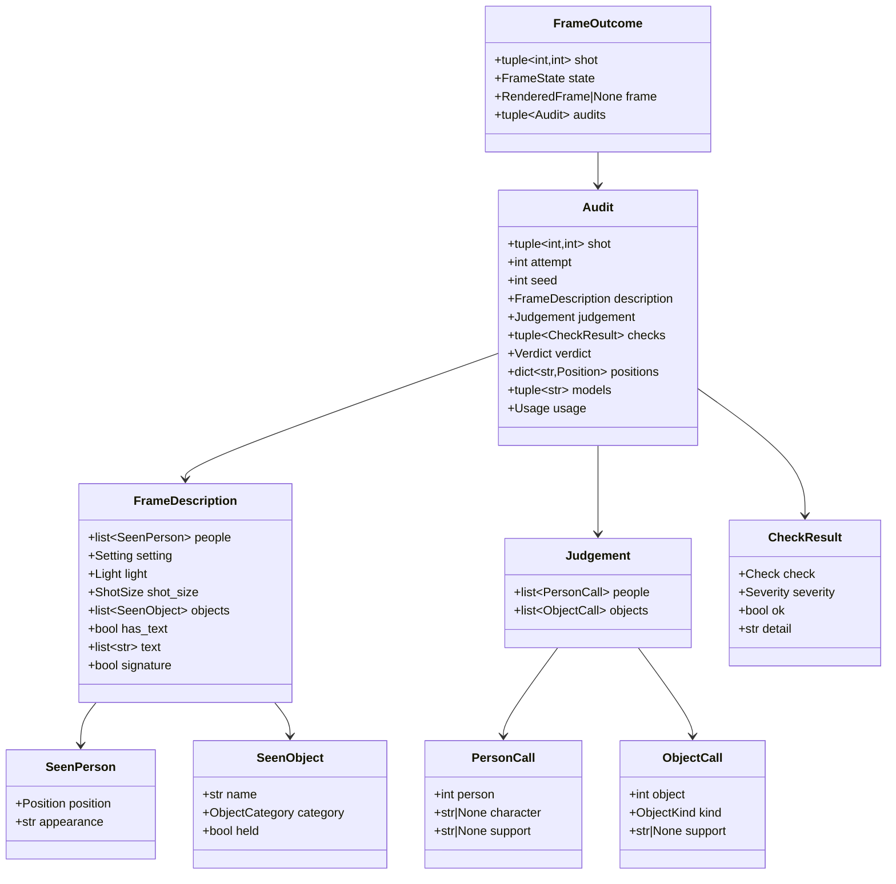
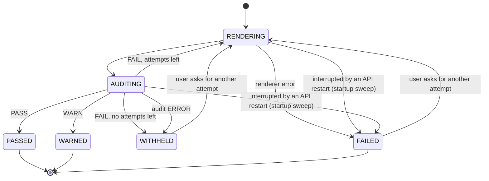

# Design — `verify` (the frame audit and re-render loop)

**Status:** agreed · **Owner:** Katlego (Claude) · **Tasks:** T020 (audit), T021 (re-render loop, audit
log: the API), T061 (the log and the retry in the web app), T062 (the architecture check), T077 (a signature warns), T078 (a prop's parts; no drawing marks), T080 (sex and look; no one in frame), T082 (the judge is told each person's sex) · **Spec:** [SPEC.md](../../SPEC.md) US2 (frame audit)

---

## 1. What this covers

Checking every rendered frame against its shot before anyone sees it, re-rendering it when it
fails, and logging every verdict. This is where Non-negotiable I is enforced **on pixels**: a frame
that shows a person, prop or event the script doesn't put in that shot is never shown. Up to T026,
grounding is enforced on text; this is the first check on images.

**Not covered:** rendering (T026 provides the renderer this calls: storyboard.md), comic layout (comic.md reads
the audit's speaker positions), portraits (characters.md).

## 2. Reference material

| Kind | Where |
| --- | --- |
| The vision decision | docs/nebius-findings.md § The vision decision: **option A**: no Nemotron model on Token Factory accepts images (U7), so a vision model (`NEBIUS_MODEL_VISION`, DeepSeek-V4.1-Flash since 2026-09-30: GLM-5.3-Flash stopped receiving images, findings § U7 re-check) *describes* the frame and Nemotron *judges* it. Option B, a self-hosted NVIDIA VLM on the ComfyUI GPU, is a stretch |
| Prior art in FrameFlow | **none**: FrameFlow had no image audit, no verdicts and no automatic re-render; "regenerate" was a user button with a random seed |
| Inputs | `Shot` (shots.md §6: framing, characters, props, time_of_day, source, span); `Entity` quotes (grounding.md §6); `Scene.int_ext`, `location` (script.md §6); the rendered frame (T026) |
| LLM seam | `structured_chat`, `Tier.VISION` and `Tier.REASONING` (llm.md §6). Image content parts are OpenAI-style (`image_url` data URLs), as probed in U7 |
| Expected renders | `E[N] = (1 − (1−p)^(k+1)) / p` for pass rate `p` and `k` re-renders (docs/submission/about.md) |

## 3. Domain model



- **The describer is blind to the shot.** It gets the image and a neutral instruction: count the
  people, where each one stands, what they look like in a short phrase, interior or exterior, the
  light, the shot size, the notable objects (each with a category from a fixed list and whether
  someone holds it), and whether any text or letters appear. It is never told
  what it *should* see, so it can't simply agree.
- **What the describer leaves out and writes down (T071).** It doesn't list what a person wears
  (that goes in the person's `appearance`) or the place's own structure (walls, floor, ceiling,
  sky, windows, doors, roofs, chimneys, stairs) as objects, nor (T078) marks of the drawing
  itself: shading, hatching, outlines, sketch lines, shadows, the frame's border (it listed
  "pencil shading" as an object, which failed a good frame). Under `text` it writes, word for
  word, each piece of writing it can actually **read**; a scribble, an unreadable signature or a
  mark that isn't letters is left out of `text` (it may still set `has_text`).
- **Ages and signatures (T072).** Each person's `appearance` starts with how old they look
  (`a child`, `a teenager`, `an adult`, `an old man`, `an old woman`). `signature` is true when
  the image carries a signature, initials or an artist's mark, readable or not: the live run's
  frames had one in a corner again and again (eval.md §6a.2: 15 of 27), and it is writing
  no script asked for. **T077:** it is the soft `SIGNATURE` check, not a hard fail: an
  artist's mark is no character, prop, line or event, so it can't break the non-negotiable,
  and failing on it withheld frames that were otherwise right (below, §8).
- **What the judge is told (T072).** A described person whose apparent age plainly contradicts
  a character's quoted age (an adult for `LERATO (10)`, a young man for `MOKGOSI (70s)`) is not
  that character: `character` null, so with no support they are `UNSCRIPTED_PERSON`. **T080:** the
  same for a plainly contradicted sex or look: a boy for a character the quotes call "she", short
  hair for one they give braids (on 2026-10-11 klein drew Lerato, `LERATO (10), braids tied back …
  as tall as she is`, as a short-haired boy, and the judge matched him to her 9 times). Only what
  the quotes say counts; a look they don't mention is no contradiction. And **code**
  refuses as support for such a person any quote that names a shot character (`LERATO (10),
  braids…` is about Lerato, so it can't put a stranger there). An ordinary
  thing the heading's place would hold (a workshop's clock, boxes and tools; a roof's bucket,
  pipes and vents; the sky, clouds and puddles outdoors) is `set_dressing`, its support the
  heading's words for the place, which code still checks. Weather that happens (lightning, rain,
  snow, a storm) is an event: `scripted_prop` only with a verbatim quote, else `unscripted`.
  **Code** refuses `set_dressing` for an object whose name is, or is a word of, a prop the
  extraction names anywhere in the script (a `kite` against `RED KITE`): a thing the script
  names is a story choice, so it needs a `scripted_prop` quote, and a second kite stays
  unscripted.
- **A part of a prop (T078).** The judge calls a `kite string` unscripted when the shot has the
  `RED KITE` (3 of eval.md §6a's 7 good frames failed so). **Code** (`part_of_prop`) treats an
  object as a part of a prop of **this shot** that the extraction quotes when its name, in lower
  case, has that prop's head noun (the last word of the prop's name) as its **second-to-last
  word**, has no copy word (`second`, `another`, `other`, `extra`, `spare`, `two`, `three`,
  `more`, `duplicate`), and its category is not one that is never set dressing (`animal`,
  `vehicle`, `weapon`, `food`): `kite string` and `kite tail` are parts of `RED KITE`; `kite`,
  `blue kite` and `second kite` end in the head noun, so they are the prop or a copy of it and
  are judged as before; `map of the town`, `box of matches` and `kite tail string` don't have
  the head noun next to last, so they are judged as before; `spool of wire` holds no `string`.
  A part passes whatever the judge called it, held or not: its support is the prop's own
  quote, already in the shot's supports. **Accepted residue:** a compound where the prop's noun
  only modifies (`coat hanger` with the `oilskin coat` in the shot, `kite shop`) reads as a part;
  no rule on words tells them apart, and it needs that very prop in the shot.
- **Each person's sex in the spec (T082).** `render_spec` gives, under each person character with
  a sex (storyboard.md's `character_sex`), the line `sex (from the script): <female|male>, "<the
  quote that shows it>"`: the evidence quote is `Entity.sex_quote` when that source gave it, else
  the introducing `Action` element's text, or the name (`MAMA THEMBI`) for a title. The judge
  already refuses a wrong sex (T080); before T082 it saw only the extracted quotes, so it matched a
  boy to Siphokazi (L002, L009).
- **The judge is Nemotron** (`Tier.REASONING`, Nemotron 3 Super, thinking on). It gets the shot's
  grounded spec (characters with their quotes, props, location, time of day, the verbatim `source`)
  and the description. It decides only what needs judgement: which described person is which
  character (or nobody), and whether each object is a scripted prop, set dressing, or unscripted.
- **`PersonCall.person` and `ObjectCall.object`** are 0-based indexes into the description's `people`
  and `objects`. The judgement must call **every** person and **every** object **exactly once**; a
  judgement that skips one, repeats one, or indexes out of range is invalid, and the audit is
  `ERROR` (the frame is withheld).
- **`support` must be verbatim.** When the judge says an unnamed person or an object is supported
  by the script ("a crowd gathers"), `support` must quote the shot's `source` or a quote of one of
  the shot's entities. Code checks the quote with `normalize_for_grounding` substring matching,
  exactly as the grounding filter does. **A support that isn't found counts as unscripted.** For
  `set_dressing`, `support` must instead quote the scene heading (the location words that make a
  stove plausible in a kitchen).
- **`positions`**: character → `left | centre | right`, from the judge's person calls (each character
  matches at most one person, so the position is unambiguous). Stored with the audit; the comic
  reads the accepted audit's positions (comic.md §4, `PanelFrame.positions`).

### The checks

| Check | Decided by | Severity | Fails when |
|---|---|---|---|
| `UNSCRIPTED_PERSON` | judge + code | **hard** | a described person is called with no character (or a name not in `shot.characters`) and has no verified `support`; **or** a character is called for more than one person (every person after the first called for it counts as unscripted); or (T072) the `support` of a person called with no character names a shot character |
| `UNSCRIPTED_OBJECT` | judge + code | **hard** | an object called `unscripted`; `scripted_prop` without a verified `support`; or `set_dressing` when the object is `held`, or its category is `animal`, `vehicle`, `weapon` or `food`, or its `support` isn't found in the heading. **Never** for an object of category `clothing` or `architecture` that isn't held (T071): costume and the place's own structure are not story choices the script makes, whatever the judge called them. A `screen_or_sign` may be set dressing (T071): what makes a sign a risk is its words, which `TEXT_IN_FRAME` checks. **T072:** `set_dressing` also fails for an object whose name is, or is a word of, a prop the extraction names (§3) |
| `TEXT_IN_FRAME` | code | **hard** | a piece of the description's `text` isn't found (`normalize_for_grounding`, as whole words) in the shot's `source` or the scene's `location` (T071): legible words the script never wrote. The heading's time of day is not a haystack (a painted "NIGHT" fails). An empty `text` passes, whatever `has_text` says; `has_text` is logged and shown but decides nothing |
| `SETTING` | code | **hard** | `interior`/`exterior` contradicts `Scene.int_ext` (`INT_EXT` accepts either; `unclear` passes) |
| `NO_CHARACTER` (T080) | code | **hard** | the prompt put at least one of the shot's people on screen (`on_screen`, from storyboard.md §3.1's `visible_characters`) and no described person is matched to any of them: a frame of the setting alone, or of strangers, for a shot about its characters (on 2026-10-11 shot 1.3 was an empty roof, shown with a warning). A shot whose people are only heard off screen, or that names no one, has an empty `on_screen` and never fails it |
| `MISSING_CHARACTER` | code | soft | a shot character **who is a person** matched to no described person (an animal character, `species` set, is described as an object: T052) |
| `LIGHT` | code | soft | `light` is `day` and the shot's time is night-family (`NIGHT`, `MIDNIGHT`, `EVENING`), or `light` is `night` and the time is day-family (`DAY`, `MORNING`, `AFTERNOON`). Transitional times (`DAWN`, `DUSK`, `SUNRISE`, `SUNSET`, `MAGIC HOUR`), a `None` time, `dawn_or_dusk` and `unclear` always pass |
| `FRAMING` | code | soft | `shot_size` is two or more steps from the shot's framing on wide → medium → close → extreme_close (`over_shoulder`, `pov` count as medium; `insert` as close); `unclear` passes |
| `SIGNATURE` (T077) | code | soft | `signature` is true: a signature, initials or an artist's mark, readable or not. Words the describer reads in it are still `text`, so a legible signature that isn't the script's (`@hutley`) still fails `TEXT_IN_FRAME` |

**Verdict:** `FAIL` if any hard check fails; `WARN` if only soft checks fail; `PASS` otherwise. Hard
checks are the ones that would put something unscripted on screen; soft checks are quality
(an omission, a wrong light), logged and shown but not blocking.

## 4. Flow

```mermaid
sequenceDiagram
    participant J as Frame job
    participant R as Renderer (T026)
    participant D as Describer (VISION)
    participant N as Judge (Nemotron, REASONING)
    participant L as Audit log (Postgres)
    loop attempt 1 .. max_renders
        J->>R: render(shot, attempt)  (seed from shot + attempt)
        R-->>J: RenderedFrame
        J->>D: image + neutral instruction → FrameDescription
        J->>N: shot spec + description → Judgement
        J->>J: verify supports; run the checks; verdict
        J->>L: Audit (every attempt, pass or fail)
        alt PASS or WARN
            J-->>J: state PASSED / WARNED; stop
        else FAIL and attempts left
            J-->>J: next attempt
        end
    end
    J-->>J: out of attempts: WITHHELD
```

- **Seeds** are deterministic: `seed(shot, attempt)`, so an attempt can be reproduced.
- **`max_renders` = 3** (the first render plus two re-renders, `k = 2`). With a pass rate `p = 0.6`
  that's `E[N] ≈ 1.56` renders per frame; the real `p` comes from T049's measurement.
  **T071:** it is the setting `RENDER_MAX_ATTEMPTS` (`Settings.render_max_attempts`, 1 to 3,
  default 3). Every full loop passes it: the storyboard's rendering stage (T026's
  `build_storyboard`) and the comic job (T064); "Try another render" still passes 1. The
  live run of 2026-10-10 is why: 257 drawings, 3 accepted, 2 of them on a second attempt, because
  the failures were systematic (the same sign, the same jacket), so a re-render bought another
  FAIL. A dev run sets 1 until the pass rate is known; the frame sheet's "attempt n of N" reads
  the same setting.
- **A withheld frame is never shown.** The storyboard shows its shot as a text card:
  the verbatim `source`, the span, and "Frame withheld: failed audit (unscripted person)". The user
  can ask for more attempts later; each is audited the same way. The comic has its own withheld
  card, without the source (its bubbles letter the dialogue): comic.md §4 step 6.

**Failure paths:** the describer or judge call fails (an `LLMError`, or `ValidationError` after the
repair retry) → that attempt's audit is `ERROR`, logged, and the frame is **withheld**, never passed
unaudited. The renderer fails → the frame job fails (a `Job` `FAILED`). A frame is never shown
without a `PASS` or `WARN` audit.

**Animal characters (T052).** An animal character (`animals(extraction)`, storyboard.md §3.1:
its own `species`, or bound to an animal by `match_speaker`) is drawn as an animal, and the describer files an animal under objects (`ObjectCategory.ANIMAL`). So the judge's
spec lists it under **"Animals in this shot"** (name, species, its quotes), not under "Characters
in this shot"; the judge prompt says an animal listed there is called `scripted_prop` with a
verbatim support quote that names it; people are matched only against the shot's person
characters (`match_speaker` over those); and `MISSING_CHARACTER` checks person characters only.
An unscripted animal is still `UNSCRIPTED_OBJECT` (hard), as before.

## 5. State



`PASSED` and `WARNED` are the only states whose frame may be displayed. No transition skips
`AUDITING`. The two sweep edges (added with docs/design/web.md, 2026-09-30) are taken only by the
startup sweep, for frames whose job died with the process; T021 implements them. `FAILED →
RENDERING` (T066, 2026-10-10) is "Try another render" on a frame whose renderer failed or whose
render a restart cut off, as on a withheld one: a failed frame is no longer the end of the line,
since one passing renderer error no longer stops the storyboard (storyboard.md §4).

## 6. Contracts

```python
# app/verify/model.py
class Position(StrEnum): LEFT = "left"; CENTRE = "centre"; RIGHT = "right"
class Setting(StrEnum): INTERIOR = "interior"; EXTERIOR = "exterior"; UNCLEAR = "unclear"
class Light(StrEnum): DAY = "day"; NIGHT = "night"; DAWN_OR_DUSK = "dawn_or_dusk"; UNCLEAR = "unclear"
class ShotSize(StrEnum): WIDE = "wide"; MEDIUM = "medium"; CLOSE = "close"; EXTREME_CLOSE = "extreme_close"; UNCLEAR = "unclear"
class ObjectKind(StrEnum): SCRIPTED_PROP = "scripted_prop"; SET_DRESSING = "set_dressing"; UNSCRIPTED = "unscripted"
class ObjectCategory(StrEnum): FURNITURE = "furniture"; ARCHITECTURE = "architecture"; NATURE = "nature"; CLOTHING = "clothing"; ANIMAL = "animal"; VEHICLE = "vehicle"; WEAPON = "weapon"; SCREEN_OR_SIGN = "screen_or_sign"; FOOD = "food"; OTHER = "other"
class Check(StrEnum): UNSCRIPTED_PERSON; UNSCRIPTED_OBJECT; TEXT_IN_FRAME; SETTING; MISSING_CHARACTER; LIGHT; FRAMING; SIGNATURE; NO_CHARACTER   # value = the name in lower case; SIGNATURE: T077, soft; NO_CHARACTER: T080, hard
class Severity(StrEnum): HARD = "hard"; SOFT = "soft"
class Verdict(StrEnum): PASS = "pass"; WARN = "warn"; FAIL = "fail"; ERROR = "error"
class FrameState(StrEnum): RENDERING; AUDITING; PASSED; WARNED; WITHHELD; FAILED   # value = the name in lower case
@dataclass(frozen=True) class CheckResult: check: Check; severity: Severity; ok: bool; detail: str
@dataclass(frozen=True) class Audit: shot: tuple[int, int]; attempt: int; seed: int; description: FrameDescription | None; judgement: Judgement | None; checks: tuple[CheckResult, ...]; verdict: Verdict; positions: dict[str, Position]; models: tuple[str, ...]; usage: Usage
@dataclass(frozen=True) class FrameOutcome: shot: tuple[int, int]; state: FrameState; frame: RenderedFrame | None; audits: tuple[Audit, ...]

# app/verify/schema.py — the two model calls (strict json_schema)
class SeenPerson(BaseModel): position: Position; appearance: str
class SeenObject(BaseModel): name: str; category: ObjectCategory; held: bool
class FrameDescription(BaseModel): people: list[SeenPerson]; setting: Setting; light: Light; shot_size: ShotSize; objects: list[SeenObject]; has_text: bool; text: list[str]; signature: bool
#   text (T071): each piece of writing the describer can read, verbatim, in reading order; [] for none.
#   The describer must always return it (strict schema). A row written before T071 has no `text`:
#   AuditView's description reads it as [] (its old has_text verdict stands in the log)
#   signature (T072): a signature, initials or an artist's mark anywhere, readable or not; required
#   from the describer; a row written before T072 reads as false in AuditView
class PersonCall(BaseModel): person: int; character: str | None; support: str | None   # person: 0-based index into description.people
class ObjectCall(BaseModel): object: int; kind: ObjectKind; support: str | None        # object: 0-based index into description.objects
class Judgement(BaseModel): people: list[PersonCall]; objects: list[ObjectCall]

# The renderer T026 must provide (verify depends on this shape, nothing more)
@dataclass(frozen=True) class RenderedFrame: shot: tuple[int, int]; attempt: int; seed: int; png: bytes; width: int; height: int; prompt: str
class Renderer(Protocol):
    async def render(self, shot: Shot, attempt: int, seed: int, width: int, height: int) -> RenderedFrame: ...
    # width × height: the storyboard's 16:9 size, or a comic panel's rect (comic.md §4 step 6)

# app/verify/audit.py (T020)
async def describe_frame(model: NebiusChatModel, png: bytes) -> tuple[FrameDescription, ChatResult]: ...
#   the blind describer on its own (Tier.VISION, no shot details); audit_frame calls it, and so do
#   portraits (characters.md), which need only people and has_text
def seed_for(shot: Shot, attempt: int) -> int: ...          # int.from_bytes(sha256(f"{scene_index}:{number}:{attempt}").digest()[:4], "big")  (unsigned)
def part_of_prop(name: str, category: ObjectCategory, shot: Shot, extraction: Extraction) -> str | None: ...   # T078, pure:
#   the shot prop whose part `name` is (§3, A part of a prop), or None; the first such prop in
#   `shot.props` order that the extraction quotes
def run_checks(shot: Shot, scene: Scene, description: FrameDescription, judgement: Judgement,
               extraction: Extraction, *, on_screen: tuple[str, ...] = ()
               ) -> tuple[tuple[CheckResult, ...], Verdict, dict[str, Position]]: ...   # pure
#   T080: `on_screen`, the people the prompt drew; audit_frame passes `visible_characters(shot, screenplay,
#   extraction)` (storyboard.md §3.1), imported where it is called: T026's renderer modules in app.storyboard
#   import app.verify, so a module-level import would be a cycle once they land
async def audit_frame(model: NebiusChatModel, frame: RenderedFrame, shot: Shot, screenplay: Screenplay,
                      extraction: Extraction) -> Audit: ...

# app/verify/loop.py (T021)
async def render_until_accepted(model: NebiusChatModel, renderer: Renderer, shot: Shot, screenplay: Screenplay,
                                extraction: Extraction, *, width: int, height: int, max_renders: int = MAX_RENDERS,
                                first_attempt: int = 1,
                                log: Callable[[Audit], Awaitable[None]],
                                on_state: Callable[[FrameState, int], Awaitable[None]] | None = None) -> FrameOutcome: ...
#   on_state(state, attempt) is awaited on every §5 transition, before the work of the new state:
#   RENDERING and AUDITING for each attempt, then the terminal state. It is how web.md's `frames` rows
#   show a frame in progress (added with docs/design/web.md, 2026-09-30).
#   first_attempt (T021): attempts run first_attempt .. first_attempt + max_renders − 1, each seeded
#   seed_for(shot, attempt). The storyboard passes 1 and 3; "Try another render" on a frame withheld at
#   attempt n passes n + 1 and 1: one more audited attempt, reproducible like the rest.
#   Order, a contract: each attempt's `log(audit)` is awaited before the next on_state, so the terminal
#   state's writer can read the audit that decided it. An audit ERROR withholds at once (no retry).
#   A renderer exception is re-raised after on_state(FAILED, attempt): the caller fails its job.
MAX_RENDERS = 3   # the default; callers pass Settings().render_max_attempts (T071)

# app/core/config.py (T071)
render_max_attempts: int = Field(default=3, ge=1, le=3)   # RENDER_MAX_ATTEMPTS: a full loop's attempts per frame
#   app/comic/job.py drops its own MAX_RENDERS for it; app/frames/views.frame_view takes it as
#   `max_renders: int` (the projects router passes the setting) and shows max(max_renders, attempt)

# The renderer the frame writers need: a Renderer that remembers where it stored each attempt (T021).
class SupportsAsset(Protocol):
    @property
    def asset(self) -> str: ...                   # the attempt's Storage path, frames/<…>.png (read-only: a frozen dataclass fits)
class RecordingRenderer(Renderer, Protocol):
    def record(self, shot: tuple[int, int], attempt: int) -> SupportsAsset: ...
    # recorded before render() returns, so a lookup after it never misses; storyboard.md §6's
    # ComfyRenderer (its RenderRecord has .asset) and T062's SketchRenderer are both one
```

**Audit log table** (`frame_audits`, T021, migration `0004`, `lock_down` like every table, deploy.md
§6; one row per audited attempt, passed or not):

| Column | Type | Notes |
|---|---|---|
| `id` | uuid, primary key | |
| `project_id` | uuid, FK `projects` on delete cascade | so a frame's attempts across its jobs (the upload's, each retry's) are one indexed read |
| `job_id` | uuid, FK `jobs` on delete cascade | the job that ran the attempt |
| `target` | text, CHECK `storyboard`/`comic`, default `storyboard` | which frame was audited: the storyboard's 1280 × 720 frame or a comic panel at its rect (T064, migration `0005`, comic.md §4a). Rows written before 0005 are `storyboard` |
| `scene_index`, `shot_number`, `attempt` | int, `attempt ≥ 1` | **unique** `(project_id, target, scene_index, shot_number, attempt)` (`(project_id, scene_index, shot_number, attempt)` until 0005), which is also the read's index |
| `seed` | **bigint** | `seed_for` is an unsigned 32-bit value: it overflows `integer` |
| `frame_asset` | text | the attempt's Storage path; never sent to the web (only a `frames` row's accepted asset is, as a signed URL) |
| `description`, `judgement` | jsonb, null | null on an ERROR audit that didn't get that far |
| `checks` | jsonb list of `{check, severity, ok, detail}` | `[]` on an ERROR audit |
| `positions` | jsonb `{character: position}` | `{}` on an ERROR audit |
| `verdict` | text, CHECK `pass`/`warn`/`fail`/`error` | |
| `models` | jsonb list of model ids | |
| `prompt_tokens`, `completion_tokens` | int | `Audit.usage`'s two counts (reasoning tokens are inside completion's) |
| `created_at` | timestamptz, `clock_timestamp()` | |

Nothing in it quotes more of the script than the shot's own `source`. A frame's **last audit** is its
row with the greatest `attempt`. Every read for the storyboard (`audits_of`, `withheld_check`,
`FrameView.audits`) filters `target = 'storyboard'`; the comic job's rows are read by nothing in the
web app yet (comic.md §4a).

**T021's writers** (`app/frames/writer.py`). Each write is its own short transaction (a frame's state
must be visible while its job still runs). The `frames` row is written by exactly these hooks and the
restart sweep.

```python
class FrameWriter:
    def __init__(self, sessions: async_sessionmaker[AsyncSession], project_id: uuid.UUID, job_id: uuid.UUID,
                 *, target: AuditTarget = AuditTarget.STORYBOARD): ...   # AuditTarget(StrEnum): STORYBOARD, COMIC (T064)
    async def log(self, audit: Audit, frame_asset: str) -> None: ...      # one frame_audits row, with the writer's target
    #   on_frame below raises ValueError on a COMIC writer: a comic panel has no frames row
    async def on_frame(self, shot: tuple[int, int], state: FrameState, attempt: int, asset: str | None) -> None: ...
    #   upserts the frames row and sets every column on every write: state, attempt, job_id; asset only
    #   for PASSED/WARNED, else null; withheld_check only for WITHHELD (from the frame's last audit: its
    #   first failed hard check in Check order, lower case, or "audit_error" when its verdict is ERROR),
    #   else null; failure "render" only for FAILED, else null. No column outlives its state.

def frame_hooks(writer: FrameWriter, renderer: RecordingRenderer, shot: tuple[int, int]
                ) -> tuple[Callable[[Audit], Awaitable[None]], Callable[[FrameState, int], Awaitable[None]]]: ...
#   (log, on_state) for render_until_accepted: log(audit) → writer.log(audit, renderer.record(shot, audit.attempt).asset);
#   on_state(state, attempt) → writer.on_frame(shot, state, attempt, renderer.record(shot, attempt).asset
#   if state is PASSED or WARNED else None). The one adapter: the retry uses it, and so does T026's
#   build_storyboard for its log and on_frame (storyboard.md §4), so the asset rule is stated once.
```

**The architecture check** (T062, `app/frames/check.py`): the loop end to end with no image model.

```python
class SketchRenderer:   # a RecordingRenderer
    def __init__(self, store: AssetStore): ...
    async def render(self, shot, attempt, seed, width, height) -> RenderedFrame: ...
    #   draws with Pillow at exactly width × height from random.Random(seed): a horizon, one to three
    #   figures, a box, pencil grey on paper; PNG with no metadata, so the same seed is the same bytes;
    #   stores it at frames/<sha256 of the PNG>.png (content address, put is idempotent) and records it
async def run_check(sessions, store: AssetStore, model: NebiusChatModel, project_id: uuid.UUID,
                    *, bucket: str, shots: int = 3) -> uuid.UUID: ...   # → the throwaway project's id
```

- **It never touches the project it is given.** It copies that project's screenplay, extraction and
  plan, and its `owner` and `pdf_path` (the same Storage object: nothing is re-uploaded), into a **new
  project** titled "{title} (architecture check)", with one
  `storyboard` job `DONE` (so the list shows it planned), and works only there. Its frames, a sketch
  that passes included, belong to that copy; delete the copy to discard them. A sketch the audit
  passes is a test artefact, not evidence of grounding: it shows the path an accepted frame takes.
- **It refuses** (`CheckRefused`, before writing anything) unless `bucket`, the store's bucket, which
  the command passes from `SUPABASE_STORAGE_BUCKET`, is `panelwise-dev` (the dev bucket, never the
  hosted demo's), and unless the source project exists and has a plan.
- For the copy's first `shots` shots **in plan order**, one `frame_attempt` job (`RUNNING` at stage
  `rendering`, `DONE` after the last shot, `FAILED` if a render raises) runs `render_until_accepted`
  with the **real** audit (`Tier.VISION` describer, `Tier.REASONING` judge: the only spend, two calls
  per attempt) through `frame_hooks`. `python -m app.frames.check <project-id> [--shots N]` builds
  the store and model from settings, calls `run_check`, and prints each shot's states and verdicts
  and the copy's id. Most sketches end `withheld` after three attempts: the path a wrong frame takes.

**The re-audit** (T071, `app/verify/reaudit.py`): today's audit run again on drawings already made,
so a change to the audit is measured without drawing anything.

```python
@dataclass(frozen=True) class Reaudit: shot: tuple[int, int]; attempt: int; target: str; before: Verdict; after: Verdict; failed: tuple[Check, ...]
async def reaudit(sessions, store: AssetStore, model: NebiusChatModel, project_id: uuid.UUID,
                  *, target: AuditTarget | None = None, limit: int | None = None) -> list[Reaudit]: ...
def summary(rows: Sequence[Reaudit]) -> str: ...   # pure: before → after counts of pass/warn/fail/error, and each hard check's count after
```

- **It writes nothing**: no row, no Storage object. It reads the project's plan and its
  `frame_audits` rows (one `target`, or both; in `(target, scene_index, shot_number, attempt)` order;
  the first `limit`), reads each row's `frame_asset` from Storage, and calls `audit_frame` with that
  PNG (its width and height from the image, the row's seed) against the row's shot.
- **The only spend** is the audit's two Token Factory calls per row; nothing is drawn.
  `python -m app.verify.reaudit <project-id> [--target storyboard|comic] [--limit N]` prints one
  line per row (`6.4 a1 comic: fail → pass`) and `summary`. A row whose asset is gone is reported
  and skipped, never a crash.

## 7. Structure

| Path | New? | Responsibility | Task |
| --- | --- | --- | --- |
| `services/api/app/verify/{__init__,model,schema,prompts,audit}.py` | new | `describe_frame` (also used by portraits), judge, checks, verdict | T020 |
| `services/api/app/verify/run.py` | new | live check: audit one PNG against one planned shot on the real account | T020 |
| `services/api/app/verify/loop.py` | new | render → audit → retry → state | T021 |
| `services/api/app/frames/{model,writer}.py` + migrations `0003` (`frames.failure`), `0004` (`frame_audits`) | new | `FrameAuditRow`, `FrameWriter`, `frame_hooks` | T021 |
| `services/api/app/frames/check.py` | new | `SketchRenderer`, `run_check`, `python -m app.frames.check` | T062 |
| `services/api/app/verify/{prompts,schema,audit,loop}.py`, `app/core/config.py`, `app/comic/job.py`, `app/frames/views.py`, `app/api/v1/{schemas,projects}.py` | changed | T071: `text` and the new `TEXT_IN_FRAME`, costume and structure exempt, signs may be dressing, `RENDER_MAX_ATTEMPTS` | T071 |
| `services/api/app/verify/reaudit.py` | new | `reaudit`, `summary`, `python -m app.verify.reaudit` | T071 |
| web: the audit log view (per shot: attempts, verdicts, checks) | new | built to web.md §4.4 step 5 | T061 |
| `services/api/tests/{verify,frames}/` | new | §9 | T020, T021, T062 |

## 8. Decisions & alternatives

| Decision | Chosen | Rejected, and why |
|---|---|---|
| Who sees the image | a vision model, blind to the shot | Nemotron directly: no Token Factory Nemotron accepts images (U7); telling the describer what to expect: it would agree |
| Who judges | Nemotron (reasoning tier) + code | the vision model judging itself: not NVIDIA, and it already saw the image without the spec, which is the point |
| Countable checks | code | the judge counting: code is exact and free |
| Where a comic panel's attempts are logged (T064) | `frame_audits` with a `target` column | a second `comic_audits` table: the same columns twice, and two writers to keep in step; logging nothing: every attempt is kept (§4), a comic panel's too |
| "Supported by the script" | only with a verbatim quote, verified in code | trusting the judge's say-so: the same failure the grounding filter exists to stop |
| After the last failed attempt | withhold the frame | show the "best" failed frame: that shows something unscripted |
| Audit error | withhold | pass unaudited: the one outcome this module exists to prevent |
| Re-render feedback | a new seed | feeding the failed checks into the prompt: SDXL-Turbo at cfg 1 ignores negative prompts (FrameFlow's own config note); revisit with the T003 model |
| Hard vs soft | hard = would show something unscripted; soft = quality | failing on every soft miss: burns renders on lighting a storyboard can live with |
| Text in the frame (T071; Tumo, 2026-10-10) | fail only legible words that aren't the script's own (the shot's `source` or the scene's location) | any writing-like mark fails (before T071): 237 of 249 failed audits on 2026-10-10 had text, a sign naming the very office the scene is in among them, so almost nothing could pass; ignoring only unreadable marks: the office's own sign would still fail; counting the time of day as script words: a painted "NIGHT" would pass |
| Costume and the place's structure (T071) | never an unscripted object when not held, and the describer stops listing them | trusting the judge on each jacket and chimney: on 2026-10-10 it called a chest pocket, a hat and jackets unscripted; a held one is still checked (a held object is a story choice) |
| Attempts per frame (T071) | the setting `RENDER_MAX_ATTEMPTS`, 1 to 3, default 3 | a constant 3: when failures are systematic, two of every three drawings buy another FAIL; more than 3: the same spend, faster |
| A wrong sex or look (T080) | the judge refuses the match, as for a wrong age | a code check on the describer's words ("a boy"): the describer's phrases vary, and matching them to "she" or "braids" is guessing |
| No one in frame (T080) | the hard `NO_CHARACTER`, against the people the prompt drew | `MISSING_CHARACTER` made hard: a shot of two where one is drawn would be withheld for a framing choice; against `shot.characters`: a planner character no covered line puts on screen was never drawn, so every attempt would fail |
| A child drawn as an adult (T072) | the judge refuses the match when the apparent age plainly contradicts the character's quoted age, so the person is unscripted | a new `AGE` check in code: the describer's age is a phrase, and matching it to `(10)`, `(70s)` or "old" in code is guessing; leaving it to portraits (T025): T025 waits on the renderer, and 14 of 27 labelled frames (eval.md §6a.2) drew the wrong age |
| A signature (T072, T077; Tumo, 2026-10-11) | the soft `SIGNATURE` check (T077): logged and shown, the frame `WARN`; words read in it are still `text`. On eval.md §6a's 27 labelled frames this passes 2 that Katlego labelled bad for their signature (one also had a second kite the describer missed): by this decision a signature is no grounding failure, so those labels count the signature as a note | a hard fail (T072): on 2026-10-11, re-judging the same stored drawings, it withheld 4 more of the-red-kite's 22 klein frames (6 accepted with T077, 2 without) and 1 of its 21 schnell frames, each otherwise right, and a mark in a corner is no character, prop, line or event; T071's rule alone (no flag): the flag stays, so a reviewer sees the mark; cropping the border to remove it: halved signatures in a 2026-10-10 experiment, and is renderer post-processing, after the renderer decision |
| A part of a prop (T078) | code: the prop's head noun right before the part's own word, a prop of this shot, no copy word, never an animal, vehicle, weapon or food; the judge's call doesn't matter | the judge alone (it called a kite string unscripted 3 times in 27 labelled frames); a shared word (my first draft matched `coil of wire` to `SPOOL OF BLUE STRING` through `of`, and `second kite` to `RED KITE`); a judge prompt saying everyday things are set dressing (2026-10-11: no labelled good frame gained, and a grown man for Lerato passed). Measured on the saved judgements of three runs over the 27 labelled frames: 0, 1 and 2 good frames gained, no labelled-bad frame passing |
| Drawing marks (T078) | the describer leaves them out | a code list of mark words: the describer's names vary; the judge: it called "pencil shading" unscripted |
| Ordinary things in the place (T072) | the judge is told what set dressing covers; code still needs the heading's words as support | exempting more categories in code (as T071 did for costume and structure): weather is `nature` too, and a lightning bolt is an event the script must have |
| Measuring an audit change (T071) | re-audit the drawings already in Storage (`reaudit`) | a new live run per change: the image spend again, and different drawings each time, so before and after aren't comparable |

**Accepted residual risk:** the audit can only judge what the describer reports. A person or object
the describer misses passes unseen. And since T072 the judge, not code, decides what a place
would hold: an object the script never names, called `set_dressing` with the heading's words,
passes (weather called dressing included). Code only stops a named prop and an unsupported one. T049 measures exactly this (recall on frames with a deliberately
injected extra person or object); if it's poor, the describer prompt or model changes, or option B.

Deviations from [docs/architecture-defaults.md](../architecture-defaults.md): none. Wording for the
pitch and README (per the vision decision): *"a vision model describes each frame; Nemotron audits
it against the script."*

## 9. How this is verified

- `run_checks` (pure) on hand-built descriptions and judgements: every check's pass and fail —
  including **two people called as one character** (the second is unscripted), a name not in the
  shot, a skipped or repeated index (`ERROR`), a held object or an animal called `set_dressing`,
  every `LIGHT` family and exemption, `unclear` framing — each
  severity's effect on the verdict, `support` quotes verified (and a fake support counted as
  unscripted), `INT_EXT` and `unclear` passing, positions derived.
- `audit_frame` with `httpx2.MockTransport`: the describer call carries the image and **no** shot
  details; the judge call carries the spec and the description; `VISION` then `REASONING` tiers.
- `render_until_accepted` with a fake renderer: pass first time; fail then pass; three fails →
  `WITHHELD`; an audit error → `WITHHELD`; every attempt logged; deterministic seeds.
- **T071:** `run_checks`: a `text` of the scene's location ("LOST PROPERTY" in `INT. LOST PROPERTY OFFICE - NIGHT`)
  or a phrase of the shot's `source` passes; a garbled sign ("PARK LEAZING STATION"), a readable
  signature and the heading's time ("NIGHT") fail, each named in the detail; `has_text` true with
  an empty `text` passes; a `clothing` or `architecture` object called `unscripted` or set dressing
  without support passes when not held and fails when held; a `screen_or_sign` called set dressing
  with the heading's words passes. The describer prompt names worn clothes, the place's structure
  and `text`; the describer's schema requires `text`; a stored description without it (a row from
  before T071) validates as `[]` in `AuditView`. `RENDER_MAX_ATTEMPTS` 0 and 4 are refused; the comic job runs
  the setting's attempts (`run_comic_job(max_renders=...)`, comic.md §6); `frame_view` shows `max(max_renders, attempt)`. `reaudit` on a real
  Postgres with an in-memory store and a scripted model: every row of one target in order, none
  written, a missing asset reported and skipped, `limit` honoured; `summary` counts before and after.
  Live, with Tumo's go-ahead (Token Factory only): `python -m app.verify.reaudit` on the
  2026-10-10 lost-property project, then one live upload of the-red-kite at `RENDER_MAX_ATTEMPTS=1`.
- **T072:** `run_checks`: `signature` true fails `TEXT_IN_FRAME` with `text` empty, and the detail
  says "a signature"; `signature` false and `text` empty passes. The describer prompt asks for each
  person's apparent age first and for `signature`; its schema requires `signature`; a stored
  description without it validates as `false` in `AuditView`. The judge prompt names the age rule,
  set dressing's ordinary things and weather as an event. `run_checks`: a no-character person
  supported by a quote naming a shot character (`LERATO (10), braids…`) is `UNSCRIPTED_PERSON`,
  one supported by `a crowd gathers` still passes; a `kite` called `set_dressing` with the
  heading's words fails against the prop `RED KITE`, a `bucket` doesn't. Live, with Tumo's go-ahead (Token
  Factory only): T071's and T072's audits on eval.md §6a's 27 labelled frames (Katlego's, in the
  dev bucket), scored against his labels, the numbers in the PR; then one upload of the-red-kite.
- **T077:** `run_checks`: `signature` true with `text` empty fails `SIGNATURE` (soft) and no hard
  check, so the verdict is `WARN`; with an unread word in `text` it also fails `TEXT_IN_FRAME`
  (`FAIL`); `signature` false fails neither. The web names `signature` "artist's signature".
  Free (Token Factory only): T072's and T077's audits on eval.md §6a's 27 labelled frames; the
  only labelled-bad frames newly passing are ones labelled for a signature, the numbers in the PR.
- **T078:** `part_of_prop`: `kite string` and `kite tail` → `RED KITE` when the shot has it; `kite`,
  `blue kite`, `second kite`, `another kite string`, `map of the town`, `kite tail string` → None;
  `kite string` → None when the shot hasn't the prop or the extraction has no quote of it;
  `spool of wire` → None against `SPOOL OF BLUE STRING`; a `weapon`, `animal`, `vehicle` or
  `food` → None. `run_checks`: a held `kite string` passes with the prop in the shot whether
  called `unscripted`, `set_dressing` or `scripted_prop` with no support, and fails without the
  prop; a held `map knife` of category `weapon` still fails. The describer prompt names shading, hatching, outlines and the border. Free, with
  Tumo's go-ahead (Token Factory only): the 27 labelled frames scored with and without T078,
  with no labelled-bad frame newly passing, the numbers in the PR.
- **T080:** `run_checks`: with `on_screen=("NANDI",)` and the one person called no character,
  `NO_CHARACTER` fails (hard, `FAIL`); called `NANDI`, it passes; only `THABO` matched, it fails; with no people described, it fails;
  with `on_screen=()` it never fails. `audit_frame` passes `visible_characters`. The judge prompt
  names sex and look beside age. The web names `no_character` "no character in frame". Free (Token
  Factory only): the 27 labelled frames and the 2026-10-11 klein run's stored drawings, the
  numbers in the PR.
- **Accuracy (T049, eval.md):** a labelled set of frames, including ones rendered with a deliberately
  injected extra person or object, gives the audit's precision and recall for the README.

## 10. Open questions

- [x] Does the describer honour `json_schema`? **Answered 2026-09-30 (T020):** GLM-5.3-Flash turned out
  not to receive images at all (findings § U7 re-check), so the describer is now DeepSeek-V4.1-Flash,
  which returned schema-valid descriptions on every live call, no repair needed.
- [ ] How reliable is the describer's `shot_size`? If noisy, `FRAMING` stays soft (it is) or is
  dropped. In T020's three live runs it matched what the frames show.
- [ ] **Precision on correct frames (for T049).** Live, the describer filed plates and bowls under
  `food`, which can never be set dressing, and set `has_text` on two of three frames whose only candidates are papers and plans on a table. Both
  push a frame toward FAIL, the safe side, but a good frame could burn its renders. T049 measures the
  false-FAIL rate; if it's high, the category list or the describer prompt changes, not the rule.
- [ ] Option B (a self-hosted NVIDIA VLM on the ComfyUI GPU) would let Nemotron-family models see
  the image directly; revisit once T003's GPU exists.
