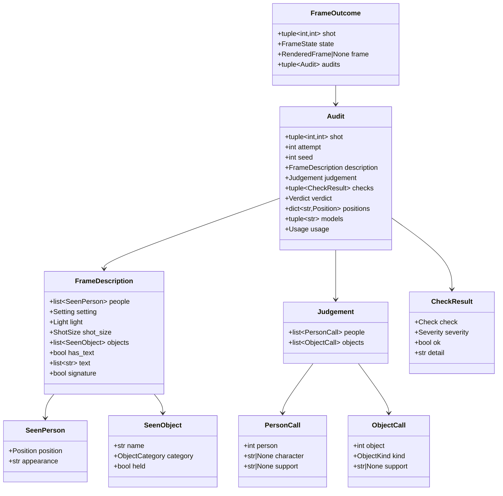
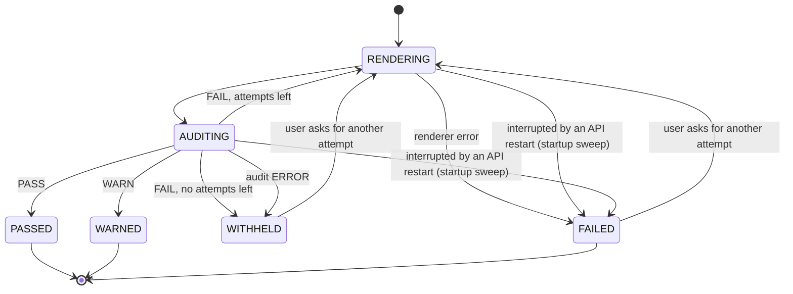

# Design — `verify` (the frame audit and re-render loop)

**Status:** agreed · **Owner:** Katlego (Claude) · **Tasks:** T020 (audit), T021 (re-render loop, audit
log: the API), T061 (the log and the retry in the web app), T062 (the architecture check), T077 (a signature warns), T078 (a prop's parts; no drawing marks), T080 (sex and look; no one in frame), T082 (the judge is told each person's sex), T083 (things the scene names; background objects warn; `recheck`), T084 (a person's support is an action line), T086 (a matched person's age; a vehicle's parts inside it; unheld food warns), T089 (objects, but animals and weapons, and lettering warn), T094 (the rule ladder), T095 (the sex agent) · **Spec:** [SPEC.md](../../SPEC.md) US2 (frame audit)

---

## 1. What this covers

Checking every rendered frame against its shot before anyone sees it, re-rendering it when it
fails, and logging every verdict. This is where Non-negotiable I is enforced **on pixels**: a frame
that shows a person, prop or event the script doesn't put in that shot is never shown. Up to T026,
grounding is enforced on text; this is the first check on images.

**Not covered:** rendering (T026 provides the renderer this calls: storyboard.md), comic layout (comic.md reads
the audit's speaker positions), portraits (characters.md).

## 2. Reference material

| Kind | Where |
| --- | --- |
| The vision decision | docs/nebius-findings.md § The vision decision: **option A**: no Nemotron model on Token Factory accepts images (U7), so a vision model (`NEBIUS_MODEL_VISION`, DeepSeek-V4.1-Flash since 2026-09-30: GLM-5.3-Flash stopped receiving images, findings § U7 re-check) *describes* the frame and Nemotron *judges* it. Option B, a self-hosted NVIDIA VLM on the ComfyUI GPU, is a stretch |
| Prior art in FrameFlow | **none**: FrameFlow had no image audit, no verdicts and no automatic re-render; "regenerate" was a user button with a random seed |
| Inputs | `Shot` (shots.md §6: framing, characters, props, time_of_day, source, span); `Entity` quotes (grounding.md §6); `Scene.int_ext`, `location` (script.md §6); the rendered frame (T026) |
| LLM seam | `structured_chat`, `Tier.VISION` and `Tier.REASONING` (llm.md §6). Image content parts are OpenAI-style (`image_url` data URLs), as probed in U7 |
| Expected renders | `E[N] = (1 − (1−p)^(k+1)) / p` for pass rate `p` and `k` re-renders (docs/submission/about.md) |

## 3. Domain model



- **The describer is blind to the shot.** It gets the image and a neutral instruction: count the
  people, where each one stands, what they look like in a short phrase, interior or exterior, the
  light, the shot size, the notable objects (each with a category from a fixed list and whether
  someone holds it), and whether any text or letters appear. It is never told
  what it *should* see, so it can't simply agree.
- **What the describer leaves out and writes down (T071).** It doesn't list what a person wears
  (that goes in the person's `appearance`) or the place's own structure (walls, floor, ceiling,
  sky, windows, doors, roofs, chimneys, stairs) as objects, nor (T078) marks of the drawing
  itself: shading, hatching, outlines, sketch lines, shadows, the frame's border (it listed
  "pencil shading" as an object, which failed a good frame). Under `text` it writes, word for
  word, each piece of writing it can actually **read**; a scribble, an unreadable signature or a
  mark that isn't letters is left out of `text` (it may still set `has_text`).
- **Ages and signatures (T072).** Each person's `appearance` starts with how old they look
  (`a child`, `a teenager`, `an adult`, `an old man`, `an old woman`). `signature` is true when
  the image carries a signature, initials or an artist's mark, readable or not: the live run's
  frames had one in a corner again and again (eval.md §6a.2: 15 of 27), and it is writing
  no script asked for. **T077:** it is the soft `SIGNATURE` check, not a hard fail: an
  artist's mark is no character, prop, line or event, so it can't break the non-negotiable,
  and failing on it withheld frames that were otherwise right (below, §8).
- **What the judge is told (T072).** A described person whose apparent age plainly contradicts
  a character's quoted age (an adult for `LERATO (10)`, a young man for `MOKGOSI (70s)`) is not
  that character: `character` null, so with no support they are `UNSCRIPTED_PERSON`. **T080:** the
  same for a plainly contradicted sex or look: a boy for a character the quotes call "she", short
  hair for one they give braids (on 2026-10-11 klein drew Lerato, `LERATO (10), braids tied back …
  as tall as she is`, as a short-haired boy, and the judge matched him to her 9 times). Only what
  the quotes say counts; a look they don't mention is no contradiction. And **code**
  refuses as support for such a person any quote that names a shot character (`LERATO (10),
  braids…` is about Lerato, so it can't put a stranger there). An ordinary
  thing the heading's place would hold (a workshop's clock, boxes and tools; a roof's bucket,
  pipes and vents; the sky, clouds and puddles outdoors) is `set_dressing`, its support the
  heading's words for the place, which code still checks. Weather that happens (lightning, rain,
  snow, a storm) is an event: `scripted_prop` only with a verbatim quote, else `unscripted`.
  **Code** refuses `set_dressing` for an object whose name is, or is a word of, a prop the
  extraction names anywhere in the script (a `kite` against `RED KITE`): a thing the script
  names is a story choice, so it needs a `scripted_prop` quote, and a second kite stays
  unscripted.
- **A part of a prop (T078).** The judge calls a `kite string` unscripted when the shot has the
  `RED KITE` (3 of eval.md §6a's 7 good frames failed so). **Code** (`part_of_prop`) treats an
  object as a part of a prop of **this shot** that the extraction quotes when its name, in lower
  case, has that prop's head noun (the last word of the prop's name) as its **second-to-last
  word**, has no copy word (`second`, `another`, `other`, `extra`, `spare`, `two`, `three`,
  `more`, `duplicate`), and its category is not one that is never set dressing (`animal`,
  `vehicle`, `weapon`, `food`): `kite string` and `kite tail` are parts of `RED KITE`; `kite`,
  `blue kite` and `second kite` end in the head noun, so they are the prop or a copy of it and
  are judged as before; `map of the town`, `box of matches` and `kite tail string` don't have
  the head noun next to last, so they are judged as before; `spool of wire` holds no `string`.
  A part passes whatever the judge called it, held or not: its support is the prop's own
  quote, already in the shot's supports. **Accepted residue:** a compound where the prop's noun
  only modifies (`coat hanger` with the `oilskin coat` in the shot, `kite shop`) reads as a part;
  no rule on words tells them apart, and it needs that very prop in the shot.
- **Each person's sex in the spec (T082).** `render_spec(shot, scene, screenplay, extraction,
  description)` (it gains `screenplay`; `audit_frame` passes it) gives, under each person character
  `character_sex` sexes, the line `sex (from the script): <female|male>, "<evidence>"` (storyboard.md
  §6: the evidence is the quote, the introduction or the name, 160 characters at most). It imports
  `app.storyboard.prompt` inside the function, as `audit_frame` does (the import cycle). The judge
  prompt gains: "A character's 'sex (from the script)' line, when there is one, is the script's own
  word for their sex: a person drawn as the other sex is not that character." Before T082 the judge
  saw only the extracted quotes, so it matched a boy to Siphokazi (L002, L009).
- **Things the scene names (T083).** An animal, vehicle, weapon or food is never set dressing: the
  script must put it there. On 2026-10-11 the judge called the boats of sipho-and-siphokazi's
  harbour (shot 1.1: "a single row of forty-year-old wooden fishing-boats") set dressing, and
  `vehicle · never set dressing` failed 31 times. **Code** (`named_in_scene`) now asks the
  script directly. Only for those four categories, an object is scripted when one of its
  candidate words is a word of **this scene's action text**:
  - **The scene's action text:** the text of every `Action` element of the scene, lower case,
    split on anything but letters ("fishing-boats" gives "fishing" and "boats"). Not the
    heading, not dialogue: a boat that is only talked about is not on screen.
  - **The candidates:** the object's name in lower case, split on spaces only (so `off-road`
    stays one word, and doesn't match "road"), each word stripped of `.,;:!?'"()`. The
    candidate is the **last word**, the thing's own noun; but when the name has two words or more
    and its last word is a part word, the candidate is **only the second-to-last word**, the thing
    the part belongs to (a `car door` is named by a car, never by the scene's doors). Part words (`mast`, `sail`, `hull`, `deck`, `cabin`, `bow`,
    `stern`, `oar`, `wheel`, `door`, `window`, `windscreen`, `bonnet`, `boot`, `bumper`, `tyre`,
    `tire`, `engine`, `roof`, `seat`, `mirror`, `light`, `tail`, `wing`, `fin`, `head`, `leg`,
    `paw`, `hoof`, `horn`, `mane`, `ear`, `collar`, `lead`, `handle`, `blade`, `barrel`,
    `trigger`, `hilt`, `sheath`, `crust`, `rind`, `peel`, `skin`, `bone`, `slice`, in singular
    or plural): `boat masts` is a part of a boat; `police car` is not a police officer; a
    single `wheel` is its own noun. A
    candidate has at least 3 letters and is no function word (`of`, `the`, `and`, `with`, `in`,
    `on`, `a`, `an`, `for`, `from`, `to`, `at`, `by`, `into`, `onto`, `over`, `under`, `its`,
    `his`, `her`, `their`). A copy word in the **name** (T078's list) means no match.
  - **Singular and plural:** a candidate matches when the scene has any of its forms: the word;
    it plus `s`; it plus `es` only after `s`, `x`, `z`, `ch` or `sh` (`boxes`, `buses`); a `-y`
    word with `-ies`; and, for a plural, its singular: `-ies` → `-y`; `-es` dropped only when what
    is left ends in `s`, `x`, `z`, `ch` or `sh`; any other `-s` dropped, but not from `-ss`. So
    `horse` meets "horses", `boats` meets "boat", `pony` meets "ponies", `box` meets "boxes", and
    no form is a stray word: `bees` never meets "be", `car` never meets "cares" (the code review:
    both would have excused an unscripted thing). Irregular plurals (`wolves`, `geese`) don't
    match: accepted residue, they stay judged.
  - **Accepted residue:** a food named after an animal (`hot dog` in a scene with a dog) reads as
    the dog, as `coat hanger` does for T078, and a verb spelled like the noun ("Gulls wheel"
    names a `wheel`); no rule on words tells them apart, and both need the word in the scene.
  - Measured on every stored audit: the same idea over **all** categories excused "small pills"
    (on "small"), "power lines" (the script's *washing* lines) and "tripod stand" (a verb), each
    an unscripted thing; the four categories (with the last and the second-to-last word, before the part-word
    limit) excused 11 of the 2026-10-11 sipho-and-siphokazi objects shot by shot, and 32 scene by
    scene, all of them the script's
    boats, fish, the bakkie's wheel and its truck.
- **Background objects warn (T083; Tumo, 2026-10-11).** An everyday thing the script never
  mentions and nobody holds (a pen on a counter, grass, the moon) withheld a frame as an invented
  person does. Now it is the soft `BACKGROUND_OBJECT` check: logged, named on the card (web.md
  §4.3 shows a warned frame's soft checks with their details), the frame `WARN`, and shown, on
  the storyboard and in the comic alike (the same audit). Exactly: an object of category `other`,
  `nature`, `furniture` or `screen_or_sign`, **not held**, whose name is **not** a word of a prop
  the extraction names (`_named_prop`), called `unscripted`, or called `set_dressing` with a
  `support` not found in the heading. Its detail is `object N (name, category): not in the
  script`. **Everything else stays hard:** any person; a held object; an animal, vehicle, weapon
  or (until T086, which makes unheld food warn) food the scene doesn't name; a `scripted_prop` without a verified support, whatever its
  category (the judge claimed a quote it can't show); a named prop called `unscripted` or
  dressing (T072); and legible text (`TEXT_IN_FRAME` still reads a sign's words). **Since T089**
  all of these but an animal or a weapon (and any person) warn too: §3, Objects and lettering
  warn. Measured free
  on the 2026-10-11 storyboards' stored audits (`recheck`, with the scene-named rule too):
  sipho-and-siphokazi 7 → 12 of 30 shots with an accepted attempt, the-red-kite 16 → 19 of 21.
  **Looked at:** 2 of the 9 attempts it newly accepts draw Siphokazi with the wrong sex (L009):
  the object checks were catching them by accident, so T083 goes live after T082.
- **The order in `run_checks` (T083)**, for each judged object: costume and structure that nobody
  holds pass (T071, `_NEVER_UNSCRIPTED`); then a part of a shot prop passes (T078,
  `part_of_prop`); then a thing the scene names passes (T083, `named_in_scene`), held or not and
  whatever the judge called it (a held sword the scene names is the script's sword); then the
  judge's call: `unscripted` → `BACKGROUND_OBJECT` when the rule above holds, else
  `UNSCRIPTED_OBJECT` "unscripted"; `scripted_prop` without support → `UNSCRIPTED_OBJECT`;
  `set_dressing` held → hard; named prop → hard; one of the four categories → hard "never set
  dressing"; support not in the heading → `BACKGROUND_OBJECT` when the rule holds, else hard
  "not in the heading". **T086:** right after `named_in_scene`, a part of the vehicle the scene is
  inside passes (`part_of_vehicle`); and before the judge's call, unheld food that no rule above
  passed and that is no named prop is `background`, so `set_dressing` → `BACKGROUND_OBJECT` (even
  with the heading as support) and `unscripted` → `BACKGROUND_OBJECT`; a `scripted_prop` food with a
  verified support still passes, without one it stays hard; held food stays hard. For each judged
  **person**, the age test (T086) comes first: a contradicted match is refused as that character
  and is never then tried as a stranger (no support can excuse it); then T072/T084 as before.
  **T089:** the cases and their order, and the `background` and `food` variables, are unchanged;
  every place above that files `UNSCRIPTED_OBJECT` ("hard") files `_filed(obj.category)`
  instead: `UNSCRIPTED_OBJECT` for an animal or a weapon, else `BACKGROUND_OBJECT`, the detail
  the same (§6).
- **A person's support is an action line (T084).** A described person the judge matches to no
  character is scripted only by a verbatim `support`. On 2026-10-12 lost-property (L011) showed
  three accepted frames whose strangers were excused by what someone **says** ("Somebody might
  have.", "Sorry, my friend. He's already got a home.") or by a sentence whose only person is a
  pronoun for a character ("A pigeon glares at him.", "him" is Koos). A line of dialogue puts no
  one on screen, as `named_in_scene` already holds for things. **Code** now asks two more things
  of a person's support, after T072's (it names no shot character):
  - **It is found in the shot's action text** (`shot_action_text`: the text of the shot's covered
    `Action` elements, in order, joined by a space and normalised as `_found` does), not in its
    dialogue or parentheticals, and no longer in an entity quote from elsewhere in the script.
    Detail: `person N (position, appearance): its support is not an action line`. **Only this
    shot's action, on purpose** (unlike T083's scene-wide words for things): a stranger the
    script introduced in an earlier shot and still on screen in a shot of dialogue alone now
    fails. Accepted: the stored runs have no such case, and a person who stays is usually a
    character the judge can match.
  - **It has no `he`, `him` or `she`**: the words of the support, lower case, split on anything
    but letters (`re.findall(r"[a-z]+", support.lower())`, so "he's" gives "he"), against
    `_PERSON_PRONOUNS`. Such a word points back at someone the script has already introduced, a
    character, so it can't introduce a stranger. Possessives and reflexives (`his`, `her`,
    `hers`, `himself`, `herself`) are **not** in the set: they usually belong to the sentence's
    own subject ("A WOMAN, 40s, folds her umbrella" introduces her); with them or without, the
    stored runs give the same result. Plural `they`/`them` stay allowed: a crowd is introduced
    as "Passengers hurry" and then "they". Detail: `person N (position, appearance): its support
    points at someone else`. **Accepted residue:** a stranger introduced in a sentence that also
    points at a character ("A WOMAN hands him a cup"), quoted whole, fails; the judge isn't told to
    quote only the stranger's part (§10).
  - **The order, for a person matched to no character**, first failure wins: support not found
    in the shot's text or its in-shot entities' quotes → "no shot character, no support" (as
    before); names a shot character → "its support is about a character" (T072); not in the
    shot's action text → "its support is not an action line"; has `he`, `him` or `she` → "its
    support points at someone else".
  - Measured free (`recheck` with a prototype, every stored audit): lost-property 12 → 9 shots
    with an accepted attempt (7.4, 10.2, 10.3, the three of L011). **Not designed on:** the
    2026-10-11 sipho-and-siphokazi 12 → 11 (6.1, a man excused by Sipho's introduction from
    another shot; 9.3, an old woman excused by "He takes the tide book from her", where "her" is
    Siphokazi, 17), the-red-kite runs 35 → 33, 16 → 15 and 10 → 9 (a "teenager" excused by "my
    girl", a child by "Is that my good shirt you are flying?", "an adult man" by "He switches off
    the soldering iron." for Mokgosi, 70s), every other stored project unchanged. Each newly
    failed attempt was read: every one excuses a person with a spoken line, someone else's pronoun
    or a quote from another shot.
- **A matched person's age (T086).** The judge is told (T072) that a person whose age plainly
  contradicts a character's is not that character, but nothing checked it. On 2026-10-12 the-bread-van
  (L012) matched THEO (9) to an adult in 17 of 24 matches, and DANIEL (40s) to "an old man". **Code**
  now compares: `described_age` reads the describer's own words (the earliest of child, teenager, old,
  adult: "an old man looking toward the girl" is old; parents and grandparents are adult and old, so "a
  mother holding a child" is adult; "older" is no age word, DANIEL (40s) drawn as "an older man" is
  not refused), and `age_contradicts(years, described)` with the
  introduction's age in years (`introduced_years`, storyboard.md §6): under 13 not an adult or old; 13 to
  19 not old; 20 to 49 not a child or old; 50 and over not a child or a teenager. No described age, or
  no introduced age, is no check. A contradicted match is `UNSCRIPTED_PERSON` `person N (position,
  appearance): described as <age>, but <NAME> is introduced at <years>`, and the character is not
  placed (so `NO_CHARACTER` and `MISSING_CHARACTER` see them absent). `run_checks` gains `ages`, each
  shot character's introduced years (`shot_ages`), passed by `audit_frame` and `recheck`. It only
  tightens: it can't make the judge match the right person, only refuse a wrong match.
- **Inside a vehicle, its parts are the place (T086).** On 2026-10-12 the-bread-van's INT. VAN - MOVING
  failed a rearview mirror, a dashboard, headrests and car seats as vehicles never set dressing, and a
  driver's held steering wheel as held (L013). **Code**: when the scene is not `EXT` and its location's
  head noun (the last word of the location's first part, before any " - ") is a vehicle, so INT. VAN -
  MOVING and SIPHO'S BAKKIE are inside one and BUS STATION, CAR PARK and TAXI RANK are not
  (`_VEHICLE_PLACES`: van, car, bus, minibus, kombi, taxi, cab, truck, lorry,
  bakkie, jeep, ambulance, train, carriage, tram, coach, boat, ship, ferry, plane, aeroplane, airplane,
  helicopter), an object, not an animal, weapon or food, whose last word is a vehicle part word
  (`_VEHICLE_PART_WORDS`: wheel, door, window, windscreen, bonnet, boot, bumper, tyre, tire, engine,
  roof, seat, mirror, light; T083's list less its animal, weapon and food parts, so a held "pistol
  barrel" or a "dog collar" in a van is judged as before) or an interior word
  (`_INTERIOR_WORDS`: dashboard, steering, headrest, seatbelt, gearstick, gear, speedometer, windshield,
  visor, glovebox, upholstery), or that has an interior word, is the place's own structure
  (`part_of_vehicle`), held or not, whatever the judge called it; never with a copy word. A bare vehicle
  (a sailboat through the window, a second van) is judged as before: the prototype that let any
  `vehicle` object pass accepted a sailboat in a boat's cabin. In `run_checks`, right after
  `named_in_scene`.
- **Unheld food warns (T086; Tumo, 2026-10-12).** Bread in the bakery failed 26 times on the-bread-van
  (`food · never set dressing`). Food nobody holds that the scene doesn't name and that is no named
  prop is now `BACKGROUND_OBJECT` (soft, `WARN`), whatever the judge called it, `unscripted` or
  `set_dressing`, even with the heading as support: food is never quietly the place's, it is shown with
  a warning. Held food (someone eating what the script never gave them) and a `scripted_prop` without
  support stay hard. Animals, vehicles and weapons stay never set dressing. (Since T089 held food,
  an unsupported prop and a vehicle warn too; only an animal or a weapon stays hard.)
- **Measured free** (every stored audit, main's `run_checks` against T086's): the-bread-van 1 → 2 shots
  with an accepted attempt, sipho-and-siphokazi (2026-10-11) 11 → 14 and its older run 10 → 11, the-red-
  kite `fbe668c8` 9 → 7 (two adults matched to LERATO, 10, now refused), every other project unchanged.
  **Looked at, every newly accepted drawing (9):** 5 right (the-bread-van 5.1 twice, Nomsa and Theo;
  the-red-kite 5.1 three times, Mokgosi and Lerato in braids); **4 wrong**: sipho-and-siphokazi 2.3, 3.2
  and 3.3 draw Siphokazi (17) as a boy, the older run's 3.3 draws Sipho (50s) young. The object
  checks were catching them by accident (L009 again): those audits are from before T082, and Siphokazi
  has no sex the judge could check (L010). **So T086 goes live after T088** (TASKS: the extraction model
  resolves a "his"/"her" to its character, code checks the quote; L010), as T083 went after T082.
- **Objects and lettering warn (T089; Tumo, 2026-10-12).** Measured free on five runs' stored audits
  with today's code (L014): the shots with an accepted attempt go the-bread-van 3 → 9 of 20 (and its
  first run 2 → 5 of 19), lost-property 9 → 33 of 49, sipho-and-siphokazi 14 → 26 of 30, the-red-kite
  19 → 20 of 21 when an object or a painted word the script didn't put there warns instead of
  failing. klein can't spell (LOST PROPERTY is painted LOST POVERTY, LOST PORRY) and fills a place with
  bags, pens, plates and cars; each one withheld the frame. Now:
  - **An object** that would fail `UNSCRIPTED_OBJECT` (any reason: `unscripted`, `prop without
    support`, `held, so not set dressing`, `the script names it`, `never set dressing`, `not in the
    heading`) fails the soft `BACKGROUND_OBJECT` instead, with the same detail, **unless its category
    is `animal` or `weapon`** (`_STORY_OBJECTS`): a dog or a knife the script never gave the scene is
    a story choice, and stays hard. Keeping those two hard costs nothing measured (the same shots on
    all five runs: a baton, a knife and a bird).
  - **`TEXT_IN_FRAME` is soft.** A painted word the script didn't write is named on the card and the
    frame shown with a warning. It is lettering, never a line someone says: speech bubbles come only
    from the script's dialogue (comic.md).
  - **Everything else stays hard:** every person (`UNSCRIPTED_PERSON`, the age check, `NO_CHARACTER`),
    `SETTING`, and an animal or weapon. In `run_checks` the object cases are unchanged; only where a
    failure is filed changes: `UNSCRIPTED_OBJECT` when `obj.category in _STORY_OBJECTS`, else
    `BACKGROUND_OBJECT`, the detail the same.
  - **Rule I, as the audit reads it now (PLAN.md Non-negotiable I; Tumo's call, 2026-10-12, "go a bit
    easy on the refusals"):** a person, an animal or a weapon the script didn't write never reaches
    the board; an everyday object, a misspelt sign, and **weather drawn as an object** (lightning in
    a storm the script gives only thunder: the-red-kite 3.2, `nature`, newly accepted) do, **named on
    the storyboard frame's card as a warning** (web.md §4.3). **The comic shows such a panel with no
    note:** comic.md draws a `WARNED` panel as it draws a `PASSED` one (the same `run_checks`), so a
    misspelt sign or an unscripted pen reaches a comic page unannotated; the storyboard card is
    where it is named. This loosens the rule for props and painted words, so the team confirms it
    on the design PR. Strict again is one revert of `_SEVERITY` and `_filed`.
  - **No re-render for them:** a `WARN` is accepted at once, so a frame whose only faults are
    objects or lettering is shown at that attempt instead of drawn again (up to 3 attempts). That
    is the point: the retries went to frames klein can't draw without a bag or a misspelt sign.
  - **What else reads these checks** (checked, none changes): `report.py` parses object and text
    details whatever their severity, and its `ShotLine.failed` lists hard checks only, so it lists
    fewer; a report over a project with audits from before and after T089 shows the first row's
    severity for a check (old runs' reports stay as written). `recheck` reuses `run_checks`. The
    web's and the comic's `withheld_check` take the first failed hard check, so a withheld frame
    no longer names `text_in_frame`, or `unscripted_object` for anything but an animal or weapon.
  - **Evidence:** L014 (the five runs, the 46 drawings) and L015 (split panels) in
    docs/learning-log.md, landing with the-bread-van's second run report (#152), which merges first.
  - **Looked at, every newly accepted drawing (46):** 34 right, **12 wrong, every one in its people**:
    7 girls drawn as boys (sipho-and-siphokazi 2.2, 2.4, 4B.1, 4B.3, 6.1; lost-property 11.1, 3.2), two
    split panels (L015), Mr. Dube drawn young (lost-property 12.2), Theo at a steering wheel (the-bread-van
    3.1), a rowboat for a fishing boat (sipho 5.2). The audits of the girls predate T088 (no sex for
    Siphokazi or Amahle then; T088 finds both now, not Priya): the object checks were catching them by
    accident (L009). So T089 is live only with T088's sex, which is merged.
- **The judge is Nemotron** (`Tier.REASONING`, Nemotron 3 Super, thinking on). It gets the shot's
  grounded spec (characters with their quotes, props, location, time of day, the verbatim `source`)
  and the description. It decides only what needs judgement: which described person is which
  character (or nobody), and whether each object is a scripted prop, set dressing, or unscripted.
- **`PersonCall.person` and `ObjectCall.object`** are 0-based indexes into the description's `people`
  and `objects`. The judgement must call **every** person and **every** object **exactly once**; a
  judgement that skips one, repeats one, or indexes out of range is invalid, and the audit is
  `ERROR` (the frame is withheld).
- **`support` must be verbatim.** When the judge says an unnamed person or an object is supported
  by the script ("a crowd gathers"), `support` must quote the shot's `source` or a quote of one of
  the shot's entities. Code checks the quote with `normalize_for_grounding` substring matching,
  exactly as the grounding filter does. **A support that isn't found counts as unscripted.** For
  `set_dressing`, `support` must instead quote the scene heading (the location words that make a
  stove plausible in a kitchen).
- **`positions`**: character → `left | centre | right`, from the judge's person calls (each character
  matches at most one person, so the position is unambiguous). Stored with the audit; the comic
  reads the accepted audit's positions (comic.md §4, `PanelFrame.positions`).

### The checks

| Check | Decided by | Severity | Fails when |
|---|---|---|---|
| `UNSCRIPTED_PERSON` | judge + code | **hard** | a described person is called with no character (or a name not in `shot.characters`) and has no verified `support`; **or** a character is called for more than one person (every person after the first called for it counts as unscripted); or (T072) the `support` of a person called with no character names a shot character; or (T084) that support isn't found in the shot's action text (`shot_action_text`), or has `he`, `him` or `she`; or (T086) a matched person's described age contradicts the character's introduced age |
| `UNSCRIPTED_OBJECT` | judge + code | **hard** | an object called `unscripted`; `scripted_prop` without a verified `support`; or `set_dressing` when the object is `held`, or its category is `animal`, `vehicle`, `weapon` or `food`, or its `support` isn't found in the heading. **Never** for an object of category `clothing` or `architecture` that isn't held (T071): costume and the place's own structure are not story choices the script makes, whatever the judge called them. A `screen_or_sign` may be set dressing (T071): what makes a sign a risk is its words, which `TEXT_IN_FRAME` checks. **T072:** `set_dressing` also fails for an object whose name is, or is a word of, a prop the extraction names (§3). **T083:** never for an animal, vehicle, weapon or food the scene's action text names (`named_in_scene`); and an everyday unheld object called `unscripted`, or dressing not in the heading, is the soft `BACKGROUND_OBJECT` instead (§3, the order in `run_checks`). **T089:** hard only for an object whose category is `animal` or `weapon` (`_STORY_OBJECTS`); for every other object the same failure, with the same detail, is the soft `BACKGROUND_OBJECT` (§3, Objects and lettering warn) |
| `TEXT_IN_FRAME` | code | soft (T089; hard before) | a piece of the description's `text` isn't found (`normalize_for_grounding`, as whole words) in the shot's `source` or the scene's `location` (T071): legible words the script never wrote. The heading's time of day is not a haystack (a painted "NIGHT" is not the script's; since T089 it warns). An empty `text` passes, whatever `has_text` says; `has_text` is logged and shown but decides nothing. T089: soft, named on the card |
| `SETTING` | code | **hard** | `interior`/`exterior` contradicts `Scene.int_ext` (`INT_EXT` accepts either; `unclear` passes) |
| `NO_CHARACTER` (T080) | code | **hard** | the prompt put at least one of the shot's people on screen (`on_screen`, from storyboard.md §3.1's `visible_characters`) and no described person is matched to any of them: a frame of the setting alone, or of strangers, for a shot about its characters (on 2026-10-11 shot 1.3 was an empty roof, shown with a warning). A shot whose people are only heard off screen, or that names no one, has an empty `on_screen` and never fails it |
| `MISSING_CHARACTER` | code | soft | a shot character **who is a person** matched to no described person (an animal character, `species` set, is described as an object: T052) |
| `LIGHT` | code | soft | `light` is `day` and the shot's time is night-family (`NIGHT`, `MIDNIGHT`, `EVENING`), or `light` is `night` and the time is day-family (`DAY`, `MORNING`, `AFTERNOON`). Transitional times (`DAWN`, `DUSK`, `SUNRISE`, `SUNSET`, `MAGIC HOUR`), a `None` time, `dawn_or_dusk` and `unclear` always pass |
| `FRAMING` | code | soft | `shot_size` is two or more steps from the shot's framing on wide → medium → close → extreme_close (`over_shoulder`, `pov` count as medium; `insert` as close); `unclear` passes |
| `BACKGROUND_OBJECT` (T083; T086: and unheld food) | judge + code | soft | an object of category `other`, `nature`, `furniture` or `screen_or_sign`, not `held`, not a named prop, called `unscripted`, or `set_dressing` whose `support` isn't in the heading (§3, Background objects warn): the place's everyday things the script didn't mention. Its detail is `object N (name, category): not in the script`. **T089:** also every object failure that isn't an animal's or a weapon's, with that failure's own detail (`held, so not set dressing`, `prop without support`, `unscripted`, `the script names it`, `never set dressing`, `not in the heading`) |
| `DRAWN_SEX` (T095) | sex agent (VISION) + code | **hard** | a person the judge matched to a character whose sex the script gives (`character_sex`) is drawn as the other sex: the sex agent, asked about that one person on the image, answers `male` or `female` and it isn't the script's. `unclear` passes, and so does a person matched to no character or to one with no sex from the script. Detail: `person N (position, appearance): drawn male, but REFILWE is female` |
| `SIGNATURE` (T077) | code | soft | `signature` is true: a signature, initials or an artist's mark, readable or not. Words the describer reads in it are still `text`, so a legible signature that isn't the script's (`@hutley`) still fails `TEXT_IN_FRAME` (soft since T089) |

**Verdict:** `FAIL` if any hard check fails; `WARN` if only soft checks fail; `PASS` otherwise. Hard
checks are the ones that would put something unscripted on screen; soft checks are quality
(an omission, a wrong light), logged and shown but not blocking.

**The rule ladder (T094; Tumo, 2026-10-13).** Which failed hard checks withhold a frame is a
setting, `AUDIT_WITHHOLD_CHECKS`: `all` (the default, every hard check, as above), empty (none), or a
comma list of check names (`drawn_sex,no_character`); an unknown name is refused at start-up, so a
typo can never switch a rule off. A failed hard check **not** on the ladder makes the attempt
`WARN` instead of `FAIL`: the frame is accepted on that attempt, and the audit keeps every check it
failed, so the card names it ("Audit: warn (unscripted person, …)"; a warned card lists hard as well
as soft failures). An audit that can't run (`ERROR`) still withholds, whatever the ladder: nothing
shows the frame was looked at. **Why:** on 2026-10-13, market-day (held out) had 0 of 15 shots
accepted, though about 12 of the 15 final drawings were right: klein fills a market with shoppers
and every one failed `UNSCRIPTED_PERSON`. With an empty ladder the same script showed 16 of 17,
9 right, 5 weak, 2 split panels (L015), none of the wrong sex or age, in 17 drawings instead of 44.
The rules come back one at a time, each measured on the stored audits first: a rule earns its
place when it withholds wrong frames and few right ones.

**The sex agent (T095).** After the judge, for each described person the judge matched to a
character whose sex the script gives (`character_sex`, people only), one more vision call asks about
that person alone: the image, the person's `position` and `appearance` as the describer wrote them,
and the fixed question "male, female or unclear; child, teenager, adult, old or unclear", answered
as a `PersonCheck`. The answers are kept with the audit (`Audit.seen`, the `frame_audits.seen`
column) so `recheck` runs `DRAWN_SEX` again for free. `run_checks` fails `DRAWN_SEX` when the agent
answers the other sex; the age answer is stored and shown, never checked (below). A failed agent call
(an `LLMError` or a `ValidationError`) checks nothing for that person and is logged: it never turns
the audit into `ERROR`, so a flaky question can't withhold a frame. **Measured** (2026-10-13,
Token Factory, DeepSeek-V4.1-Flash, stored drawings of stormwater, load-shedding, the-night-taxi,
market-day's second run and the-red-kite, the labels' sex standing in for the script's): **175**
matched people asked; 154 agree, 9 `unclear`, **12 the other sex, every one looked at and every
one a real error** (Fatima drawn as a boy twice, Pieter as a girl twice, a girl matched to Jabu, a
young man to Fatima, Refilwe as a boy three times, Sibusiso as a young woman three times); **0 false
alarms**. Three known wrong frames pass as `unclear` (Refilwe as a short-haired child in 1.2 and 6.2,
load-shedding 1.2). About 1,000 tokens a question, so roughly 45,000 a script of 20 shots.
**Age is not checked:** in the same 175 answers the agent called men in their 50s `old` 15 times
(BONGANI, MR. VAN DER MERWE), and a 60s woman `adult`: an introduction's decade doesn't map to the
agent's bands. T086's code age check stays the one age rule. **Only where the script gives a sex:**
in the live runs above, REFILWE, SIBUSISO and FATIMA had none in the extraction, so the agent would
have asked about none of them; T096 and the L018 work widen that.

## 4. Flow

```mermaid
sequenceDiagram
    participant J as Frame job
    participant R as Renderer (T026)
    participant D as Describer (VISION)
    participant N as Judge (Nemotron, REASONING)
    participant L as Audit log (Postgres)
    loop attempt 1 .. max_renders
        J->>R: render(shot, attempt)  (seed from shot + attempt)
        R-->>J: RenderedFrame
        J->>D: image + neutral instruction → FrameDescription
        J->>N: shot spec + description → Judgement
        J->>D: T095: each matched person with a script sex → PersonCheck
        J->>J: verify supports; run the checks; verdict; T094: a hard failure off the ladder warns
        J->>L: Audit (every attempt, pass or fail)
        alt PASS or WARN
            J-->>J: state PASSED / WARNED; stop
        else FAIL and attempts left
            J-->>J: next attempt
        end
    end
    J-->>J: out of attempts: WITHHELD
```

- **Seeds** are deterministic: `seed(shot, attempt)`, so an attempt can be reproduced.
- **`max_renders` = 3** (the first render plus two re-renders, `k = 2`). With a pass rate `p = 0.6`
  that's `E[N] ≈ 1.56` renders per frame; the real `p` comes from T049's measurement.
  **T071:** it is the setting `RENDER_MAX_ATTEMPTS` (`Settings.render_max_attempts`, 1 to 3,
  default 3). Every full loop passes it: the storyboard's rendering stage (T026's
  `build_storyboard`) and the comic job (T064); "Try another render" still passes 1. The
  live run of 2026-10-10 is why: 257 drawings, 3 accepted, 2 of them on a second attempt, because
  the failures were systematic (the same sign, the same jacket), so a re-render bought another
  FAIL. A dev run sets 1 until the pass rate is known; the frame sheet's "attempt n of N" reads
  the same setting.
- **A withheld frame is never shown.** The storyboard shows its shot as a text card:
  the verbatim `source`, the span, and "Frame withheld: failed audit (unscripted person)". The user
  can ask for more attempts later; each is audited the same way. The comic has its own withheld
  card, without the source (its bubbles letter the dialogue): comic.md §4 step 6.

**Failure paths:** the describer or judge call fails (an `LLMError`, or `ValidationError` after the
repair retry) → that attempt's audit is `ERROR`, logged, and the frame is **withheld**, never passed
unaudited. The renderer fails → the frame job fails (a `Job` `FAILED`). A frame is never shown
without a `PASS` or `WARN` audit.

**Animal characters (T052).** An animal character (`animals(extraction)`, storyboard.md §3.1:
its own `species`, or bound to an animal by `match_speaker`) is drawn as an animal, and the describer files an animal under objects (`ObjectCategory.ANIMAL`). So the judge's
spec lists it under **"Animals in this shot"** (name, species, its quotes), not under "Characters
in this shot"; the judge prompt says an animal listed there is called `scripted_prop` with a
verbatim support quote that names it; people are matched only against the shot's person
characters (`match_speaker` over those); and `MISSING_CHARACTER` checks person characters only.
An unscripted animal is still `UNSCRIPTED_OBJECT` (hard), as before.

## 5. State



`PASSED` and `WARNED` are the only states whose frame may be displayed. No transition skips
`AUDITING`. The two sweep edges (added with docs/design/web.md, 2026-09-30) are taken only by the
startup sweep, for frames whose job died with the process; T021 implements them. `FAILED →
RENDERING` (T066, 2026-10-10) is "Try another render" on a frame whose renderer failed or whose
render a restart cut off, as on a withheld one: a failed frame is no longer the end of the line,
since one passing renderer error no longer stops the storyboard (storyboard.md §4).

## 6. Contracts

```python
# app/verify/model.py
class Position(StrEnum): LEFT = "left"; CENTRE = "centre"; RIGHT = "right"
class Setting(StrEnum): INTERIOR = "interior"; EXTERIOR = "exterior"; UNCLEAR = "unclear"
class Light(StrEnum): DAY = "day"; NIGHT = "night"; DAWN_OR_DUSK = "dawn_or_dusk"; UNCLEAR = "unclear"
class ShotSize(StrEnum): WIDE = "wide"; MEDIUM = "medium"; CLOSE = "close"; EXTREME_CLOSE = "extreme_close"; UNCLEAR = "unclear"
class ObjectKind(StrEnum): SCRIPTED_PROP = "scripted_prop"; SET_DRESSING = "set_dressing"; UNSCRIPTED = "unscripted"
class ObjectCategory(StrEnum): FURNITURE = "furniture"; ARCHITECTURE = "architecture"; NATURE = "nature"; CLOTHING = "clothing"; ANIMAL = "animal"; VEHICLE = "vehicle"; WEAPON = "weapon"; SCREEN_OR_SIGN = "screen_or_sign"; FOOD = "food"; OTHER = "other"
class Check(StrEnum): UNSCRIPTED_PERSON; UNSCRIPTED_OBJECT; TEXT_IN_FRAME; SETTING; MISSING_CHARACTER; LIGHT; FRAMING; SIGNATURE; NO_CHARACTER; BACKGROUND_OBJECT   # BACKGROUND_OBJECT: T083, soft; value = the name in lower case; SIGNATURE: T077, soft; NO_CHARACTER: T080, hard;
#   T089: TEXT_IN_FRAME soft, UNSCRIPTED_OBJECT only for an animal or a weapon
class Severity(StrEnum): HARD = "hard"; SOFT = "soft"
class Verdict(StrEnum): PASS = "pass"; WARN = "warn"; FAIL = "fail"; ERROR = "error"
class FrameState(StrEnum): RENDERING; AUDITING; PASSED; WARNED; WITHHELD; FAILED   # value = the name in lower case
@dataclass(frozen=True) class CheckResult: check: Check; severity: Severity; ok: bool; detail: str
@dataclass(frozen=True) class Audit: shot: tuple[int, int]; attempt: int; seed: int; description: FrameDescription | None; judgement: Judgement | None; checks: tuple[CheckResult, ...]; verdict: Verdict; positions: dict[str, Position]; models: tuple[str, ...]; usage: Usage
@dataclass(frozen=True) class FrameOutcome: shot: tuple[int, int]; state: FrameState; frame: RenderedFrame | None; audits: tuple[Audit, ...]

# app/verify/schema.py — the two model calls (strict json_schema)
class SeenPerson(BaseModel): position: Position; appearance: str
class SeenObject(BaseModel): name: str; category: ObjectCategory; held: bool
class FrameDescription(BaseModel): people: list[SeenPerson]; setting: Setting; light: Light; shot_size: ShotSize; objects: list[SeenObject]; has_text: bool; text: list[str]; signature: bool
#   text (T071): each piece of writing the describer can read, verbatim, in reading order; [] for none.
#   The describer must always return it (strict schema). A row written before T071 has no `text`:
#   AuditView's description reads it as [] (its old has_text verdict stands in the log)
#   signature (T072): a signature, initials or an artist's mark anywhere, readable or not; required
#   from the describer; a row written before T072 reads as false in AuditView
class PersonCall(BaseModel): person: int; character: str | None; support: str | None   # person: 0-based index into description.people
class ObjectCall(BaseModel): object: int; kind: ObjectKind; support: str | None        # object: 0-based index into description.objects
class Judgement(BaseModel): people: list[PersonCall]; objects: list[ObjectCall]

# The renderer T026 must provide (verify depends on this shape, nothing more)
@dataclass(frozen=True) class RenderedFrame: shot: tuple[int, int]; attempt: int; seed: int; png: bytes; width: int; height: int; prompt: str
class Renderer(Protocol):
    async def render(self, shot: Shot, attempt: int, seed: int, width: int, height: int) -> RenderedFrame: ...
    # width × height: the storyboard's 16:9 size, or a comic panel's rect (comic.md §4 step 6)

# app/verify/audit.py (T020)
async def describe_frame(model: NebiusChatModel, png: bytes) -> tuple[FrameDescription, ChatResult]: ...
#   the blind describer on its own (Tier.VISION, no shot details); audit_frame calls it, and so do
#   portraits (characters.md), which need only people and has_text
def seed_for(shot: Shot, attempt: int) -> int: ...          # int.from_bytes(sha256(f"{scene_index}:{number}:{attempt}").digest()[:4], "big")  (unsigned)
def part_of_prop(name: str, category: ObjectCategory, shot: Shot, extraction: Extraction) -> str | None: ...   # T078, pure:
#   the shot prop whose part `name` is (§3, A part of a prop), or None; the first such prop in
#   `shot.props` order that the extraction quotes
def named_in_scene(name: str, category: ObjectCategory, scene: Scene) -> str | None: ...   # T083, pure:
#   the scene word that names the object (§3, Things the scene names), or None; only for animal, vehicle,
#   weapon and food. run_checks skips an object it names, as it does a part_of_prop
def shot_action_text(shot: Shot, scene: Scene) -> str: ...   # T084, pure:
#   normalize_for_grounding of the text of `scene.elements[i]` for each `i` in `shot.elements` that is an
#   `Action`, joined by " " in order; "" when the shot covers no action. A person's support must be found
#   in it (§3, A person's support is an action line)
# _PERSON_PRONOUNS = frozenset({"he", "him", "she"})  # T084: against re.findall(r"[a-z]+", support.lower())
def described_age(appearance: str) -> str | None: ...   # T086, pure: "child", "teenager", "old" or "adult",
#   the earliest match in the lower-cased appearance of: child \b(child|children|kids?|boys?|girls?|toddlers?|baby|
#   babies|infant)\b; teenager \b(teenagers?|teens?|teenage|adolescents?)\b; old \bold (man|woman|person|adult)\b|
#   \belderly\b|\b(grandmother|grandfather|granny|grandma|grandpa)\b; adult \b(adults?|man|men|woman|women|mother|
#   father|mum|mom|dad|lady|gentleman|guy)\b; None when none matches
def age_contradicts(years: int, described: str | None) -> bool: ...   # T086, pure: §3, A matched person's age
def inside_vehicle(scene: Scene) -> frozenset[str]: ...   # T086, pure: the location's head noun (the last of
#   re.findall(r"[a-z]+", location.split(" - ")[0].lower())) when it is in _VEHICLE_PLACES and the scene isn't
#   EXT; empty otherwise
def part_of_vehicle(name: str, category: ObjectCategory, scene: Scene) -> bool: ...   # T086, pure: §3, Inside a
#   vehicle; the name split as named_in_scene splits it, its last word's _forms against _VEHICLE_PART_WORDS |
#   _INTERIOR_WORDS, or any word in _INTERIOR_WORDS; False outside a vehicle, with a copy word, or for an animal,
#   weapon or food
def shot_ages(shot: Shot, screenplay: Screenplay, years: Callable[[str, Screenplay], int | None]) -> dict[str, int]: ...
#   T086: {character: years} for each shot character years() gives; years is storyboard's introduced_years,
#   passed in (app.storyboard imports app.verify)
# run_checks(..., *, on_screen=(), ages: Mapping[str, int] | None = None)  # T086: ages from shot_ages
_STORY_OBJECTS: frozenset[ObjectCategory] = frozenset({ObjectCategory.ANIMAL, ObjectCategory.WEAPON})  # T089
def _filed(category: ObjectCategory) -> Check: ...   # T089, pure: UNSCRIPTED_OBJECT if category in
#   _STORY_OBJECTS else BACKGROUND_OBJECT; used at every UNSCRIPTED_OBJECT append in run_checks
# _SEVERITY[Check.TEXT_IN_FRAME] = Severity.SOFT  (T089; UNSCRIPTED_OBJECT stays HARD, for animals and weapons)
# services/api/app/verify/recheck.py (T083): measures a code-only audit change for free
async def recheck(sessions: async_sessionmaker[AsyncSession], project_id: UUID, *,
                  target: AuditTarget | None = None) -> tuple[list[Reaudit], int]: ...
#   every stored audit of the project (one target, or both), in reaudit's order, re-checked: today's
#   run_checks on its stored description and judgement, on_screen = visible_characters(shot, screenplay,
#   extraction) for every row of either target, exactly as audit_frame builds it (imported inside the
#   function, as audit_frame does: the storyboard import cycle). `before` is the stored verdict, `after`
#   today's. Skipped, and counted in the returned int: a row whose description or judgement is NULL (an
#   ERROR) or doesn't validate as FrameDescription / Judgement (stored before today's schema). A row whose
#   lists make run_checks return ERROR is not skipped: its `after` is `error`. Reads the project and its
#   frame_audits only: no model, no Storage, no write. Raises ValueError for no project or no plan,
#   as reaudit does
def accepted_shots(rows: Sequence[Reaudit]) -> tuple[int, int]: ...   # pure: shots with any attempt
#   `pass` or `warn`, before and after
# python -m app.verify.recheck <project-id> [--target storyboard|comic]   (default: both, as reaudit)
#   prints reaudit.line per row, then reaudit.summary, then "shots with an accepted attempt: <b> → <a>"
#   and "skipped: <n>". Exit 0; 2 with "no such project" / "no shot plan yet" (the ValueError); 1 on a
#   database error (SQLAlchemyError or OSError), as report.py
def run_checks(shot: Shot, scene: Scene, description: FrameDescription, judgement: Judgement,
               extraction: Extraction, *, on_screen: tuple[str, ...] = ()
               ) -> tuple[tuple[CheckResult, ...], Verdict, dict[str, Position]]: ...   # pure
#   T080: `on_screen`, the people the prompt drew; audit_frame passes `visible_characters(shot, screenplay,
#   extraction)` (storyboard.md §3.1), imported where it is called: T026's renderer modules in app.storyboard
#   import app.verify, so a module-level import would be a cycle once they land
async def audit_frame(model: NebiusChatModel, frame: RenderedFrame, shot: Shot, screenplay: Screenplay,
                      extraction: Extraction) -> Audit: ...

# app/verify/loop.py (T021)
async def render_until_accepted(model: NebiusChatModel, renderer: Renderer, shot: Shot, screenplay: Screenplay,
                                extraction: Extraction, *, width: int, height: int, max_renders: int = MAX_RENDERS,
                                first_attempt: int = 1,
                                log: Callable[[Audit], Awaitable[None]],
                                on_state: Callable[[FrameState, int], Awaitable[None]] | None = None) -> FrameOutcome: ...
#   on_state(state, attempt) is awaited on every §5 transition, before the work of the new state:
#   RENDERING and AUDITING for each attempt, then the terminal state. It is how web.md's `frames` rows
#   show a frame in progress (added with docs/design/web.md, 2026-09-30).
#   first_attempt (T021): attempts run first_attempt .. first_attempt + max_renders − 1, each seeded
#   seed_for(shot, attempt). The storyboard passes 1 and 3; "Try another render" on a frame withheld at
#   attempt n passes n + 1 and 1: one more audited attempt, reproducible like the rest.
#   Order, a contract: each attempt's `log(audit)` is awaited before the next on_state, so the terminal
#   state's writer can read the audit that decided it. An audit ERROR withholds at once (no retry).
#   A renderer exception is re-raised after on_state(FAILED, attempt): the caller fails its job.
MAX_RENDERS = 3   # the default; callers pass Settings().render_max_attempts (T071)

# app/core/config.py (T071)
render_max_attempts: int = Field(default=3, ge=1, le=3)   # RENDER_MAX_ATTEMPTS: a full loop's attempts per frame
#   app/comic/job.py drops its own MAX_RENDERS for it; app/frames/views.frame_view takes it as
#   `max_renders: int` (the projects router passes the setting) and shows max(max_renders, attempt)

# The renderer the frame writers need: a Renderer that remembers where it stored each attempt (T021).
class SupportsAsset(Protocol):
    @property
    def asset(self) -> str: ...                   # the attempt's Storage path, frames/<…>.png (read-only: a frozen dataclass fits)
class RecordingRenderer(Renderer, Protocol):
    def record(self, shot: tuple[int, int], attempt: int) -> SupportsAsset: ...
    # recorded before render() returns, so a lookup after it never misses; storyboard.md §6's
    # ComfyRenderer (its RenderRecord has .asset) and T062's SketchRenderer are both one
```

**Audit log table** (`frame_audits`, T021, migration `0004`, `lock_down` like every table, deploy.md
§6; one row per audited attempt, passed or not):

| Column | Type | Notes |
|---|---|---|
| `id` | uuid, primary key | |
| `project_id` | uuid, FK `projects` on delete cascade | so a frame's attempts across its jobs (the upload's, each retry's) are one indexed read |
| `job_id` | uuid, FK `jobs` on delete cascade | the job that ran the attempt |
| `target` | text, CHECK `storyboard`/`comic`, default `storyboard` | which frame was audited: the storyboard's 1280 × 720 frame or a comic panel at its rect (T064, migration `0005`, comic.md §4a). Rows written before 0005 are `storyboard` |
| `scene_index`, `shot_number`, `attempt` | int, `attempt ≥ 1` | **unique** `(project_id, target, scene_index, shot_number, attempt)` (`(project_id, scene_index, shot_number, attempt)` until 0005), which is also the read's index |
| `seed` | **bigint** | `seed_for` is an unsigned 32-bit value: it overflows `integer` |
| `frame_asset` | text | the attempt's Storage path; never sent to the web (only a `frames` row's accepted asset is, as a signed URL) |
| `description`, `judgement` | jsonb, null | null on an ERROR audit that didn't get that far |
| `checks` | jsonb list of `{check, severity, ok, detail}` | `[]` on an ERROR audit |
| `positions` | jsonb `{character: position}` | `{}` on an ERROR audit |
| `verdict` | text, CHECK `pass`/`warn`/`fail`/`error` | |
| `models` | jsonb list of model ids | |
| `prompt_tokens`, `completion_tokens` | int | `Audit.usage`'s two counts (reasoning tokens are inside completion's) |
| `created_at` | timestamptz, `clock_timestamp()` | |

Nothing in it quotes more of the script than the shot's own `source`. A frame's **last audit** is its
row with the greatest `attempt`. Every read for the storyboard (`audits_of`, `withheld_check`,
`FrameView.audits`) filters `target = 'storyboard'`; the comic job's rows are read by nothing in the
web app yet (comic.md §4a).

**T021's writers** (`app/frames/writer.py`). Each write is its own short transaction (a frame's state
must be visible while its job still runs). The `frames` row is written by exactly these hooks and the
restart sweep.

```python
class FrameWriter:
    def __init__(self, sessions: async_sessionmaker[AsyncSession], project_id: uuid.UUID, job_id: uuid.UUID,
                 *, target: AuditTarget = AuditTarget.STORYBOARD): ...   # AuditTarget(StrEnum): STORYBOARD, COMIC (T064)
    async def log(self, audit: Audit, frame_asset: str) -> None: ...      # one frame_audits row, with the writer's target
    #   on_frame below raises ValueError on a COMIC writer: a comic panel has no frames row
    async def on_frame(self, shot: tuple[int, int], state: FrameState, attempt: int, asset: str | None) -> None: ...
    #   upserts the frames row and sets every column on every write: state, attempt, job_id; asset only
    #   for PASSED/WARNED, else null; withheld_check only for WITHHELD (from the frame's last audit: its
    #   first failed hard check in Check order, lower case, or "audit_error" when its verdict is ERROR),
    #   else null; failure "render" only for FAILED, else null. No column outlives its state.

def frame_hooks(writer: FrameWriter, renderer: RecordingRenderer, shot: tuple[int, int]
                ) -> tuple[Callable[[Audit], Awaitable[None]], Callable[[FrameState, int], Awaitable[None]]]: ...
#   (log, on_state) for render_until_accepted: log(audit) → writer.log(audit, renderer.record(shot, audit.attempt).asset);
#   on_state(state, attempt) → writer.on_frame(shot, state, attempt, renderer.record(shot, attempt).asset
#   if state is PASSED or WARNED else None). The one adapter: the retry uses it, and so does T026's
#   build_storyboard for its log and on_frame (storyboard.md §4), so the asset rule is stated once.
```

**The architecture check** (T062, `app/frames/check.py`): the loop end to end with no image model.

```python
class SketchRenderer:   # a RecordingRenderer
    def __init__(self, store: AssetStore): ...
    async def render(self, shot, attempt, seed, width, height) -> RenderedFrame: ...
    #   draws with Pillow at exactly width × height from random.Random(seed): a horizon, one to three
    #   figures, a box, pencil grey on paper; PNG with no metadata, so the same seed is the same bytes;
    #   stores it at frames/<sha256 of the PNG>.png (content address, put is idempotent) and records it
async def run_check(sessions, store: AssetStore, model: NebiusChatModel, project_id: uuid.UUID,
                    *, bucket: str, shots: int = 3) -> uuid.UUID: ...   # → the throwaway project's id
```

- **It never touches the project it is given.** It copies that project's screenplay, extraction and
  plan, and its `owner` and `pdf_path` (the same Storage object: nothing is re-uploaded), into a **new
  project** titled "{title} (architecture check)", with one
  `storyboard` job `DONE` (so the list shows it planned), and works only there. Its frames, a sketch
  that passes included, belong to that copy; delete the copy to discard them. A sketch the audit
  passes is a test artefact, not evidence of grounding: it shows the path an accepted frame takes.
- **It refuses** (`CheckRefused`, before writing anything) unless `bucket`, the store's bucket, which
  the command passes from `SUPABASE_STORAGE_BUCKET`, is `panelwise-dev` (the dev bucket, never the
  hosted demo's), and unless the source project exists and has a plan.
- For the copy's first `shots` shots **in plan order**, one `frame_attempt` job (`RUNNING` at stage
  `rendering`, `DONE` after the last shot, `FAILED` if a render raises) runs `render_until_accepted`
  with the **real** audit (`Tier.VISION` describer, `Tier.REASONING` judge: the only spend, two calls
  per attempt) through `frame_hooks`. `python -m app.frames.check <project-id> [--shots N]` builds
  the store and model from settings, calls `run_check`, and prints each shot's states and verdicts
  and the copy's id. Most sketches end `withheld` after three attempts: the path a wrong frame takes.

**The re-audit** (T071, `app/verify/reaudit.py`): today's audit run again on drawings already made,
so a change to the audit is measured without drawing anything.

```python
@dataclass(frozen=True) class Reaudit: shot: tuple[int, int]; attempt: int; target: str; before: Verdict; after: Verdict; failed: tuple[Check, ...]
async def reaudit(sessions, store: AssetStore, model: NebiusChatModel, project_id: uuid.UUID,
                  *, target: AuditTarget | None = None, limit: int | None = None) -> list[Reaudit]: ...
def summary(rows: Sequence[Reaudit]) -> str: ...   # pure: before → after counts of pass/warn/fail/error, and each hard check's count after
```

- **It writes nothing**: no row, no Storage object. It reads the project's plan and its
  `frame_audits` rows (one `target`, or both; in `(target, scene_index, shot_number, attempt)` order;
  the first `limit`), reads each row's `frame_asset` from Storage, and calls `audit_frame` with that
  PNG (its width and height from the image, the row's seed) against the row's shot.
- **The only spend** is the audit's two Token Factory calls per row; nothing is drawn.
  `python -m app.verify.reaudit <project-id> [--target storyboard|comic] [--limit N]` prints one
  line per row (`6.4 a1 comic: fail → pass`) and `summary`. A row whose asset is gone is reported
  and skipped, never a crash.

### T094, T095 contracts

```python
# app/core/config.py
class Settings: audit_withhold_checks: str = "all"     # T094: "all", "" or a comma list of Check values
def withholding(settings: Settings) -> frozenset[Check] | None: ...   # None for "all"; ValueError for an unknown name

# app/verify/loop.py
async def render_until_accepted(..., withholding: frozenset[Check] | None = None) -> FrameOutcome: ...
#   T094: a FAIL whose failed hard checks are all off `withholding` is logged and accepted as WARN;
#   None keeps today's rule (every hard check withholds). build_storyboard, run_job, run_comic_job and
#   run_attempt pass it through; the API passes withholding(settings).

# app/verify/model.py
class Check(StrEnum): ... DRAWN_SEX = "drawn_sex"         # T095, hard
@dataclass(frozen=True) class PersonSeen: person: int; character: str; sex: str; age: str   # T095
@dataclass(frozen=True) class Audit: ...; seen: tuple[PersonSeen, ...] = ()               # T095

# app/verify/schema.py
class PersonCheck(BaseModel): sex: Literal["male", "female", "unclear"]; age: Literal["child", "teenager", "adult", "old", "unclear"]

# app/verify/audit.py
SEX_AGENT_PROMPT: str      # the fixed question above, verbatim in the code
async def check_person(model: NebiusChatModel, png: bytes, position: str, appearance: str) -> tuple[PersonCheck, ChatResult]: ...  # Tier.VISION
def run_checks(..., seen: Sequence[PersonSeen] = ()) -> ...   # T095: DRAWN_SEX from `seen` and character_sex

# app/frames/model.py, migration 0007
FrameAuditRow.seen: Mapped[list[dict] | None]   # JSONB, nullable: older rows have none (recheck: no DRAWN_SEX)
```

The card names `drawn sex` like any check (`document.py`'s check names). `report.py` counts it with
the others; `recheck` reads `seen` from the row.

## 7. Structure

| Path | New? | Responsibility | Task |
| --- | --- | --- | --- |
| `services/api/app/verify/{__init__,model,schema,prompts,audit}.py` | new | `describe_frame` (also used by portraits), judge, checks, verdict | T020 |
| `services/api/app/verify/run.py` | new | live check: audit one PNG against one planned shot on the real account | T020 |
| `services/api/app/verify/loop.py` | new | render → audit → retry → state | T021 |
| `services/api/app/frames/{model,writer}.py` + migrations `0003` (`frames.failure`), `0004` (`frame_audits`) | new | `FrameAuditRow`, `FrameWriter`, `frame_hooks` | T021 |
| `services/api/app/frames/check.py` | new | `SketchRenderer`, `run_check`, `python -m app.frames.check` | T062 |
| `services/api/app/verify/{prompts,schema,audit,loop}.py`, `app/core/config.py`, `app/comic/job.py`, `app/frames/views.py`, `app/api/v1/{schemas,projects}.py` | changed | T071: `text` and the new `TEXT_IN_FRAME`, costume and structure exempt, signs may be dressing, `RENDER_MAX_ATTEMPTS` | T071 |
| `services/api/app/verify/reaudit.py` | new | `reaudit`, `summary`, `python -m app.verify.reaudit` | T071 |
| `services/api/app/verify/{model,audit}.py` | changed | `Check.BACKGROUND_OBJECT`, `named_in_scene`, the order in `run_checks` | T083 |
| `services/api/app/verify/recheck.py` | new | `recheck`, `accepted_shots`, `python -m app.verify.recheck` | T083 |
| `services/api/app/verify/audit.py` | changed | `shot_action_text`, `_PERSON_PRONOUNS`, two person-support rules in `run_checks` | T084 |
| `services/api/app/verify/{audit,recheck}.py`, `app/storyboard/prompt.py` | changed | `described_age`, `age_contradicts`, `inside_vehicle`, `part_of_vehicle`, `shot_ages`, `run_checks(ages=)`, unheld food as `BACKGROUND_OBJECT`; `introduced_years` | T086 |
| `services/api/app/verify/audit.py` | changed | `_STORY_OBJECTS`, `_SEVERITY[TEXT_IN_FRAME]` soft, object failures routed to `BACKGROUND_OBJECT` | T089 |
| web: the audit log view (per shot: attempts, verdicts, checks) | new | built to web.md §4.4 step 5 | T061 |
| `services/api/tests/{verify,frames}/` | new | §9 | T020, T021, T062 |

## 8. Decisions & alternatives

| Decision | Chosen | Rejected, and why |
|---|---|---|
| Which failures withhold (T094; Tumo, 2026-10-13) | a ladder setting, empty on the hosted demo until each rule is measured back in; `all` stays the code default | every hard check (before): market-day 0 of 15 with most drawings right; dropping the audit: the card's notes and `recheck` are how the rules come back |
| A drawn character's sex (T095) | a vision question about the one matched person, only when the script gives a sex, `unclear` passing | the judge alone (T082 tells it the sex; it still matched the girls drawn as boys); asking the describer for every person's sex (more tokens on people nobody checks, and a describer told to look for sex starts guessing it); age bands from the same answer (15 of 175 called men in their 50s old) |
| Who sees the image | a vision model, blind to the shot | Nemotron directly: no Token Factory Nemotron accepts images (U7); telling the describer what to expect: it would agree |
| Who judges | Nemotron (reasoning tier) + code | the vision model judging itself: not NVIDIA, and it already saw the image without the spec, which is the point |
| Countable checks | code | the judge counting: code is exact and free |
| Where a comic panel's attempts are logged (T064) | `frame_audits` with a `target` column | a second `comic_audits` table: the same columns twice, and two writers to keep in step; logging nothing: every attempt is kept (§4), a comic panel's too |
| "Supported by the script" | only with a verbatim quote, verified in code | trusting the judge's say-so: the same failure the grounding filter exists to stop |
| After the last failed attempt | withhold the frame | show the "best" failed frame: that shows something unscripted |
| Audit error | withhold | pass unaudited: the one outcome this module exists to prevent |
| Re-render feedback | a new seed | feeding the failed checks into the prompt: SDXL-Turbo at cfg 1 ignores negative prompts (FrameFlow's own config note); revisit with the T003 model |
| Hard vs soft | hard = would show something unscripted; soft = quality | failing on every soft miss: burns renders on lighting a storyboard can live with |
| Text in the frame (T071; Tumo, 2026-10-10) | fail only legible words that aren't the script's own (the shot's `source` or the scene's location) | any writing-like mark fails (before T071): 237 of 249 failed audits on 2026-10-10 had text, a sign naming the very office the scene is in among them, so almost nothing could pass; ignoring only unreadable marks: the office's own sign would still fail; counting the time of day as script words: a painted "NIGHT" would pass |
| Costume and the place's structure (T071) | never an unscripted object when not held, and the describer stops listing them | trusting the judge on each jacket and chimney: on 2026-10-10 it called a chest pocket, a hat and jackets unscripted; a held one is still checked (a held object is a story choice) |
| Attempts per frame (T071) | the setting `RENDER_MAX_ATTEMPTS`, 1 to 3, default 3 | a constant 3: when failures are systematic, two of every three drawings buy another FAIL; more than 3: the same spend, faster |
| A wrong sex or look (T080) | the judge refuses the match, as for a wrong age | a code check on the describer's words ("a boy"): the describer's phrases vary, and matching them to "she" or "braids" is guessing |
| No one in frame (T080) | the hard `NO_CHARACTER`, against the people the prompt drew | `MISSING_CHARACTER` made hard: a shot of two where one is drawn would be withheld for a framing choice; against `shot.characters`: a planner character no covered line puts on screen was never drawn, so every attempt would fail |
| A child drawn as an adult (T072) | the judge refuses the match when the apparent age plainly contradicts the character's quoted age, so the person is unscripted | a new `AGE` check in code: the describer's age is a phrase, and matching it to `(10)`, `(70s)` or "old" in code is guessing; leaving it to portraits (T025): T025 waits on the renderer, and 14 of 27 labelled frames (eval.md §6a.2) drew the wrong age |
| A signature (T072, T077; Tumo, 2026-10-11) | the soft `SIGNATURE` check (T077): logged and shown, the frame `WARN`; words read in it are still `text`. On eval.md §6a's 27 labelled frames this passes 2 that Katlego labelled bad for their signature (one also had a second kite the describer missed): by this decision a signature is no grounding failure, so those labels count the signature as a note | a hard fail (T072): on 2026-10-11, re-judging the same stored drawings, it withheld 4 more of the-red-kite's 22 klein frames (6 accepted with T077, 2 without) and 1 of its 21 schnell frames, each otherwise right, and a mark in a corner is no character, prop, line or event; T071's rule alone (no flag): the flag stays, so a reviewer sees the mark; cropping the border to remove it: halved signatures in a 2026-10-10 experiment, and is renderer post-processing, after the renderer decision |
| A part of a prop (T078) | code: the prop's head noun right before the part's own word, a prop of this shot, no copy word, never an animal, vehicle, weapon or food; the judge's call doesn't matter | the judge alone (it called a kite string unscripted 3 times in 27 labelled frames); a shared word (my first draft matched `coil of wire` to `SPOOL OF BLUE STRING` through `of`, and `second kite` to `RED KITE`); a judge prompt saying everyday things are set dressing (2026-10-11: no labelled good frame gained, and a grown man for Lerato passed). Measured on the saved judgements of three runs over the 27 labelled frames: 0, 1 and 2 good frames gained, no labelled-bad frame passing |
| Drawing marks (T078) | the describer leaves them out | a code list of mark words: the describer's names vary; the judge: it called "pencil shading" unscripted |
| Ordinary things in the place (T072) | the judge is told what set dressing covers; code still needs the heading's words as support | exempting more categories in code (as T071 did for costume and structure): weather is `nature` too, and a lightning bolt is an event the script must have |
| Things the scene names (T083) | code: the object's noun or its whole's noun in the scene's action text, for the never-set-dressing categories only | the judge's label alone (it called the harbour's boats dressing 31 times); every category (it excused "small pills", "power lines", "tripod stand"); the shot's own text only: the boats a scene's first shot names belong to every shot of that harbour, and a later shot's own text often doesn't name them (11 objects excused against the scene's 32) |
| Background objects (T083; Tumo, 2026-10-11) | the soft `BACKGROUND_OBJECT`: shown, named, the frame `WARN` | hard as before: on 2026-10-11 it withheld 5 of sipho-and-siphokazi's 30 shots and 3 of the-red-kite's 21 for a pen, grass or a moon alone; painted text warning too (Tumo kept it hard: legible invented words on an accepted frame; reversed by T089, below) |
| A matched person's age (T086) | code compares the describer's age word with the introduction's years | the judge alone (T072's sentence): on the-bread-van it matched THEO (9) to adults 17 times; a finer scale (teen for 11 or 12, adult for 50s): the describer's words are coarse, so only plain contradictions count |
| A vehicle's parts inside it (T086) | code: part and interior words, inside a scene whose location is a vehicle | any `vehicle` object there (it passed a sailboat seen from a boat's cabin); the judge's call (it called the van's dashboard never-set-dressing) |
| Unheld food (T086; Tumo, 2026-10-12) | soft `BACKGROUND_OBJECT` whatever the judge called it | food as plain set dressing with the heading as support (it would pass silently: a cake at a birthday the script never had); hard as before (bread in a bakery failed 26 times) |
| Objects and lettering warn (T089; Tumo, 2026-10-12) | every object failure but an animal's or a weapon's, and `TEXT_IN_FRAME`, are soft and named on the card | strict as before (9 of 49 on lost-property, most for a misspelt LOST PROPERTY sign); all objects soft (the same counts, but a knife or a dog the script never gave would pass); asking klein for no lettering (a prompt change, fal money, and the script's own signs would go too); a setting for strict mode (one revert does it, no caller needs both) |
| A person's support (T084) | code: found in the shot's action text, with no `he`, `him` or `she` | any verbatim quote of the shot or of an in-shot entity, as before (2026-10-12: three strangers accepted on lost-property, excused by dialogue or a pronoun, and an old woman for Siphokazi on sipho-and-siphokazi); a person-noun list the support must contain (a vocabulary that never ends: "commuter", "busker", "courier"); telling the judge only (it can't be measured free, and code would still trust what it cites; a judge sentence is §10's open question) |
| Measuring a code-only audit change (T083) | `recheck`: today's checks on stored descriptions and judgements | `reaudit`: two Token Factory calls a drawing for a change that calls no model |
| Measuring an audit change (T071) | re-audit the drawings already in Storage (`reaudit`) | a new live run per change: the image spend again, and different drawings each time, so before and after aren't comparable |

**Accepted residual risk:** the audit can only judge what the describer reports. A person or object
the describer misses passes unseen. And since T072 the judge, not code, decides what a place
would hold: an object the script never names, called `set_dressing` with the heading's words,
passes (weather called dressing included). Code only stops a named prop and an unsupported one. T049 measures exactly this (recall on frames with a deliberately
injected extra person or object); if it's poor, the describer prompt or model changes, or option B.

Deviations from [docs/architecture-defaults.md](../architecture-defaults.md): none. Wording for the
pitch and README (per the vision decision): *"a vision model describes each frame; Nemotron audits
it against the script."*

## 9. How this is verified

- `run_checks` (pure) on hand-built descriptions and judgements: every check's pass and fail —
  including **two people called as one character** (the second is unscripted), a name not in the
  shot, a skipped or repeated index (`ERROR`), a held object or an animal called `set_dressing`,
  every `LIGHT` family and exemption, `unclear` framing — each
  severity's effect on the verdict, `support` quotes verified (and a fake support counted as
  unscripted), `INT_EXT` and `unclear` passing, positions derived.
- `audit_frame` with `httpx2.MockTransport`: the describer call carries the image and **no** shot
  details; the judge call carries the spec and the description; `VISION` then `REASONING` tiers.
- `render_until_accepted` with a fake renderer: pass first time; fail then pass; three fails →
  `WITHHELD`; an audit error → `WITHHELD`; every attempt logged; deterministic seeds.
- **T071:** `run_checks`: a `text` of the scene's location ("LOST PROPERTY" in `INT. LOST PROPERTY OFFICE - NIGHT`)
  or a phrase of the shot's `source` passes; a garbled sign ("PARK LEAZING STATION"), a readable
  signature and the heading's time ("NIGHT") fail, each named in the detail; `has_text` true with
  an empty `text` passes; a `clothing` or `architecture` object called `unscripted` or set dressing
  without support passes when not held and fails when held; a `screen_or_sign` called set dressing
  with the heading's words passes. The describer prompt names worn clothes, the place's structure
  and `text`; the describer's schema requires `text`; a stored description without it (a row from
  before T071) validates as `[]` in `AuditView`. `RENDER_MAX_ATTEMPTS` 0 and 4 are refused; the comic job runs
  the setting's attempts (`run_comic_job(max_renders=...)`, comic.md §6); `frame_view` shows `max(max_renders, attempt)`. `reaudit` on a real
  Postgres with an in-memory store and a scripted model: every row of one target in order, none
  written, a missing asset reported and skipped, `limit` honoured; `summary` counts before and after.
  Live, with Tumo's go-ahead (Token Factory only): `python -m app.verify.reaudit` on the
  2026-10-10 lost-property project, then one live upload of the-red-kite at `RENDER_MAX_ATTEMPTS=1`.
- **T072:** `run_checks`: `signature` true fails `TEXT_IN_FRAME` with `text` empty, and the detail
  says "a signature"; `signature` false and `text` empty passes. The describer prompt asks for each
  person's apparent age first and for `signature`; its schema requires `signature`; a stored
  description without it validates as `false` in `AuditView`. The judge prompt names the age rule,
  set dressing's ordinary things and weather as an event. `run_checks`: a no-character person
  supported by a quote naming a shot character (`LERATO (10), braids…`) is `UNSCRIPTED_PERSON`,
  one supported by `a crowd gathers` still passes; a `kite` called `set_dressing` with the
  heading's words fails against the prop `RED KITE`, a `bucket` doesn't. Live, with Tumo's go-ahead (Token
  Factory only): T071's and T072's audits on eval.md §6a's 27 labelled frames (Katlego's, in the
  dev bucket), scored against his labels, the numbers in the PR; then one upload of the-red-kite.
- **T077:** `run_checks`: `signature` true with `text` empty fails `SIGNATURE` (soft) and no hard
  check, so the verdict is `WARN`; with an unread word in `text` it also fails `TEXT_IN_FRAME`
  (`FAIL`); `signature` false fails neither. The web names `signature` "artist's signature".
  Free (Token Factory only): T072's and T077's audits on eval.md §6a's 27 labelled frames; the
  only labelled-bad frames newly passing are ones labelled for a signature, the numbers in the PR.
- **T078:** `part_of_prop`: `kite string` and `kite tail` → `RED KITE` when the shot has it; `kite`,
  `blue kite`, `second kite`, `another kite string`, `map of the town`, `kite tail string` → None;
  `kite string` → None when the shot hasn't the prop or the extraction has no quote of it;
  `spool of wire` → None against `SPOOL OF BLUE STRING`; a `weapon`, `animal`, `vehicle` or
  `food` → None. `run_checks`: a held `kite string` passes with the prop in the shot whether
  called `unscripted`, `set_dressing` or `scripted_prop` with no support, and fails without the
  prop; a held `map knife` of category `weapon` still fails. The describer prompt names shading, hatching, outlines and the border. Free, with
  Tumo's go-ahead (Token Factory only): the 27 labelled frames scored with and without T078,
  with no labelled-bad frame newly passing, the numbers in the PR.
- **T080:** `run_checks`: with `on_screen=("NANDI",)` and the one person called no character,
  `NO_CHARACTER` fails (hard, `FAIL`); called `NANDI`, it passes; only `THABO` matched, it fails; with no people described, it fails;
  with `on_screen=()` it never fails. `audit_frame` passes `visible_characters`. The judge prompt
  names sex and look beside age. The web names `no_character` "no character in frame". Free (Token
  Factory only): the 27 labelled frames and the 2026-10-11 klein run's stored drawings, the
  numbers in the PR.
- **T082:** `render_spec` shows `sex (from the script): female, "Siphokazi nods. She cannot stop the
  smile."` for a sexed character and no such line when `character_sex` is None; the judge prompt has
  the sentence.
- **T083:** `named_in_scene`: `boat masts` and `boats` (vehicle) against "a single row of
  forty-year-old wooden fishing-boats" → a match; `fish` (food) against "a fish-head in its mouth"
  → "fish"; `horse` against "horses", `pony` against "ponies", `box of fish` → a match;
  `off-road vehicle` against "the road" → None (the hyphenated word stays whole); `police car`
  against "a police officer" → None (`car` is no part word); `car door` against a scene with a
  door and no car → None (the part's whole is the candidate); `bees` against "will be" → None;
  `car` against "she cares" → None; `buses` against "a bus" → a match; `second boat` → None (copy word);
  `small boats` (other) → None (not one of the four categories); `cart of` → None; a word only in
  the heading or in dialogue → None. `run_checks`: a set-dressing `boats` of a scene
  that names them passes; one the scene doesn't name still fails `UNSCRIPTED_OBJECT` "never set
  dressing"; an unheld `pen` (other) called `unscripted` fails `BACKGROUND_OBJECT` (soft, `WARN`)
  and not `UNSCRIPTED_OBJECT`; a held `pen`, an unheld `pen` called `scripted_prop` with no
  support, and a named prop called `unscripted` still fail `UNSCRIPTED_OBJECT`; a `moon` (nature)
  called `set_dressing` with a support not in the heading fails `BACKGROUND_OBJECT`; a `dog`
  (animal) called `unscripted` still fails `UNSCRIPTED_OBJECT`. `recheck` on database rows: today's
  verdict per attempt, a row with no description and one in an old schema skipped and counted,
  `accepted_shots`, no such project and no plan raising ValueError. The web names
  `background_object` "unscripted background". Free: `recheck --target storyboard` on the 2026-10-11
  runs gives sipho-and-siphokazi at least 12 of 30 (12 measured) and the-red-kite at least 19 of 21 shots with an
  accepted attempt, and the frames newly accepted are looked at for anything a hard check should have
  caught. **Held out:** the same on every other stored project (the-red-kite's earlier runs), the
  numbers in the PR beside the two that showed the problem.
- **T084:** `shot_action_text` joins only the shot's `Action` elements, in order, and is "" for a
  shot of dialogue alone. `run_checks`: an unmatched person supported by a dialogue line of the
  shot fails `UNSCRIPTED_PERSON` "its support is not an action line"; by an entity quote not in
  the shot's action text, the same; by "A pigeon glares at him." (in the action text) fails "its
  support points at someone else", and so do `He …`, `… she …` and "he's" in any case; `his`, `her`,
  `himself` alone don't ("A WOMAN, 40s, folds her umbrella." passes); `he` inside another word ("the",
  "where") doesn't count; a support found nowhere still fails "no shot character, no support", and a
  dialogue line with "him" fails "its support is not an action line" (the order); "A SLEEPING
  COMMUTER lies across a bench under a newspaper." passes, and so does "Passengers hurry past. They
  ignore him"'s first sentence quoted alone; "they" alone passes; a matched character is unaffected;
  T072's "its support is about a character" still wins when the support names one. Free: `recheck`
  on lost-property `0c7cceb4` gives at most 9 shots with an accepted attempt and fails 7.4, 10.2 and
  10.3; **held out**, every other stored project, its before and after in the PR, each newly failed
  attempt read. Then the new held-out script (Tumo, 2026-10-12, unseen until T084 and the L010 fix
  are built) is drawn and every accepted frame looked at.
- **T086:** `described_age`: "a child, a boy with short dark hair" → child; "an old man with white hair, looking
  toward the girl" → old; "a 10-year-old girl" → child; "an older woman" → adult; "a mother holding a child"
  → adult; "a grandmother with a shawl" → old; "an elderly man" → old; "a
  teenager with dark hair" → teenager; "an adult seen from behind" → adult; "an adult woman" → adult; "a figure
  in a coat" → None. `age_contradicts`: (9, adult) and (9, old) → True, (9, teenager) and (9, child) → False;
  (17, old) → True, (17, child) → False; (40, old) and (40, child) → True, (40, teenager) → False; (70, child)
  and (70, teenager) → True, (70, adult) → False; (any, None) → False. `run_checks` with `ages={"THEO": 9}`:
  THEO matched to "an adult seen from behind" fails `UNSCRIPTED_PERSON` "described as adult, but THEO is
  introduced at 9" and THEO isn't placed; matched to "a child, a boy" passes; without `ages` nothing changes.
  `inside_vehicle`: INT. VAN - MOVING → {"van"}; SIPHO'S BAKKIE → {"bakkie"}; EXT. VAN, INT. BAKERY, INT. BUS
  STATION, INT. CAR PARK - LEVEL 2, INT. TAXI RANK → empty. `part_of_vehicle` in
  INT. VAN: "steering wheel", "rearview mirror", "dashboard", "headrests", "car seats" → True; "sailboat",
  "car", "van", "second van", "steering wheel" in INT. BAKERY, a held "pistol barrel" (weapon) and a "dog
  collar" (animal) in INT. VAN → False. A THEO refused for age with a verbatim action-line support still
  fails (no stranger excuse). `run_checks` in INT. VAN: a held
  steering wheel and an unheld dashboard called never-set-dressing both pass. Unheld "bread loaves" (food)
  called `set_dressing` with the heading as support, or `unscripted`, fails `BACKGROUND_OBJECT` (soft, `WARN`),
  not `UNSCRIPTED_OBJECT`; a held bun still fails `UNSCRIPTED_OBJECT`; food the scene names still passes (T083).
  Free: the comparison on every stored audit gives the numbers in §3, every newly accepted drawing looked at
  and listed in the PR. Live: after T088, on the held-out script.
- **T089:** `run_checks`: an unheld pen called `unscripted` with no prop of that name and a held pen called `set_dressing` each fail `BACKGROUND_OBJECT` (soft, `WARN`) with details `object N (pen, other): not in the script` and `object N (pen, other): held, so not set dressing`; a held bun (food) and a car (vehicle) called never-set-dressing warn too, with their own details; a `scripted_prop` mug without a found support warns `prop without support`; a knife (weapon) called `unscripted` and a dog (animal) called `set_dressing` still fail `UNSCRIPTED_OBJECT` (hard); painted text 'LOST POVERTY' in a shot whose source says LOST PROPERTY fails `TEXT_IN_FRAME` with severity soft and the verdict `WARN`; with an unscripted person as well, the verdict is `FAIL`; painted text alone (no other fault) gives `WARN`. Also: an animal `scripted_prop` without support still fails `UNSCRIPTED_OBJECT` "prop without support"; a held knife (weapon) called `set_dressing` still fails it "held, so not set dressing"; a held `clothing` object (a scarf in a hand) now warns. `_filed`: animal and weapon → `UNSCRIPTED_OBJECT`; other, nature, furniture, screen_or_sign, clothing, architecture, vehicle, food → `BACKGROUND_OBJECT`. **Existing tests that change** (their hard object or text failure is now a warning): `test_checks.py` (the `hard` set loses `TEXT_IN_FRAME`; the verdict asserts on held, unsupported and never-dressing objects and on text), `test_t083.py` (a vehicle expected `FAIL`; `test_the_rest_stays_hard`'s held pen, named prop and unsupported prop, its animal case stays), `test_t086.py` (held food and a food `scripted_prop` without support), `test_t078.py` (an `UNSCRIPTED_OBJECT` assert); each is changed to the new routing, not deleted. Free: `recheck` on every stored project gives the numbers in §3, every newly accepted drawing looked at and listed in the PR. Live: the next run.
- **Accuracy (T049, eval.md):** a labelled set of frames, including ones rendered with a deliberately
  injected extra person or object, gives the audit's precision and recall for the README.

- **T094** (`tests/verify/test_loop.py`, `tests/core`): a failed check off the ladder is
  accepted as WARN on that attempt, logged as WARN, its checks kept; one on the ladder still
  withholds; an empty ladder still withholds an `ERROR`; `all` is today's loop; the setting parses
  `all`, `ALL`, empty and a spaced comma list, and refuses a misspelt name; a warned card names
  hard failures too (`build.py`, `document.py`).
- **T095** (`tests/verify/test_t095.py`, tests first): `run_checks` fails `DRAWN_SEX` for a seen
  `male` on a female character and passes `unclear`, the same sex, a person matched to no
  character, and a character with no sex from the script; an animal is never asked;
  `audit_frame` asks only about matched people with a script sex (a MockTransport counts the
  vision calls), stores `seen`, and a failing agent call checks nothing and leaves the verdict
  as the other checks make it; `recheck` reruns `DRAWN_SEX` from a stored row's `seen` and skips
  it for a row with none; migration 0007 upgrades and downgrades. Free and Token Factory: the
  prototype's 175 questions reproduced in shape by the real code on one stored run.

## 10. Open questions

- **T084, the judge's side:** the judge isn't told that a person's support must be an action line
  without he/she. If later runs show a scripted stranger failing because the judge quoted a line
  of dialogue, add one judge sentence and measure it with `reaudit` (Token Factory), not `recheck`.

- [x] Does the describer honour `json_schema`? **Answered 2026-09-30 (T020):** GLM-5.3-Flash turned out
  not to receive images at all (findings § U7 re-check), so the describer is now DeepSeek-V4.1-Flash,
  which returned schema-valid descriptions on every live call, no repair needed.
- [ ] How reliable is the describer's `shot_size`? If noisy, `FRAMING` stays soft (it is) or is
  dropped. In T020's three live runs it matched what the frames show.
- [ ] **Precision on correct frames (for T049).** Live, the describer filed plates and bowls under
  `food`, which can never be set dressing, and set `has_text` on two of three frames whose only candidates are papers and plans on a table. Both
  push a frame toward FAIL, the safe side, but a good frame could burn its renders. T049 measures the
  false-FAIL rate; if it's high, the category list or the describer prompt changes, not the rule.
- [ ] Option B (a self-hosted NVIDIA VLM on the ComfyUI GPU) would let Nemotron-family models see
  the image directly; revisit once T003's GPU exists.
